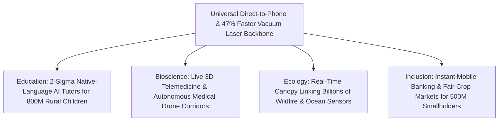

# PILLAR 05: SPACE & ORBITAL STEWARDSHIP (CARBON EDITION)
## Pathway 5.1: Zero Dead Zones on Earth — Direct-to-Cell & Vacuum Optical Laser Backbones

> **The Cynic's Cliché:**
> *"Why waste billions launching thousands of satellites into orbit when we have unconnected rural schools on Earth? Satellite internet is just a laggy luxury toy for superyachts and billionaires while real infrastructure means burying fiber-optic cables in the dirt!"*
>
> **The Nov 2026 Orbital Breakthrough:**
> Trenching physical cables across the final 40% of Earth's surface—mountain ranges, archipelagos, oceans, and tropical rainforests—costs \$30,000 to \$80,000 per kilometer and scars living ecosystems with bulldozers and diesel towers. Meanwhile, light travels **47% faster in the vacuum of space ($300,000\text{ km/s}$)** than inside subsea silica glass fiber ($204,000\text{ km/s}$). Powered by reusable heavy-lift rockets, **Starlink V3** vacuum laser meshes, **AST SpaceMobile's** giant unfolding phased arrays, **Amazon Kuiper**, and **ESA's *HydRON*** optical network, Low Earth Orbit has become both the fastest long-haul backbone and the gentlest, zero-footprint cell tower for the final 2.5 billion offline human beings.

> *"We go to space to improve life on Earth—almost every modern tool we rely on to connect, navigate, and protect our planet lives in orbit."*
> — **Sir Peter Beck**, Founder & CEO, Rocket Lab

---

## ACT I: THE HUMAN REALITY — AN UNBROKEN PLANETARY CANOPY
### A Rainy Tuesday in the Peruvian Andes, the Pacific, and Post-Hurricane Carolina

Step inside a solar-roofed village clinic in the high Peruvian Andes—or onto a small artisanal fishing boat off Mindanao, or a washed-out mountain road in western North Carolina—on a Tuesday morning in the early 2030s.

Nobody is lugging around a \$5,000 pelican case or aiming a bulky parabolic dish at the clouds. A community midwife named Elena holds an ordinary, unmodified \$110 Android smartphone she bought at a local market stall. Yet four quiet revolutions have rewritten what geography means for human dignity:

1. **Broadband Straight to Everyday Pocket Phones:**
   Elena's unmodified handset displays full 5G Non-Terrestrial Network (NTN) signal bars, **145 Mbps download throughput**, and an **18-millisecond ping**. Five hundred kilometers overhead, an unfolding orbital phased-array antenna larger than a tennis court dynamically steers a razor-sharp cellular beam directly onto her phone's internal antenna using standard 3GPP spectrum—zero mountain roads bulldozed, zero diesel generators humming on the ridge.

2. **2.5 Billion Minds Invited to the Global Table Overnight:**
   Without stringing 10,000 miles of copper or glass through the Amazon or Congo basins, Elena streams a live, high-definition obstetric ultrasound to a maternal specialist in Lima while an AI diagnostic copilot translates Quechua and Spanish in real time. Next door, thirty rural students converse with personalized 2-Sigma AI science tutors, and smallholder cacao farmers lock in fair export prices via instant mobile micro-banking.

3. **Vacuum Light Outruns Every Undersea Cable on Earth:**
   When teaching hospitals, climate supercomputers, or global exchanges synchronize between London, Tokyo, Nairobi, and São Paulo, packets hop straight up to Low Earth Orbit and race across **coherent optical space lasers** in pure vacuum—arriving up to **50% faster** than signals trapped inside winding, earthquake-prone undersea glass fibers.

4. **Disaster-Proof Civic Lifelines:**
   When a Category-5 typhoon or earthquake snaps subsea cables and topples ground masts, communities no longer plunge into terrifying multi-week blackouts. Rescue coordinators, paramedics, and families text, call, and share live triage maps directly through the sky.

5. **The Skeptic's Honest Question:**
   How did an unmodified pocket phone emitting a tiny $0.2\text{-Watt}$ radio whisper talk clearly to a spacecraft moving at $27,500\text{ km/h}$ five hundred kilometers overhead—and how did orbital lasers surpass terrestrial fiber on both speed and cost?

---

## ACT II: THE CONVERGENCE BRIDGE & NOV 2026 STATE OF THE ART
### Vacuum Refractive Physics, Giant Phased-Array Mirrors, and Reusable Tonnage

```mermaid
flowchart LR
    subgraph EarthTrap["The Terrestrial Trenching Trap"]
        T1["USD 50k/km Rural Fiber & Rainforest Bulldozing"]
        T2["Silica Glass Slowdown: 204,000 km/s Light Speed"]
        T3["Hurricane Tower Blackouts & Subsea Cable Cuts"]
    end
    subgraph SOTA2026["Verified Nov 2026 Orbital SOTA"]
        S1["Starlink V3 Optical Mesh & Direct-to-Cell Live"]
        S2["AST SpaceMobile BlueBird Giant Unfolding Arrays"]
        S3["Amazon Kuiper & ESA HydRON Terabit Laser Trunks"]
    end
    subgraph PlanetaryGift["Human & Biosphere Dividend"]
        P1["2.5B Offline Students, Clinics & Farmers Online"]
        P2["47% Faster Vacuum Light Backbone (300,000 km/s)"]
        P3["100% Disaster-Proof Lifelines Zero Forest Scars"]
    end
    EarthTrap --> SOTA2026
    SOTA2026 ==> PlanetaryGift
```

### 1. Three Immutable Physics Advantages Driving the Flip
For half a century, satellite internet meant Geostationary Orbit (GEO) at $35,786\text{ km}$—creating an unavoidable $600\text{-millisecond}$ speed-of-light lag. Moving down $70\times$ closer into Low Earth Orbit ($340\text{–}550\text{ km}$) unlocked three compounding physical multipliers:

* **The 47% Vacuum Speed-of-Light Bonus ($n = 1.000$ vs. $n = 1.468$):**
  Inside terrestrial and subsea silica glass fiber, electromagnetic waves slow down by the glass refractive index ($n \approx 1.468$):
  $$v_{\text{fiber}} = \frac{c}{1.468} \approx 204,218\text{ km/s} \quad \text{vs.} \quad v_{\text{vacuum}} = 299,792\text{ km/s}$$
  In the pure vacuum of space, $1,550\text{ nm}$ optical inter-satellite laser links (OISLs) travel **46.8% faster than light in glass** along direct great-circle geodesics—slashing London-to-Tokyo round-trip latency from $\sim 158\text{ ms}$ down to **$\sim 68\text{ ms}$**.

* **The Friis Aperture Breakthrough for Unmodified Phones:**
  Closing a cellular link across $d = 500\text{ km}$ to a tiny smartphone antenna ($G_{\text{phone}} \approx 1$) obeys the Friis transmission law:
  $$P_r = \frac{P_t \, G_{\text{phone}} \, A_{\text{sat}}}{4\pi d^2}$$
  By unfolding **giant $64\text{ m}^2\text{ to }223\text{ m}^2$ phased-array apertures** in orbit and running real-time AI MIMO beamforming to cancel $7.6\text{ km/s}$ Doppler shifts and 3GPP timing delays, the satellite acts as an ultra-sensitive acoustic shell in the sky—turning every existing pocket phone into a broadband terminal.

* **The Launch Cost Collapse (`$20,000/kg` $\rightarrow$ `<$150/kg`):**
  Reusable boosters (**SpaceX Falcon 9 & Starship**, **Blue Origin New Glenn**, **Rocket Lab Neutron**) turned orbital deployment from artisanal jewelry into high-cadence utility shipping, lofting 50+ terabits of switching capacity in a single afternoon sortie.

### 2. Verified Nov 2026 Pioneers & Operational Hardware in Orbit

| Pioneer / Constellation | Architecture & Orbit | Verified 2025–2026 Operational SOTA | Earth Impact & Human Utility |
| :--- | :--- | :--- | :--- |
| **SpaceX Starlink V3 & Direct-to-Cell** | VLEO/LEO ($340\text{–}550\text{ km}$) + 100–200 Gbps OISL space lasers | **9,000+ optical space lasers** moving tens of terabits/sec (petabytes/day); **Direct-to-Cell** live for unmodified phones across T-Mobile, Rogers, KDDI, Entel, One NZ & disaster zones. | Lifesaving connectivity during Hurricanes Helene/Milton & wildfires; V3 Starship sats scale handset speeds past $100+\text{ Mbps}$. |
| **AST SpaceMobile (*BlueBird*)** | LEO ($500\text{–}700\text{ km}$) giant unfolding phased arrays ($64\text{–}223\text{ m}^2$) | Commercial **BlueBird Block 1** ($693\text{ sq ft}$) & **Block 2** ($2,400\text{ sq ft}$) arrays in orbit; live video calls & **$120\text{ Mbps}$ peak** to unmodified smartphones. | Partnered with AT&T, Verizon, Vodafone & Rakuten to reach $2.8\text{B+}$ mobile users seamlessly on native cellular bands. |
| **Amazon Project Kuiper** | 3,236-satellite LEO optical mesh ($590\text{–}630\text{ km}$) | Validated **$100\text{ Gbps}$ optical inter-satellite links**; high-rate Kirkland factory output & multi-rocket commercial rollout. | Sub-\$400 ultra-compact community/school terminals + direct optical backhaul into global cloud compute. |
| **ESA *HydRON* & EU *IRIS²*** | Multi-orbit coherent Terabit "Fiber in the Sky" optical network | **ESA *HydRON*** (High-Throughput Optical Network) demonstrating **Terabit-class** coherent laser routing & adaptive-optics ground gateways. | Open, sovereign optical space backbone seamlessly merging terrestrial fiber with orbital photonic rings. |
| **NASA *TBIRD* & *DSOC*** | CubeSat LEO Terabit & Deep-Space Optical Transceivers | **200 Gbps** laser downlink from tissue-box LEO payload; **267 Mbps** laser link from 31 million km in deep space. | Validates compact, low-power optical feeder links for planetary and cislunar science networks. |
| **3GPP Rel-18/19 & FCC SCS** | Global Non-Terrestrial Network (NTN) cellular standard | FCC **Supplemental Coverage from Space (SCS)** active; Apple, Qualcomm, MediaTek & Google shipping native NTN modems in standard phones. | Eliminates proprietary \$1,500 satellite handsets; any \$100 smartphone roams from ground tower to orbit in $<15\text{ ms}$. |

---

## ACT III: THE ROLLOUT ROADMAP (2026 $\rightarrow$ 2040) & BIOSPHERE ECONOMICS

### 1. Four-Stage Planetary Deployment Trajectory

| Era & Milestone | Orbital Hardware & Launch Scale | Handset & Backbone Performance | What Changes for Humanity & Earth |
| :--- | :--- | :--- | :--- |
| **2025–2026 (Live SOTA)** *Death of Wilderness Silence* | **>8,000 LEO sats**; Starlink Direct-to-Cell SMS/voice/data + AST Block 1/2 unfolding arrays. | **10–120 Mbps** peak direct-to-phone; **100–200 Gbps** space laser trunks. | Hikers, mariners, rural drivers, and hurricane survivors never lose emergency SMS/voice even when ground grids collapse. |
| **2027–2029** *The Starship Capacity Flood* | Starship V3 & New Glenn deploy full **340 km VLEO** shells + 90+ giant AST Block 2/3 mirrors. | **150–250 Mbps** to unmodified 5G phones; **1 Tbps** coherent vacuum DWDM lasers. | Public rural broadband budgets pivot from \$60k/km dirt trenching to instant **\$2–\$5/mo** civic vouchers for rural schools & clinics. |
| **2030–2034** *Zero Offline Communities* | **25,000+ dark-sky-coated VLEO nodes** + adaptive-optics ground laser gateways worldwide. | **300–500 Mbps** bidirectional handset; **Sub-20 ms** global latency; `<$2` IoT chips. | **All 2.5 billion previously offline humans online**; 2-Sigma AI tutoring, telemedicine, and mobile banking become universal birthrights. |
| **2035–2040** *The Biosphere & Cislunar Mesh* | Multi-orbit photonic rings (*HydRON*-class **10 Tbps** trunks) extending to Lunar $L_1/L_2$. | **1 Gbps+** pocket connectivity; 100B solar-powered forest/ocean sensors. | Every rainforest watershed, fishing ground, and wildlife corridor has real-time telemetry without a single kilometer of road cut. |

### 2. Transoceanic Latency & Ecological Comparison (Earth Trenching vs. Orbit)

| Global Metric / Corridor | Legacy Subsea Silica & Rural Trenching | Orbital Vacuum Laser & Direct-to-Cell Mesh | Planetary Stewardship Advantage |
| :--- | :--- | :--- | :--- |
| **CAPEX to Connect Final 2.5B People** | **\$130B–\$190 Billion** (civil trenching & diesel masts) | **~\$14B–\$20 Billion** (shared global LEO constellation) | **~90% Lower Capital Cost** |
| **London $\leftrightarrow$ Tokyo Round-Trip Ping** | **$\sim 158\text{ ms}$** ($204,218\text{ km/s}$ via Red Sea glass) | **$\sim 68\text{ ms}$** ($299,792\text{ km/s}$ polar vacuum laser) | **$-90\text{ ms}$ (57% Faster Latency)** |
| **Sydney $\leftrightarrow$ São Paulo Round-Trip Ping** | **$\sim 260\text{ ms}$** (routed north through US cables) | **$\sim 92\text{ ms}$** (direct South Pacific laser geodesic) | **$-168\text{ ms}$ (65% Faster Latency)** |
| **Ecological Footprint in Wilderness** | Bulldozed forest roads, soil erosion, diesel fuel supply | **Zero ground footprint** (solar-powered 340–550 km up) | **10,000+ Miles of Rainforest Spared** |
| **Resilience to Floods, Quakes & Cuts** | Weeks to repair snapped subsea cables or toppled masts | **0% local outage** (mesh routes overhead in milliseconds) | **Disaster-Immune Civic Lifeline** |

### 3. Keeping Night Skies Dark, Spectrum Fair & Orbits Self-Cleaning
Responsible orbital stewardship is engineered directly into the 2026+ architecture so universal connectivity never degrades astronomy or orbital safety:

* **Self-Cleaning 340–450 km VLEO Shells:**
  At Very Low Earth Orbit altitudes, residual atmospheric drag naturally clears any unpowered spacecraft in **12 to 24 months**—making multi-decade space junk physically impossible and beating international 5-year deorbit mandates by more than half.

* **100% Demisable Alloys & Dielectric Dark-Sky Coatings:**
  Replacing titanium reaction wheels with vaporizing silicon, copper, and aluminum structures ensures zero ground casualty risk upon reentry. Meanwhile, multi-layer dielectric Bragg mirrors bounce sunlight away from Earth so satellites remain dimmer than naked-eye visibility ($>\text{Magnitude } 7$) in active partnership with the International Astronomical Union (IAU).

* **AI Dynamic Spectrum Nulling & Sovereign Open Access:**
  Onboard neural beamformers carve real-time spatial nulls around active urban cell towers while illuminating rural, ocean, and mountain dead zones with zero interference. Open 3GPP roaming across competing constellations (**Starlink**, **AST SpaceMobile**, **Project Kuiper**, **Eutelsat OneWeb / IRIS²**, and **Telesat Lightspeed**) prevents any single operator from acting as a bottleneck.

* **Hybrid Optical-RF Weather Diversity:**
  To guarantee 99.999% uptime from space lasers down to terrestrial cloud data centers even during monsoons, ground gateways pair adaptive-optics laser telescopes in arid deserts with automatic multi-band E-band/Ka-band RF failover.

---

## ACT IV: THE SYNERGY UNLOCK & CLOSING ANSWER TO THE CYNIC

When we lift telecommunications off the forest floor and place it gently into sunlight 400 kilometers overhead, four civilization-scale gifts compound at once:

1. **Geographic Birth Lottery Abolished:**
   A twelve-year-old girl in a Himalayan valley or Sahelian village learns calculus, biology, and coding from the exact same real-time multimodal AI mentor as a student in Zurich or Boston—unlocking human genius that used to die unrecorded for lack of a copper wire.

2. **Medical Drones Without Borders:**
   Unbroken 3GPP satellite links guide electric blood-delivery, vaccine, and antivenom drones safely beyond visual line-of-sight over mountains and islands, slashing rural maternal and trauma mortality.

3. **Rainforests Left Whole:**
   Developing nations leapfrog straight past copper wire, timber utility poles, and diesel cell towers—preserving intact watersheds while enjoying faster transoceanic speeds than Wall Street had in 2020.

4. **The Warm Truth for the Cynic:**
   Rockets carrying optical lasers and unfolding antennas are not abandoning Earth's poor—they are building the fastest, cleanest, most egalitarian bridge humanity has ever strung across our shared home planet.

---

## References & Verified Sources

* **Featured Researcher / Leader:** [Sir Peter Beck — Founder & CEO, Rocket Lab](https://www.rocketlabusa.com/)
* **Companies, Labs & Consortia:** [SpaceX Starlink (V3 & Direct-to-Cell)](https://www.starlink.com/) · [AST SpaceMobile (BlueBird)](https://ast-science.com/) · [Amazon Project Kuiper](https://www.aboutamazon.com/what-we-do/devices-services/project-kuiper) · [ESA HydRON & EU IRIS²](https://connectivity.esa.int/projects/hydron) · [Rocket Lab](https://www.rocketlabusa.com/) · [NASA TBIRD & DSOC](https://www.nasa.gov/) · [Telesat Lightspeed](https://www.telesat.com/leo-satellites/)
* **Global & Regulatory Precedents:** [FCC Supplemental Coverage from Space (SCS) Framework](https://www.fcc.gov/space) · [3GPP Release 18/19 Non-Terrestrial Networks (NTN)](https://www.3gpp.org/technologies/ntn-overview) · [Hurricane Helene & Tonga Cable-Cut Orbital Lifelines](https://www.starlink.com/) · [IAU Dark-Sky Dielectric Mirror Standards](https://cps.iau.org/)
* **Connected Carbon Pathways:** [2-Sigma AI Mastery in the Morning, Hands-On Human Guilds in the Afternoon](../../04-social-norms/two-sigma-guild-education/REPORT.md) · [Earth's Protective Canopy: Catching Wildfires in 3 Minutes & Plugging Methane Leaks from Orbit](../earth-digital-twin-canopy/REPORT.md) · [Skipping the \$1.2 Trillion Billing Maze: Continuous AI Diagnostics & Universal Direct Care](../../03-bioscience-regeneration/healthcare-without-billing/REPORT.md) · [Symphonic Swarms: Chemical-Free Farms, Ocean & Wildfire Rescue Bots](../../02-automation-science/specialized-swarm-robotics/REPORT.md)
