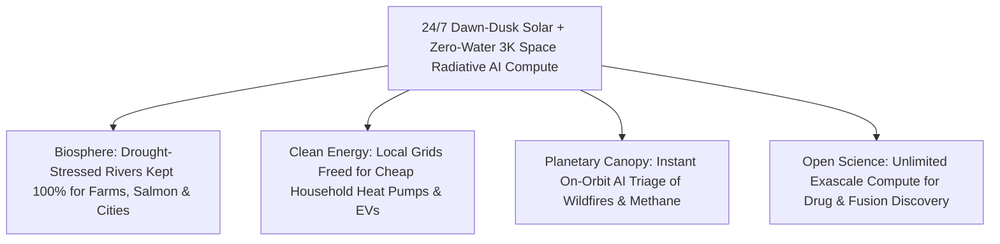

# PILLAR 05: SPACE & ORBITAL STEWARDSHIP (CARBON EDITION)
## Pathway 5.2: Cooling AI in the Deep Freeze of Space — Orbital Solar-Radiative Data Centers

> **The Cynic's Cliché:**
> *"AI data centers are an environmental catastrophe! Training frontier models and running global intelligence will guzzle billions of gallons of drought-stricken municipal rivers, force utilities to keep coal and gas plants burning, and jack up household electric bills!"*
>
> **The Nov 2026 Orbital Breakthrough:**
> That resource panic assumes humanity must cram gigawatts of hot silicon inside Earth's warm, wet, grid-constrained atmosphere. Just 650 kilometers straight up in a **sun-synchronous dawn-dusk orbit**, solar wings bathe in **24/7 unfiltered $1,361\text{ W/m}^2$ sunlight**—zero clouds, zero night, zero gigawatt-hour lithium battery farms required. Behind a thin sunshield, two-sided radiative fins dump 100% of GPU heat straight into the **3 Kelvin ($-270^\circ\text{C}$) deep-space sink** via Stefan-Boltzmann infrared radiation using **zero liters of Earth's fresh water**. Led by **Starcloud**, **Axiom Space**, **Lonestar Data Holdings**, and **SpaceX Starship's** 100–150+ ton lift capacity, orbital compute lets human intelligence scale infinitely while leaving terrestrial rivers cool and local power grids cheap.

> *"In space, solar energy is continuous and unlimited, and cooling radiates straight into deep space without consuming a drop of Earth's water or straining local power grids."*
> — **Philip Johnston**, Co-Founder & CEO, Starcloud

---

## ACT I: THE HUMAN REALITY — WHEN INTELLIGENCE STOPS COMPETING FOR WATER
### A Summer Afternoon in Phoenix and Northern Virginia, 2033

Walk along the Salt River outside Phoenix, Arizona—or past a quiet tree-lined substation in Loudoun County, Virginia—on a $42^\circ\text{C}$ July afternoon in **2033**.

In 2025, county commissioners and water boards were locked in bitter zoning wars over sprawling five-gigawatt hyperscale AI campuses that threatened to evaporate millions of gallons of drinking water a day and delay residential heat-pump hookups by seven years. By 2033, the hottest, hungriest frontier training clusters have moved gracefully upstairs:

1. **Zero Gallons of Watershed Evaporated:**
   When a pediatric oncologist in Phoenix queries an exascale protein-folding AI model to design a custom immunotherapy for a six-year-old patient, her hospital uses zero drops of Colorado River water for server cooling. Six hundred kilometers overhead, along Earth's twilight terminator line, a silent 50-megawatt **Orbital Solar-Radiative Compute Array** crunches the molecular dynamics in pure sunlight and beams the result down over a coherent $1,550\text{ nm}$ laser link in twelve milliseconds.

2. **Household Electric Bills Protected from Hyperscale Spikes:**
   Instead of forcing families and small businesses to subsidize \$50 billion in new high-voltage transmission lines for terrestrial AI mega-campuses, heavy batch training, climate digital twins, and orbital satellite sensor fusion run directly off raw solar photons in space—freeing terrestrial solar, wind, geothermal, and fusion power to electrify homes, transit, and farms at rock-bottom rates.

3. **24/7 Baseload Solar Without Mining Million-Ton Battery Banks:**
   In a dawn-dusk sun-synchronous orbit, the spacecraft rides the eternal sunrise ring around Earth. Its ultra-thin roll-out solar blankets never see a cloud, never experience winter, and spend 99%+ of the year in uninterrupted $1,361\text{ W/m}^2$ irradiance—delivering **5× more annual energy per square meter** than a solar panel in Arizona with almost zero battery mass.

4. **Sovereign, Disaster-Immune Planetary Memory:**
   Further out in cislunar space and on the lunar surface, sovereign medical archives, scientific libraries, and open-source weights rest safely inside radiation-vaulted nodes—untouchable by hurricanes, wildfires, grid cyberattacks, or earthquakes.

5. **The Skeptic's Honest Question:**
   Wait—isn't vacuum an insulator like a Thermos bottle? How do you cool scorching liquid-hot AI GPUs in space without air, and how could launching servers on rockets ever beat building warehouses in Virginia?

---

## ACT II: THE CONVERGENCE BRIDGE & NOV 2026 STATE OF THE ART
### Stefan-Boltzmann $T^4$ Radiative Physics, Dawn-Dusk Sunlight, and Starship Mass Lift

### 1. Resolving the "Thermos Myth": How 3 Kelvin Space Cools Hot Silicon
Skeptics often confuse *convection* with *thermal radiation*. While vacuum eliminates air convection, every warm surface in the universe sheds heat directly as infrared photons into the **3 Kelvin ($-270.4^\circ\text{C}$) cosmic microwave background** according to the **Stefan-Boltzmann Law**:

$$P_{\text{rad}} = \varepsilon \, \sigma \, A \, \left(T_{\text{radiator}}^4 - T_{\text{space}}^4\right)$$

where $\sigma = 5.67 \times 10^{-8}\text{ W}\cdot\text{m}^{-2}\cdot\text{K}^{-4}$ and emissivity $\varepsilon \approx 0.92$. Notice the **fourth-power ($T^4$) scaling**:
* Modern AI accelerators (NVIDIA Blackwell/Rubin-class silicon with two-phase pumped-loop cold plates) run happily at $T_{\text{radiator}} = 350\text{ K}$ ($77^\circ\text{C}$) to $370\text{ K}$ ($97^\circ\text{C}$).
* At $360\text{ K}$, a double-sided ultra-light carbon-composite radiator panel shaded behind the solar wing sheds **$1,750+\text{ Watts per square meter}$** straight into deep space—with **zero fans, zero chillers, zero PUE pump overhead ($\text{PUE} \approx 1.02$), and zero liters of water**!

### 2. Three Economic Curves Crossing in 2026–2030
* **5× Higher Solar Harvest:** Ground solar averages $\sim 200\text{–}260\text{ W/m}^2$ over 24 hours due to night, atmosphere, cosine angle, and weather. Dawn-dusk LEO solar receives a steady **$1,361\text{ W/m}^2$** continuously—cutting solar silicon area per megawatt by up to 80% and eliminating overnight storage CAPEX.
* **Zero Permitting Queue vs. 7-Year Terrestrial Delays:** In 2026, securing a 500 MW grid hookup in Virginia, Ireland, or Singapore takes 5 to 8 years. An orbital compute module manufactured on an assembly line can reach dawn-dusk sun-synchronous orbit in afternoon launch windows.
* **In-Orbit Edge Triage:** Earth-observation satellites capture terabytes of raw hyperspectral imagery per orbit. Processing that data directly on orbital GPUs sends down crisp kilobyte alerts (e.g., *"wildfire spark at GPS X,Y"*) rather than clogging RF spectrum.

### 3. Verified 2025–2026 Pioneers Building Orbital & Lunar Compute

| Pioneer / Program | Orbital & Hardware Focus | Verified 2025–2026 Milestone | Earth-First Impact |
| :--- | :--- | :--- | :--- |
| **Starcloud** *(formerly Lumen Orbit, YC/VC-backed)* | Sun-synchronous dawn-dusk megawatt-to-gigawatt solar-radiative AI data centers | **2025–2026:** Preparing & launching pathfinder orbital GPU demonstrator satellites toward modular $4\text{ km}^2$ gigawatt-scale space clusters. | Eliminates terrestrial water cooling and grid bottlenecks for large-scale AI training & inference. |
| **Lonestar Data Holdings** | Cislunar & Lunar surface disaster-recovery data vaults | **2024–2026:** Tested software-defined data storage in cislunar space (*Intuitive Machines IM-1*) and deployed physical SSD data center payload (*Freedom* on *IM-2*). | Ultimate off-planet backup for human civilization's medical, legal, and cultural heritage. |
| **Axiom Space** (*Orbital Data Center / ODC*) | LEO commercial station optical-linked cloud compute racks | Deployed commercial cloud/edge compute hardware in LEO with **Kepler Communications** optical laser relays & AWS/Red Hat space software stacks. | Real-time in-space AI processing for Earth climate constellations and microgravity biotech labs. |
| **Thales Alenia Space (*ASCEND*)** | European Commission Horizon Europe orbital cloud feasibility | Completed comprehensive lifecycle carbon & engineering blueprint proving orbital data centers can slash lifecycle $\text{CO}_2$ vs. fossil-grid terrestrial centers when launched cleanly. | Sets European green-launch and radiative modular assembly benchmarks for the 2030s. |
| **SpaceX Starship + Optical Mesh** | 9-meter fairing, 100–150t reusable lift + 100+ Gbps space lasers | High-cadence flight tests & Raptor 3 thrust upgrades unlocking flat-packed roll-out solar/radiator compute stacks connected straight to Starlink's optical mesh. | Collapses mass-to-orbit cost toward `<$100/kg`, making orbital `$/kWh` competitive with strained ground grids. |

---

## ACT III: PHASED ROLLOUT ROADMAP (2026 $\rightarrow$ 2040) & WATER-GRID ARITHMETIC

### 1. From Kilowatt Edge Nodes to Gigawatt Dawn-Dusk Compute Rings

| Deployment Phase | Module Scale & Launch Cadence | Power, Cooling & Link Specs | Terrestrial Relief Unlocked |
| :--- | :--- | :--- | :--- |
| **Phase 1: Orbital Edge AI** *(2025–2027)* | **10 kW – 100 kW** pathfinder sats (**Starcloud**, **Axiom ODC**, **OrbitsEdge**). | Radiation-tolerant H100/Blackwell GPUs; passive heat-pipe fins; **100 Gbps** laser links. | Real-time orbital AI inference cuts wildfire, methane, and maritime alert latency from hours to seconds. |
| **Phase 2: Megawatt Starship Modules** *(2028–2031)* | Single **Starship** flights deploy **1 MW – 5 MW** self-unfolding solar-radiator blades. | **$1,361\text{ W/m}^2$** roll-out tandem arrays; pumped two-phase $360\text{ K}$ radiators; **1 Tbps** optical trunk. | Absorbs frontier AI training surges without waiting 7 years for municipal substation upgrades. |
| **Phase 3: 100 MW Robotic Clusters** *(2032–2036)* | Autonomous docking of standardized compute tiles into **50–250 MW** dawn-dusk farms. | Thin-film space solar ($>35\%$ efficiency); $\text{PUE} < 1.03$; zero water; laser-linked to global cloud. | Saves **billions of liters of freshwater annually** across drought-stressed regions of the US West, Europe & Asia. |
| **Phase 4: Gigawatt Cislunar Cloud** *(2037–2042)* | Lunar-silicon solar wings + gigawatt orbital AI factories & shadowed crater cryo-vaults. | **$40\text{ K}$** lunar crater passive superconductor cooling + multi-gigawatt sun-synchronous rings. | Earth's electric grids dedicate 100% of clean capacity to human homes, parks, transit, and ecological restoration. |

### 2. Quantitative Head-to-Head: 100 MW Terrestrial AI Campus vs. Dawn-Dusk Orbital Array

| Operational Metric (100 MW AI Compute) | Terrestrial Hyperscale Data Center | Dawn-Dusk Orbital Radiative Array | Biosphere & Grid Benefit |
| :--- | :--- | :--- | :--- |
| **Annual Freshwater Evaporated** | **300M – 600 Million Liters / Year** | **0 Liters** (100% infrared radiation to 3K space) | **Saves Municipal Drinking Rivers** |
| **Solar Capacity Factor** | **22% – 28%** (day/night, clouds, winter) | **>98%** (unbroken dawn-dusk $1,361\text{ W/m}^2$ sun) | **~4× Continuous Clean Harvest** |
| **Grid Battery Storage Required** | **400 – 800 MWh** of lithium/iron batteries | **Near-Zero** (brief eclipse trim capacitors only) | **Avoids Massive Terrestrial Mining** |
| **Cooling Power Overhead (PUE)** | **1.15 – 1.40** (chillers, towers, fans) | **1.02 – 1.04** (closed-loop fluid pump only) | **~90% Cut in Cooling Energy Waste** |
| **Interconnection & Zoning Wait** | **5 to 8 Years** (transmission & ratepayer fights) | **<6 Months** (factory-to-pad modular launch) | **Zero Residential Ratepayer Spike** |

### 3. Engineering Realism: Radiation Hardening, Upgrading GPUs & Clean Launch
Building megawatt-to-gigawatt orbital compute requires solving four practical engineering questions head-on:

* **Fault-Tolerant Commercial GPUs Below the Van Allen Belts:**
  At $550\text{–}680\text{ km}$ altitude, Earth's magnetosphere deflects the vast majority of deep-space galactic cosmic rays. Pairing lightweight spot tantalum shielding over high-bandwidth memory (HBM) with ECC error correction, triple-modular software checkpointing, and autonomous hypervisor reboots allows standard commercial AI silicon to run reliably at $1/50\text{th}$ the cost of legacy military `rad-hard` chips.

* **Micrometeoroid Resilience in Pumped Fluid Radiators:**
  Instead of single-point-of-failure coolant loops, modern radiative wings use redundant manifolded oscillating heat pipes and self-sealing capillary channels—meaning even if a tiny micrometeoroid pierces one finlet, isolation valves seal that $2\%$ segment in milliseconds while the rest of the array runs uninterrupted.

* **Circular Hardware Refresh & Zero Space Debris:**
  Standardized blind-mate GPU cassettes are swapped every 4 to 5 years by electric orbital servicing tugs while the 20-year solar and radiator backbone stays in place. Retired compute blades are either recycled for high-purity copper/gold/silicon in orbit or cleanly demised via controlled atmospheric reentry.

* **Carbon-Neutral Solar Methalox Launch Payback:**
  When reusable stainless-steel boosters burn synthetic methalox (`CH4 + LOX`) synthesized from captured atmospheric $\text{CO}_2$ and green-powered water electrolysis, an orbital GPU rack offsets its entire manufacturing and launch energy footprint in **under five months** compared to natural-gas-backed terrestrial data centers.

---

## ACT IV: THE SYNERGY UNLOCK & CLOSING ANSWER TO THE CYNIC

Moving heavy AI training and satellite data crunching into sunlit dawn-dusk orbit turns a zero-sum resource fight into pure abundance:

1. **No More False Choice Between AI Cures and Clean Rivers:**
   Communities in Arizona, Chile, Spain, and India never have to choose between training life-saving medical foundation models and keeping water in farmers' wells and desert streams.
2. **Instant Sky-Side Intelligence for Earth's Canopy:**
   Instead of beaming raw petabytes of forest images to ground servers, **FireSat** and **Carbon Mapper** satellites pass frames over laser links straight to orbital GPUs—spotting a campfire-sized blaze in milliseconds.
3. **Lower Neighborhood Electric Bills:**
   Every gigawatt of batch AI training placed in eternal orbital sunshine is a gigawatt of terrestrial wind, solar, and geothermal preserved for families at home.
4. **The Warm Truth for the Cynic:**
   Space is literally an infinite, $3\text{-Kelvin}$ natural heat sink bathed in uninterrupted clean solar power—and plugging our hottest computers into it is one of the kindest things we can do for Earth's rivers and neighborhoods.

---

## References & Verified Sources

* **Featured Researcher / Leader:** [Philip Johnston — Co-Founder & CEO, Starcloud](https://www.starcloud.com/)
* **Companies, Labs & Consortia:** [Starcloud (formerly Lumen Orbit)](https://www.starcloud.com/) · [Lonestar Data Holdings](https://lonestarlunar.com/) · [Axiom Space (Orbital Data Center)](https://www.axiomspace.com/) · [Thales Alenia Space (ASCEND)](https://www.thalesaleniaspace.com/en) · [SpaceX Starship](https://www.spacex.com/) · [Kepler Communications](https://kepler.space/) · [OrbitsEdge](https://www.orbitsedge.com/)
* **Global & Regulatory Precedents:** [EU Horizon Europe ASCEND Green Orbital Cloud Study](https://www.thalesaleniaspace.com/en) · [Lonestar Cislunar & Lunar SSD Vault Flights (IM-1/IM-2)](https://lonestarlunar.com/) · [James Webb Space Telescope Passive Deep-Space Cryo-Shielding](https://webb.nasa.gov/)
* **Connected Carbon Pathways:** [Orbital Sunlight: 24/7 Space-Based Solar Beams](../../01-abundant-energy/space-solar-power/REPORT.md) · [Zero Dead Zones on Earth: Direct-to-Cell & Vacuum Optical Laser Backbones](../orbital-laser-mesh/REPORT.md) · [Earth's Protective Canopy: Catching Wildfires in 3 Minutes & Plugging Methane Leaks from Orbit](../earth-digital-twin-canopy/REPORT.md) · [Ending Drought Forever: Sub-Penny Desalination & Continental New Rivers](../../01-abundant-energy/aquifer-rivers-desalination/REPORT.md)
