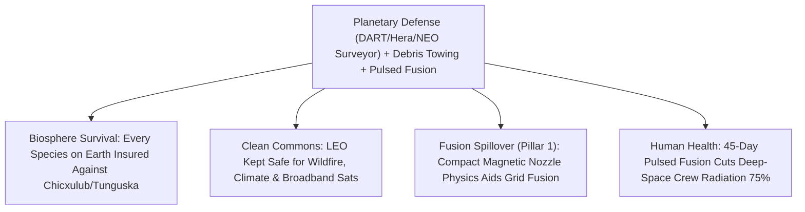

# PILLAR 05: SPACE & ORBITAL STEWARDSHIP (CARBON EDITION)
## Pathway 5.9: Planetary Guardians — Asteroid Deflection, Orbital Debris Sweepers & Pulsed Fusion Drives

> **The Cynic's Cliché:**
> *"Space programs are an indulgence while Earth faces existential risks! Killer asteroids are Hollywood disaster-movie hype, space junk will trap us in a Kessler Syndrome trash cloud anyway, and fusion rockets belong in Star Trek!"*
>
> **The Nov 2026 Orbital Breakthrough:**
> Look closely: **Earth has no natural immune system against cosmic impacts**, and for 66 million years since Chicxulub erased 75% of all species, life sat helplessly in a cosmic shooting gallery. Not anymore! Between **NASA's *DART* impact** and **ESA's *Hera* spacecraft arriving at *Dimorphos* in late 2026**, humanity has **proven for the first time in Earth's 4.5-billion-year history that we can spot and steer an asteroid away from our home planet**—backed soon by **NASA's *NEO Surveyor*** infrared sentry! Simultaneously, **Astroscale (*ADRAS-J*)** and **ClearSpace** robotic tow-trucks are actively Rendezvous-and-Capturing dead rocket stages in orbit under strict 5-year deorbit rules, while **Helicity Space**, **Princeton Fusion**, and **Howe Industries** are bench-testing compact **pulsed magneto-inertial fusion drives ($I_{\text{sp}} > 5,000\text{–}10,000\text{ s}$)** that slash both deep-space deflection intercepts and Mars transits from 8 months down to **45–60 days**!

> *"Orbital highways are a shared planetary commons—just as we tow stalled cars off bridges on Earth, active debris removal keeps space safe and sustainable for generations."*
> — **Nobu Okada**, Founder & CEO, Astroscale

---

## ACT I: THE HUMAN REALITY — THE FIRST GENERATION THAT CANNOT GO THE WAY OF THE DINOSAURS
### Night Watch at the Planetary Defense Commons & LEO Tow-Truck Ops, 2034

Step inside the quiet, glass-walled **Planetary Defense & Orbital Stewardship Center** in Darmstadt or Pasadena on a starry autumn night in **2034**.

On the main holographic display, three protective shields work in silent concert to safeguard both Earth's eight billion human beings and the pristine orbital highways surrounding our world:

1. **Decades of Warning Instead of Blind Panic:**
   Out at the Sun-Earth $L_1$ balance point $1.5\text{ million kilometers}$ sunward, **NASA's *NEO Surveyor*** infrared space telescope—teamed on the ground with Chile's **Vera C. Rubin Observatory**—has cataloged **99% of all dark, coal-black "city-killer" asteroids ($\ge 140\text{ meters}$)** crossing Earth's neighborhood. When a 210-meter rubble asteroid is flagged with a 1-in-400 impact probability for 2051, nobody panics: a compact kinetic-impactor and gravity-tractor squadron nudges its velocity by just **two millimeters per second** seventeen years early, making it miss Earth cleanly by ten lunar distances.

2. **Tow Trucks Keeping Orbital Highways Crystal Clear:**
   Closer to home at $780\text{ km}$ altitude—where 1970s–2000s derelict Cold War rocket stages once threatened catastrophic **Kessler Syndrome** collisions—an **Astroscale / ClearSpace** electric servicing tug approaches a tumbling 4-ton upper stage, matches its spin autonomously via LiDAR machine vision, locks onto its adapter ring, and gently tows it down into atmospheric burn-up while refueling at an orbital water depot for its next cleanup run.

3. **45-Day Pulsed Fusion Cruisers Across the Inner Solar System:**
   Docked at Earth-Moon $L_1$, a sleek deep-space explorer powered by a **pulsed magneto-inertial fusion nozzle** ($\text{D}\text{-}^3\text{He}$ / $\text{D-D}$ peristaltic magnetic compression) prepares for departure. With exhaust velocities ten times faster than chemical rockets ($I_{\text{sp}} \approx 10,000\text{ seconds}$), crews reach Mars in **50 days** instead of 240—slashing deep-space galactic cosmic radiation exposure by 75% and enabling rapid-response deflection of long-period comets!

4. **Peaceful Global Cooperation Without Weapons:**
   Because asteroid trajectories and orbital debris clouds ignore national borders, planetary defense and debris towing operate as open, internationally verified civic utilities—uniting NASA, ESA, JAXA, ISRO, and commercial fleets in shared stewardship.

5. **The Skeptic's Honest Question:**
   Did *DART* and *Hera* really prove we can deflect loose rubble asteroids without shattering them into shotgun pellets, can robotic claws actually catch spinning junk at $28,000\text{ km/h}$, and how can space fusion fly before giant grid tokamaks?

---

## ACT II: THE CONVERGENCE BRIDGE & NOV 2026 STATE OF THE ART
### Momentum Enhancement ($\beta = 3.6$), Autonomous RPO Towing, and Open-Nozzle Fusion

```mermaid
flowchart LR
    subgraph CosmicRisks["The Three Unmanaged Space Risks"]
        R1["Uncataloged Dark 140m City-Killer Asteroids"]
        R2["Legacy 800 km Derelict Rocket Stages (Kessler Risk)"]
        R3["Chemical Rocket Limit: Isp 380s = 8-Month Mars Trips"]
    end
    subgraph SOTA2026["Verified 2025-2026 Guardian SOTA"]
        S1["NASA DART + ESA Hera Late-2026 Arrival + NEO Surveyor"]
        S2["Astroscale ADRAS-J 15m Flyaround & ClearSpace-1"]
        S3["Helicity Space, Princeton Fusion & Howe Pulsed Drives"]
    end
    subgraph SafeHorizon["Protected Earth & Fast Solar Access"]
        P1["100% Extinction-Proof Biosphere Insurance"]
        P2["Clean, Towed & Recycled LEO Commons"]
        P3["Isp 10,000s Pulsed Fusion = 45-60 Day Deep Space"]
    end
    CosmicRisks --> SOTA2026
    SOTA2026 ==> SafeHorizon
```

### 1. Three Engineering Triumphs Turning Risk Into Mastery
* **1. Kinetic Deflection & the Ejecta Recoil Multiplier ($\beta > 3$):**
  When NASA's $570\text{ kg}$ *DART* probe struck the $160\text{-meter}$ moonlet *Dimorphos* at $6.1\text{ km/s}$, it shortened the asteroid's orbit by **33 minutes**—more than $3\times$ the push of the spacecraft alone—because backward-flying rock ejecta acted like a natural rocket exhaust:
  $$\Delta p_{\text{asteroid}} = \beta \, m_{\text{impactor}} \, v_{\text{impact}}, \quad \text{with measured } \beta \approx 3.61$$
  In **late 2026, ESA's *Hera* spacecraft** arrives directly at *Dimorphos* carrying *Juventas* low-frequency radar and *Milani* spectrometers to map the asteroid's interior—completing humanity's repeatable, peer-reviewed **Planetary Defense Playbook**!

* **2. Why Space Fusion Propulsion Is *Easier* Than Terrestrial Grid Fusion:**
  On Earth, a fusion power plant must trap plasma continuously inside massive vacuum vessels, breed tritium in thick lithium blankets, and boil steam turbines at $>35\%$ thermal conversion just to compete with cheap solar! A **pulsed magneto-inertial space drive** needs **zero steam turbines and zero vacuum chamber**—space *is* the vacuum, and magnetic nozzles channel hot fusion plasma directly out the back as pure thrust at $v_e = g_0 I_{\text{sp}} \approx 100,000\text{ m/s}$!

* **3. Non-Cooperative Rendezvous & Proximity Operations (RPO):**
  Dead satellites have no GPS beacons or docking handles. Modern debris tugs use onboard neural-vision LiDAR to reconstruct a tumbling stage's 3D spin axis in real time, synchronizing rotation within centimeters before engaging magnetic plates or multi-arm claws.

### 2. Verified 2024–2026 Planetary Defense, Debris & Propulsion Pioneers

| Pioneer / Mission | Guardian Domain | Verified 2024–2026 Milestone | Civilizational Protection Value |
| :--- | :--- | :--- | :--- |
| **NASA *DART* & *NEO Surveyor* + Vera Rubin** | Asteroid early-warning infrared sentry & kinetic deflection | *DART* proved $\beta \approx 3.6$ deflection; **Rubin Observatory** (*LSST*) achieving first light in Chile + **NASA *NEO Surveyor*** infrared space telescope advancing to $L_1$ launch. | Spots dark infrared heat signatures of Sun-side "city-killer" rocks decades before impact. |
| **ESA *Hera* & *Ramses* (*Apophis* 2029)** | Post-impact asteroid tomography & rapid-reconnaissance | **ESA *Hera*** arriving at *Dimorphos* in **late 2026**; ESA greenlit **Ramses** rapid-response mission to rendezvous with asteroid *Apophis* before its historic 2029 close Earth flyby! | Proves humanity can build, launch, and rendezvous with an approaching asteroid on rapid schedules. |
| **Astroscale (*ADRAS-J* / *ELSA-M* / *ADRAS-J2*)** | Commercial active orbital debris inspection & towing | **ADRAS-J** executed world-first autonomous fly-around **within 15 meters** of an uncooperative 3-ton derelict H-2A rocket stage in LEO; contracted by JAXA (*ADRAS-J2*) to capture & deorbit it! | Clears multi-ton "super-spreader" fragmentation hazards before collisions can create 10,000 shrapnel pieces. |
| **ClearSpace (*ClearSpace-1*) & Starfish Space (*Otter*)** | Multi-arm robotic debris capture & geostationary life-extension | ESA-backed **ClearSpace-1** four-arm capture claw & **Starfish Space *Otter*** autonomous electrostatic/mechanical satellite docking vehicles entering orbital service. | Extends healthy satellite lifetimes by 5+ years and sweeps dead carcasses cleanly out of busy shells. |
| **Helicity Space, Princeton Fusion & Howe Industries** | Pulsed magneto-inertial fusion (*Helicity Drive*), *PFRC*, & *Pulsed Plasma Rocket* | **Helicity Space** (backed by Lockheed/Airbus ventures) testing peristaltic magnetic reconnection nozzles; **Howe *PPR*** & **Princeton *PFRC*** funded under NASA NIAC/ defense space propulsion awards. | Targets **$I_{\text{sp}} = 5,000\text{–}10,000+\text{ s}$** with high thrust—cutting Mars transit to **45–60 days** & intercepting fast comets. |

---

## ACT III: PHASED ROLLOUT ROADMAP (2026 $\rightarrow$ 2042) & RISK ARITHMETIC

### 1. Building a Permanent Three-Layer Shield Around Earth

| Era & Horizon | Asteroid Sentry & Deflection | Orbital Debris Stewardship | Deep-Space Propulsion Leap |
| :--- | :--- | :--- | :--- |
| **2025–2027 (Live SOTA)** *Proof & Inspection* | **ESA *Hera*** maps *Dimorphos* (late 2026); **Rubin Observatory** discovers thousands of new NEOs; **NEO Surveyor** launches. | **FCC 5-year deorbit rule** & **ESA Zero Debris Charter** enforced; **Astroscale *ADRAS-J2*** captures 3-ton stage. | Ground plasma/magnetic-nozzle firing milestones (**Helicity**, **PFRC**); solar-electric $I_{\text{sp}} = 3,000\text{ s}$ tugs mature. |
| **2028–2032** *Active Shield & Sweep* | **ESA *Ramses*** & **NASA *OSIRIS-APEX*** escort *Apophis* (April 2029); 90%+ of $\ge 140\text{ m}$ rocks cataloged. | Commercial tow-fleets remove **15–25 top high-risk legacy rocket bodies/yr** from 800 km sun-synchronous orbits. | First in-orbit **nuclear thermal / pulsed plasma** & $100\text{ kW}$ magneto-inertial fusion demonstration flights. |
| **2033–2038** *Standby Interceptor & Recycling* | Pre-built kinetic/ion-beam deflection interceptors parked on ready alert at Sun-Earth $L_1/L_2$. | Dead stages towed to **orbital aluminium/titanium smelters** (**CisLunar / ThinkOrbital**) instead of burning up! | **1–5 MW Pulsed Fusion tugs** ($I_{\text{sp}} \approx 8,000\text{ s}$) haul cislunar cargo & cut Mars crew transit to **60 days**. |
| **2039–2045** *Solar-System Guardians* | Lunar/Lagrange infrared interferometer spots even long-period Oort Cloud comets years out. | **Net-negative orbital debris count** across all LEO/MEO/GEO shells despite 50,000+ active satellites. | Routine **45-day Earth–Mars** & **6-month outer-planet** fusion clippers open the entire solar system safely. |

### 2. Why Every Dollar in Planetary Guardianship Returns 1,000×

| Civilizational Metric | Pre-2022 Unprotected Baseline | 2030s Active Guardian Architecture | Risk & Performance Transformation |
| :--- | :--- | :--- | :--- |
| **Warning Time for Dark 140m "City-Killer" Rock** | **0 Days** (Chelyabinsk 2013 struck completely unseen from Sun-side!) | **10 to 50+ Years** (*NEO Surveyor* $L_1$ infrared + Rubin) | **From Blind Luck to 100% Preventable** |
| **Cost of *NEO Surveyor* + Deflection Fleet** | \$100B–\$5T regional devastation from one Tunguska-scale strike | **~\$1.5B–\$3 Billion total** (`<$0.40` per human on Earth!) | **Highest-ROI Insurance in History** |
| **Fate of Dead 800 km Legacy Rocket Bodies** | Linger 150+ years risking 15,000-fragment Kessler cascades | **Actively towed & recycled** + 5-yr rule on all new sats | **Permanent Safe Access to Orbit** |
| **Human Mars One-Way Transit & Radiation** | **210–260 Days** (chemical $I_{\text{sp}} = 380\text{ s}$; high cosmic ray dose) | **45–60 Days** (pulsed fusion $I_{\text{sp}} \ge 8,000\text{ s}$) | **4× Faster; -75% Crew Radiation** |

### 3. Governance Safeguards: Non-Weaponized Deflection, Clean Recycling & Safe Plasma
Operating planetary defense, debris sweepers, and high-energy drives safely relies on four open international norms:

* **Transparent Multilateral Deflection Oversight (IAWN & SMPAG):**
  Every asteroid orbit refinement and deflection campaign runs in full public daylight through the UN-endorsed **International Asteroid Warning Network (IAWN)** and **Space Mission Planning Advisory Group (SMPAG)**—using pure non-nuclear kinetic impactors, ion-beam shepherds, and gravity tractors whenever decades of infrared warning exist.

* **Dual-Use Prevention Protocols for Debris Tugs:**
  Because a spacecraft capable of grappling a dead rocket stage could theoretically approach an active satellite, **Astroscale** and **ClearSpace** pioneer **CONFERS** (Consortium for Execution of Rendezvous and Servicing Operations) transparency standards—publishing live encrypted flight telemetry, daytime lighting rules, and multilateral observer logs.

* **From Atmospheric Burn-Up to Circular Orbital Scrap Yards:**
  Towing legacy multi-ton aluminum and titanium upper stages up to orbital electron-beam recycling depots turns hazardous Cold War space junk into valuable clean structural stock while preventing upper-stratosphere alumina soot buildup.

* **Aneutronic & Low-Neutron Deep-Space Igniters Above Safe Orbits:**
  Pulsed magneto-inertial fusion tugs operate exclusively above $800\text{ km}$ nuclear/plasma-safe orbits and cislunar Lagrange hubs—ferrying cargo between orbital depots while clean chemical/electric shuttles handle Earth-to-LEO crew boarding.

---

## ACT IV: THE SYNERGY UNLOCK & CLOSING ANSWER TO THE CYNIC

Combining infrared eyes, robotic tow trucks, and high-$I_{\text{sp}}$ pulsed fusion engines fulfills humanity's deepest duty as Earth's conscious steward:

1. **Life's First Cosmic Shield in 4.5 Billion Years:**
   Dolphins, redwood trees, and songbirds cannot build infrared telescopes or kinetic impactors—human beings can! For less than forty cents per person on Earth, we retire asteroid extinction risk for the entire living biosphere.

2. **Protecting the Satellites That Protect Earth:**
   Active debris towing (**Astroscale**, **ClearSpace**) ensures **FireSat** wildfire sensors, hurricane weather satellites, and rural Direct-to-Cell constellations never get blinded by legacy Cold War shrapnel.

3. **Fast, Safe Bridges Across Deep Space:**
   Pulsed magneto-inertial fusion nozzles turn grueling eight-month deep-space endurance voyages into brisk six-week crossings—protecting human DNA and intercepting fast-moving comets with ease.

4. **The Warm Truth for the Cynic:**
   Tow trucks in Low Earth Orbit and infrared sentries at $L_1$ are the exact opposite of reckless hubris—they are calm, responsible civic housekeeping for our shared planetary home.

---

## References & Verified Sources

* **Featured Researcher / Leader:** [Nobu Okada — Founder & CEO, Astroscale](https://astroscale.com/)
* **Companies, Labs & Consortia:** [NASA Planetary Defense (DART & NEO Surveyor)](https://science.nasa.gov/mission/dart/) · [ESA Hera & Ramses](https://www.esa.int/Space_Safety/Hera) · [Astroscale (ADRAS-J & ELSA-M)](https://astroscale.com/) · [ClearSpace & Starfish Space](https://clearspace.today/) · [Helicity Space](https://www.helicityspace.com/) · [Princeton Fusion Systems (PFRC)](https://www.psatellite.com/) · [Howe Industries (Pulsed Plasma Rocket)](https://www.howeindustries.net/)
* **Global & Regulatory Precedents:** [NASA DART 33-Minute Asteroid Orbit Deflection & ESA Hera Late-2026 Rendezvous](https://www.esa.int/Space_Safety/Hera) · [FCC 5-Year Deorbit Rule & ESA Zero Debris Charter](https://www.esa.int/Space_Safety/Clean_Space) · [UN International Asteroid Warning Network (IAWN) Multilateral Protocol](https://iawn.net/)
* **Connected Carbon Pathways:** [Compact Commercial Fusion](../../01-abundant-energy/fusion-power/REPORT.md) · [Making Conquest Obsolete: Resource Sovereignty & Asymmetric Defensive Shields](../../04-social-norms/defensive-shields-peace/REPORT.md) · [Trillions of Tons Without Cutting Down a Single Tree: Asteroid Metals & Water Propellant](../asteroid-cislunar-resources/REPORT.md) · [Earth's Protective Canopy: Catching Wildfires in 3 Minutes & Plugging Methane Leaks from Orbit](../earth-digital-twin-canopy/REPORT.md)
