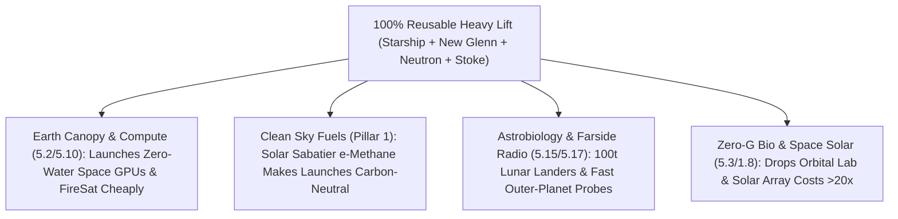

# PILLAR 05: SPACE & ORBITAL STEWARDSHIP (CARBON EDITION)
## Pathway 5.14: Mechazilla & the \$50/kg Sky Railroad — Rapidly Reusable Super-Heavy Lift Opening the Solar System

> **The Cynic's Cliché:**
> *"Heavy rockets are billionaire vanity fireworks—dropping hundred-million-dollar titanium stages into the ocean on every flight! Spaceflight will always cost \$20,000 to \$60,000 per kilogram, keeping big space telescopes, clean orbital power, and lunar science trapped as once-a-generation budget luxuries!"*
>
> **The 2025–2026 Reusable Fleet Breakthrough:**
> Imagine if transatlantic aviation threw away a \$300 million Boeing 787 into the Atlantic after every single flight from New York to London—a ticket would cost \$1.5 million! For sixty-five years, that was rocketry. Between **2024 and late 2026**, humanity broke the expendable curse forever: **SpaceX's *Starship & Super Heavy*** achieved repeated **mid-air launch-tower chopstick catches (*Mechazilla*)** of a 20-story stainless-steel booster, unveiled streamlined **Raptor 3** engines ($>280\text{ tf}$ thrust with internal cooling and no heavy external heatshields), and advanced orbital propellant transfer for **NASA's Artemis HLS**. Better yet, this is no single-company monopoly: **Blue Origin's *New Glenn*** reached orbit with reusable 7-meter fairings and first-stage recovery, **Rocket Lab's *Neutron*** ("Hungry Hippo" captive fairing) and **Stoke Space's** 100%-reusable, actively cooled hydrogen-oxygen second stage entered flight integration, and global reusable methane launchers surged—driving payload-to-LEO costs down **1,000-fold from the Space Shuttle's ~\$60,000/kg toward `<\$100/kg` (and \$20–\$50/kg at airline cadence)**!

> *"Full and rapid reusability is the fundamental dividing line between humanity remaining forever launch-constrained and opening space to solve big problems for Earth and science."*
> — **Gwynne Shotwell**, President & Chief Operating Officer, SpaceX

---

## ACT I: THE HUMAN REALITY — WHEN A UNIVERSITY LAB LAUNCHED AN 8-METER TELESCOPE ON A GRANT BUDGET
### Starbase & Cape Canaveral Launch Pads, a University Cleanroom in Tucson, and Lunar Orbit, 2030

Stand on the public beach causeway at Cape Canaveral—or inside a public university astrophysics bay in Tucson, Arizona—on a bright Tuesday morning in **2030**.

During the expendable rocket era (1960–2020), launching payloads cost so much per kilogram—and rocket nosecones were so narrow ($4\text{ to }5\text{ meters}$)—that engineers spent **ten years and \$10 billion** shaving grams off fragile beryllium mirrors and inventing 344 single-point-of-failure origami hinges just to fold the James Webb Space Telescope inside an Ariane 5 fairing. Watch what happens once a **9-meter-wide, 150-to-200-ton rapidly reusable sky railroad** runs multiple times a week:

1. **Goodbye \$10 Billion Origami—Hello Monolithic Welded Science:**
   Inside Tucson's mirror lab, graduate students bolt a single, rugged **8-meter monolithic glass-ceramic UV/optical mirror** onto a standard commercial satellite bus using off-the-shelf stainless steel brackets. Because launch mass costs **\$80/kg instead of \$50,000/kg**, they don't spend eight years carving honeycomb weight pockets or testing 300 unfolding hinges—they build five identical space telescopes for **\$180 million total** instead of one fragile \$10B nail-biter!

2. **Seven Minutes From Roaring Liftoff to Gentle Tower Hug:**
   At `08:00:00`, thirty-three clean-burning liquid-methane/oxygen **Raptor 3** engines lift 5,000 metric tons off the water-cooled steel pad. Six minutes and fifty seconds later, a twin sonic boom rolls across the surf as the 71-meter **Super Heavy** booster guides itself via hypersonic grid fins straight between **Mechazilla's mechanical chopstick arms**—setting down right back onto its launch mount, ready for propellant load and afternoon inspection like a commercial jetliner!

3. **Refilling the Tank Upstairs to Unlock the Outer Worlds:**
   Previously, even giant rockets arrived in low Earth orbit with empty tanks, leaving barely a few tons for Jupiter or the Moon. By transferring sub-cooled liquid oxygen and methane (`CH4 / LOX`) in low Earth orbit, a full **Starship** resets the Tsiolkovsky rocket equation—able to carry **100+ metric tons all the way to the lunar surface (`lunar-south-pole`, `lunar-farside-radio-cosmology`) or send massive astrobiology probes fast-track to Europa and Titan (`ocean-worlds-astrobiology-probes`)**!

4. **The Skeptic's Honest Question:**
   Wait—the Space Shuttle was supposed to be reusable in 1981 and ended up costing \$1.5 billion a launch! Why did Shuttle refurbishment fail, and what materials/engine breakthroughs make 2026 second-stage reuse real?

---

## ACT II: THE CONVERGENCE BRIDGE & NOV 2026 STATE OF THE ART
### Tsiolkovsky's Reset, Methalox + 304L Steel, and Competitive Multi-Vendor Reuse

### 1. Three Engineering Pivots That Solved the Space Shuttle's Trap
* **1. Clean Methalox (`CH4/LOX`) + Raptor 3 Internal Regenerative Cooling:**
  Kerosene (`RP-1`) leaves sticky carbon soot ("coking") inside turbopumps, while the Shuttle's liquid-hydrogen engines required months of teardown. Liquid methane burns soot-free at extreme chamber pressures ($>350\text{ bar}$ in SpaceX's **Raptor 3**, Blue Origin's **BE-4**, and Rocket Lab's **Archimedes**). Even wilder, **Raptor 3** routes secondary gas flows internally through 3D-printed channels—eliminating external plumbing shrouds and heavy engine heatshields while delivering **$280\text{ tf}$ thrust at just $1,525\text{ kg}$ engine mass**!

* **2. Landing Gear Stays on the Ground (*Mechazilla* Tower Catch) & Active Cooling:**
  Every kilogram of hydraulic landing legs flown up and down steals payload mass. Catching Super Heavy (and ultimately Starship) on **tower chopstick arms** deletes heavy landing legs and sets the stage directly onto quick-disconnect ground plumbing! Meanwhile, **Stoke Space (*Nova*)** proved an ingenious alternative for medium-lift second stages: circulating cryogenic propellant through a metallic heatshield during reentry for **24-hour turnaround with zero ceramic tiles to crack**.

* **3. Resetting Tsiolkovsky's Tyranny via Orbital Propellant Transfer:**
  Tsiolkovsky's rocket equation ($\Delta v = I_{\text{sp}} g_0 \ln(m_0/m_f)$) demands ~90% of a rocket's pad mass be burned just escaping Earth's $9.8\text{ m/s}^2$ gravity well and $7.8\text{ km/s}$ orbital velocity. Refilling a reusable upper stage in LEO grants an entirely fresh **$\Delta v \approx 6\text{--}8\text{ km/s}$** starting *already at orbital speed*—multiplying deep-space science payload mass **$10\times$ to $20\times$**!

### 2. Verified 2024–2026 Competitive Reusable Launch Ecosystem

| Launch System / Pioneer | Payload & Architecture | Verified 2024–2026 Milestone | Competitive Ecosystem Role |
| :--- | :--- | :--- | :--- |
| **SpaceX *Starship & Super Heavy* (Block 2/3)** | $100\text{--}200+\text{ t}$ to LEO (9m diameter); full two-stage stainless-steel methalox | **Multiple successful Mechazilla tower booster catches (IFT-5 onward, 2024–2026)**, controlled ship splashdowns/reentry shield upgrades, **Raptor 3** unveiled, & orbital transfer prep for Artemis III. | Super-heavy sky freighter enabling 9m space telescopes, lunar bases, and VLEO/radiative compute shells. |
| **Blue Origin *New Glenn*** | $45\text{ t}$ to LEO (massive **7-meter fairing**); BE-4 methalox reusable booster + Blue Ring | **Reached orbit on inaugural NG-1 flight (Jan 2025)** with follow-on 2025–2026 NASA **ESCAPADE** Mars & national/commercial missions; 25-flight booster design life. | Heavy-lift competition with spacious 7m volume for planetary probes & Kuiper broadband. |
| **Rocket Lab *Neutron*** | $13\text{ t}$ reusable to LEO; carbon-composite "Hungry Hippo" captive fairing + Archimedes | Archimedes methalox engine hot-fire campaigns & Wallops Launch Complex 3 pad completion entering flight operations. | Eliminates fairing ocean recovery ships entirely—swallowing & releasing satellites like a cargo bay. |
| **Stoke Space (*Nova*) & Global Entrants (*Ariane Next / Maia / Zhuque-3*)** | 100% reusable two-stage medium launcher with actively cooled metallic heatshield | Integrated hopper flights & full first/second-stage engine testing (2024–2026), joined by stainless-steel reusable methalox tests globally. | Proves rapid, tile-free 24-hour second-stage turnaround for dedicated responsive orbits. |

---

## ACT III: PHASED ROLLOUT ROADMAP (2026 $\rightarrow$ 2038) & ENVIRONMENTAL MATH

### 1. From \$60,000/kg Scarcity to the \$30/kg Carbon-Neutral Sky Railroad

| Launch Era | Reusability Cadence | Marginal Launch Cost (\$/kg to LEO) | Transformative Payoff for Earth & Science |
| :--- | :--- | :--- | :--- |
| **1981–2011** *Space Shuttle Baseline* | Months of manual refurbishment per orbiter | **~\$60,000 / kg** | Science severely mass-starved; Hubble/JWST took decades per flagship. |
| **2020–2024** *Falcon 9 1st-Stage Reuse* | Booster flown 20+ times; 2nd stage expended | **~\$1,500–\$2,500 / kg** | Connected rural schools (`orbital-laser-mesh`) & launched *FireSat*/*Euclid* at 1/10th legacy cost. |
| **2025–2027 (Live SOTA)** *Super-Heavy Tower Catch & New Glenn* | **Mechazilla** booster reuse + ship catch maturation + **New Glenn / Neutron / Stoke** | **\$200–\$500 / kg** | 7m–9m fairings end telescope origami; **Artemis HLS** & **Europa/Titan** science cadence accelerates. |
| **2028–2035** *Airline-Cadence Solar Methalox* | Same-day two-stage turnaround fueled by **Sabatier green $\text{e-CH}_4$** (`synthetic-sky-fuels`) | **\$30–\$90 / kg** | **Zero fossil carbon**; orbital radiative AI (`orbital-radiative-compute`), lunar farside radio, & space solar scale cleanly. |

### 2. Addressing Rocket Emissions & Sonic Booms With Clean Physics
A thoughtful citizen asks: *"Wait—if rockets launch every day, won't their exhaust harm the upper atmosphere or rattle coastal towns?"* Look at how clean-methalox physics solves both:

* **Zero Black-Carbon Soot + 100% Green Solar Sabatier Propellant (`synthetic-sky-fuels`):**
  Unlike kerosene (`RP-1`) or toxic solid rocket boosters (which released chlorine and alumina dust into the stratosphere), **methalox (`CH4 + 2 O2 -> CO2 + 2 H2O`)** produces **zero alumina particles and virtually zero black-carbon soot**. Better yet, coupling coastal launch pads to solar electrolysis and direct-air $\text{CO}_2$ capture (**Sabatier reaction: $\text{CO}_2 + 4\text{H}_2 \rightarrow \text{CH}_4 + 2\text{H}_2\text{O}$**) makes every flight **100% net-zero carbon**—using the exact atmospheric chemistry needed on Mars too!

* **Zero Ocean Hardware Dumping + Offshore Floating Spaceports:**
  Expendable rockets dumped thousands of tons of aluminum stages, batteries, and hydrazine residue into ocean trenches every year. **100% reusability drops zero hardware in the sea**, while high-cadence heavy launches shift to **offshore marine platforms 30+ km out to sea**—keeping coastal wildlife refuges and residential windows peaceful.

* **Point-to-Point Humanitarian Disaster Airlift Bonus (`suborbital-earth-hops`):**
  The exact thermal protection and precision tower/landing control built for orbital cargo also enables sub-hour global emergency relief delivery—placing portable water-purification units, surgical micro-hospitals, and Direct-to-Cell relays anywhere on Earth after an earthquake before runways are even cleared.

* **Open University & Developing-Nation Rideshare Equity:**
  When 150-ton cargo manifests fly weekly, space agencies and philanthropic foundations reserve standardized **\$0-to-at-cost CubeSat and smallsat educational lockers**—allowing engineering students in Kenya, Colombia, Vietnam, and public community colleges to fly real orbital hardware within a four-year degree.

---

## ACT IV: THE SYNERGY UNLOCK & CLOSING ANSWER TO THE CYNIC

Step back and see why collapsing launch cost by **99.8%** is the master key underneath almost every pathway in Pillar 5:

1. **Unshackling Human Curiosity From \$10 Billion Price Tags:**
   When space mass becomes cheap and wide ($9\text{ meters}$), NASA, ESA, JAXA, ISRO, and public universities can fly *ten* bold life-finding telescopes (`Habitable Worlds Observatory`, lunar radio arrays, icy-moon landers) for the former price of one—turning career-long anxious waits into rapid iterative discovery.

2. **Ending Disposable Ocean Litter:**
   Bringing both rocket stages safely home to their launch arms ends sixty years of treating the Atlantic and Pacific Oceans as aerospace scrapyards.

3. **Healthy Multi-Provider Competition:**
   With **SpaceX**, **Blue Origin**, **Rocket Lab**, **Stoke Space**, and European/Asian reusable teams all competing on cost and reliability, no single company or billionaire controls humanity's highway to the sky.

4. **The Ultimate Answer to the Cynic:**
   Next time someone sneers at a launch-tower catch as a *"billionaire stunt,"* ask them if reusable airliners were a stunt compared to throwing a 747 in the sea after every flight: **catching that booster in mid-air just turned space from a luxury tax into a railroad for science and Earth stewardship.**

---

## References & Verified Sources

* **Featured Researcher / Leader:** [Gwynne Shotwell — President & Chief Operating Officer, SpaceX](https://www.spacex.com/vehicles/starship/)
* **Companies, Labs & Consortia:** [SpaceX (Starship, Super Heavy & Raptor 3)](https://www.spacex.com/vehicles/starship/) · [Blue Origin (New Glenn)](https://www.blueorigin.com/new-glenn) · [Rocket Lab (Neutron)](https://www.rocketlabusa.com/launch/neutron/) · [Stoke Space (Nova 100% Reusable)](https://www.stokespace.com/) · [NASA Artemis Human Landing System (HLS)](https://www.nasa.gov/humans-in-space/artemis/) · [CNES / ESA MaiaSpace & Themis Reusable Boosters](https://www.esa.int/Enabling_Support/Space_Transportation)
* **Global & Regulatory Precedents:** [SpaceX Mechazilla Chopstick Booster Catches (IFT-5 Onward, 2024–2026)](https://www.spacex.com/launches/) · [Blue Origin New Glenn NG-1 Orbital Debut & ESCAPADE Mars Launch (2025–2026)](https://www.blueorigin.com/news) · [FAA Part 450 Commercial Reusable Launch Licensing & Marine Wildlife Protections](https://www.faa.gov/space)
* **Connected Carbon Pathways:** [Synthetic Sky Fuels: Drop-In Solar Jet Fuel & Green e-Methane](../../01-abundant-energy/synthetic-sky-fuels/REPORT.md) · [Cooling AI in the Deep Freeze of Space: Orbital Solar-Radiative Data Centers](../orbital-radiative-compute/REPORT.md) · [Searching Living Subsurface Oceans: Europa Clipper & Dragonfly](../ocean-worlds-astrobiology-probes/REPORT.md) · [The Quietest Ear in the Solar System: Lunar Farside Radio Arrays](../lunar-farside-radio-cosmology/REPORT.md)
