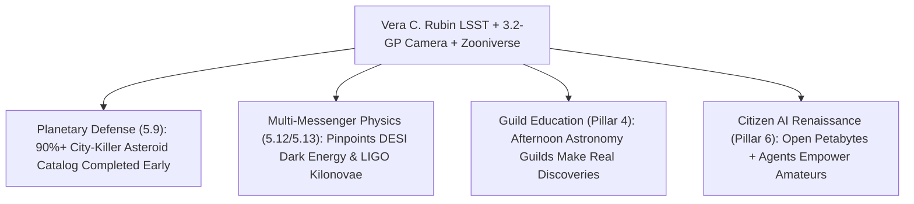

# PILLAR 05: SPACE & ORBITAL STEWARDSHIP (CARBON EDITION)
## Pathway 5.11: Filming the Cosmic Time-Lapse — Vera C. Rubin LSST, Dwarf Planet 2026 ED138 & Citizen Sky Patrols

> **The Cynic's Cliché:**
> *"Giant astronomy telescopes are elitist billion-dollar ivory towers locked behind PhD paywalls—taking pretty static postcards of distant nebulae that ordinary high-schoolers can never touch while ignoring hazardous rocks right in our own solar backyard!"*
>
> **The Nov 2026 Orbital & Mountain-Top Breakthrough:**
> On **June 30, 2026**, atop Cerro Pachón in the Chilean Andes, the **NSF–DOE Vera C. Rubin Observatory** officially launched its 10-year **Legacy Survey of Space and Time (LSST)**—switching from static snapshots to the **greatest high-definition cosmic time-lapse movie ever filmed**. Armed with the world's largest digital camera (**3,200 megapixels**, the size of a compact car) and an agile 8.4-meter Simonyi Survey Telescope that photographs the entire southern sky **every three nights**, Rubin generates **~10 million real-time transient alerts every single night**! Within months of survey start, Rubin data had already unveiled **2026 ED138** (a 600–1,500 km wide trans-Neptunian **dwarf planet candidate** announced in late October 2026, the largest outer-solar-system world found in two decades), ultra-faint Milky Way satellite galaxies like **Aquarius IV**, and tens of thousands of newfound asteroids—while streaming discoveries directly to students and families worldwide via **Zooniverse's *Galaxy Zoo: Rubin*** and ***Rubin Comet Catchers***!

> *"With Rubin Observatory, we aren't just taking still photographs of the universe anymore—we are filming a ten-year color movie of the living cosmos and handing the reel to everyone on Earth."*
> — **Prof. Željko Ivezić**, Director of Rubin Observatory Construction & Professor of Astronomy, University of Washington

---

## ACT I: THE HUMAN REALITY — THE HIGH SCHOOL CLUB THAT SPOTTED AN ACTIVE COMET
### A Public Library Laptop in Valparaíso, Cerro Pachón Summit, and Tucson Alert Brokers, 2029

Step inside an after-school astronomy guild at a public secondary school in Valparaíso, Chile—or a kitchen table in rural Ohio, or a community planetarium in Nairobi—on a crisp October evening in **2029**.

For centuries, discovering a new world in our solar system or catching a star tearing apart around a black hole required winning scarce midnight hours on a mountaintop telescope reserved for tenured specialists. Three years into the **Legacy Survey of Space and Time**, the night sky has become an open, living civic commons:

1. **60 Seconds From Mountain Mirror to Kitchen Laptop:**
   High on Cerro Pachón ($2,682\text{ m}$), Rubin's 8.4-meter ternary mirror slews across a $9.6\text{-square-degree}$ patch of sky—the area of **45 full Moons in a single 30-second exposure**—snap-settling in five seconds flat. Fiber-optic trunks rush each $6.4\text{-gigabyte}$ raw frame to SLAC National Accelerator Laboratory in California, where automated difference-imaging software subtracts tonight's sky from the master reference template. Within **60 seconds of shutter close**, everything that moved, flared, or blinked beams out free to public community brokers (*ANTARES*, *Fink*, *Lasair*, *ALeRCE*).

2. **A Sixteen-Year-Old's Real Planetary Discovery:**
   At 20:14 local time, sixteen-year-old Camila opens **Rubin Comet Catchers** on Zooniverse using a \$250 school Chromebook. AI anomaly filters have narrowed ten million nightly alerts down to three hundred strange, fuzzy-tailed moving candidates that defy standard asteroid templates. Camila spots a faint sublimating coma around a main-belt rock, flags its dust-jet geometry with twelve fellow citizen patrollers across four continents, and triggers automated follow-up spectroscopy—earning co-discoverer credit on an IAU Minor Planet Center circular before homeroom!

3. **Mapping Every City-Killer Rock & Hidden Outer World:**
   Behind Camila's screen, Rubin's relentless three-night cadence has multiplied humanity's known solar-system inventory by **$5\times$ to $10\times$**—cataloging millions of asteroids, thousands of icy Kuiper Belt objects following in the footsteps of **2026 ED138**, and giving Earth decades of calm, early planetary-defense warning (`planetary-defense-propulsion`) at less than \$0.15 per citizen per year.

4. **The Skeptic's Honest Question:**
   Wait—Hubble and JWST already take breathtakingly sharp space photos! Why couldn't they film the whole sky or find **2026 ED138**, and what optical-computing leap made Rubin possible in 2026?

---

## ACT II: THE CONVERGENCE BRIDGE & NOV 2026 STATE OF THE ART
### Étendue ($A\Omega$), the 3.2-Gigapixel Focal Plane, and Open Alert Brokers

```mermaid
flowchart LR
    subgraph NarrowPast["Pre-2026 Pinhole Astronomy"]
        P1["JWST / Hubble = Tiny Field of View (<0.005 deg2)"]
        P2["Outer Dwarf Planets & Faint Satellites Missed"]
        P3["Proprietary Lockups Delayed Public Access"]
    end
    subgraph Rubin2026["Verified June-Nov 2026 Rubin SOTA"]
        R1["SLAC 3,200-MP LSST Camera + 8.4m Fast-Slew Mirror"]
        R2["Oct 2026: 2026 ED138 Dwarf Planet & Aquarius IV"]
        R3["60-Sec Public Alerts + Zooniverse Citizen Patrols"]
    end
    subgraph OpenCosmos["2030s Living Sky Commons"]
        O1["20 Billion Galaxies + 17 Billion Stars Mapped"]
        O2["90%+ Near-Earth Hazard Catalog Completed"]
        O3["Millions of Students Co-Authoring Real Science"]
    end
    NarrowPast --> Rubin2026
    Rubin2026 ==> OpenCosmos
```

### 1. Three Engineering Miracles Inside the Cosmic Movie Camera
* **1. Unprecedented Optical Étendue ($A\Omega = 319\text{ m}^2\cdot\text{deg}^2$):**
  Flagship space telescopes like JWST are exquisite microscopes that peer through a soda straw—covering a tiny fraction of one full Moon at a time. Survey discovery speed scales with **étendue**, the product of light-collecting mirror area ($A$) and sky field-of-view solid angle ($\Omega$):
  $$\mathcal{E} = A_{\text{eff}} \cdot \Omega \approx 33.2\text{ m}^2 \times 9.6\text{ deg}^2 \approx 319\text{ m}^2\cdot\text{deg}^2$$
  By forging a unique **single-cast 8.4-meter primary-plus-tertiary mirror (M1M3)** paired with a 3.4-meter convex secondary, Rubin achieves fast slews every 35 seconds without mirror flex—sweeping the entire visible southern sky every three nights!

* **2. SLAC's 3,200-Megapixel Cryogenic Focal Plane:**
  Built by DOE's SLAC National Accelerator Laboratory, the **LSST Camera** packs **189 ultra-flat CCD sensors** cooled to $-100^\circ\text{C}$ behind a record-setting $1.57\text{-meter}$ optical lens. A single uncompressed image is so sharp it could resolve a golf ball from 25 kilometers away and requires **378 ultra-HD 4K televisions** just to display at full size.

* **3. Real-Time Difference Imaging + Human-AI Zooniverse Loops:**
  Processing **20 terabytes of sky data every night** over 10 years yields a 500-petabyte archive. Open brokers (**ALeRCE** in Chile, **ANTARES** at NOIRLab, **Fink**, **Lasair**) pair machine-learning classifiers with **Zooniverse's 2.7+ million citizen volunteers**, routing weird edge cases—collisional asteroid tails, gravitational lenses, kilonovae—straight to human curiosity.

### 2. Verified June–November 2026 Rubin & Citizen Sky Milestones

| Milestone / Program | Lead Institutions & Teams | Verified 2025–2026 Breakthrough | Immediate Gift to Science & Citizens |
| :--- | :--- | :--- | :--- |
| **LSST 10-Year Survey Start (June 30, 2026)** | NSF, DOE, SLAC, NOIRLab & Simonyi Survey Telescope Team | Official commencement of the **10-year Legacy Survey of Space and Time** on June 30, 2026—launching continuous 6-band ($ugrizy$) southern-sky cinema. | Opens a 60-second global transient stream with zero proprietary gatekeeping on sky alerts. |
| **Dwarf Planet Candidate *2026 ED138* (Oct 2026)** | Matthew Holman, Kevin Napier & IAU Minor Planet Center | Announced in **October 2026** from early Rubin survey frames (with archival precovery back to 1937): a **600–1,500 km trans-Neptunian world** far beyond Pluto. | Largest outer-solar-system TNO discovery in ~20 years; tests Planet Nine / outer Kuiper gravity. |
| **Aquarius IV Ultra-Faint Dwarf Galaxy** | William Cerny et al. (Early Data Preview / Rubin Collaboration) | Uncovered one of the **dimmest, most dark-matter-dominated Milky Way satellite galaxies** ever seen (~355,000 light-years away in Aquarius). | Probes small-scale dark-matter halo physics that brighter sky surveys systematically missed. |
| **Galaxy Zoo: Rubin & Rubin Comet Catchers** | Zooniverse, Oxford, Adler Planetarium & Rubin Education | Live public citizen-science workflows letting volunteers classify strange galaxy mergers and hunt active comets/centaurs inside real Rubin frames. | Turns passive screen time into genuine co-authored astronomical discovery for students worldwide. |

---

## ACT III: PHASED ROLLOUT ROADMAP (2026 $\rightarrow$ 2036) & PLANETARY STEWARDSHIP

### 1. Ten Years of Deepening Cosmic Cinema

| Survey Horizon | Cumulative Data & Reach | Solar System & Galactic Yield | Public & Educational Impact |
| :--- | :--- | :--- | :--- |
| **2026 (Year 1 Live)** *First-Year Movie & TNO Surge* | **June 30, 2026 LSST start**; millions of nightly alerts flowing via SLAC & NOIRLab. | **2026 ED138** dwarf planet candidate, **Aquarius IV**, & **>100,000 new asteroids** logged in months. | Free **Rubin SkyViewer**, *Galaxy Zoo: Rubin*, and *Rubin Comet Catchers* live in classrooms. |
| **2027–2029** *Planetary Defense Census* | 250+ full-sky passes stacked; paired with **NASA *NEO Surveyor*** infrared space telescope. | **5M+ main-belt asteroids**, **100,000+ Near-Earth Objects**, & dozens of interstellar *ʻOumuamua*-class visitors caught early. | High-school guilds routinely co-discover active comets, supernovae, and strong gravitational lenses. |
| **2030–2033** *Dark Matter & Kilonova Goldmine* | Deep stacked co-adds surpass 27th magnitude across $18,000\text{ deg}^2$ of sky. | **Millions of Type Ia supernovae** + immediate optical localization of **LIGO/IceCube** neutron-star collisions. | Open petabyte cloud notebooks let any university in the Global South lead frontier cosmology papers. |
| **2036 (10-Year Complete)** *The 37-Billion-Object Atlas* | **800+ visits per sky patch**; **500+ petabytes** of calibrated public time-lapse data. | **20 billion galaxies + 17 billion stars** mapped in 4D motion—humanity's definitive living sky encyclopedia. | Permanent open heritage archive honoring **Vera Rubin's** legacy of curiosity without barriers. |

### 2. Static Elite Telescopes vs. Rubin's Open Cosmic Time-Lapse

| Discovery Dimension | Pre-2026 Classical Observatory Model | 2026+ Vera C. Rubin LSST + Zooniverse | Civic & Scientific Dividend |
| :--- | :--- | :--- | :--- |
| **Full Southern Sky Cadence** | Years to stitch partial narrow patches | **Every 3 Nights in 6 Optical Filters** | **Nothing Moves Unseen Across the Night Sky** |
| **Transient Alert Latency** | Days to months (often locked for 12–18 mos) | **60 Seconds Worldwide, Free & Public** | **Instant Multi-Telescope & Citizen Follow-Up** |
| **Known Solar System Objects** | ~1.4 million cataloged over 220 years | **>6 Million+ Objects ($5\times$ Leap)** | **Decades of Calm Planetary-Defense Lead Time** |
| **Who Participates in Discovery** | Tiny slice of grant-funded observatories | **Any Student, Teacher, or Amateur With Wi-Fi** | **Shatters Elitist Gatekeeping in Science** |

### 3. Dark-Sky Coexistence: Satellite Glint Mitigation & Indigenous Mountain Respect
Filming the faintest whispers of the universe while LEO constellations expand overhead proves that technological progress and dark-sky reverence can work hand-in-hand:

* **IAU Dark-Sky Coatings & Automated Streak Masking:**
  Working directly with the **IAU Centre for the Protection of the Dark and Quiet Sky**, Rubin scientists co-engineered dielectric mirror baffles and sub-7th-magnitude brightness targets with **Starlink**, **Kuiper**, and **VLEO** operators—combining darkened satellite buses, predictive orbital scheduling, and pixel-level streak subtraction so faint dwarf planets like **2026 ED138** shine cleanly through.

* **Zero-Paywall Global Equity (*ALeRCE* & Cloud Science Platforms):**
  Instead of requiring a \$10M campus supercomputer to download petabytes of FITS files, the **Rubin Science Platform** lets an undergraduate in Santiago, Lagos, or Manila run Python queries *next to the data* in a web browser at \$0 cost.

---

## ACT IV: THE SYNERGY UNLOCK & CLOSING ANSWER TO THE CYNIC

Stand beneath the Milky Way and see how Vera Rubin's namesake observatory transforms both cosmic knowledge and human belonging:

1. **Planetary Peace of Mind:**
   Dinosaurs never had a 3,200-megapixel sky guard. Spotting potentially hazardous asteroids decades before Earth's orbit crosses theirs turns impact risk from an apocalyptic movie trope into a routine, solvable orbital nudge.

2. **Honoring Vera Rubin by Opening Every Door:**
   Vera Rubin had to fight gender barriers just to use mountaintop telescopes while uncovering the evidence for dark matter. Fittingly, her namesake observatory refuses to hoard the sky—streaming ten million nightly wonders free to every curious mind on Earth.

3. **Waking Up Wonder in Screen-Tired Youth:**
   Nothing cures teenage scrolling apathy faster than realizing that the fuzzy dot you flagged after dinner on *Rubin Comet Catchers* is a real four-billion-year-old icy world beyond Neptune that no human eye had ever recognized before.

4. **The Ultimate Answer to the Cynic:**
   Next time someone dismisses big telescopes as *"elitist toys taking static space wallpaper,"* show them **2026 ED138** and a sixteen-year-old citizen astronomer's name on an IAU discovery circular: **we built a giant eye on an Andean peak, and it gave all eight billion of us the night sky back.**

---

## References & Verified Sources

* **Featured Researcher / Leader:** [Prof. Željko Ivezić — Director of Rubin Construction, NSF–DOE Vera C. Rubin Observatory](https://rubinobservatory.org/)
* **Companies, Labs & Consortia:** [NSF–DOE Vera C. Rubin Observatory](https://rubinobservatory.org/) · [SLAC National Accelerator Laboratory (3.2-GP LSST Camera)](https://www6.slac.stanford.edu/) · [NSF NOIRLab & ANTARES Broker](https://noirlab.edu/) · [ALeRCE Chilean Community Broker](https://alerce.online/) · [Zooniverse (Galaxy Zoo: Rubin & Rubin Comet Catchers)](https://www.zooniverse.org/) · [IAU Minor Planet Center](https://minorplanetcenter.net/)
* **Global & Regulatory Precedents:** [June 30, 2026 Commencement of the 10-Year Legacy Survey of Space and Time (LSST)](https://rubinobservatory.org/) · [October 2026 Announcement of Dwarf Planet Candidate 2026 ED138 (Holman & Napier)](https://minorplanetcenter.net/) · [Discovery of Ultra-Faint Milky Way Satellite Aquarius IV (Cerny et al.)](https://rubinobservatory.org/) · [IAU Centre for the Protection of the Dark and Quiet Sky](https://cps.iau.org/)
* **Connected Carbon Pathways:** [Nudging Asteroids & Fast Solar Sail Clippers](../planetary-defense-propulsion/REPORT.md) · [A Living, Evolving Cosmos: DESI & Dynamical Dark Energy](../desi-dynamical-dark-energy/REPORT.md) · [2026 Physics Nobel: IceCube Neutrinos & Multi-Messenger Tomography](../icecube-neutrino-multimessenger/REPORT.md) · [The Amateur Golden Age: Open Satellites, eDNA & AI Swarms](../../06-synergy-horizons/citizen-science-ai-renaissance/REPORT.md)
