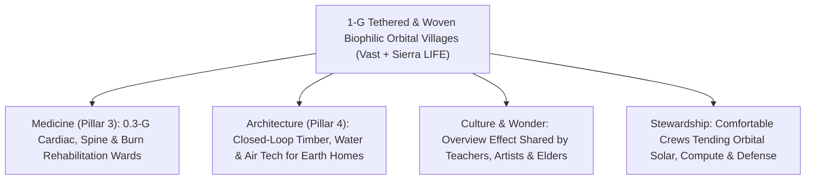

# PILLAR 05: SPACE & ORBITAL STEWARDSHIP (CARBON EDITION)
## Pathway 5.8: Sunlight, Cedar & 1-G Spin — From Vast Haven to Tethered Orbital Villages

> **The Cynic's Cliché:**
> *"Living in space is miserable! Only crew-cut military test pilots want to float around cramped, smelly aluminum tin cans drinking recycled water out of plastic pouches while their bones dissolve and their eyeballs flatten—giant O'Neill space colonies won't exist for two hundred years!"*
>
> **The Nov 2026 Orbital Breakthrough:**
> That bleak stereotype confuses a 1990s zero-gravity government laboratory with human-centered orbital architecture! Two breakthroughs have arrived at the exact same moment in 2025–2026: first, **warm biophilic interiors and expandable woven habitats**—led by **Vast's *Haven-1*** (crafted with warm maple wood veneers, soft sunlit domes, and quiet private suites) and **Sierra Space's *LIFE*** 3-story inflatable Vectran modules (burst-tested past 4× NASA safety margins). Second, you **do not need a billion-ton 2080s ring world to enjoy Earth gravity**: connecting just **two Starship-launched habitat pods on a 450-meter Zylon tether** and spinning them gently at **2 revolutions per minute** creates full, comfortable **1.0-G Earth gravity** right in the 2030s—letting ordinary botanists, artists, retirees, and families pour hot tea into real ceramic mugs among cedar and fern gardens with zero bone loss!

> *"To become a true spacefaring civilization where millions can live and thrive without microgravity health decline, artificial-gravity spinning habitats are the essential breakthrough."*
> — **Max Haot**, CEO, Vast

---

## ACT I: THE HUMAN REALITY — POURING TEA IN ORBITAL SUNLIGHT
### Sunday Morning in a Tethered 1-G Cedar Conservatory, 2037

Step out of your maple-paneled bedroom into the sunlit central atrium of an **Orbital Tethered Garden Village** four hundred and fifty kilometers above the Mediterranean on a Sunday morning in **2037**.

Forget every movie cliché of tangles of Velcro, humming server racks, and astronauts strapped down for two hours of daily resistance-band workouts just to stop their femurs from decalcifying. Look at how ordinary, warm, and deeply human daily life feels when gravity is restored by a gentle spin:

1. **Real Ceramic Mugs, Hot Showers & Barefoot Wooden Floors:**
   You pour freshly brewed Kenyan coffee from a glass carafe straight into a ceramic cup. It arcs smoothly downward at **$9.81\text{ m/s}^2$ ($1.0g$)**, indistinguishable from a café in Kyoto or Copenhagen. Water falls normally in a hot rain shower; soup simmers in an open pot; tears, sinuses, and inner-ear balance work the exact way human biology spent three million years evolving to expect.

2. **Maple, Cedar, Ferns & a 360-Degree Blue Horizon:**
   You are standing inside a three-story, $1,400\text{-cubic-meter}$ **Sierra Space *LIFE*-class** woven habitat lined with aromatic cedar slats, warm maple cabinetry inspired by **Vast's *Haven* stations**, and cascading living walls of dwarf citrus, jasmine, and ferns that scrub $\text{CO}_2$ naturally. Through a wide, domed multi-pane cupola beneath the floor-deck, clouds over Greece and the Nile Delta drift past slowly once every thirty seconds—at a gentle **2.0 RPM** rotation so smooth your inner ear never feels a hint of dizziness.

3. **Space Opened to Grandparents, Artists, Botanists & Wheelchair Users:**
   Because $1.0g$ living quarters eliminate Spaceflight-Associated Neuro-ocular Syndrome (SANS), muscle atrophy, kidney stones, and spinal swelling—while taking the elevator 225 meters up the tether cable to the central hub lets anyone dial gravity smoothly from $1.0g$ down to **$0.38g$ (Mars), $0.16g$ (Moon), or $0.0g$**—elderly scholars, musicians, and mobility-impaired visitors thrive effortlessly in low-gravity therapy lounges!

4. **Rehabilitation & Longevity Medicine Unimaginable on Earth:**
   Indeed, variable-gravity medical wings at **$0.25g\text{ to }0.5g$** become miracles for severe burn victims (no bedsores!), heart-failure recovery patients whose hearts work half as hard while healing, and joint-rehabilitation seniors.

5. **The Skeptic's Honest Question:**
   Wait—if spinning habitats require kilometers of steel like *Elysium* or *2001: A Space Odyssey*, how could humanity build comfortable 1-G orbital villages in the 2030s without trillions of dollars?

---

## ACT II: THE CONVERGENCE BRIDGE & NOV 2026 STATE OF THE ART
### Centripetal Tether Physics ($a = \omega^2 r$), Woven Vectran Shells, and Vast Haven

### 1. The Simple Physics Shortcut: Why a Dumbbell Tether Beats a Giant Wheel by 100×
In rotating reference frames, artificial centripetal acceleration equals angular velocity squared times radius ($a_c = \omega^2 r$). Human vestibular research shows that if rotation exceeds **3 to 4 RPM**, turning your head triggers nauseating Coriolis cross-coupling. To stay at a whisper-gentle **$\omega = 2.0\text{ RPM}$ ($0.2094\text{ rad/s}$)** while delivering full Earth gravity ($a_c = 9.81\text{ m/s}^2$), the required radius is:

$$r = \frac{a_c}{\omega^2} = \frac{9.81}{(0.2094)^2} \approx 224\text{ meters} \quad (\text{448 m tip-to-tip})$$

* **The Wheel Fallacy vs. The Tether Shortcut:** Building a solid rigid wheel 450 meters across takes tens of thousands of tons of steel. Connecting **two inflatable Sierra Space *LIFE* or Vast *Haven* modules** across a 448-meter multi-strand **Zylon / Kevlar / carbon-nanotube tether truss** requires **less than 3 tons of cable** ($<3\%$ of habitat mass!) and just two Starship launches!
* **Vast's 100-Meter Spinning Stick Stepping Stone:** Even sooner, **Vast** has engineered a **100-meter modular spinning truss** ($r = 50\text{ m}$) generating comfortable **Lunar ($0.16g$) and Martian ($0.38g$) gravity** at $\le 2.7\text{ RPM}$ using standardized docked modules!

### 2. Verified 2025–2026 Commercial Habitat Hardware & Milestones

| Pioneer / Program | Habitat Breakthrough | Verified 2025–2026 Milestone | Human Comfort & Cost Shift |
| :--- | :--- | :--- | :--- |
| **Vast (*Haven-1* $\rightarrow$ *Haven-2* $\rightarrow$ Artificial-G Stick)** | Human-centric biophilic design + world's first commercial artificial-gravity roadmap | **2025–2026:** Flight-qualifying **Haven-1** primary structure, 1.1m domed window, & warm maple-wood crew quarters; proposed **Haven-2** ISS successor leading directly to 100m spinning stick. | Replaces sterile lab walls with warm Scandinavian/Japanese-style wood, quiet acoustics ($<45\text{ dBA}$), & real sleep beds. |
| **Sierra Space (*LIFE* Inflatable Habitats)** | Woven Vectran softgoods expanding $3\times$ in orbit ($300\text{ m}^3$ to $1,400\text{ m}^3$) | **Passed multiple full-scale ultimate burst-pressure tests** exceeding NASA's strict $4\times$ human certification safety margin—stronger pound-for-pound than steel against micrometeoroids! | Packs a 3-story, 5,000-sq-ft apartment loft inside a single rocket fairing; *LIFE 3.0* scales to $1,400\text{ m}^3$ per launch. |
| **Starlab Space** *(Voyager, Airbus, Mitsubishi, MDA)* | Single-launch 8-meter stainless-steel continuous-volume orbital research park | Passed NASA Space Act milestones toward single-Starship launch of a spacious $340\text{ m}^3$ three-deck research & hospitality atrium before 2030. | Proves single-launch monolithic wide-body cabins with zero risky multi-year spacewalk plumbing assembly. |
| **Axiom Space (*Hab One / Two*)** | Luxury industrial-design orbital suites (*Philippe Starck* padded cabins + largest space cupola) | Pressure hulls welded by Thales Alenia Space; advancing modular commercial station life-support & panoramic Earth-observatory domes. | Establishes hospitality-grade acoustic dampening, circadian LED skylights, and plug-and-play docking ports. |
| **ESA *MELiSSA* & NASA *Veggie / Ohalo III*** | Bioregenerative living plant walls & closed-loop air/water gardens | Validated thriving orbital harvests of tomatoes, peppers, dwarf wheat, and microalgae oxygenators in LEO. | Turns grey mechanical life-support scrubbers into fragrant, mood-lifting edible botanical conservatories. |

---

## ACT III: PHASED ROLLOUT ROADMAP (2026 $\rightarrow$ 2045) & HOSPITALITY ECONOMICS

### 1. From Haven-1 Maple Cabins to Thousand-Person Spinning Garden Rings

| Era & Milestone | Orbital Architecture | Gravity Level & Volume | Who Can Visit & Live Upstairs |
| :--- | :--- | :--- | :--- |
| **2026–2028 (Live SOTA)** *Biophilic Free-Flyers* | **Vast *Haven-1***, early **Haven-2** & **Axiom / Starlab** modules; **Haven-1** pioneer partial-G spin test. | $0g$ + **Lunar $0.16g$** test spins; $100\text{–}340\text{ m}^3$ warm wood cabins. | Sovereign astronauts, biotech researchers, and early citizen pioneers (4-to-30-day stays). |
| **2029–2033** *100m Stick & Twin-Pod Tether* | **Vast 100m Artificial-Gravity Stick** + first **2-pod Sierra *LIFE* 450m tether** ($2\text{ RPM}$). | **$0.38g$ Mars** to **full $1.0g$ Earth**; **$2,800\text{ m}^3$** two-wing garden loft. | Scientists, filmmakers, university semesters-in-orbit, and honeymooners with **zero zero-G health decline**. |
| **2034–2039** *6-Spoke Tethered Villages* | Six **$1,400\text{ m}^3$ *LIFE 3.0*** cedar-and-glass pods linked in a hexagonal tether ring + $0g$ hub dock. | **$1.0g$ outer rim**, **$0.3g$ rehab deck**, **$0g$ central docking port** ($10,000\text{ m}^3$). | **150–300 residents**: cardiac/burn rehab clinics, botanical researchers, retirees & creative residencies (`<$25k` trip). |
| **2040–2050** *Cislunar Park Towns* | Sintered lunar/asteroid radiation shells wrapping sunlit multi-acre **Stanford Torus** neighborhoods. | **$1.0g$ garden valleys** with flowing creeks, bicycle paths & fruit orchards. | **Thousands of permanent families, schools & artisans** living in sunny cislunar villages alongside Garden Earth. |

### 2. Legacy ISS Aluminum Module vs. 2035 Tethered Woven Garden Habitat

| Human Living Metric | 2000–2026 ISS Rigid Tin Can | 2035 Tethered *LIFE / Haven* Village | Human Flourishing Leap |
| :--- | :--- | :--- | :--- |
| **Gravity & Bone/Eye Health** | $0g$ ($1.5\%$ bone loss/mo + eye flattening) | **Full $1.0g$ at 2 RPM** (+ variable $0.3g$ deck) | **Zero Bone Loss; Indefinite Healthy Stays** |
| **Pressurized Volume per Launch** | $\sim 70\text{–}100\text{ m}^3$ ($4.2\text{ m}$ aluminum cylinder) | **$1,400\text{ m}^3$** (expanding Vectran/Starship shell) | **14× More Spacious Living Volume** |
| **Acoustic & Interior Feel** | $65+\text{ dBA}$ fan roar; exposed cables; sponge baths | **$<42\text{ dBA}$ library quiet**; maple/cedar wood; real showers | **Nordic Boutique-Hotel Warmth** |
| **Micrometeoroid & Debris Armor** | Thin Whipple aluminum bumper | **Multi-layer Vectran/Kevlar** ($4\times+$ burst margin) | **Superior Impact Absorption & Self-Sealing** |

### 3. Fail-Safe Tether Redundancy, Spin-Down Docking & Radiation Care
Making spinning orbital gardens safer and quieter than a commercial cruise ship relies on four mature engineering choices:

* **Fail-Safe Multi-Strand Hoytether Geometry:**
  Orbital tethers are never a single wire that a micrometeoroid could snap! Woven **Hoytether** meshes cross-link dozens of redundant Zylon, Kevlar, and ultra-high-molecular-weight polyethylene ribbons spaced meters apart—even if multiple strands are nicked over a decade, load redistributes instantaneously with a $6\times$ safety factor, and each pod carries independent life support and return thrusters if ever uncoupled.

* **Zero-Spin Central Hub Docking & Gravity Elevators:**
  Arriving shuttles dock effortlessly at the **counter-rotating $0g$ central hub** on the spin axis, and passengers ride a smooth pressurized cable-elevator down the spoke into $1.0g$—never wasting propellant to spin the habitat up and down between flights!

* **Water-Wall & Magnetosphere Radiation Shielding:**
  Routing the habitat's clean drinking water reserves, hydroponic soil troughs, and polyethylene storage tanks around bedroom hulls inside Earth's protective magnetosphere ($450\text{ km}$ below the inner Van Allen belt) keeps annual radiation exposure safely within terrestrial occupational standards.

* **Active Momentum Balancing:**
  When forty guests walk from one end of a garden atrium to the other for dinner, automated water-ballast trim pumps shift matching liters between spoke tanks in seconds—keeping the 2.0 RPM rotation silky-smooth without perceptible wobble.

---

## ACT IV: THE SYNERGY UNLOCK & CLOSING ANSWER TO THE CYNIC

Replacing cold military tin cans with warm, sunlit, $1.0g$ cedar-and-maple villages changes who space belongs to:

1. **Opening the "Overview Effect" to Everyday Humanity:**
   Every astronaut who has looked down at borderless blue Earth from orbit returns changed forever—more compassionate, more protective of our biosphere. When teachers, poets, elders, and students can visit in normal $1.0g$ comfort without six months of centrifuge training, millions bring that planetary stewardship home.

2. **Low-Gravity Healing Sanctuaries:**
   A $0.3g$ rehabilitation deck lets severe third-degree burn patients rest lightly without excruciating skin pressure, helps frail seniors walk again without hip-fracture fear, and eases the workload on recovering hearts.

3. **Closed-Loop Sustainable Homes on Earth:**
   Every ultra-quiet acoustic panel, 99.5% greywater garden loop, and living air-purifying plant wall perfected inside **Vast** and **Sierra Space** habitats flows directly into affordable off-grid mass-timber homes on Earth.

4. **Healthy Stewards for Clean Orbital Infrastructure:**
   Technicians servicing orbital solar arrays, zero-water AI compute clusters, and bioprinting cleanrooms can live upstairs for full seasons without sacrificing a single gram of bone density.

5. **The Warm Truth for the Cynic:**
   Space doesn't have to look like a submarine basement—with warm wood, green leaves, and a gentle 2-RPM spin, human beings can carry beauty, tea ceremonies, and laughter wherever we go.

---

## References & Verified Sources

* **Featured Researcher / Leader:** [Max Haot — CEO, Vast](https://www.vastspace.com/)
* **Companies, Labs & Consortia:** [Vast (Haven-1, Haven-2 & 100m Spinning Stick)](https://www.vastspace.com/) · [Sierra Space (LIFE Woven Vectran Habitats)](https://www.sierraspace.com/) · [Starlab Space (Voyager / Airbus / Mitsubishi)](https://starlab-space.com/) · [Axiom Space](https://www.axiomspace.com/) · [Tethers Unlimited (Hoytether Architecture)](https://en.wikipedia.org/wiki/Hoytether) · [ESA MELiSSA Bioregenerative Consortium](https://www.melissafoundation.org/)
* **Global & Regulatory Precedents:** [Sierra Space Full-Scale Ultimate Burst-Pressure Qualification (>4x NASA Margin)](https://www.sierraspace.com/) · [Gemini 11 Pioneer Tether-Spin Demonstration & Vast Haven Artificial-G Roadmap](https://www.vastspace.com/) · [NASA Commercial LEO Destinations (CLD) Transition Program](https://www.nasa.gov/humans-in-space/)
* **Connected Carbon Pathways:** [100 Vibrant Years: Epigenetic Rejuvenation & Preventative Healthspan](../../03-bioscience-regeneration/epigenetic-healthspan/REPORT.md) · [Curing the Loneliness Epidemic: Turning Dead Strip Malls into Walkable Village Commons](../../04-social-norms/intergenerational-villages/REPORT.md) · [The Antidote to Doomerism: Why Cynicism Feels Smart, Why It's Empirically Wrong, and How We Build](../../06-synergy-horizons/cynicism-to-agency/REPORT.md) · [The Shackleton Peak-of-Eternal-Light Base: Humanity's First Cislunar Commons](../lunar-south-pole/REPORT.md)
