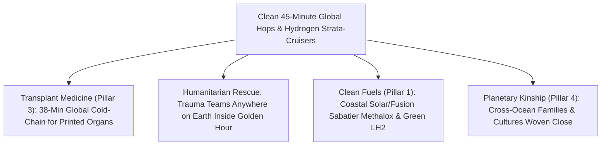

# PILLAR 05: SPACE & ORBITAL STEWARDSHIP (CARBON EDITION)
## Pathway 5.7: Anywhere on Earth in 45 Minutes — Clean Point-to-Point & Hypersonic Strata-Cruisers

> **The Cynic's Cliché:**
> *"Forty-minute rocket hops across Earth? That's an earsplitting, carbon-belching toy for Davos executives! Nobody wants sonic booms rattling city windows or fossil-fueled rockets replacing commercial airplanes."*
>
> **The Nov 2026 Orbital Breakthrough:**
> That critique pictures 1970s kerosene Concorde jets roaring over suburbs. The **2026–2040 high-speed Earth mobility revolution** runs on **100% carbon-neutral synthetic methalox** (captured from air $\text{CO}_2$ and seawater via solar/fusion power) and **zero-carbon green liquid hydrogen ($\text{LH}_2$) whose only exhaust is pure water vapor**! Offshore floating sea-ports 30 kilometers out at sea keep suborbital sonic booms completely away from coastal neighborhoods, while runway-launched **Hermeus**, **Venus Aerospace**, and **Destinus** strata-cruisers glide above $30\text{ km}$ altitude on high-efficiency rotating-detonation and combined-cycle engines. What it unlocks for humanity is deeply poignant: **3D-bioprinted transplant hearts reaching Tokyo from Zurich in 38 minutes**, disaster surgical teams arriving inside the "Golden Hour" anywhere on Earth, and distant grandparents becoming a Saturday-afternoon hug away.

> *"Every time humanity has doubled the speed of global travel, we haven't just saved hours—we've woven distant economies and families into a closer neighborhood."*
> — **AJ Piplica**, Co-Founder & CEO, Hermeus

---

## ACT I: THE HUMAN REALITY — WHEN OCEANS SHRINK TO A COMMUTE
### An Organ Courier in Zurich and a Family Reunion between Sydney and London, 2038

Stand on a sunlit floating hydrofoil pier twenty miles off the coast of Tokyo Bay—or beside a quiet, zero-emission runway outside Zurich—on a Saturday morning in **2038**.

For seventy years between the Boeing 707 (1958) and 2025, commercial aviation speed stayed frozen at Mach 0.85, trapping intercontinental travelers inside dry aluminum tubes for fifteen to twenty-two exhausting hours while burning hundreds of millions of tons of fossil kerosene. By 2038, climbing briefly above the thick soup of the lower atmosphere has shrunk the entire planet into a single human neighborhood:

1. **The 38-Minute Organ & Trauma Lifeline ("Planetary Golden Hour"):**
   At 07:10 UTC, a rare HLA-matched pediatric heart valve and an autonomous surgical robotics team lift off smoothly aboard a green-hydrogen **Destinus / Venus** hypersonic courier from Europe. Cruising silently through the upper stratosphere at Mach 8—or arcing cleanly through frictionless vacuum at $24,000\text{ km/h}$—the courier touches down in Japan **38 minutes later**, three hours before cold-ischemia tissue damage could ever begin.

2. **Disaster Relief Anywhere on Earth Under One Hour:**
   When a magnitude-7.8 earthquake strikes a remote mountain basin in Central Asia or a cyclone batters an island nation, mobile water-purification units, Starlink/AST trauma beacons, and fifty emergency physicians arrive from three continents **within 45 minutes**—turning three-day logistics nightmares into immediate rescue.

3. **Zero Fossil Carbon & Offshore Sonic Peace:**
   Every drop of propellant in the offshore **Starship Point-to-Point** liner was synthesized right on the sea-platform using offshore wind/solar electricity, seawater electrolysis ($\text{H}_2 + \text{O}_2$), and direct ocean/air carbon capture ($\text{CO}_2 + 4\text{H}_2 \to \text{CH}_4 + 2\text{H}_2\text{O}$)—a **100% closed net-zero loop**. Meanwhile, hydrogen strata-cruisers emit zero carbon at all, and offshore sea-pads keep ascent/landing booms out over open water where fast electric hydrofoils whisk passengers to downtown piers in 18 minutes.

4. **Grandparents Across Oceans Without Losing a Week:**
   As 1,000-cycle stainless-steel airframes drive ticket prices down toward today's premium economy fares, a nurse in Sydney can fly to London to celebrate her mother's eightieth birthday over a weekend without losing four days to jet lag.

5. **The Skeptic's Honest Question:**
   Wait—Concorde retired in 2003 because supersonic air drag burned ridiculous amounts of fuel per seat! How can going *five to twenty times faster* than Concorde ever be clean, safe, or affordable?

---

## ACT II: THE CONVERGENCE BRIDGE & NOV 2026 STATE OF THE ART
### Ballistic Coasting in Zero Drag, Rotating Detonation Engines, and e-Fuels

```mermaid
flowchart LR
    subgraph SubsonicTrap["The 70-Year Mach 0.85 Plateau"]
        S1["16-22 Hr Flights Fighting Dense Tropospheric Drag"]
        S2["Fossil Jet-A Kerosene & Contrail Warming"]
        S3["Concorde Failed Pushing Air Continuously at 18 km"]
    end
    subgraph SOTA2026["Verified 2025-2026 High-Speed Pioneers"]
        P1["Starship Full Reusability & Mechazilla Tower Catch"]
        P2["Hermeus Quarterhorse/Darkhorse Mach 5 TBCC Flight"]
        P3["Venus Aerospace RDRE & Destinus Green-H2 Cruisers"]
    end
    subgraph Earth45Min["45-Minute Clean Planetary Kinship"]
        E1["38-Min Global Organ, Vaccine & Disaster Response"]
        E2["100% Net-Zero Solar Methalox & Pure-H2O Exhaust"]
        E3["Offshore Sea-Pads = Zero Urban Sonic Booms"]
    end
    SubsonicTrap --> SOTA2026
    SOTA2026 ==> Earth45Min
```

### 1. The Counterintuitive Physics: Why Going *Higher* Saves Energy Over Long Distances
Concorde's fatal flaw was flying continuously inside the atmosphere at $18\text{ km}$ altitude, fighting relentless supersonic aerodynamic drag ($F_{\text{drag}} = \frac{1}{2} \rho v^2 C_d A$) for three solid hours across the Atlantic. Two modern architectures beat that drag trap:

* **1. Suborbital Vacuum Coasting ($\rho \to 0$ Above 100 km):**
  A reusable stainless-steel methalox liner boosts for just **3 minutes** out of the atmosphere, shuts its engines completely off, and **coasts in zero-drag vacuum for 25 minutes** along a Keplerian ellipse at $7\text{ km/s}$ before gliding belly-first back into dense air to shed 99% of kinetic energy aerodynamically! Crossing $15,000\text{ km}$ (New York $\leftrightarrow$ Shanghai or London $\leftrightarrow$ Sydney) requires nearly the exact same propellant whether the trip is $8,000\text{ km}$ or $18,000\text{ km}$—turning Earth's longest grueling 20-hour routes into **35-to-45-minute hops**.

* **2. Rotating Detonation & Turbine-Based Combined Cycle Strata-Cruisers ($30\text{–}45\text{ km}$):**
  For runway-to-runway Mach 5 to Mach 9 hops, **Rotating Detonation Rocket Engines (RDRE)** spin a supersonic detonation wave continuously around a ring chamber—extracting **15% to 25% higher thermodynamic efficiency** than conventional deflagration engines—while hydrogen precooled air-breathing turbines (**Hermeus**, **Destinus**) use atmospheric oxygen instead of carrying heavy $\text{LOX}$ tanks!

### 2. Verified 2024–2026 Hardware & Flight Milestones

| Pioneer / Vehicle | Speed & Propulsion Class | Verified 2024–2026 Milestone | Human & Environmental Payoff |
| :--- | :--- | :--- | :--- |
| **SpaceX (*Starship* Point-to-Point)** | Mach 22 suborbital vacuum coast (30–45 min global anywhere) | Proven **Super Heavy booster tower catches**, controlled Starship ocean/pad reentry flips, and Raptor 3 simplified engines enabling rapid airline-like turnaround. | Unlocks 40-minute antipodal travel & 100-ton emergency humanitarian lift from offshore sea-pads. |
| **Hermeus (*Quarterhorse* $\rightarrow$ *Halcyon*)** | Mach 5 Turbine-Based Combined Cycle (TBCC) runway cruiser | Built & tested **Quarterhorse Mk 1 / Mk 2** high-speed flight testbeds validating proprietary *Chimera* turbine-to-ramjet transition with standard runway takeoff. | Connects NYC–London in **90 minutes** from existing airports using sustainable synthetic aviation fuels. |
| **Venus Aerospace (*Stargazer* & *VDR2*)** | Mach 6–9 Rotating Detonation (*RDRE* + ramjet) drone & liner | Completed historic flight & long-duration thrust tests of **high-efficiency Rotating Detonation Engines** + unveiled *VDR2* Mach 6 air-breathing hypersonic engine. | Runway takeoff to high stratosphere ($33+\text{ km}$): San Francisco to Tokyo in **~1 hour** with muffled ground acoustics. |
| **Destinus (*Destinus S / L*)** | Mach 5 liquid-hydrogen ($\text{LH}_2$) cryogenic strata-cruiser | Flying autonomous hydrogen-powered supersonic/hypersonic demonstrator prototypes in Europe with onboard cryogenic $\text{LH}_2$ precooling. | **Zero $\text{CO}_2$ exhaust** (pure water vapor) connecting Europe to Asia/Australia in 2 to 3 hours. |
| **Boom Supersonic (*Overture / XB-1*)** | Mach 1.7 "Boomless Cruise" 100%-SAF airliner | **XB-1 broke the sound barrier multiple times in early 2025** demonstrating *Mach Cutoff* physics (sonic boom refracts upward and never touches the ground!). | Proves quiet overland high-speed flight & 100% Sustainable Aviation Fuel commercial airline demand. |

---

## ACT III: PHASED ROLLOUT ROADMAP (2026 $\rightarrow$ 2042) & SEAT ECONOMICS

### 1. From Organ Couriers to Everyday Transoceanic Commutes

| Rollout Phase | Fleet & Route Focus | Travel Time (London $\leftrightarrow$ Tokyo) | Societal & Safety Milestones |
| :--- | :--- | :--- | :--- |
| **Phase 1: Uncrewed Medical & Cargo** *(2026–2029)* | Autonomous **Hermeus / Venus / Destinus** drones + early offshore **Starship** cargo sorties. | **45 – 120 Minutes** *(vs. 14 hrs subsonic)* | High-priority transplant organs, radioisotopes (99m-Tc with 6-hr half-life!), and disaster relief pods prove 10,000+ safe flights first. |
| **Phase 2: Mach 5–6 Runway Cruisers** *(2030–2034)* | 20-to-80-seat **Hermeus *Halcyon***, **Venus**, & **Destinus** hydrogen liners on transoceanic corridors. | **90 – 130 Minutes** *(Airport-to-Airport)* | FAA/EASA high-altitude corridors live; zero-sonic-boom ocean routing & *Mach Cutoff* overland cruise. |
| **Phase 3: Offshore Point-to-Point Hubs** *(2034–2038)* | Floating solar-methalox sea-ports 30 km off NYC, London, Tokyo, Singapore, Sydney, Dubai & São Paulo. | **38 Minutes** *(Suborbital Vacuum Arc)* | 300-to-500-seat liners inspected & refueled in 60 minutes; ticket prices cross below \$2,500 round-trip. |
| **Phase 4: Planetary Neighborhood** *(2039–2045)* | 1,000+ flight-cycle reusable fleets powered 100% by coastal fusion/solar e-fuels & green $\text{LH}_2$. | **30 – 45 Minutes Anywhere on Earth** | Transoceanic travel becomes as fast, clean, and routine as taking an intercity express train today. |

### 2. Legacy 18-Hour Widebody Jet vs. 2038 Clean Point-to-Point & Strata-Cruisers

| Global Mobility Metric (15,000 km Route) | 2026 Subsonic Jetliner (Boeing 787 / A350) | 2038 Hydrogen Strata-Cruiser (Mach 6) | 2038 Offshore Methalox Liner (Mach 22) |
| :--- | :--- | :--- | :--- |
| **Gate-to-Gate / Pier-to-Pier Time** | **17 to 20 Hours** (+2 days jet lag) | **~110 Minutes** (standard runways) | **~42 Minutes** (+18 min hydrofoil) |
| **Net Fossil Carbon Emitted** | High fossil Jet-A + persistent ice contrails | **Zero $\text{CO}_2$** (green $\text{LH}_2$) | **Net-Zero** (Sabatier air/ocean $\text{CO}_2$ loop) |
| **Peak Passenger G-Load** | $1.2g$ takeoff | **$1.3g$ smooth climb** | **$2.0g\text{–}2.5g$** (gentle rollercoaster seat tilt) |
| **Urban Sonic Boom Footprint** | Subsonic airport noise | **Refracted upward / Over-ocean** | **0 dB in cities** (30 km offshore sea-pads) |

### 3. Safety-First Certification, Stratospheric Water Care & G-Load Comfort
Turning 45-minute suborbital arcs and Mach 6 strata-cruisers into everyday civic transit rests on four rigorous engineering safeguards:

* **10,000 Cargo Flights Before Passenger Ticket #1:**
  Unlike 1960s experimental rockets, reusable point-to-point vehicles earn EASA and FAA airliner-grade reliability ($<10^{-7}$ loss-of-crew probability via multi-engine-out capability and automated intact-abort envelopes) by flying **tens of thousands of orbital satellite, tanker, and uncrewed medical-courier sorties** long before welcoming everyday families aboard.

* **Protecting the Stratosphere From Water Vapor & $\text{NO}_x$:**
  Because water vapor injected into the dry middle stratosphere can trap heat if unmanaged, green-hydrogen cruisers (**Destinus**) optimize flight levels where water residence time is days rather than years, while suborbital methalox liners coast *above* the stratosphere ($110\text{–}150\text{ km}$) in pure vacuum for 85% of their trajectory!

* **Tilting Cradle Seats ($G_x$ Comfort for Grandparents & Kids):**
  Articulated cabin seats rotate automatically during the 3-minute boost and 2-minute atmospheric glide so forces press gently into passengers' backs ($2.0g$ chest-to-back, milder than a theme-park coaster) rather than head-to-toe—making a 40-minute hop comfortable for healthy seniors and children alike.

* **Seamless Hydrofoil & Electric Airport Integration:**
  High-speed foil ferries and sub-surface coastal tunnels link downtown waterfront stations directly to 30-km offshore solar-methalox sea-pads in 15 to 18 minutes, complete with biometric pre-clearance during the boat ride so pier-to-pier travel stays under one hour!

---

## ACT IV: THE SYNERGY UNLOCK & CLOSING ANSWER TO THE CYNIC

Shrinking Earth's widest oceans from twenty exhausting hours down to forty clean minutes changes human solidarity forever:

1. **A Single Global Hospital Network:**
   Rare short-half-life cancer radioisotopes ($^{99\text{m}}\text{Tc}$ and $^{225}\text{Ac}$), antivenoms, and 3D-bioprinted organs manufactured in specialized regional hubs can reach *any* operating room on Earth while cells are still warm and viable.

2. **The Planetary Golden-Hour Firehouse:**
   No island or mountain community is ever "too remote" when earthquake trauma hospitals, water purifiers, and rescue robotics can drop in from 10,000 kilometers away in forty-five minutes.

3. **Fossil Jet-A Retired by Sky & Seawater Fuels:**
   High-speed synthetic methalox and green liquid-hydrogen fuel hubs pioneer the exact coastal e-fuel chemistry that decarbonizes maritime shipping and regional aviation too.

4. **Empathy Across Every Ocean:**
   Nothing dissolves geopolitical caricature faster than students, grandparents, musicians, and scientists sharing dinner across continents without losing half a week to grueling transit.

5. **The Warm Truth for the Cynic:**
   Powered by sunlight, seawater, and air—and launched quietly out at sea—45-minute Earth hops aren't a billionaire joyride; they turn our whole planet into one caring neighborhood.

---

## References & Verified Sources

* **Featured Researcher / Leader:** [AJ Piplica — Co-Founder & CEO, Hermeus](https://www.hermeus.com/)
* **Companies, Labs & Consortia:** [SpaceX (Starship Point-to-Point)](https://www.spacex.com/) · [Hermeus (Quarterhorse & Halcyon)](https://www.hermeus.com/) · [Venus Aerospace (RDRE & VDR2)](https://www.venusaero.com/) · [Destinus (Liquid-Hydrogen Cruisers)](https://destinus.com/) · [Boom Supersonic (Mach Cutoff Physics)](https://boomsupersonic.com/) · [NASA Quesst / X-59 Low-Boom Program](https://www.nasa.gov/mission/quesst/)
* **Global & Regulatory Precedents:** [SpaceX Super Heavy Precision Mechazilla Tower Catch & Rapid Reuse](https://www.spacex.com/) · [Boom XB-1 2025 Boomless Supersonic Mach-Cutoff Flights](https://boomsupersonic.com/xb-1) · [Venus Aerospace High-Efficiency Rotating Detonation Engine Flights](https://www.venusaero.com/)
* **Connected Carbon Pathways:** [Turning Thin Air into Jet Fuel, Green Steel & Stone](../../01-abundant-energy/synthetic-sky-fuels/REPORT.md) · [Ending the Transplant Waitlist & Restoring Sight, Speech, and Motion](../../03-bioscience-regeneration/organ-bioprinting-bionics/REPORT.md) · [Miracles Only Microgravity Can Grow: Flawless Drug Crystals, ZBLAN Fiber & Printed Hearts](../zero-g-biomanufacturing/REPORT.md) · [Curing the Loneliness Epidemic: Turning Dead Strip Malls into Walkable Village Commons](../../04-social-norms/intergenerational-villages/REPORT.md)
