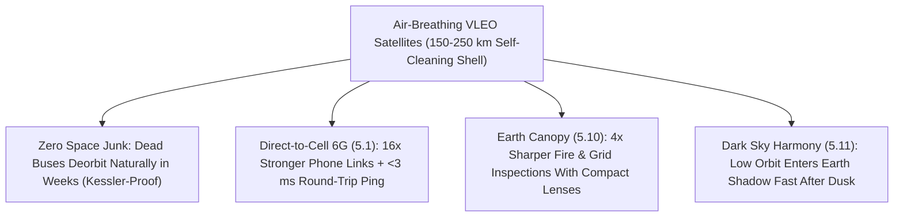

# PILLAR 05: SPACE & ORBITAL STEWARDSHIP (CARBON EDITION)
## Pathway 5.16: Skimming the Upper Sky Forever — Air-Breathing Electric Satellites & Self-Cleaning VLEO Orbits

> **The Cynic's Cliché:**
> *"Every new satellite constellation is wrapping Earth in a permanent tomb of space junk! One chain-reaction Kessler collision at 800 kilometers will trap humanity underneath millions of hypervelocity shrapnel fragments for centuries!"*
>
> **The 2025–2026 VLEO & Air-Breathing Breakthrough:**
> What if satellites flew in an orbital lane where **space junk is physically impossible**—and never ran out of fuel either? Welcome to **Very Low Earth Orbit (VLEO, $150\text{ to }250\text{ km}$ altitude)**! Compared to legacy $600\text{--}800\text{ km}$ orbits, flying $4\times$ closer to Earth delivers **$4\times$ sharper wildfire/crop imagery** from the exact same lens and **$16\times$ stronger Direct-to-Cell radio signals** (inverse-square law!). Best of all, VLEO is **100% self-cleaning**: if any satellite loses power or collides, natural upper-atmospheric drag pulls every fragment harmlessly into clean atmospheric burn-up **within days to weeks**—zero century-long Kessler debris! And in **2025–2026**, aerospace teams cracked VLEO's only historical catch (running out of thruster fuel) via **Air-Breathing Electric Propulsion (ABEP)**: startups and agencies including **Kreios Space**, **Sitael / ESA (*RAM-EP*)**, **JAXA**, and **Albedo (*Clarity-1*)** scoop rarefied atomic oxygen and nitrogen straight out of the upper thermosphere, ionize it with solar power, and jet it out the back as **virtually limitless free propellant**!

> *"In Very Low Earth Orbit, the upper atmosphere stops being an enemy that drags satellites down and becomes both an inexhaustible fuel tank and an automatic debris cleaner."*
> — **Adrián Senar**, Co-Founder & CEO, Kreios Space

---

## ACT I: THE HUMAN REALITY — SHARPER EYES, ZERO SPACE JUNK, NO XENON TANK LIMIT
### An Orbital Traffic Control Center, a Vigo Plasma Vacuum Chamber, and Denver Crop Audits, 2029

Step inside a modern space-sustainability operations desk—or peer through the quartz porthole of a plasma wind tunnel in Vigo, Spain or Pisa, Italy—on a clear morning in **2029**.

In the early 2020s, orbital stewards faced a painful dilemma: put satellites high up ($700\text{--}1,200\text{ km}$) so they don't need fuel to fight air drag, and dead spacecraft linger as lethal $7.5\text{ km/s}$ bullets for **100 to 1,000 years**; put them down low ($200\text{ km}$) where dead satellites vanish cleanly in weeks, and their onboard tank of rare, ultra-expensive **xenon gas (\$3,000+/kg)** runs dry in six months! Now watch how **Air-Breathing Electric Propulsion (ABEP)** and aerodynamic VLEO buses turn physics completely inside out:

1. **Drinking the Sky at 200 Kilometers Up:**
   Sleek, dart-shaped satellites cruise at $7.8\text{ km/s}$ through the ultra-thin thermosphere at $180\text{--}220\text{ km}$ altitude. Instead of carrying 150 kilograms of pressurized xenon or krypton, a honeycomb **hypersonic passive intake** at the nose funnels incoming neutral **atomic oxygen ($\text{O}$) and nitrogen ($\text{N}_2$)** molecules into an **electrodeless radio-frequency (helicon / ECR) plasma thruster**. Powered by sleek body-mounted solar wings, the thruster accelerates those atmospheric ions backward at **$20\text{ to }35\text{ km/s}$**—canceling aerodynamic drag indefinitely using the sky itself as propellant!

2. **10-Centimeter Vision From a Backpack-Sized Mirror (*Albedo* + VLEO Optical Physics):**
   Because optical resolution improves linearly with lower altitude ($\Delta x = 1.22\,\lambda h / D$), dropping from $800\text{ km}$ down to $200\text{ km}$ lets a compact $30\text{-centimeter}$ mirror match the razor-sharp clarity of a giant $1.2\text{-meter}$ spy-class telescope! **Albedo's *Clarity-1*** pathfinder (launched March 2025) pioneered commercial VLEO Earth imaging—inspecting power-line wildfire sparks, rooftop solar damage, and precision irrigation leaks at a fraction of legacy satellite mass and cost.

3. **Automatic Fail-Safe Space Hygiene:**
   What happens if a solar storm fries a VLEO satellite's computer at 03:00 AM? The electric thruster simply turns off—and gentle thermospheric drag lowers the dead spacecraft smoothly to harmless reentry within **14 to 30 days**, leaving the orbital highway spotless for future generations!

4. **The Skeptic's Honest Question:**
   Wait—at $200\text{ km}$ altitude, reactive **atomic oxygen ($\text{O}$)** chews right through ordinary silver coatings and thruster grids like sandblasting acid! How did 2025–2026 engineers build an engine that breathes corrosive atomic oxygen without eating itself alive?

---

## ACT II: THE CONVERGENCE BRIDGE & NOV 2026 STATE OF THE ART
### Inverse-Square Link Budgets, Electrodeless Plasma Thrusters, and Specular Intake Physics

```mermaid
flowchart LR
    subgraph HighLEOTrap["Legacy 700-1,200 km Orbit Tradeoff"]
        H1["Dead Satellites Linger 100-1,000 Yrs (Kessler Risk)"]
        H2["Distant Cameras Need Huge Mirrors; Weak Phone Links"]
        H3["Low Orbits Burned Out Expensive Xenon Tanks Fast"]
    end
    subgraph VLEOSOTA["Verified 2025-2026 VLEO & ABEP Pioneers"]
        V1["Albedo Clarity-1 Commercial VLEO Flight (2025-2026)"]
        V2["Kreios Space + Sitael/ESA RAM-EP Electrodeless ABEP"]
        V3["JAXA SLATS (167.4 km Record) + Redwire SabreSat/Phantom"]
    end
    subgraph SelfCleaningSky["2030s Immortal Clean VLEO Shell"]
        C1["Zero Propellant Tank Depletion (5-to-10+ Yr Life)"]
        C2["4x Sharper Earth Imaging + 16x Stronger Phone Links"]
        C3["100% Passive Deorbit in Weeks -> Zero Space Junk!"]
    end
    HighLEOTrap --> VLEOSOTA
    VLEOSOTA ==> SelfCleaningSky
```

### 1. Four Physics Breakthroughs Unlocking the 150–250 km Frontier
* **1. The $4\times$ Optical & $16\times$ Telecom Dividend of Flying $4\times$ Closer:**
  Dropping altitude $h$ by a factor of $4$ (from $800\text{ km}$ to $200\text{ km}$) simultaneously shrinks diffraction-limited ground pixel size $\Delta x \propto h$ by **$4\times$** (shrinking mirror mass, volume, and cost by $\sim 4^3 = 64\times$ for equal resolution!) while slashing free-space radio path loss ($L_{\text{FS}} \propto h^2$) by **$16\times$ ($+12\text{ dB}$)**—supercharging Direct-to-Smartphone links (`orbital-laser-mesh`) and sub-5-millisecond latency!

* **2. Beating Atomic-Oxygen Corrosion via Electrodeless Helicon / ECR Plasma:**
  Traditional gridded ion and Hall thrusters rely on delicate hollow cathodes and metal grids that rapidly oxidize and sputter away when exposed to hot **atomic oxygen ($\text{O}$)**. **Kreios Space**, **University of Stuttgart (*IRS DISCOVERER*)**, and **Sitael / ESA** solved this with **electrodeless inductive / Electron Cyclotron Resonance (ECR) plasma thrusters** + magnetic nozzles: radio waves heat the scooped $\text{O}/\text{N}_2$ gas through a ceramic/quartz wall with **zero exposed metal electrodes** touching the plasma!

* **3. Specular-Reflection Intake Ducts ($\eta_c > 45\%\text{--}60\%$):**
  At $200\text{ km}$, the molecular mean free path exceeds $100\text{ meters}$ (**free-molecular flow**). If air molecules bounce *diffusely* in random directions off intake walls, most bounce right back out the front! Coating honeycomb intake tubes with smooth **atomic-oxygen-resistant silica/alumina/graphene films** promotes **specular forward reflection**, compressing ultra-thin air $100\times\text{ to }200\times$ into the ionization chamber while cutting external drag.

* **4. Clean Reentry Materials (Demise-by-Design, Zero Alumina Haze):**
  Paired with wooden/polymer structural panels (*LignoSat* Kyoto University heritage) or low-melting silicon/stainless alloys, compact VLEO satellites vaporize cleanly without dumping tons of stratospheric alumina particles.

### 2. Verified 2024–2026 VLEO & Air-Breathing Propulsion Leaders

| Organization / Platform | Core VLEO Technology | Verified 2024–2026 Milestone | Strategic Orbital Impact |
| :--- | :--- | :--- | :--- |
| **Albedo (*Clarity-1* & Fleet)** | Aerodynamic low-altitude optical & $2\text{ m}$ thermal infrared bus | **Launched *Clarity-1* in March 2025**, proving commercial ultra-high-resolution VLEO operations alongside $2\text{ m}$ urban heat-island / wildfire thermal mapping. | Delivers aerial-grade clarity globally without spy-satellite size or cost. |
| **Kreios Space** *(Spain / EU)* | Electrodeless RF **Air-Breathing Electric Propulsion (ABEP)** for `<250 km` | Scaled funding & continuous **atomic-oxygen/nitrogen plasma firing campaigns (2025–2026)** ahead of orbital VLEO demonstration mission. | Eliminates xenon propellant tanks completely for multi-year $180\text{ km}$ missions. |
| **ESA & Sitael (*RAM-EP*) / Univ. of Stuttgart (*IRS*)** | Passive honeycomb intake + double-stage Hall / electrodeless helicon thrusters | First firing of air-breathing electric thruster in vacuum hypersonic particle beam; **ESA Skylark / RAM-EP** flight pathfinder advancing for `<200 km` operations. | Establishes European open VLEO bus standards for Copernicus Earth sentinels. |
| **Redwire (*SabreSat* & *Phantom*) & Thales Alenia (*Skimsat*)** | Slender low-drag VLEO spacecraft buses for ESA & commercial constellations | **ESA contracted Redwire *Skimsat*** VLEO demonstrator; *SabreSat* platform engineered specifically for sustained $150\text{--}250\text{ km}$ aerodynamic flight. | Cuts satellite mass & launch cost by >50% per unit of imaging performance. |
| **JAXA (*SLATS / Tsubame* Heritage)** | Ion-propelled aerodynamic VLEO flight & atomic-oxygen materials sensor | Holds Guinness record **lowest sustained Earth-observation altitude ($167.4\text{ km}$)**, validating atomic-oxygen protective coatings now flying on Gen-2 buses. | Proved flight stability & sharp optical imaging right inside the thermosphere. |

---

## ACT III: PHASED ROLLOUT ROADMAP (2026 $\rightarrow$ 2038) & KESSLER IMMUNITY

### 1. Moving Earth's Working Constellations Into Self-Cleaning Airspace

| Deployment Phase | Altitude & Propulsion SOTA | Imaging, Comms & Lifetime | Orbital Sustainability Breakthrough |
| :--- | :--- | :--- | :--- |
| **2025–2026 (Live SOTA)** *Commercial VLEO & ABEP Firing* | $250\text{--}320\text{ km}$ high-efficiency Hall (**Albedo *Clarity-1***) + ground/IOV **ABEP** plasma qualification. | $10\text{--}30\text{ cm}$ optical, $2\text{ m}$ thermal IR; 3–5 yr fueled life. | Proves commercial VLEO economics; FCC 5-year deorbit rule beaten by **100×** (weeks, not years!). |
| **2027–2029** *First Unlimited-Fuel ABEP Demos* | Orbital **Kreios / ESA *RAM-EP* / Redwire *Skimsat*** flying continuously at **$180\text{--}220\text{ km}$** on pure air. | Zero onboard propellant consumed during cruise; `<3 ms` ground RTT ping! | First satellites whose mission lifetime is set by electronics, **never an empty gas tank**. |
| **2030–2034** *Self-Cleaning Canopy Shells* | Thousands of Earth-imaging, wildfire (`earth-digital-twin-canopy`), & 6G Direct-to-Cell nodes migrate to **$170\text{--}230\text{ km}$**. | $16\times$ stronger pocket-phone signal; 100% passive deorbit in **<21 days**. | **Zero long-lived debris** in VLEO; relieves congestion in legacy $550\text{--}800\text{ km}$ shells. |
| **2035–2040** *Mars & Venus Air-Skimmers* | $\text{CO}_2$-breathing ABEP buses skimming **Mars ($110\text{ km}$)** and **Venus ($135\text{ km}$)** indefinitely! | Centimeter-scale global Mars/Venus weather & ice radar mapping forever. | Universal planetary exploration architecture using any world's upper atmosphere as fuel. |

### 2. Legacy 800 km Satellites vs. 200 km Air-Breathing VLEO

| Orbital Metric | Legacy 800 km LEO Satellite | 200 km Air-Breathing VLEO Bus | Sustainability & Performance Gain |
| :--- | :--- | :--- | :--- |
| **Natural Debris Decay Time If Dead** | **150 to 500+ Years** (Kessler hazard) | **7 to 30 Days** (100% self-cleaning!) | **Zero Permanent Space Junk Possible** |
| **Telescope Mirror Size for Equal Clarity** | $1.2\text{ m}$ heavy optical barrel | **$0.30\text{ m}$ compact mirror ($1/4\text{th}$ diameter)** | **~90% Lighter Optics & Cheaper Satellites** |
| **Radio Signal Strength on Ground** | Baseline ($1\times$) | **$16\times$ Stronger ($+12\text{ dB}$ Link Gain)** | **Direct-to-Watch/Phone With Tiny Antennas** |
| **Xenon / Krypton Fuel Needed** | Hundreds of kg (scarce noble gas) | **0 kg Cruise Fuel (Scoops Upper Sky)** | **Infinite Specific Impulse ($I_{\text{sp}} \to \infty$ Effective)** |
| **Night-Sky Astronomical Visibility** | Sunlit for hours past twilight | **Enters Earth's Shadow Minutes After Sunset** | **Protects Rubin Observatory Dark Skies!** |

### 3. Dark-Sky Bonus & Privacy Governance
* **A Gift to Ground Astronomers (`rubin-citizen-sky-patrol`):**
  Satellites at $1,000\text{ km}$ stay sunlit all night in summer, leaving streaks across astronomical images. At **$180\text{--}200\text{ km}$**, Earth's geometric shadow swallows VLEO satellites almost immediately after sunset—leaving midnight skies pitch-dark for **Vera Rubin LSST**!
* **Strict Civic Privacy Guardrails:**
  Just as **Albedo** committed publicly from day one (**imaging infrastructure, solar roofs, powerlines, and crops—never facial recognition or person-tracking**, enforced by physical pixel limits and audited terms), VLEO thermal/infrastructure maps inspect wildfire hazards and leaky city steam pipes while protecting individual privacy.

---

## ACT IV: THE SYNERGY UNLOCK & CLOSING ANSWER TO THE CYNIC

Look at the elegance of solving two seemingly opposite problems with one piece of physics:

1. **Kessler Syndrome Defused by Gravity and Air:**
   In the $180\text{--}220\text{ km}$ lane, space debris simply cannot accumulate. Stop thrusting, and Mother Nature sweeps the lane clean in two weeks.

2. **Turning Aerodynamic Drag Into Free Fuel:**
   Scooping thin oxygen and nitrogen molecules with solar electricity ends aerospace's reliance on scarce, energy-intensive noble gases like xenon.

3. **Better Earth Care With Smaller, Darker Spacecraft:**
   Four-times-closer orbits shrink satellites to suitcase scale, give rural phones sixteen-times-stronger signals, and duck into Earth's night shadow right after dusk so astronomers keep pristine starlight.

4. **The Ultimate Answer to the Cynic:**
   Next time someone warns that *"satellites will trap humanity under centuries of space junk,"* point $200\text{ kilometers}$ overhead to air-breathing VLEO gliders: **we found an orbital lane that drinks the upper sky for fuel and cleans itself automatically.**

---

## References & Verified Sources

* **Featured Researcher / Leader:** [Adrián Senar — Co-Founder & CEO, Kreios Space](https://kreiosspace.com/)
* **Companies, Labs & Consortia:** [Kreios Space (Air-Breathing Electric Propulsion)](https://kreiosspace.com/) · [Albedo (Clarity VLEO Constellation)](https://albedo.com/) · [ESA & Sitael (RAM-EP Air-Breathing Thruster)](https://www.esa.int/Enabling_Support/Space_Engineering_Technology/World-first_firing_of_air-breathing_electric_thruster) · [University of Stuttgart IRS (DISCOVERER electrodeless ABEP)](https://www.irs.uni-stuttgart.de/) · [Redwire Space (SabreSat & ESA Skimsat)](https://redwirespace.com/) · [JAXA SLATS (Tsubame 167.4 km VLEO Record)](https://global.jaxa.jp/projects/sat/slats/)
* **Global & Regulatory Precedents:** [Albedo Clarity-1 Commercial VLEO Pathfinder Launch (March 2025)](https://albedo.com/) · [FCC 5-Year Orbital Debris Deorbit Mandate (Beaten 80x by VLEO Natural Drag)](https://www.fcc.gov/space) · [JAXA SLATS Guinness Record Lowest Sustained Earth-Observation Orbit (167.4 km)](https://global.jaxa.jp/projects/sat/slats/)
* **Connected Carbon Pathways:** [Zero Dead Zones on Earth: Direct-to-Cell & Vacuum Optical Laser Backbones](../orbital-laser-mesh/REPORT.md) · [Earth's Protective Canopy: Catching Wildfires in 3 Minutes from Orbit](../earth-digital-twin-canopy/REPORT.md) · [Filming the Cosmic Time-Lapse: Vera C. Rubin LSST & Dark-Sky Standards](../rubin-citizen-sky-patrol/REPORT.md) · [Clean Perovskite-Silicon Tandem Solar](../../01-abundant-energy/perovskite-tandem-solar/REPORT.md)
