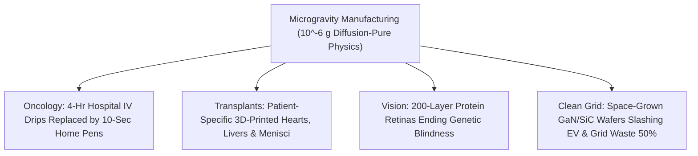

# PILLAR 05: SPACE & ORBITAL STEWARDSHIP (CARBON EDITION)
## Pathway 5.3: Miracles Only Microgravity Can Grow — Flawless Drug Crystals, ZBLAN Fiber & Printed Hearts

> **The Cynic's Cliché:**
> *"Zero-gravity space factories are just an overpriced science-fair stunt! Nothing made in orbit could ever justify the cost of rocket fuel when we can build cleanrooms and pharmaceutical plants right here on the ground."*
>
> **The Nov 2026 Orbital Breakthrough:**
> Even inside the most expensive \$10 billion cleanroom on Earth, you cannot turn off $9.81\text{ m/s}^2$ of gravity—which constantly stirs thermal convection currents, settles heavy molecules to the bottom of vats, warps delicate protein crystals, and crushes soft 3D-printed human blood vessels before they cure. In Low Earth Orbit, **turning off gravity unlocks a brand-new thermodynamic regime**. Already in 2024–2026, **Varda Space Industries** is flying autonomous orbital pharmaceutical factories and landing hypersonic capsules in Utah and South Australia to reformulate IV cancer infusions into 10-second home injections; **Redwire's *BioFabrication Facility*** is 3D-printing human knee menisci and cardiac tissue; **LambdaVision** is layering 200-coat artificial retinas to cure blindness; and **Flawless Photonics** is drawing ZBLAN optical glass with $10\times\text{ to }100\times$ lower loss than silica!

> *"Turning off gravity is a fundamental new knob for manufacturing—allowing us to formulate life-saving medicines and materials in orbit that physics simply won't permit on Earth."*
> — **Will Bruey**, Co-Founder & CEO, Varda Space Industries

---

## ACT I: THE HUMAN REALITY — WHEN ZERO GRAVITY COMES HOME TO YOUR CLINIC
### A Living Room in Ohio and an Eye Clinic in Boston, 2033

Step into a sunny kitchen in Columbus, Ohio, on a Wednesday morning in **2033**, where 68-year-old retired teacher Arthur is getting ready to tend his tomato garden.

Five years earlier, patients with Arthur's metastatic melanoma had to drive two hours to a regional infusion center every three weeks, sit tethered to an IV pole for four exhausting hours, and nurse bruised veins. Today, Arthur takes an autoinjector pen from his refrigerator, presses it gently against his thigh for **ten painless seconds**, puts on his sun hat, and walks out to his garden:

1. **4-Hour Cancer Infusions Shrunk into 10-Second Home Pens:**
   Inside that pen is an ultra-dense, silky suspension of uniform monoclonal antibody microcrystals (like reformulated *Keytruda*) seeded inside an autonomous **Varda** orbital capsule 500 kilometers overhead. Free from Earth's buoyancy-driven convection, the protein molecules assembled into a hyper-stable crystalline polymorph that packs 5× higher therapeutic dose into a tiny subcutaneous syringe—and doesn't even require ultra-cold $-80^\circ\text{C}$ dry-ice shipping for rural clinics in the tropics.

2. **Sight Restored by 200-Layer Microgravity Retinas:**
   Across the country in Boston, an ophthalmologist implants a paper-thin **LambdaVision** protein-based artificial retina into a grandmother blinded by retinitis pigmentosa. Because zero gravity eliminated sedimentation and surface-tension ripples during its 200-step dip-coating assembly in orbit, every light-sensing bacteriorhodopsin molecule faces the exact right direction—letting her see her granddaughter's smile for the first time in twenty years.

3. **3D-Bioprinted Hearts & Menisci Without Toxic Scaffolds:**
   In transplant wards, patients no longer wait years on organ lists while 17 people a day die waiting. Inside orbital bioreactors descended from **Redwire's *BioFabrication Facility***, a patient's own induced pluripotent stem cells (iPSCs) are printed into branching vascularized heart patches, livers, and knee menisci that float gently in warm nutrient media while maturing—never collapsing into a flat puddle under their own weight.

4. **Ultra-Pure ZBLAN Glass & Defect-Free Semiconductors:**
   Beneath oceans and inside medical laser scalpels, **ZBLAN heavy-metal fluoride fibers** pulled in microgravity carry infrared light across thousands of kilometers without repeater amplifiers—cutting subsea telecom power by 90%.

5. **The Skeptic's Honest Question:**
   Wait—if rockets still cost \$100 to \$1,000 per kilogram, how can manufacturing anything in orbit ever make hard economic sense on Earth?

---

## ACT II: THE CONVERGENCE BRIDGE & NOV 2026 STATE OF THE ART
### Silencing Buoyancy Convection, Value-per-Kilogram Math, and Hypersonic Return Capsules

```mermaid
flowchart LR
    subgraph GravityTrap["Earth 1-G Physics Ceiling"]
        E1["Buoyancy Convection Warps Biologic Crystals"]
        E2["Soft 3D-Printed Blood Vessels Collapse Under 1-G"]
        E3["Heavy Ions Settle & Ruin ZBLAN Optical Glass"]
    end
    subgraph SOTA2026["Verified 2024-2026 Orbital Fabs"]
        S1["Varda W-1/W-2/W-3 Autonomous Drug Reentry Capsules"]
        S2["Redwire BFF Printed Meniscus & Cardiac Tissue"]
        S3["LambdaVision 200-Layer Retinas & ZBLAN Fiber Pulls"]
    end
    subgraph MedicalMiracles["Earthbound Healing & Abundance"]
        M1["4-Hr IV Cancer Drips Become 10-Sec Home Pens"]
        M2["Sight-Restoring Retinas & Zero-Waitlist Organs"]
        M3["10x-100x Lower-Loss Photonic & Quantum Fibers"]
    end
    GravityTrap --> SOTA2026
    SOTA2026 ==> MedicalMiracles
```

### 1. The Physics Unlock: Driving the Grashof & Rayleigh Numbers to Zero
On Earth, the moment a liquid warms by a fraction of a degree or depletes solute around a growing crystal, density differences ($\Delta \rho$) multiplied by gravity ($g = 9.81\text{ m/s}^2$) trigger chaotic convective plumes governed by the **Grashof number**:

$$\text{Gr} = \frac{g \, \beta \, \Delta T \, L^3}{\nu^2} \xrightarrow{g \to 10^{-6}g} 0$$

When $g$ drops by a millionfold in free-fall Low Earth Orbit:
* **Pure Diffusion-Controlled Crystallization:** Biologic molecules drift gently onto crystal faces by pure Brownian diffusion without shear turbulence or sedimentation—yielding crystals **10× larger, dramatically more uniform, and capable of locking into novel polymorphs** (proven first by Merck's ISS *Keytruda* experiments and industrialized by **Varda**).
* **Seed-Crystal Multiplier Economics:** Even better, pharmaceutical firms don't always need to manufacture tons of bulk drug in orbit—bringing back **10 kilograms of microgravity master seed crystals** inside a reentry capsule can nucleate entire terrestrial bioreactor batches into that exact orbital polymorph!
* **Extreme Value-to-Mass Ratios:** While launch costs `<$1,000/kg` today (falling toward `<$100/kg`), monoclonal antibody seed crystals, artificial retinas, and ZBLAN specialty fibers are worth **\$2 million to \$50 million per kilogram**—meaning transport is less than **0.01%** of product value!

### 2. Verified 2024–2026 Pioneers & Flight-Proven Hardware

| Pioneer / Platform | Microgravity Domain | Verified 2024–2026 Milestone | Patient & Industrial Payoff |
| :--- | :--- | :--- | :--- |
| **Varda Space Industries** | Autonomous free-flying pharma crystallization & hypersonic reentry | **2024–2026:** Landed *W-1* in Utah & *W-2 / W-3* series at Koonibba Test Range (Australia) at Mach 25+; grew novel ritonavir & biologic polymorphs on autonomous Rocket Lab/SpaceX buses. | Turns painful hospital IV cancer/autoimmune infusions into shelf-stable home injections. |
| **Redwire Space (*BFF & PIL-BOX*)** | 3D human tissue bioprinting & automated pharma crystal boxes | **3D-bioprinted human knee meniscus** & live beating cardiac tissue on ISS; flew **28+ *PIL-BOX* pharma experiments** with Eli Lilly, Bristol Myers Squibb & Butler Univ. | Scaffold-free vascularized meniscus, heart patches, and rapid small-molecule drug discovery. |
| **LambdaVision** | Layer-by-layer bacteriorhodopsin artificial retinas | Validated automated microgravity 200-layer protein thin-film assembly across **9+ ISS missions**; advancing toward FDA clinical trials with commercial LEO station partners. | Restores functional sight for retinitis pigmentosa and age-related macular degeneration. |
| **Flawless Photonics** | Zero-G ZBLAN heavy-metal fluoride optical fiber drawing | Pulled multi-kilometer continuous **ZBLAN glass fiber** in orbit free of gravity-induced barium-zirconium microcrystals. | **$10\times\text{–}100\times$ lower attenuation** than silica glass for repeaterless subsea cables & laser surgery. |
| **Space Forge (*ForgeStar*)** | Ultra-pure vacuum & microgravity wide-bandgap semiconductors | Launched orbital semiconductor furnace pathfinders growing defect-free $\text{GaN}$, $\text{SiC}$ & diamond substrates with reusable heat-shield return. | Cuts terrestrial EV charger, 5G tower, and grid inverter energy waste by up to **40–60%**. |

---

## ACT III: PHASED ROLLOUT ROADMAP (2026 $\rightarrow$ 2040) & TRANSPLANT ARITHMETIC

### 1. From Capsule Sorties to Dedicated Orbital Bioparks

| Era & Scale | Orbital Platform & Return Cadence | Core Products Returned to Earth | Lives & Industries Transformed |
| :--- | :--- | :--- | :--- |
| **2025–2027 (Live SOTA)** *Monthly Capsule Runs* | **Varda *W-Series*** capsules, **Redwire *PIL-BOX***, **Space Forge** pathfinders (monthly returns). | Biologic polymorph seed crystals, early ZBLAN fiber spools, retinal trial implants. | First orbital-formulated subcutaneously injectable biologics & retinal implants enter human clinical trials. |
| **2028–2031** *Weekly Commercial Station Fabs* | Dedicated cleanroom modules on **Vast *Haven-2***, **Starlab**, **Axiom**, & reusable **Dream Chaser / Starship** downmass. | Commercial **LambdaVision** retinas, printed knee menisci, vascular cardiac patches, $\text{GaN}$ boule seeds. | Outpatient subcutaneous cancer therapy becomes standard; thousands of blindness patients regain vision. |
| **2032–2036** *Daily Bioprinting Ferries* | Uncrewed, ultra-quiet ($<10^{-7}g$) free-flying sterile bioparks serviced by autonomous return gliders. | Patient-specific iPSC printed livers, kidneys, and pediatric heart valves; bulk ZBLAN subsea trunks. | **Organ transplant waitlists begin collapsing toward zero**; zero immunosuppressant rejection using patient cells. |
| **2037–2042** *Routine Orbital Pharmacy* | Sub-\$50/kg downmass via coastal/runway lifting-body shuttles every 12 hours globally. | Full-organ regenerative grafts, room-temperature quantum photonic crystals, shelf-stable pan-vaccines. | Microgravity medicine becomes an invisible, affordable utility behind every neighborhood hospital on Earth. |

### 2. Earth 1-G Cleanroom vs. Free-Flying Microgravity Fab (Head-to-Head)

| Biomanufacturing Challenge | Terrestrial 1-G Cleanroom Ceiling | Low Earth Orbit ($10^{-6}g$) Breakthrough | Direct Human Benefit |
| :--- | :--- | :--- | :--- |
| **Monoclonal Antibody Formulation** | Chaotic convection yields fragile slurries requiring 4-hr IV drip & $-80^\circ\text{C}$ cold chain | Uniform, dense polymorph crystals stable at room temp | **10-Second Home Pen & Rural Tropical Access** |
| **3D Soft Organ Bioprinting** | Capillary networks sag unless stiffened with toxic/inflammatory synthetic gels | Cells self-assemble in 3D using pure natural extracellular matrix | **Living Heart Patches & Kidneys From Own Cells** |
| **Artificial Retinal Thin Films** | Sedimentation causes clumping & blind spots across 200 protein layers | Molecularly flat, defect-free 200-layer alignment | **High-Acuity Sight for Blindness Patients** |
| **ZBLAN Optical Fiber Loss** | $\sim 0.2\text{ dB/km}$ silica limit; 1-G ruins ZBLAN with scattering crystals | **$<0.01\text{ dB/km}$** glass clarity across mid-infrared | **Repeaterless Transoceanic Cables & Laser Medicine** |

### 3. FDA GMP Traceability, Sterile Free-Flyers & Gentle Runway Reentry
Turning microgravity breakthroughs into everyday hospital medicines relies on four mature operational pillars:

* **Autonomous "Lights-Out" GMP Sterility & Microgravity Purity:**
  Crewed space stations experience constant "g-jitter" whenever astronauts exercise on treadmills or dock cargo vehicles. Uncrewed free-flying pharmaceutical capsules (**Varda**) and dedicated robotic bioparks maintain pristine **$<10^{-7}g$ stillness** while eliminating human contamination risks—streaming continuous laser Raman spectroscopy and 4K microscopy logs directly to FDA Good Manufacturing Practice (GMP) auditors on Earth.

* **Lifting-Body Gentle Return ($<1.5g$) for Fragile Living Organs:**
  While rugged protein seed crystals and ZBLAN optical fiber spools happily ride compact ballistic reentry capsules ($6\text{–}8g$ deceleration), delicate 3D-bioprinted cardiac grafts, livers, and retinas return aboard winged lifting-body vehicles (**Sierra Space *Dream Chaser*** and **SpaceX Starship** terminal glide profiles) that touch down smoothly on standard commercial runways near major transplant centers at gentle airliner G-loads.

* **Closed-Loop Media Recycling in Orbit:**
  Up to 95% of cell-culture water, amino acids, and buffer salts inside orbital bioprinters are filtered and sterilized in closed loops onboard—meaning rockets primarily carry ultra-compact stem-cell vials, growth factors, and finished high-value grafts rather than heavy bulk water.

* **Democratized Global Access via Seed-Crystal Multiplication:**
  Because a single 5-kilogram capsule return of microgravity master seed crystals can nucleate tens of thousands of liters of terrestrial subcutaneous biologic doses, patients in public hospitals from São Paulo to Nairobi benefit from orbital drug formulations at lower per-dose delivery cost than legacy 4-hour hospital IV infusions.

---

## ACT IV: THE SYNERGY UNLOCK & CLOSING ANSWER TO THE CYNIC

Turning off gravity 450 kilometers above our heads unlocks four deeply humane miracles on Earth:

1. **Giving Cancer Patients Their Days Back:**
   Replacing exhausting four-hour hospital IV chairs with painless ten-second home autoinjectors—and shipping room-temperature-stable biologics to clinics without $-80^\circ\text{C}$ dry-ice freezers—democratizes frontier oncology and autoimmune care worldwide.

2. **Ending the Tragedy of the Organ Waitlist:**
   Combining Nobel-winning iPSC stem-cell reprogramming (Pillar 3) with zero-G scaffold-free printing lets patients receive genetically matched cardiac patches, knee menisci, and whole organs with zero lifelong immunosuppressant drugs.

3. **Power Electronics That Save Terrestrial Gigawatts:**
   Wide-bandgap semiconductor seed boules ($\text{GaN}$, $\text{SiC}$, and diamond) grown free of gravity-driven dislocations in orbit make every electric car, wind turbine, solar inverter, and heat pump on Earth dramatically smaller and up to 50% less wasteful.

4. **The Warm Truth for the Cynic:**
   We don't launch pharmaceutical capsules, retinal coaters, and bioprinters for astronauts—every single crystal, retina, ZBLAN fiber, and printed heart patch blazes right back down through the sky to heal a human life on Earth.

---

## References & Verified Sources

* **Featured Researcher / Leader:** [Will Bruey — Co-Founder & CEO, Varda Space Industries](https://www.varda.com/)
* **Companies, Labs & Consortia:** [Varda Space Industries](https://www.varda.com/) · [Redwire Space (BioFabrication Facility & PIL-BOX)](https://redwirespace.com/) · [LambdaVision](https://www.lambdavision.com/) · [Flawless Photonics](https://flawlessphotonics.com/) · [Space Forge](https://www.spaceforge.com/) · [Merck (Microgravity Keytruda Research)](https://www.issnationallab.org/) · [Sierra Space (Dream Chaser Gentle Return)](https://www.sierraspace.com/)
* **Global & Regulatory Precedents:** [Varda W-Series FAA/ASA Licensed Hypersonic Capsule Recoveries (Utah & South Australia)](https://www.varda.com/) · [Merck ISS Pembrolizumab (Keytruda) Microgravity Polymorph Breakthrough](https://www.issnationallab.org/) · [Redwire First-in-Orbit 3D-Printed Human Knee Meniscus](https://redwirespace.com/)
* **Connected Carbon Pathways:** [Ending the Transplant Waitlist & Restoring Sight, Speech, and Motion](../../03-bioscience-regeneration/organ-bioprinting-bionics/REPORT.md) · [One-Dose Genetic Cures: In Vivo CRISPR & Base Editing for All](../../03-bioscience-regeneration/invivo-crispr-cures/REPORT.md) · [10,000 Experiments Before Breakfast: Autonomous Physical Wet & Solid Labs](../../02-automation-science/self-driving-labs/REPORT.md) · [Anywhere on Earth in 45 Minutes: Clean Point-to-Point & Hypersonic Strata-Cruisers](../suborbital-earth-hops/REPORT.md)
