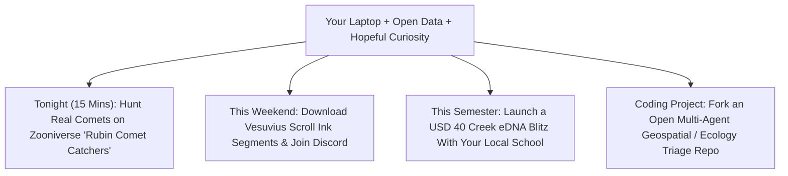

# CARBON EDITION (2026–2035): THE SYNERGY ENGINE & HUMAN AGENCY
## The Amateur Golden Age: How Open Satellites, eDNA & AI Swarms Turn Curious Citizens into Frontier Pioneers

> **The Cynic's Myth vs. The Empirical Reality:** Twentieth-century specialization convinced ordinary people that the Age of Discovery was over for everyone without a tenured university lab, a \$50 million grant, and a decade of institutional gatekeeping—leaving curious students and retirees nothing to do on screens except doomscroll. Yet across **2024–2026**, open public petabyte archives collided with multimodal AI agent swarms to ignite **history's greatest Citizen Science Renaissance**: independent software engineer **Pietro Miotti** deployed **48 parallel AI agents** across $1,200\text{ km}^2$ of public NASA LiDAR in Mexico to flag a hidden cliffside Maya ceremonial complex in under 72 hours (`lidar-agent-citizen-archaeology`); computer-science students **Luke Farritor, Youssef Nader, and Julian Schilliger** read 2,000-year-old carbonized **Herculaneum scrolls** that baffled classicists for 270 years (`vesuvius-scroll-ai-papyrology`); **Vera C. Rubin Observatory** opened 10 million nightly sky alerts to **Zooniverse** patrollers (`rubin-citizen-sky-patrol`); and high-schoolers with \$50 syringe filters mapped blind stygofauna and rare amphibians in local creeks (`citizen-edna-groundwater-atlas`)!

> *"For centuries, those charred scrolls sat unreadable—until open X-ray scans and thousands of brilliant young minds around the world proved that curiosity plus open AI can recover lost libraries."*
> — **Dr. Brent Seales**, Professor of Computer Science, University of Kentucky & Co-Founder, Vesuvius Challenge

---

## 1. Why the 20th-Century Gatekeeper Model Just Flipped Inside Out

Remember the word **"amateur"**? Its Latin root (*amator*) never meant "incompetent"—it meant **"someone who does it for love."** Charles Darwin, Gregor Mendel, Mary Anning, Michael Faraday, and Grote Reber (who built the world's first radio telescope in his Illinois backyard in 1937) were all amateurs!

Why did amateurs get locked out between 1950 and 2020? Because *collecting raw frontier data* required scarce physical instruments—particle accelerators, archaeological helicopters, sequencing centers, and mountaintop mirrors—guarded by institutional queues. Then two quiet revolutions converged by **November 2026**:

1. **Humanity Put Petabytes of Raw Reality Online for \$0:**
   Public mandates turned **NASA GEDI / airborne LiDAR**, **Diamond Light Source synchrotron X-ray scans**, **Vera C. Rubin LSST sky streams**, **ESA Copernicus / Planet Earth mosaics**, and **GenBank / GBIF biodiversity atlases** into free downloadable commons—far more terabytes than the world's few thousand overworked professors could inspect in ten lifetimes!
2. **Multimodal AI Swarms Gave One Curious Laptop the Eyes of 50 Grad Students:**
   In **November 2026**, while traveling in Peru, software engineer **Pietro Miotti** wondered what modern explorers would do with public satellite laser data. Over a single weekend (**<72 hours**), he rendered $1,200\text{ km}^2$ of public NASA LiDAR strips over Campeche/Chiapas jungle terrain and dispatched **48 parallel frontier AI agents** equipped with an archaeological visual rubric to filter out sinkholes and modern roads. The swarm pinpointed a cliffside hilltop featuring an 8-to-12-meter oval pyramid, a leveled plaza, and an ancient reservoir—confirmed by Mexico's **INAH** as missing from the official government administrative register! Even better was the epilogue: when academic Mayanists noted the site had recently appeared in a specialized research paper (*Estrada-Belli et al., 2025*) that the agents' literature search missed, Miotti immediately documented the **independent AI rediscovery** transparently—illustrating the exact **respectful alliance between fast citizen AI scouts and deep-context domain scholars**!

---

## 2. Five Live Frontiers Where Citizens + Open AI Are Making Real Discoveries Today

| Frontier Domain | Open Public Data Engine | Citizen + AI Breakthrough Receipt (2024–2026) | Connected Carbon Pathway |
| :--- | :--- | :--- | :--- |
| **1. Canopy Archaeology** | Public **NASA GEDI / Airborne LiDAR** elevation strips | **Pietro Miotti's Nov 2026 48-agent swarm** independently flagged an unregistered Maya pyramid/plaza complex across $1,200\text{ km}^2$ in `<72 hours`, submitted in Spanish to **INAH**. | [`lidar-agent-citizen-archaeology`](../../02-automation-science/lidar-agent-citizen-archaeology/REPORT.md) |
| **2. Ancient Papyrology** | **Diamond Light Source** $8\text{ }\mu\text{m}$ 3D X-ray CT scroll volumes | **Vesuvius Challenge** students (**Farritor, Nader, Schilliger** + global Discord community) decoded **Philodemus's lost Greek philosophy** from volcanic charcoal without unrolling a page! | [`vesuvius-scroll-ai-papyrology`](../../02-automation-science/vesuvius-scroll-ai-papyrology/REPORT.md) |
| **3. Planetary Sky Patrol** | **Vera C. Rubin LSST** (June 30, 2026 start; 10M alerts/night) | **Zooniverse *Galaxy Zoo: Rubin* & *Rubin Comet Catchers*** pair ML anomaly brokers with 2.7M+ volunteers hunting active comets alongside dwarf planet candidate **2026 ED138**. | [`rubin-citizen-sky-patrol`](../../05-space-frontier/rubin-citizen-sky-patrol/REPORT.md) |
| **4. Biosphere & Aquifer eDNA** | Portable **Oxford Nanopore** metabarcoding + open **GBIF** maps | School classes & watershed volunteers push $1\text{ L}$ of creek or well water through a **\$40 sterile filter**—discovering hidden cave crustaceans, salmon runs, & invasive pests early. | [`citizen-edna-groundwater-atlas`](../../03-bioscience-regeneration/citizen-edna-groundwater-atlas/REPORT.md) |
| **5. Protein & RNA Design** | **AlphaFold DB** (200M+ structures) + **Foldit / Eterna** | Citizen puzzle players co-authored *Nature* papers designing **stabilized mRNA vaccines** (*Eterna OpenVaccine*) and de novo binder proteins alongside university wet labs. | [`protein-atomic-nanofabrication`](../../02-automation-science/protein-atomic-nanofabrication/REPORT.md) |

---

## 3. Saturday Morning in Oaxaca & Glasgow: Replacing Doomscrolling With Frontier Discovery

Meet **Mateo (17, public high-school junior in Oaxaca)** and **Eleanor (68, retired civil drafter in Glasgow)** in **2029**.

In 2023, cultural commentators feared AI would make human minds obsolete—turning teenagers and retirees into passive consumers of synthetic slop. Instead, open science platforms paired with Afternoon Guilds (`two-sigma-guild-education`) and Intergenerational Villages (`intergenerational-villages`) turned every neighborhood library into an active expedition basecamp:

* **09:30 AM — Sampling the Living Watershed:** Mateo's school ecology guild hikes twenty minutes to a cloud-forest spring, draws 500 milliliters of clear water through a pocket syringe filter—harming zero frogs or fish—and drops the metabarcoded eDNA cartridge into a shared municipal sequencer. By Tuesday, their sample reveals a critically endangered salamander thought locally extinct since 1998, triggering automatic watershed conservation credits!
* **03:00 PM — Pairing Youth Speed With Elder Craft:** Online in a shared **Vesuvius / Mayanist Citizen Studio**, Eleanor uses fifty years of architectural drafting intuition to verify subtle eroded terrace alignments flagged by Mateo's 32-agent Python script—co-signing a clean geospatial verification packet for university field archaeologists before looters or bulldozers ever touch the ridge.

---

## 4. Architecture of Ethical Citizen-Scholar-AI Collaboration

```mermaid
flowchart LR
    subgraph RawCommons["Open Public Petabyte Observatories"]
        R1["Vera Rubin 10M/Night Sky Stream + NASA LiDAR"]
        R2["Synchrotron X-Ray Scroll Scans + AlphaFold DB"]
        R3["Community Creek & Aquifer eDNA Barcodes"]
    end
    subgraph ScoutLayer["Citizen + Multi-Agent Scout Swarms"]
        S1["48-Agent Multimodal Triage (Miotti Pattern)"]
        S2["Zooniverse + Vesuvius Discord Global Prizes"]
        S3["High-School Afternoon Guilds & Retiree Studios"]
    end
    subgraph GuardianLoop["Domain Scholar & Heritage Stewardship"]
        G1["Archaeologists & Indigenous Councils Vet & Protect"]
        G2["Exact GPS Fuzzy-Masked Against Heritage Looting!"]
        G3["Co-Authored Papers + Shared Discovery Joy"]
    end
    RawCommons --> ScoutLayer
    ScoutLayer ==> GuardianLoop
```

### Guardrails That Make Amateur Science Beloved by Scholars (Never Adversarial)

A thoughtful archaeologist or astronomer rightly asks: *"Wait—if thousands of amateurs unleash AI agents on LiDAR maps, won't treasure looters raid ancient sites or flood journals with AI hallucinations?"* Three proven 2026 norms solve both risks cleanly:

| Legitimate Domain Risk | 2026 Citizen-Scholar Protocol | Verified Precedent in Action |
| :--- | :--- | :--- |
| **Archaeological Looting of Exposed GPS Coordinates** | **Coordinate Fuzzy-Masking + Direct Registry Filing:** Never post exact sub-kilometer pyramid GPS pins on social media; route candidates privately to national heritage institutes (**INAH**, ministries, & indigenous guardians). | **GlobalXplorer (Sarah Parcak)** & **INAH** confidential heritage-protection workflows. |
| **Rediscovering Already-Published Academic Sites** | **Automated ArXiv / Crossref Geospatial Literature Check + Humble Credit:** Cross-index GIS polygons against academic site databases *before* press headlines, celebrating both novel hits and registry gap-fills! | **Pietro Miotti's Nov 2026 transparent post-mortem** crediting *Estrada-Belli et al. (2025)* while spotlighting official registry sync. |
| **False-Positive Slop Overwhelming Experts** | **Consensus Multi-Human + Physics Thresholds:** Require 10+ independent Zooniverse volunteer confirmations or open-code reproducibility (*Vesuvius ink-detection holdout tests*) before escalating to flagship instruments. | **Zooniverse *Galaxy Zoo*** & **Vesuvius Challenge \$1M+ peer-verified Greek text panels**. |

### Answering Three Honest Questions From Skeptics & Educators

1. **"Won't AI soon do 100% of this science by itself without needing human volunteers?"**
   * Look closely at *why* Zooniverse, the Vesuvius Challenge, and Miotti's LiDAR workflow succeeded: **AI excels at tireless high-volume filtering, while curious humans set creative hypotheses, spot out-of-distribution anomalies, and verify physical edge cases!** Even when AI segments 98% of ink strokes on a charred scroll, passionate human minds choose *which* scroll passages to target, debug subtle CT artifacts, and connect Greek philosophical nuances across centuries.
2. **"Does a student really need an expensive GPU rig to participate?"**
   * Zero local GPU hardware is required! **Zooniverse's *Rubin Comet Catchers*** runs in any mobile browser; the **Rubin Science Platform** executes Python notebooks free inside cloud servers sitting next to the telescope archive; and **Pietro Miotti's entire 48-agent, $1,200\text{ km}^2$ LiDAR sweep** ran over a single weekend using standard consumer API credits costing less than a pair of hiking boots!
3. **"How do public schools fit frontier research into packed K–12 schedules?"**
   * Pair **2-Sigma AI morning mastery** ([`two-sigma-guild-education`](../../04-social-norms/two-sigma-guild-education/REPORT.md))—finishing core reading and math in two focused morning hours—with **Afternoon Discovery Guilds**, giving high-schoolers ten dedicated hours every week to sample local creeks with eDNA, hunt comets, and co-author real papers before graduating!

---

## 5. How Any School, Library, or Family Joins the Amateur Golden Age Tonight

### Four Concrete Weekend Expeditions You Can Start This Month
* **1. Catch a Real Comet From Your Couch (`rubinobservatory.org` / `zooniverse.org`):**
  * Spend twenty minutes after dinner with your kids or friends on **Galaxy Zoo: Rubin** or **Rubin Comet Catchers**—inspecting real 3,200-megapixel Andean sky cutouts taken hours ago.
* **2. Read Unseen Ancient Greek Letters (`scrollprize.org`):**
  * Download a free $8\text{ }\mu\text{m}$ Herculaneum scroll sub-volume tutorial from the **Vesuvius Challenge** open repository and help trace papyrus sheet layers untouched since 79 AD.
* **3. Run a Saturday Watershed eDNA Blitz (`citizen-edna-groundwater-atlas`):**
  * Partner your local scout troop, hiking club, or biology teacher with a community metabarcoding kit—filtering $1\text{ liter}$ of stream water to publish an open biodiversity snapshot of your town's frogs, fish, and pollinators.
* **4. Audit Public Environmental Maps With an Open Agent Swarm:**
  * Point a multi-agent vision script at open **Carbon Mapper** methane plumes (`earth-digital-twin-canopy`), municipal tree-shade canopy gaps, or unregistered heritage terraces—always following responsible disclosure to local stewards.
* **5. Host a Monthly Intergenerational "Open Discovery Night" at Your Public Library:**
  * Pair retired engineers, naturalists, and historians (`intergenerational-villages`) with high-school coding clubs for two hours of pizza and live **Zooniverse / Vesuvius / GBIF** exploration—turning lonely evenings into co-authored neighborhood breakthroughs.
* **6. Open-Access Micro-Grants for Amateur Replications:**
  * Local science museums and civic foundations award fast, zero-overhead **\$500 "Backyard Faraday" micro-grants** (`forty-eight-hour-governance`) covering eDNA filters, cloud credits, or optical adapters for promising student-citizen teams.
* **7. Co-Authorship & Citation Dignity Standards:**
  * Journals and preprints adopt explicit Zooniverse / Scroll Prize contributor attribution badges—ensuring teenagers, schoolteachers, and retirees who spot frontier anomalies receive permanent, citable credit in the scientific record.

Look at what this cross-pillar convergence means for human meaning (`post-labor-meaning`, `cynicism-to-agency`):

1. **AI Didn't Replace Human Curiosity—It Handed Every Citizen a Telescope and a Lab:**
   When routine drudgery is handled by 48 parallel agents, a curious human with a weekend free can ask real questions about Mayan cities, outer-solar-system comets, Greek philosophy, and underground life.
2. **Healing the Rift Between "Experts" and "The Public":**
   Anti-science populism thrives when science feels like a closed priesthood lecturing outsiders. When millions of ordinary families co-author discoveries alongside university labs, public trust in empirical truth soars!
3. **Turning Screens From Slot Machines Into Starships:**
   Give a fourteen-year-old an outrage feed and they grow anxious; give them live Cerro Pachón sky frames and a shot at naming a real comet, and they fall in love with reality.
4. **Closing Answer to the Cynic:**
   Next time someone tells you *"all the great discoveries are behind paywalls and ordinary people don't matter in the age of AI,"* point to a 21-year-old reading volcanic charcoal from Herculaneum and 48 agents scanning jungle canopy from a laptop: **the Golden Age of the Amateur has just begun.**

---

## References & Verified Sources

* **Featured Researcher / Leader:** [Dr. Brent Seales — Professor of Computer Science, Univ. of Kentucky & Co-Founder, Vesuvius Challenge](https://scrollprize.org/)
* **Companies, Labs & Consortia:** [Vesuvius Challenge (Scroll Prize)](https://scrollprize.org/) · [Pietro Miotti — 48-Agent Maya LiDAR Experiment](https://pietromiotti.com/latest/maya-site/) · [Zooniverse (Galaxy Zoo: Rubin & Rubin Comet Catchers)](https://www.zooniverse.org/) · [NSF–DOE Vera C. Rubin Observatory](https://rubinobservatory.org/) · [eBioAtlas / NatureMetrics & GBIF](https://www.gbif.org/) · [Eterna & Foldit Citizen Biochemistry](https://eternagame.org/)
* **Global & Regulatory Precedents:** [Vesuvius Challenge Grand Prize Decoding of Herculaneum Papyri (2024–2026)](https://scrollprize.org/) · [Pietro Miotti Nov 2026 1,200 km² NASA LiDAR Multi-Agent Triage & INAH Registry Report](https://pietromiotti.com/latest/maya-site/) · [UNESCO Recommendation on Open Science & Indigenous Heritage Protection](https://www.unesco.org/en/open-science)
* **Connected Carbon Pathways:** [Canopy LiDAR & Multi-Agent Citizen Archaeology](../../02-automation-science/lidar-agent-citizen-archaeology/REPORT.md) · [Reading Burnt Libraries: Vesuvius Scroll X-Ray AI Papyrology](../../02-automation-science/vesuvius-scroll-ai-papyrology/REPORT.md) · [Filming the Cosmic Time-Lapse: Vera C. Rubin LSST & Citizen Sky Patrols](../../05-space-frontier/rubin-citizen-sky-patrol/REPORT.md) · [Hidden Aquifers & Citizen eDNA Biodiversity Atlases](../../03-bioscience-regeneration/citizen-edna-groundwater-atlas/REPORT.md) · [2-Sigma AI Mastery + Afternoon Craft Guilds](../../04-social-norms/two-sigma-guild-education/REPORT.md)
