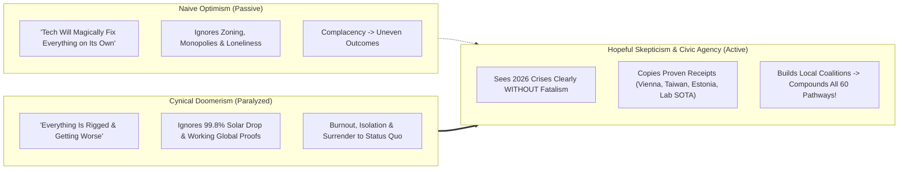
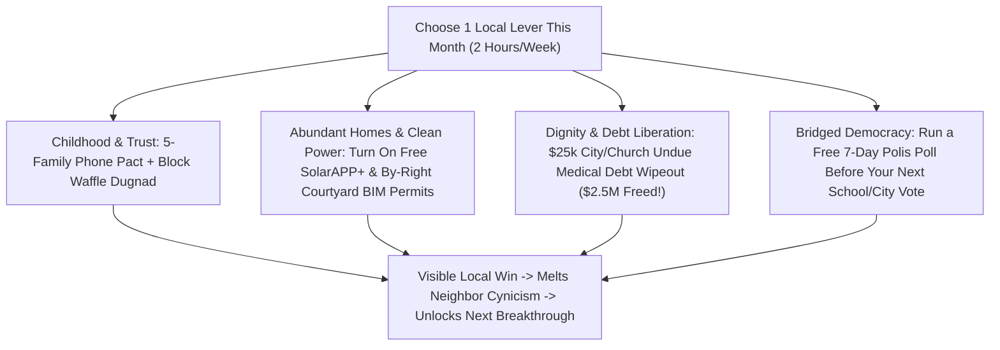

# CARBON EDITION (2026–2035): THE SYNERGY ENGINE & HUMAN AGENCY
## The Antidote to Doomerism: Why Cynicism Feels Smart, Why It's Empirically Wrong, and How We Build

> **The Cynic's Myth vs. The Empirical Reality:** Modern culture treats cynicism and doomerism as badges of sophistication—assuming that anyone who expects humanity to heal the biosphere, cure disease, or upgrade civic institutions must be naive. Yet landmark psychological and historical evidence proves the exact opposite: **Stanford professor Jamil Zaki's research** reveals that cynics actually score *lower* on cognitive reasoning and social accuracy ("the cynic illusion"), while **Hans Rosling** and **Hannah Ritchie's** global datasets prove humanity has *already* solved "impossible" crises—healing the **Ozone Layer**, cutting **acid rain 90%+**, slashing **global child mortality by 75%+**, and driving **solar photovoltaic costs down 99.8% since 1976**!

> *"Cynicism masquerades as wisdom, but hope is not naive optimism—hopeful skepticism sees problems clearly and refuses to surrender our collective power to solve them."*
> — **Prof. Jamil Zaki**, Professor of Psychology, Stanford University & Author of *Hope for Cynics*

---

## 1. Unmasking "The Cynic Illusion": Why Doomerism Feels Smart When It's Wrong

Have you ever noticed how, at a dinner party or in an online comment thread, the person who sighs *"Nothing will ever change—politicians are all bought, corporations will hoard fusion, and humanity is doomed"* instantly sounds streetwise and worldly, while the engineer or civic organizer explaining a working breakthrough has to fight not to look gullible?

At **Stanford University's Social Neuroscience Lab**, psychologist **Prof. Jamil Zaki** put that cultural reflex to the empirical test across tens of thousands of subjects—and uncovered one of the most liberating findings of our era, **The Cynic Illusion**:

1. **People Mistake Cynicism for Intelligence—Yet the Data Shows the Opposite:** When surveyed, **70% of people guess** that a cynical person will outperform a trusting person on cognitive and lie-detection tasks. When researchers analyzed actual longitudinal datasets of 200,000+ individuals across 30 countries (Stavrova & Ehlebracht), **less cynical people scored significantly higher on cognitive ability, verbal comprehension, and analytical reasoning**—and were *better*, not worse, at spotting actual fraudsters because cynics lazily assume *everyone* is corrupt instead of paying close attention to evidence!
2. **We Underestimate Our Neighbors' Decency by Nearly $2\times$:** In famous "lost wallet" field experiments conducted across **355 cities in 40 countries** (*Science*, Cohn et al., 2019—leaving 17,000+ wallets containing cash and contact info on counters), citizens and even professional economists predicted people would pocket the money. In reality, **the more cash a lost wallet held, the MORE likely strangers were to track down the owner and return every dime (72% return rate for wallets with ~\$94 cash!)**.
3. **Why Doomerism Is Status Quo Armor:** Cynicism is emotionally seductive because it is *safe against disappointment*—if you declare the game rigged in advance, you never have to risk trying, organizing, or caring. Tragically, **doomerism acts as unpaid PR for extractive incumbents**: when young citizens believe climate action, housing abundance, or democratic reform is "impossible," they stay home—turning a false prophecy into a self-fulfilling surrender.

---

## 2. Four Times Cynics Said "Humanity Will Never Fix That"—And Humanity Fixed It

Whenever a voice in your head says *"Sure, the physics in this Atlas works, but human politics and greed will never let us scale it,"* hold up four hard, verified global receipts tracked by **Hans Rosling (*Factfulness*)**, **Max Roser (*Our World in Data*)**, and **Dr. Hannah Ritchie (*Not the End of the World*)**:

| "Impossible" Global Crisis | What Doomers Predicted at the Peak | How Humanity Actually Solved It | Verified Empirical Receipt (Nov 2026) |
| :--- | :--- | :--- | :--- |
| **1. The Antarctic Ozone Hole (1985)** | *"Chemical lobbies will block CFC bans forever; global treaties can't enforce compliance; Earth's UV shield will collapse."* | Scientists sounded the alarm; **every single nation on Earth (197/197)** ratified the **1987 Montreal Protocol**, phasing out **99%+ of ozone-depleting substances** via clean chemical substitutes. | UN/WMO atmospheric monitoring confirms the **Ozone Layer is healing steadily on schedule** for full recovery—also avoiding an extra ~0.5°C–1.0°C of global warming as a bonus! |
| **2. Acid Rain Dying Forests & Lakes (1980s)** | *"Coal utilities will never pay billions for smokestack scrubbers; forests across North America and Europe are finished."* | Bipartisan **1990 U.S. Clean Air Act Amendments** + European protocols paired strict sulfur-dioxide ($\text{SO}_2$) caps with flexible trading, unleashing cheap scrubber innovation at **one-fourth of predicted cost**. | $\text{SO}_2$ acid-rain emissions fell **94% in the U.S. and 85%+ across Europe** while GDP grew $2.5\times$; Adirondack and Scandinavian lakes came roaring back to life. |
| **3. Global Child Mortality & Smallpox** | *"Rapid population growth dooms billions to inevitable famine and infectious-disease tragedy."* | Public sanitation, oral rehydration salts, WHO vaccination rings, vaccines, and maternal literacy scaled across every income tier on Earth. | **Smallpox eradicated (0 cases since 1977)**; global under-5 child mortality plunged **more than 75% since 1960**—saving **100+ million children's lives** in a single generation. |
| **4. Solar Power ("Too Expensive Forever")** | Every year from 2002 to 2022, mainstream forecasts predicted solar growth would flatten out as an expensive niche toy. | Wright's Law manufacturing curves + German *Energiewende* demand + global wafer/perovskite engineering drove relentless 24% learning-rate drops per doubling. | Solar PV module costs plunged **99.8% since 1976** (from >\$100/W to **<\$0.09/W** in 2026), installing **over 600+ GW/year globally**—now the cheapest electricity in human history! |

Read those four rows twice. We did not achieve those victories because human beings in 1987 or 1990 were faultless saints. We achieved them because **determined scientists, engineers, mayors, and ordinary citizens practiced "Hopeful Skepticism"**—refusing both complacent wishful thinking ("things will fix themselves") and lazy doomer surrender ("nothing matters").

---

## 3. From Doomscroller to Builder: Maya's Year in Tacoma (2027–2028)

Meet **Maya (26, a structural drafter)** in **Tacoma, Washington**.

In November 2026, Maya was the textbook portrait of intelligent modern burnout. Every night from 10:30 PM to midnight, she lay in bed reading viral threads about housing unaffordability, climate dread, loneliness, and AI angst. She cared fiercely about the world—which made her feel utterly helpless. When a coworker invited her to a neighborhood housing-and-transit meetup, Maya almost texted back: *"What's the point? NIMBYs always win anyway."*

Instead, Maya remembered reading Jamil Zaki's rule—**treat trust and agency as a scientific experiment you run in your own zip code**:

* **Experiment 1 (Month 1 — Deleting the Rage Lens):** Maya moved social apps off her home screen, switched to a C2PA/bridged reader (`04-social-norms/bridging-consensus-trust`), and showed up with a thermos of tea to a rainy Tuesday meeting of **14 neighbors** pushing for Tacoma's **Pre-Approved Mass-Timber Courtyard Ordinance** (`04-social-norms/forty-eight-hour-governance`).
* **Experiment 2 (Month 4 — Bridging Instead of Fighting):** Instead of shouting at older homeowners worried about neighborhood character, Maya used her drafting tablet to sketch gentle three-story cedar courtyard cottages modeled on historic Pacific Northwest bungalows, and ran a **7-day neighborhood Polis poll**. To her shock, **84% of both renters and retired homeowners voted green** once Wall Street landlord LLCs were excluded (`04-social-norms/sovereign-debt-jubilee`).
* **Experiment 3 (Month 11 — Tangible Steel & Timber):** Eleven months after she nearly stayed in bed doomscrolling, Maya stood on 6th Avenue in a yellow hard hat watching a crane lower the first **cross-laminated timber garden apartment** onto a former vacant tire lot—creating eighteen \$780/month homes, a corner espresso porch, and six street cherry trees.

Maya's resting heart rate dropped, she met her partner at the Saturday block *Dugnad* waffle table (`04-social-norms/high-trust-civic-norms`), and six cynical friends from her office asked how they could join the next site. **Action didn't follow hope—hope erupted out of action.**

---

## 4. Comparing the Three Mindsets: Naive Optimism vs. Cynicism vs. Hopeful Agency

### Empirical Scoreboard: Perception vs. Verified Global Reality

| Question Asked to the Public (Gapminder / OWID) | What Cynical Intuition Guesses | Verified Empirical Reality (2026 SOTA) | Why the Gap Exists |
| :--- | :--- | :--- | :--- |
| **"Share of humans living in extreme poverty vs. 1990?"** | *55%+ of respondents guess it **doubled*** | **Fell by >75%** (from 38% to <8.5% of humanity) | Breaking news reports sudden crashes, never slow daily triumphs |
| **"Did global per-capita $\text{CO}_2$ emissions peak yet?"** | *"Still exploding uncontrollably everywhere"* | **Peaked over a decade ago in OECD**; clean power additions now outbuild fossil **>5-to-1** | Exponential S-curves look tiny right until the inflection knee |
| **"If you drop a wallet with \$94 cash, what % return it?"** | *People predict **<25%*** | **72% returned intact** across global cities (*Science*, 2019) | Media highlights rare crimes; millions of daily kindnesses go unfilmed |
| **"Can cross-partisan citizens agree on tech/zoning rules?"** | *"Never—society is 50/50 irreconcilable"* | **80%+ consensus** routinely achieved on *Polis* & Citizens' Assemblies | Outrage feeds amplify the loudest 6% of accounts |

---

## 5. Your 30-Day Citizen Agency Playbook: Pick One Lever Where You Live

You do not have to personally build a 20-Tesla tokamak or synthesize a CRISPR lipid nanoparticle to accelerate the Carbon Edition future. **Every single physical breakthrough in Pillars 1, 2, 3, and 5 scales twice as fast when everyday citizens unlock Pillar 4 social norms in their own town.**

Pick **just one** concrete, high-joy lever from this menu this month:

### Answering the Three Final Doubts in the Reader's Mind

1. **"Isn't celebrating progress disrespectful to people genuinely suffering from rent, illness, or war right now?"**
   * As **Hannah Ritchie** and **Hans Rosling** framed so memorably, **two truths MUST be held in the mind at the exact same time**: *"The world is still full of urgent, unacceptable suffering—AND the world is much better than it was, which proves it can become vastly better still!"* Recognizing that we cut child mortality by 75% never minimizes the tragedy of children still at risk; it proves **suffering is solvable, so we have zero excuse to quit**.
2. **"What can one ordinary person really change against giant structural forces?"**
   * Every global norm in this Atlas started with a surprisingly small group of stubborn, cheerful humans: *Undue Medical Debt* began with **two former debt-collection executives** realizing they could buy and forgive hospital bills for pennies; *Smartphone Free Childhood* exploded from **one WhatsApp group started by two moms in England** to hundreds of thousands of families in weeks; *SolarAPP+* can be switched on by **one municipal building director** in an afternoon.
3. **"How do I protect my own mental health from sliding back into doomscrolling?"**
   * Trade *global passive consumption* for *local embodied construction*. Spend **90% less time** reading hot takes about national politics at midnight, and **two hours a week** building something tangible alongside neighbors whose first names you know—planting shade trees on a school street, mentoring in an Afternoon Guild ([`two-sigma-guild-education`](../../04-social-norms/two-sigma-guild-education/REPORT.md)), or locking phones in a weekend Sabbath Box ([`sacred-worth-contemplation`](../../04-social-norms/sacred-worth-contemplation/REPORT.md)).

### Six Concrete Experiments in Hopeful Agency You Can Run This Month

Before closing this Atlas, choose **one** concrete two-hour experiment from across the six pillars and run it in your own neighborhood over the next thirty days:

* **1. Erase \$1,000,000 of Neighbors' Medical Debt for \$10,000 ([`sovereign-debt-jubilee`](../../04-social-norms/sovereign-debt-jubilee/REPORT.md)):**
  * Pitch a weekend fundraiser at your congregation, service club, employer, or city council with *Undue Medical Debt*—turning \$10,000 into a million dollars of bright yellow debt-abolition letters arriving in local mailboxes.
* **2. Switch On Zero-Second Solar Permits in Your Town ([`forty-eight-hour-governance`](../../04-social-norms/forty-eight-hour-governance/REPORT.md) & [`perovskite-tandem-solar`](../../01-abundant-energy/perovskite-tandem-solar/REPORT.md)):**
  * Email your municipal building director and one city councilor a two-paragraph link to the U.S. Department of Energy's free **SolarAPP+** platform—cutting local solar/battery permit delays from a month to zero seconds at \$0 taxpayer cost.
* **3. Spark a 5-Family Phone-Free Pact & Block Waffle *Dugnad* ([`high-trust-civic-norms`](../../04-social-norms/high-trust-civic-norms/REPORT.md)):**
  * Text four parents in your kid's class tonight to delay smartphones together until 14, and put out two sawhorse tables and a waffle iron next Saturday morning after sweeping your street's storm drains.
* **4. Propose an Opt-In "2-Sigma + Afternoon Guild" Pilot Classroom ([`two-sigma-guild-education`](../../04-social-norms/two-sigma-guild-education/REPORT.md)):**
  * Share Benjamin Bloom's 2-Sigma data and *Khanmigo* / *Alpha School* growth benchmarks with two enthusiastic teachers and your PTA—trading K–8 nightly worksheet battles for afternoon woodworking, ecology, and theater guilds.
* **5. Run a Free 7-Day *Polis* Bridge Poll on a Local Deadlock ([`bridging-consensus-trust`](../../04-social-norms/bridging-consensus-trust/REPORT.md)):**
  * Before your campus, HOA, or town council fights at a podium mic over housing or bike lanes, spin up a free `pol.is` board and watch the quiet **80% common ground** light up green.
* **6. Legalize Turning One Dead Strip Mall Into a Courtyard Village ([`intergenerational-villages`](../../04-social-norms/intergenerational-villages/REPORT.md)):**
  * Bring five young renters and five empty-nest seniors together to champion a one-page **By-Right Greyfield Courtyard Village Overlay**—replacing sun-baked asphalt with mass-timber starter homes, lemon trees, and shared \$4.50 Thursday suppers.

### Five Daily Mental Habits of the "Hopeful Skeptic" (Jamil Zaki + Hans Rosling)
To inoculate yourself permanently against both gullible hype and paralyzing doomerism, practice five simple cognitive habits:

* **1. Demand Denominators & Multi-Decade Baselines (*Factfulness*):**
  * Whenever a headline screams crisis, ask: *"Compared to 1990 or 2015, is the per-capita trend rising or falling—and where on Earth has a country or city already bent this curve?"*
* **2. Audit Your Own "Cynic Reflex" in Conversations:**
  * Notice the ego boost of sounding jaded at dinner—and replace *"They'll never let that happen"* with *"Wait—Denmark, Taiwan, or Fervo is already doing this; what specific local rule blocks us from copying it?"*
* **3. Treat Neighbor Trust as a Small Bet Worth Running:**
  * Remember the 17,000 lost wallets: loan a tool, host a driveway cider hour, or ask a stranger for advice—letting real human warmth overwrite media threat bias.
* **4. Separate Physical Possibility from Temporary Institutional Habit:**
  * Only thermodynamics is permanent; 29% credit cards, 3-year solar permits, and outrage algorithms are recent human inventions we can rewrite in a single legislative session.
* **5. Measure Your Diet of Midnight News vs. Saturday Building:**
  * Keep a healthy 1-to-4 ratio: for every thirty minutes spent reading about global problems, spend two hours building a local solution with people whose faces you can see.

### Essential Anti-Doomerism Library (Verified Empirical Sources)
* **Prof. Jamil Zaki (Stanford University, 2024):** *Hope for Cynics: The Surprising Science of Human Goodness*.
* **Dr. Hannah Ritchie (Oxford / Our World in Data, 2024):** *Not the End of the World: How We Can Be the First Generation to Build a Sustainable Planet*.
* **Hans Rosling, Ola Rosling & Anna Rosling Rönnlund:** *Factfulness: Ten Reasons We're Wrong About the World—and Why Things Are Better Than You Think*.
* **Cohn, Maréchal, Tannenbaum & Zoli (*Science*, 2019):** *Civic Honesty Around the Globe* (the 40-country, 17,303-wallet field experiment).

### Closing Invitation: One of Many
Why is this project named **OneOfMany**?

Because the future is not a single predetermined train track hurtling toward dystopia. Out of the vast branching tree of physically possible 2035s, **a delightfully abundant, restorative, high-trust, peaceful human civilization is 100% allowed by the laws of physics, proven in working pieces across Earth today, and waiting for us to choose it.**

Cynicism is the easiest posture in the world—and the dullest. Close the doomscroll tab, share one working receipt from these sixty pathways over dinner tonight, and go build your corner of a magnificent tomorrow.

---

## References & Verified Sources

* **Featured Researcher / Leader:** [Prof. Jamil Zaki — Professor of Psychology, Stanford University & Author of Hope for Cynics](https://ssnl.stanford.edu/)
* **Companies, Labs & Consortia:** [Stanford Social Neuroscience Lab (Prof. Jamil Zaki)](https://ssnl.stanford.edu/) · [Our World in Data (Oxford — Max Roser & Dr. Hannah Ritchie)](https://ourworldindata.org/energy) · [Gapminder Foundation (Hans Rosling — Factfulness)](https://www.gapminder.org/) · [UNEP / WMO Ozone Secretariat](https://ozone.unep.org/) · [Science Global Civic Honesty Consortium (Cohn et al.)](https://www.science.org/doi/10.1126/science.aau8712) · [Solutions Journalism Network](https://www.solutionsjournalism.org/)
* **Global & Regulatory Precedents:** [1987 Montreal Protocol (197/197 Nations; 99%+ CFCs Phased Out; Ozone Healing)](https://ozone.unep.org/treaties/montreal-protocol) · [1990 Clean Air Act (-94% U.S. Acid Rain SO2 at 1/4th Predicted Cost)](https://www.epa.gov/acidrain/acid-rain-program) · [Global Under-5 Child Mortality Cut >75% & Smallpox Eradicated (100M+ Saved)](https://ourworldindata.org/child-mortality) · [Solar PV 99.8% Price Drop Since 1976 (Beating 20 Straight Years of Forecasts)](https://ourworldindata.org/cheap-renewables-growth)
* **Connected Carbon Pathways:** [The Household Abundance Dividend: How Energy × Robotics × Bio Slashes Family Costs 70%](../cost-of-living-collapse/REPORT.md) · [Algorithms That Reward Common Ground Instead of Outrage](../../04-social-norms/bridging-consensus-trust/REPORT.md) · [From Cynical Atomization to High-Trust Joy: Everyday Norms That Change Everything](../../04-social-norms/high-trust-civic-norms/REPORT.md) · [The 48-Hour Digital State: Estonia X-Road, Physics Permits & 5-Minute Justice](../../04-social-norms/forty-eight-hour-governance/REPORT.md) · [Defusing the Household Debt Trap: 1.5% Homestead Mortgages & Medical Debt Abolition](../../04-social-norms/sovereign-debt-jubilee/REPORT.md) · [Compact Commercial Fusion](../../01-abundant-energy/fusion-power/REPORT.md)
