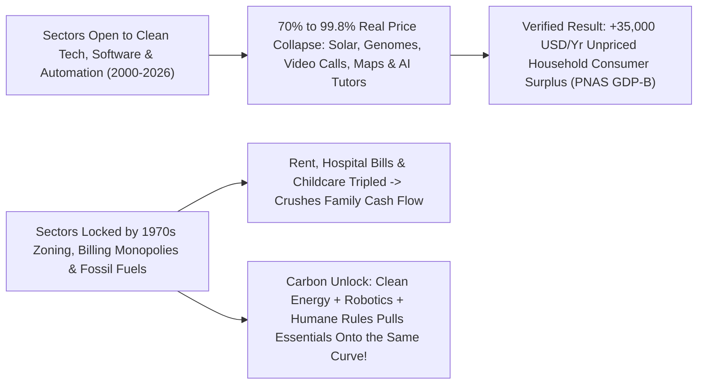
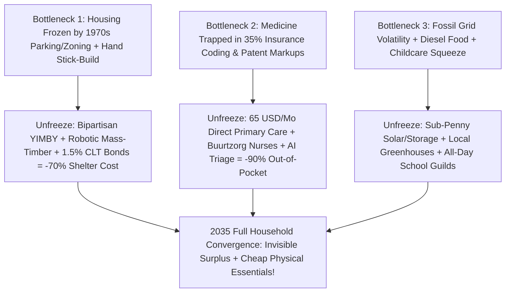

# CARBON EDITION (2026–2035): THE SYNERGY ENGINE & HUMAN AGENCY
## The Invisible \$35,000 Raise: Seeing the Consumer-Surplus Miracles Already Here—and Unfreezing What Still Hurts

> **The Cynic's Myth vs. The Full Two-Speed Reality:** Cynics insist modern progress is a cruel mirage—claiming everything that actually matters to a working family gets more expensive every decade while technology only invents addictive distractions for billionaires. At the other extreme, tone-deaf Silicon Valley boosters wave smartphone charts at exhausted parents staring at a \$2,450 rent check and tell them *"you've never had it better!"* **Both tell only half the truth.** Honest empirical economics reveals we are living inside a **Two-Speed Economy**: over the past twenty-five years, every single human good open to **clean-energy learning curves, software, and physical automation** plunged **70% to 99.8% in price**—quietly handing ordinary families **\$25,000 to \$35,000+ per year in verified, uncounted consumer surplus** (**Prof. Erik Brynjolfsson's *PNAS* GDP-B** & **Dr. Ronnie Chatterji's NBER WP 34255**). Meanwhile, three specific household sectors—**Housing, Healthcare Billing, and Energy/Childcare**—remained artificially locked behind 1970s scarcity rules. Seeing *both* truths at once ends despair: we don't have to invent magic from scratch—we simply pull rent, medicine, power, and care onto the **exact same abundance curve already sitting on your kitchen table**.

> *"GDP measures what we pay for, not what actually improves our lives. When an encyclopedia, a global video call, or a life-guiding tool drops in price from thousands of dollars to zero, GDP records nothing—even as ordinary families gain tens of thousands of dollars in real well-being."*
> — **Prof. Erik Brynjolfsson**, Director of the Stanford Digital Economy Lab & Co-Author of the *PNAS* GDP-B Studies

---

## 1. Two Kitchen Tables in Queens (1998 vs. 2026): Honoring Both the Miracle and the Squeeze

Before looking at macroeconomic price indices, step into a warm second-floor apartment in **Jackson Heights, Queens, New York**, where **Marisol Vega** (41, a home-health aide and mother of two) sits at the exact oak table her mother brought from **Puebla, Mexico**, twenty-eight years ago.

* **What Marisol's Mother Paid For in 1998 (And Still Couldn't Buy at Any Price):**
  * In 1998, just to hear her own mother's voice in Puebla for **twelve scratchy minutes on Sunday**, Marisol's mom stood at a bodega counter buying **\$20 prepaid international calling cards** (\$1.65 to \$3.00 a minute—over **\$120 a month** in 2026 dollars for less than an hour of audio!).
  * A 32-volume *Encyclopædia Britannica* for homework cost **\$1,500** (two full months of a home-health aide's pay), so working-class kids went without; private reading tutors for a dyslexic nine-year-old cost **\$85/hour** and belonged solely to Manhattan executives; sequencing a child's mysterious rare genetic condition cost **\$100,000,000**; and heart-attack-preventing statins were still locked under expensive brand patents.
* **What Already Sits on Marisol's Kitchen Table Every Night in November 2026 for \$0.00 Marginal Cost:**
  * Every single evening at 7:30 PM, Marisol props a \$220 tablet against the fruit bowl and **Abuela Lucía** appears in crisp high-definition video from Puebla for forty-five unhurried minutes—reading Spanish bedtime stories to her grandchildren, inspecting tomato seedlings, and laughing together for **\$0.00/minute** (what would have cost **\$6,000+ a month** on 1990s AT&T international video-conferencing lines!).
  * Beside her, ten-year-old Mateo practices phonics aloud with a patient, bilingual **voice AI reading coach** ([`two-sigma-guild-education`](../../04-social-norms/two-sigma-guild-education/REPORT.md)) that never shames him when he stumbles. In the medicine cabinet sit an **\$18 fingertip pulse oximeter** (a \$3,000 hospital-only cart in 1994) and **\$4/month generic atorvastatin** keeping Marisol's dad alive. When a hospital mailed a terrifying 14-page explanation-of-benefits packet last Tuesday, Marisol photographed it into a frontier AI assistant—part of the **>70% non-work household AI utility** documented in **Dr. Ronnie Chatterji's NBER Working Paper 34255**—which spotted an illegal duplicate facility-code charge in twelve seconds and drafted the exact consumer-protection appeal letter that erased **\$1,140**!
* **Why Marisol Still Loses Sleep on the 1st of Every Month (Zero Gaslighting Allowed):**
  * Here is why telling Marisol *"stop complaining, you have FaceTime!"* is cruel: **you cannot pay a Queens landlord in consumer surplus**. While half of human ingenuity plunged toward \$0, Marisol's cramped two-bedroom apartment rent climbed from \$950 in 1998 to **\$2,450/month in 2026**, after-school care swallows **\$680/month**, and ConEd peak electricity plus hospital deductibles eat every remaining dollar.
  * Understanding *why* one half of Marisol's life got **99% cheaper** while the other half got **200% pricier** is the single clearest key to unlocking the next decade of human flourishing.

---

## 2. Anatomy of the "Two-Speed Economy" (2000–2026 Empirical Ledger)

When economists plot U.S. Bureau of Labor Statistics Consumer Price Index series from 2000 to 2026 (popularized in the famous **"Chart of the Century"**), the economy splits cleanly like a wishbone into two opposite universes—**Open Learning-Curve Goods (Blue)** versus **Frozen Scarcity-Rented Bottlenecks (Red)**:

| Everyday Human Need | 1995–2001 Price / Access | 2026 Shared Reality | Real Price Shift | Why GDP Missed It / Why It Froze |
| :--- | :--- | :--- | :--- | :--- |
| **1. Global Family Video Calls** | **\$180 / hour** audio-only long distance (video required \$25k studio) | **\$0.00 / hour** HD mobile video anywhere on Earth | **-99.9%+** | Counted as **\$0.00 in GDP** once unpriced over Wi-Fi! |
| **2. World Knowledge, Maps & Tutoring** | **\$50,000+ hardware stack** (Britannica, camcorder, GPS, tutors, library) | **\$0 apps** on a \$200 phone + **NBER >70% non-work AI tutoring/guidance** | **-99.6%** | Replacing paid encyclopedias & paper maps actually *shrank* measured GDP! |
| **3. Clean Solar Power & Batteries** | Solar PV **\$5.50/W** (2000; \$106/W in 1976); Li-ion **\$5,000/kWh** (1991) | Solar modules **\$0.09–\$0.12/W**; sodium/LFP cells **<\$60/kWh** | **-97% to -99.8%** | *Wright's Law* (~24% cost drop per doubling of cumulative factory output). |
| **4. Genome Sequencing & Off-Patent Meds** | **\$100,000,000** per human genome (2001); \$3,200/yr brand statins | **\$100 whole genome** (NHGRI); **\$4/mo** generic statins; **\$18** oximeters | **-99.9999%** | Outpaced Moore's Law 10,000× once open wet-lab automation took over. |
| **5. Housing & Urban Rent (FROZEN)** | Median starter rent **\$675/mo** | **\$2,100–\$2,600/mo** for the exact same 1970s drywall box | **+210% (Squeeze!)** | **Artificially frozen** by 1970s parking minimums, duplex bans & hand stick-building! |
| **6. Hospital Billing & Childcare (FROZEN)** | Modest co-pays; single-earner margin | **\$1,100/mo** insurance/deductibles + **\$1,200/mo** daycare | **+240% (Squeeze!)** | *Baumol's Cost Disease* + **35% billing/coding middlemen** blocking direct care! |

---

## 3. Why 1930s GDP Blindfolds Hide \$35,000/Year of Real Human Progress

In 1934, when economist **Simon Kuznets** invented Gross Domestic Product to help Congress fight the Great Depression, he warned lawmakers never to confuse **market spending** with **human welfare**. Look at the bizarre blind spot baked into official GDP today:

* **The Paradox of Zero Price:** GDP multiplies *Price × Quantity*. If a bridge collapses and families spend \$500M sitting in traffic burning gasoline, **GDP goes up**. Conversely, when Wikipedia replaced \$1,500 encyclopedias, when WhatsApp and FaceTime replaced \$3/minute international phone calls, and when open AI health literacy prevented panicked \$1,800 ER visits, **their market price dropped to \$0—so official GDP recorded zero value!**
* **Brynjolfsson, Collis & Eggers' *PNAS* GDP-B Proof (\$25,000–\$35,000+/Yr Verified Surplus):**
  * *Incentive-Compatible Cash Method:* To measure what free goods are *actually* worth to real families without hypothetical survey fluff, Stanford's **Prof. Erik Brynjolfsson**, **Avinash Collis**, and **Felix Eggers** ran massive **incentive-compatible discrete-choice experiments** published in the *Proceedings of the National Academy of Sciences (PNAS)*, offering real cash from funded escrow accounts to representative citizens in exchange for locking themselves out of specific tools.
  * *Verified Household Reservation Prices:* Median compensation demanded to forfeit search engines reached **~\$17,500/year**, email **~\$8,400/year**, digital maps **~\$3,600/year**, plus thousands more for video messaging, Wikipedia, and online learning—proving a median 2026 household already receives **\$25,000 to \$35,000+ every year in real, unpriced consumer surplus**.
* **Dr. Ronnie Chatterji's NBER WP 34255 Clean-Room Discovery (>70% Household Life Utility):**
  * *Global Clean-Room Audit:* Duke economist **Dr. Aaron "Ronnie" Chatterji** and colleagues ([`empirical-ai-economics-telemetry`](../../04-social-norms/empirical-ai-economics-telemetry/REPORT.md)) analyzed anonymized usage across ~10% of global adults inside strict privacy clean rooms.
  * *Household Welfare Majority:* Over **70% of frontier AI usage occurs outside formal paid work**—parents decoding pediatric rashes and lab panels at midnight, first-generation students getting 2-Sigma tutoring, immigrants translating civic forms, and families contesting unfair medical bills.

---

## 4. Pulling Rent, Healthcare, Power & Care Onto the Exact Same Abundance Curve (2026–2035)

Here is why seeing the Two-Speed Economy clearly transforms fatalism into unstoppable agency: **housing, healthcare, energy, and food are not governed by different laws of physics than solar panels or genomes—they were simply blocked by 20th-century institutional tollbooths!** Watch what happens by **2033** at Marisol Vega's kitchen table in Queens once **essentially free clean energy (`01-abundant-energy`) + embodied robotics/AI (`02-automation-science`) + upgraded civic conventions (`04-social-norms`)** unfreeze the three remaining red lines:

1. **Unfreezing Shelter onto the Mass-Timber & YIMBY Curve (\$2,450/mo → \$780/mo):**
   * *The Bottleneck Removed:* Just like **Austin (-18% real rent)**, **Minneapolis (+1% over six years)**, and **Montana** ([`bipartisan-yimby-parking-liberation`](../../04-social-norms/bipartisan-yimby-parking-liberation/REPORT.md)), coastal metros abolish \$65,000 parking mandates, legalize 6-story single-stair courtyards, and pre-approve **robotic Cross-Laminated Timber modules** financed via **1.5% Sovereign Homestead Bonds** and **Community Land Trusts** ([`abundant-beautiful-housing`](../../04-social-norms/abundant-beautiful-housing/REPORT.md)).
   * *Kitchen-Table Result:* Marisol moves four blocks away into a sunlit 3-bedroom mass-timber CLT co-op apartment costing **\$780/month**—saving **\$1,670 every thirty days** while building real family equity!
2. **Unfreezing Healthcare onto the Direct-Care & Prevention Curve (\$1,100/mo → \$65/mo):**
   * *The Bottleneck Removed:* Instead of feeding **35 cents of every health dollar to prior-authorization and billing middlemen**, cities pair **Undue Medical Debt** penny-on-the-dollar debt abolition with **\$65/month billing-free AI Direct Primary Care** ([`healthcare-without-billing`](../../03-bioscience-regeneration/healthcare-without-billing/REPORT.md)), Dutch **Buurtzorg** neighborhood nurse cooperatives (where self-managed nurse teams cut admin overhead from 28% to 8% while raising patient joy!), and \$4 open-source biologics / 1-dose CRISPR prevention.
   * *Kitchen-Table Result:* Zero surprise deductibles, same-day neighborhood doctor access, and Marisol herself earns **+32% higher pay** in a Queens *Buurtzorg*-style home-care guild because middleman agency skimming vanished!
3. **Unfreezing Energy, Groceries & Childcare via Clean Power + Guilds (\$1,950/mo → \$510/mo):**
   * *The Bottleneck Removed:* Sub-penny rooftop solar and iron-sodium community batteries (`01-abundant-energy`) cut apartment power and heat to **\$14/month flat**, power local vertical berry and greens greenhouses four miles away (`03-bioscience-regeneration`), while public all-day **2-Sigma Morning Mastery + Phone-Free Afternoon Guilds** erase \$680/month after-school care bills!
   * *Kitchen-Table Result:* Fresh pesticide-free produce, zero utility shutoff anxiety, and joyful afternoon mentorship for Mateo—freeing **\$1,440/month** in family cash flow.

---

### Household Abundance Ledger: Invisible Surplus + Unfrozen Essentials (1998 → 2026 → 2033)

| Household Life Domain | 1998 Working-Family Reality | 2026 Half-Unfrozen Reality | 2033 Full Carbon Convergence |
| :--- | :--- | :--- | :--- |
| **1. Global Family Connection, Maps & Knowledge** | **\$180/hr** calls; \$1,500 Britannica; paper maps | **\$0/mo** HD video, GPS, Wikipedia & AI coaching (**+\$22k/yr surplus**) | **\$0/mo** fiduciary family AI + universal 100-language presence |
| **2. Preventative Diagnostics & Off-Patent Meds** | **\$100M** genome; \$3,000 hospital oximeter; pricey rx | **\$100** genome; **\$18** oximeter; **\$4/mo** generic heart statins | **\$65/mo** billing-free Direct Care + 1-dose CRISPR prevention |
| **3. Shelter & Neighborhood Stability** | **\$950/mo** older apartment | **\$2,450/mo** rent squeeze (frozen by 1970s zoning/parking rules) | **\$780/mo** sunlit 3BR mass-timber CLT co-op w/ owner equity |
| **4. Clean Power, Heat, Fresh Food & Childcare** | Volatile fossil bills; single-income stretch | **\$1,950/mo** combined power, diesel-trucked groceries & after-school care | **\$510/mo** (\$14 solar power + local greenhouse harvest + \$0 school guilds) |
| **5. Net Monthly Cash Margin + Unpriced Welfare** | Tight survival margin; **\$1.8k/yr** surplus | Cash-squeezed on bills, yet holding **+\$35k/yr** unpriced tools | **+\$2,800/mo** cash savings + **+\$98k/yr** full material & digital thriving |

---

## 5. Answering Three Honest Kitchen-Table Questions

1. **"Isn't talking about 'consumer surplus' an excuse to pay working people lower wages?"**
   * *Empathetic Answer:* **Never—the exact opposite!** In Marisol's story, stripping out passive rent-seeking middlemen (landlord scarcity markups, 35% hospital-billing overhead, corporate home-care agency skims) simultaneously **raises real care/guild wages by 25%–35%** *while* slashing monthly household bills by **70%** ([`cost-of-living-collapse`](../cost-of-living-collapse/REPORT.md)).
   * *Diagnostic Power:* Counting GDP-B simply shows citizens *which* playbook works: open learning curves create shared abundance; artificial cartels create misery.
2. **"Why didn't smartphones make people feel happier if they delivered \$35,000 of surplus?"**
   * *Attention Hijacking vs. Tool Utility:* Ad-funded social-media feeds intentionally hijacked teen and adult attention (cured via **[`phone-free-childhood-play-hoods`](../../04-social-norms/phone-free-childhood-play-hoods/REPORT.md)** and ad-free fiduciary tools), obscuring quiet miracles like maps, translation, and family video calls.
   * *Hedonic Adaptation vs. Monthly Rent Cortisol:* Human brains adapt to free miracles in six weeks while an unpaid \$2,450 rent check triggers acute survival panic on the 1st of every month ([`scarcity-mindset-to-abundance-trust`](../scarcity-mindset-to-abundance-trust/REPORT.md))!
3. **"Can physical atoms like wood, food, and nursing ever get cheaper like software bits?"**
   * *Wright's Law Proof in Atoms:* **Solar panels and lithium batteries ARE physical atoms**—mined silicon, glass, aluminum, iron, and phosphate—and they dropped **99.8% and 97% in price** the moment standardized modular manufacturing met open deployment!
   * *Next Physical Wave:* Factory mass-timber panels, vertical LED greenhouses, and AI-supported *Buurtzorg* nursing follow that exact physical learning curve once civic rules unfreeze them.

---

### Fast-Track Civic Action Plan to Unfreeze the Red Lines (2026–2030)

| Civic & Policy Lever | Lead Institution | Target Bottleneck Unfrozen | Verified Household Savings |
| :--- | :--- | :--- | :--- |
| **1. Official Municipal & Federal GDP-B Satellite Accounts** | BEA / Eurostat + City Comptrollers | Ends 1934 blindfold; tracks real consumer surplus + essential rent/medical pain together | Protects free digital/AI public commons |
| **2. By-Right Mass-Timber + Parking Repeal + 25% CLT** | City Councils & State Legislatures | Pulls shelter off 1970s land scarcity onto modular factory learning curves | **-\$1,200 to -\$1,700/mo** on family shelter |
| **3. Municipal Direct Primary Care + Medical Debt Buyout** | Cities, Unions & Undue Medical Debt | Skips 35% insurance-coding bloat & erases legacy hospital collection accounts for pennies | **-\$800+/mo** in premiums & deductibles |
| **4. Instant SolarAPP+ Permitting + All-Day School Guilds** | Town Building Depts & School Boards | Cuts rooftop solar soft costs 50% & replaces pricey after-school care with joyful craft guilds | **-\$750+/mo** on utilities & childcare |

### The Bottom Line

* **Honor the Real Squeeze Without Despair:** Telling a working mom with a \$2,450 rent check that "life has never been better because of smartphones" is cruel—rent, medical billing, and childcare genuinely hurt because they were locked off the learning curve.
* **See the \$35,000 Miracle Already in Your Hands:** At the exact same time, refusing to see \$0 global bedtime stories with Grandma, \$100 genomes, -99.8% solar power, and >70% household AI support blinds us to the greatest engine of human welfare ever built.
* **Finish Unfreezing the Red Lines:** We do not live in a fallen world where progress stopped—we live in a **half-unfrozen world**. Pulling housing, direct healthcare, clean energy, and local food onto that exact same modular abundance curve lets every family budget finally breathe free.

---

## References & Verified Sources

* **Consumer Surplus & AI Welfare Science:** [Prof. Erik Brynjolfsson, Avinash Collis & Felix Eggers — *PNAS*: Using Massive Online Choice Experiments to Measure Changes in Well-Being (GDP-B)](https://www.pnas.org/doi/10.1073/pnas.1815663116) · [Stanford Digital Economy Lab — GDP-B Initiative](https://digitaleconomy.stanford.edu/) · [Dr. Aaron "Ronnie" Chatterji et al. — *NBER Working Paper 34255* (>70% Non-Work Household AI Welfare)](https://www.nber.org/papers/w34255)
* **Two-Speed Economy & Deflationary Curves:** [U.S. Bureau of Labor Statistics — Consumer Price Index Sectoral Data](https://www.bls.gov/cpi/) · [Our World in Data — Why Did Renewables Become So Cheap So Fast? (-99.8% Solar & -97% Batteries)](https://ourworldindata.org/cheap-renewables-growth) · [NHGRI — DNA Sequencing Costs (\$100M to \$100)](https://www.genome.gov/about-genomics/fact-sheets/DNA-Sequencing-Costs-Data) · [Direct Primary Care Coalition](https://www.dpcare.org/) · [Buurtzorg Nederland Self-Managed Nursing](https://www.buurtzorg.com/) · [Undue Medical Debt](https://unduemedicaldebt.org/)
* **Connected Carbon Pathways:** [The Household Abundance Dividend: Slashing Family Costs 70%](../cost-of-living-collapse/REPORT.md) · [Real-Time AI Economics: Ronnie Chatterji's NBER Telemetry & GDPval](../../04-social-norms/empirical-ai-economics-telemetry/REPORT.md) · [Beyond GDP Scarcity: Post-Scarcity Economics & Demonetized Abundance](../../04-social-norms/post-scarcity-economics/REPORT.md) · [Unfreezing the 1970s Street: Austin, Minneapolis & the Montana Miracle](../../04-social-norms/bipartisan-yimby-parking-liberation/REPORT.md)
