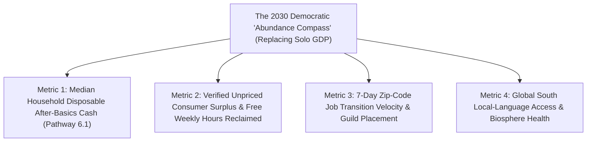

# CARBON EDITION (2026–2035): THE SYNERGY ENGINE & HUMAN AGENCY
## Steering Abundance with Open Eyes: Live Privacy-Safe Telemetry + Participatory Citizen Democracy

> **The Cynic's Myth vs. The Empirical Reality:** Pundits warn that democratic societies are flying completely blind into the AI revolution—stuck measuring 2026 cognitive abundance with clunky **1934 Great Depression factory GDP formulas** that count \$0 when free AI saves a parent or nurse ten hours a week, while central banks react six months too late and citizens get polarized into 50/50 rage tribes! Yet in **2025–2026**, four breakthroughs built a **real-time, privacy-safe democratic dashboard**: **Prof. Aaron "Ronnie" Chatterji's landmark NBER telemetry (*w34255*)** & open **`GDPval`** task benchmarks—paired with **Garimella et al.'s Global South empirical studies**—revealed how hundreds of millions of real people actually use AI; **2026 Economics Nobel laureates Robert E. Hall & Michael Woodford's** micro-founded stabilization math merged with **cryptographic Data Clean Rooms** (`open-macro-cleanroom-policy`); and **Taiwan-style *Polis* bridging** (`bridging-consensus-trust`) plus **permanent Sortition Citizens' Assemblies** (`sortition-citizens-assemblies`) put ordinary citizens squarely at the helm!

> *"Roughly seventy percent of consumer AI usage is non-work decision support, learning, and writing—creating massive, unpriced consumer welfare that traditional GDP statistics completely miss unless we build privacy-preserving empirical measurement."*
> — **Prof. Aaron "Ronnie" Chatterji**, Professor of Business & Public Policy, Duke University & Lead Author, NBER Working Paper 34255 (*How People Use ChatGPT*)

---

## 1. Why Simon Kuznets's 1934 GDP Yardstick Goes Blind During Abundance

In 1934, economist Simon Kuznets invented **Gross Domestic Product (GDP)** to count steel ingots, wheat bushels, and tank shells—and immediately warned Congress *never* to confuse GDP with human welfare! Look at the absurd blind spot GDP creates as Carbon Edition technologies drive prices toward zero:

1. **The "Zero-Price Paradox" Hides Trillions in Real Human Thriving:**
   When a parent uses a \$0 open AI tutor (`two-sigma-guild-education`) instead of a \$90/hour private tutor, or Wikipedia instead of a \$1,400 encyclopedia, or WhatsApp video instead of \$3/minute international calls, **measured GDP actually *shrinks*—even as family flourishing skyrockets!**
2. **Hype vs. Ground Truth Fixed by Privacy-Safe Telemetry (*Chatterji NBER w34255* & *GDPval*):**
   Until late 2025, public debate swung wildly between *"AI is all fake hype"* and *"AI will fire 50% of workers by Friday."* Then **Aaron Chatterji, David Deming, Zoe Hitzig, and colleagues (NBER WP 34255)** applied **automated, zero-human-eyes privacy-preserving classifiers** across millions of real conversations (reaching ~10% of global adults), while open **`GDPval`** benchmarks tested real O\*NET occupational deliverables across 44 professions, and **Garimella et al.** audited adoption across **Global South** languages, smallholder farms, and informal micro-enterprises!
   * **What the data actually showed:** Over **70% of real usage is non-work household empowerment**—practical life guidance, health/legal comprehension, tutoring, and writing—functioning far more as **cognitive scaffolding and unpriced consumer surplus** than sudden mass layoffs, while also exposing exact Global South local-language gaps that public policy can immediately fund!
3. **2026 Nobel Micro-Stabilization Meets Cryptographic Clean Rooms:**
   In **October 2026**, **Robert E. Hall (Stanford)** and **Michael Woodford (Columbia)** won the **Nobel Prize in Economic Sciences** for grounding macroeconomic stabilization in **household-and-firm microfoundations and expectations**. Combine their micro-founded models with **differential-privacy Data Clean Rooms** (*Opportunity Insights* / Nordic / EU standards, `open-macro-cleanroom-policy`), and policymakers see county-by-county wage, rent, and AI displacement shifts **within 7 days instead of 18-month census lags**—without ever exposing a single citizen's identity!

---

## 2. Four Pillars of the Open Empirical Abundance Compass

| Governance Layer | Old 20th-Century Blindness | Verified 2025–2026 Breakthrough | Connected Carbon Pathway |
| :--- | :--- | :--- | :--- |
| **1. Real-World AI & Welfare Telemetry** | Guessing AI impact from CEO tweets or 2-year-old labor surveys | **Chatterji et al. (NBER w34255)** privacy-classified usage telemetry + **`GDPval`** real-work benchmarks + **Garimella et al.** Global South informal-sector audits. | [`empirical-ai-economics-telemetry`](../../04-social-norms/empirical-ai-economics-telemetry/REPORT.md) |
| **2. Micro-Founded Live Macro Stabilization** | Aggregate 1970s models blind to household expectations & regional shocks | **2026 Economics Nobel (Hall & Woodford)** microfoundations + **Differential-Privacy Data Clean Rooms** delivering weekly anonymized zip-code pulse maps. | [`open-macro-cleanroom-policy`](../../04-social-norms/open-macro-cleanroom-policy/REPORT.md) |
| **3. Outrage-Immune Public Consensus** | Cable TV & engagement-rage feeds fracturing towns 51% vs. 49% | **Polis** & **Community Notes** matrix-factorization algorithms elevating statements backed by **80%+ cross-partisan majorities** (*vTaiwan*, *Bowling Green, KY*). | [`bridging-consensus-trust`](../../04-social-norms/bridging-consensus-trust/REPORT.md) |
| **4. Informed Everyday Citizen Steering** | Lobbyist-captured hearings dominated by paid insiders | **Permanent Sortition Citizens' Assemblies** (*Ostbelgien Belgium*, *Paris*, *Ireland*)—everyday citizens chosen like a jury, briefed on live cleanroom data, setting binding priorities! | [`sortition-citizens-assemblies`](../../04-social-norms/sortition-citizens-assemblies/REPORT.md) |

---

## 3. Inside Guadalajara & Ostbelgien's Live Civic Compass Room (2029)

Step inside a sunlit municipal deliberation hall in **Guadalajara, Mexico**—or **Eupen, Belgium**—on a Saturday afternoon in **2029** to see how **live empirical telemetry + participatory citizen democracy** steers rapid technological change without panic or capture:

1. **09:00 AM — Reading the True Dashboard (GDP + Consumer Surplus + Time Saved):**
   Seventy-five randomly selected residents (**mirrors of their city by age, income, gender, and neighborhood—a baker, a pediatric nurse, a warehouse technician, a retiree**) gather for their paid quarterly weekend **Citizens' Assembly**. On the wall sits the city's **Open Abundance Compass**, fed by $\epsilon$-differentially private Data Clean Rooms:
   * *Headline 1 (Flourishing):* Local AI clinical scribes and 2-Sigma school tutors saved residents **4.2 million hours of unpaid paperwork and \$180M in household tutoring/translation value** this quarter ("Time & Welfare Dividend: **+11%**").
   * *Headline 2 (Early Friction Alert):* Live payroll cleanrooms spot a **-9% hiring dip** among entry-level bilingual call-center clerks six months *before* national unemployment stats would ever notice!
2. **01:00 PM — 14,000 Neighbors Weigh In on *Polis*:**
   Before choosing how to respond, the Assembly opens a 7-day citywide **Polis** conversation where 14,000 residents submit and vote on practical remedies. Outrage fades; **86% across all parties** unite around redirecting local Compute Commons tax revenue (`compute-commons-taxation`) into **paid 90%-wage Paramedic, Elder-Care & Mass-Timber Guild apprenticeships** (`displaced-worker-bridge`) plus open Zapotec/Nahuatl regional voice models!
3. **04:30 PM — Fast, Trusted Execution:**
   Because expectations are transparent, credible, and micro-founded (**Hall & Woodford's exact Nobel lesson!**), neither workers nor local businesses panic—turning potential disruption into higher wages and shorter workweeks within weeks.

---

## 4. Closed Loop: Privacy-Safe Telemetry $\rightarrow$ Bridged Deliberation $\rightarrow$ Shared Flourishing

### Privacy Guarantee: Measuring Everything About Society While Knowing Nothing About *You*
A healthy skeptic immediately asks: *"Hold on—doesn't 'live AI and economic telemetry' risk becoming creepy government surveillance?"* Look at the mathematical firewall separating **Open Cleanroom Macroeconomics** from surveillance:

| Feature | Authoritarian Surveillance State | Cryptographic Democratic Clean Room (2026 SOTA) |
| :--- | :--- | :--- |
| **Who Sees Raw Individual Chats or Bank Rows?** | State security bureaus & data brokers | **Literally Zero Humans** (automated zero-knowledge / secure-enclave aggregation + $\epsilon$-differential privacy noise) |
| **Direction of Transparency** | **Citizen is naked; State is secret** | **Citizen is 100% private; Aggregate economy & algorithms are 100% public!** |
| **Verified Precedent** | Social-credit black boxes | **Chatterji et al. (NBER w34255)** zero-human-eye classifier + **U.S. Census / Opportunity Insights** differential privacy + **Estonia X-Road** (`forty-eight-hour-governance`). |

### Answering Three Core Questions From Privacy Advocates, Economists & Voters

1. **"Can differential privacy really stop a clever attacker from re-identifying my small business or chat topic?"**
   * Yes—by mathematical theorem, not corporate promise! **$\epsilon$-Differential Privacy** injects calibrated cryptographic noise before aggregates ever leave secure hardware enclaves, guaranteeing mathematically bounded information leakage regardless of an attacker's auxiliary databases, while **Chatterji et al.'s NBER pipeline** runs automated classifiers inside isolated enclaves so **zero human researchers ever view raw user text**.
2. **"Don't Citizens' Assemblies lack the technical expertise to understand macroeconomics or AI?"**
   * Real-world track records across **Ireland, France, Ostbelgien (Belgium), Japan, and Austin** prove the exact opposite: when everyday nurses, truckers, shopkeepers, and retirees are paid fairly for their time, shielded from party whips and TV cameras, and briefed by balanced panels of independent economists with live cleanroom data, their policy recommendations score *higher* on empirical rigor and long-term fiscal prudence than lobbyist-drafted bills!
3. **"Why did Hall & Woodford's 2026 Nobel insight change how fast cities should respond to AI shifts?"**
   * **Hall and Woodford** proved that economic stability hinges on **credible household expectations**. When workers trust—because they can see live public rules on their city's dashboard—that any `-8%` sector hiring dip *automatically* unlocks **90%-wage Guild Bridge seats** (`displaced-worker-bridge`) and debt protection (`zero-cliff-safety-nets`), households don't freeze consumer spending in fear and voters don't turn to Luddite bans!

* **4. Guaranteeing Algorithmic & Statistical Open Source:**
  * Every classifier weight, *Polis* clustering matrix, and cleanroom privacy budget ($\epsilon$) is published as auditable open-source code—so independent university labs, labor unions, and civic watchdogs can verify every dial on the compass without trusting any black box.
* **5. Citizen Dividend Feedback Loops (`universal-capital-dividends`):**
  * When the Abundance Compass registers surging automated output alongside flat median wage hours, pre-enacted Sovereign Equity & Compute Commons formulas automatically dial up household dividend payouts—turning productivity surges directly into family Saturday mornings!

---

## 5. Upgrading National Dashboards Beyond 1934 GDP ("GDP-Plus / Time & Thriving")

### Four Civic Upgrades Any City, State, or Ministry Can Launch in 90 Days
* **1. Publish a Quarterly "GDP-B & Reclaimed Family Time" Supplement:**
  * Pair standard municipal/national GDP reports with **Stanford Digital Economy Lab (`GDP-B`)** choice-experiment welfare metrics and open **`GDPval`** task benchmarks—counting free digital tutoring, healthcare navigation, and open-source tools fairly.
* **2. Stand Up a Privacy-Safe Regional Labor Clean Room:**
  * Partner state payroll agencies and universities using open differential-privacy standards (*Opportunity Insights* model) to publish **weekly anonymized county hiring and wage-transition heatmaps** instead of waiting 18 months.
* **3. Pre-Wire Automatic Guild Bridge Triggers:**
  * Tie verified sector displacement telemetry directly to pre-approved **90%-wage apprenticeship stipends** in healthcare, mass-timber housing, grid electrification, and ecological restoration.
* **4. Convene a Permanent Sortition Citizens' Council + Open *Polis* Board:**
  * Draw 50–100 representative residents by civic lottery every year (the **Ostbelgien model**) paired with citywide `pol.is` consensus polling to steer local AI, school, and infrastructure dividends.

Why is this pathway flagged urgent (`isUrgentSocial: true`) for 2026–2030?

1. **You Cannot Steer a Rocket With a Rearview Mirror From 1934:**
   Measuring an AI-and-solar economy solely with 1934 factory GDP is like flying an airliner using only an oil-pressure gauge. Adding **Verified Consumer Surplus** (*Brynjolfsson GDP-B / Chatterji telemetry*) and **Median Family Discretionary Time** shows citizens what is genuinely working—and flags who needs a hand *this week*, not two years later.
2. **Including the Global South From Day One:**
   Expanding empirical telemetry across Hindi, Swahili, Spanish, Bahasa, and rural informal markets (**Garimella et al.**) ensures AI abundance lifts four billion Global South workers rather than widening digital divides.
3. **Proving Democracy Outperforms Technocracy AND Populism:**
   Everyday citizens—when given representative sortition seats, honest cleanroom numbers, and outrage-free *Polis* tools—consistently make wiser, fairer long-term choices than either unaccountable elites or partisan shouting matches.
4. **Closing Answer to the Cynic:**
   Next time someone claims *"democracy is too slow, blind, and polarized to govern exponential AI,"* show them **Chatterji's privacy-safe telemetry**, **Hall & Woodford's 2026 Nobel stabilization science**, and **Belgium and Taiwan's citizen assemblies**: **give a free people clear eyes and a fair table, and democracy steers abundance better than any system on Earth.**

---

## References & Verified Sources

* **Featured Researcher / Leader:** [Prof. Aaron "Ronnie" Chatterji — Duke University & Lead Author, NBER WP 34255 (*How People Use ChatGPT*)](https://www.nber.org/papers/w34255)
* **Companies, Labs & Consortia:** [National Bureau of Economic Research (NBER WP 34255)](https://www.nber.org/papers/w34255) · [2026 Nobel Prize in Economic Sciences — Robert E. Hall & Michael Woodford](https://www.nobelprize.org/prizes/economic-sciences/2026/summary/) · [Stanford Digital Economy Lab (GDP-B Consumer Surplus)](https://digitaleconomy.stanford.edu/) · [Opportunity Insights (Harvard Anonymized Micro-Data)](https://opportunityinsights.org/) · [Computational Democracy Project (Polis)](https://compdemocracy.org/Polis/) · [Federation for Innovation in Democracy — Europe (FIDE Sortition Assemblies)](https://fide.eu/)
* **Global & Regulatory Precedents:** [Chatterji, Cunningham, Deming et al. (2025/2026), *How People Use ChatGPT* & Open *GDPval* Occupational Benchmarks](https://www.nber.org/papers/w34255) · [2026 Sveriges Riksbank Nobel Prize Citation for Microfoundations of Macroeconomic Stabilisation](https://www.nobelprize.org/prizes/economic-sciences/2026/summary/) · [Ostbelgien (Belgium) Permanent Sortition Citizens' Council & Taiwan vTaiwan Polis Process](https://oidp.net/)
* **Connected Carbon Pathways:** [Empirical AI Economics: Privacy-Safe Telemetry & Consumer Welfare](../../04-social-norms/empirical-ai-economics-telemetry/REPORT.md) · [2026 Nobel Stabilization & Open Cryptographic Data Clean Rooms](../../04-social-norms/open-macro-cleanroom-policy/REPORT.md) · [Algorithms That Reward Common Ground Instead of Outrage](../../04-social-norms/bridging-consensus-trust/REPORT.md) · [Everyday Juries for Big Choices: Permanent Sortition Citizens' Assemblies](../../04-social-norms/sortition-citizens-assemblies/REPORT.md) · [90%-Wage Worker Transition Bridges](../../04-social-norms/displaced-worker-bridge/REPORT.md)
