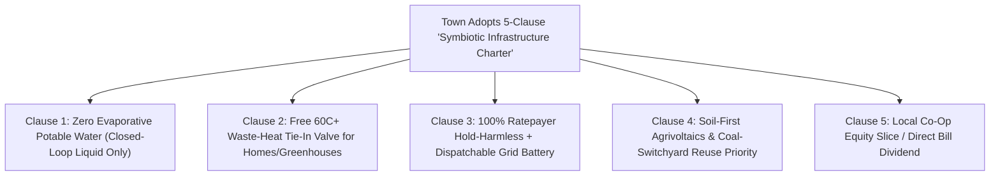

# CARBON EDITION (2026–2035): THE SYNERGY ENGINE & HUMAN AGENCY
## The Great Infrastructure Peace: Turning Data Centers, Solar Farms & Grids into Beloved Hometown Treasures

> **The Cynic's Myth vs. The Empirical Reality:** Across the mid-2020s, an exhausting zero-sum war threatened to paralyze both the clean-energy transition and AI science: rural counties passed moratoriums against solar arrays and transmission lines, while suburban towns revolted against hyperscale AI data centers feared to guzzle rivers, spike household electric bills, and hum behind ugly concrete walls. Yet cynics missed the root cause: **communities weren't rejecting technology—they were rightly rejecting extractive 20th-century single-use design!** In **2025–2026**, four breakthroughs proved how **symbiotic physical engineering + cooperative local ownership** flips NIMBY (*Not In My Backyard*) fury into YIMBY (*Yes In My Backyard!*) civic pride: **65°C liquid-cooled data centers** piping free winter heat into thousands of homes and greenhouses (`symbiotic-civic-data-centers`), **elevated agrivoltaic canopies** boosting berry/sheep yields +30% while cutting farm water use (`agrivoltaics-shaded-harvests`), **retiring coal switchyards** reborn as high-wage fusion/geothermal/thermal-brick hubs (`fusion-power`), and **member-owned electric & fiber cooperatives** paying cash dividends straight to local ratepayers (`cooperative-broadband-energy-trusts`).

> *"Infrastructure battles happen when communities bear 100% of the visual and grid costs while distant shareholders keep 100% of the upside. Make every megawatt heat local homes, shade local crops, and pay local dividends, and neighbors ask how fast you can build."*
> — **Nordic Symbiotic District Energy Principle — Exemplified by Stockholm Exergi (*Stockholm Data Parks*) & Mäntsälä (*Nivos Energia*) Pioneers**

---

## 1. Anatomy of the 2025 "NIMBY Gridlock"—Why Neighbors Were Right to Push Back

Sit in the folding chairs of a packed county commission hearing in Virginia, Ireland, Ohio, or rural Oregon in 2025, and listen with genuine empathy to the farmers and homeowners at the microphone.

When developers dropped a legacy **single-purpose, evaporative-cooled 300 MW data center** or a **bulldozed, gravel-sprayed utility solar field** onto a rural town without sharing a dime of grid value, residents got hit by three unfair shocks:

1. **Thermodynamic Insult (Throwing Away Valuable Heat & Water):** Legacy air-cooled server halls boiled millions of gallons of municipal drinking water into cooling-tower steam just to dump 300 megawatts of warmth into the summer sky—right next door to families paying \$280/month for winter natural-gas heating!
2. **Ecological & Agricultural Erasure:** First-generation utility solar scraped topsoil bare, fenced out grazing sheep and pollinators, and pit clean kilowatts against proud multi-generational family farmland.
3. **Ratepayer Cross-Subsidies Without Local Equity:** Residential households feared paying higher grid-upgrade charges on their monthly utility bills so an out-of-state corporation could lock up substation capacity behind razor wire.

Once you diagnose those three flaws honestly, the cure isn't lecturing townspeople—it is **engineering Symbiotic Civic Infrastructure where a single acre and a single electron perform three neighborhood jobs at once!**

---

## 2. Four Symbiotic Flips Turning Extractive Boxes Into Hometown Treasures

| Old Extractive Flashpoint | The 2026 Symbiotic Engineering Flip | Verified Real-World Proof (2025–2026 SOTA) | Connected Carbon Pathway |
| :--- | :--- | :--- | :--- |
| **1. "Data Centers Steal Our Water & Hike Power Bills!"** | **Closed-Loop $65^\circ\text{C}$ Direct-to-Chip Cooling + District Heating + Behind-the-Meter Storage:** Zero evaporative water loss; server waste heat warms thousands of homes, public pools, & winter tomato greenhouses while on-site iron-air/LFP batteries *stabilize* town grids! | **Mäntsälä, Finland (Yandex/Nebius + Nivos Energia)** cut town fossil heating $>60\%$ via server heat; **Microsoft Denmark (Esbjerg/Høje-Taastrup)** & **Stockholm Data Parks** warm tens of thousands of homes! | [`symbiotic-civic-data-centers`](../../01-abundant-energy/symbiotic-civic-data-centers/REPORT.md) |
| **2. "Solar Panels Ruin Prime Family Farmland!"** | **Elevated Dual-Harvest Agrivoltaics ($2.5\text{--}4\text{ m}$ high):** Semi-transparent / tracking solar canopies shield tomatoes, berries, leafy greens, and grazing sheep from $42^\circ\text{C}$ heatwaves—cutting irrigation water **30%–40%** while farmer income **doubles per acre**! | **Jack's Solar Garden (Colorado)**, **Fraunhofer ISE APV-RESOLA**, & **50+ GW global agrivoltaics** proving up to **130%–160% Land Equivalent Ratio** (more food + clean power!). | [`agrivoltaics-shaded-harvests`](../../01-abundant-energy/agrivoltaics-shaded-harvests/REPORT.md) |
| **3. "Closing Coal Plants Kills Boilermaker Towns!"** | **Coal-to-Clean Switchyard Repowering:** Plug compact **HTS fusion (`ARC`/`Helion`)**, **superhot geothermal**, or **thermal firebricks** directly into existing coal steam turbines and gigawatt transmission lines—retaining 100% of union wages with zero toxic coal ash! | **Helion / Constellation**, **TerraPower Kemmerer (Wyoming)** coal-town transition, & **U.S. DOE Energy Communities** repowering retired coal interconnections without new forest powerlines. | [`fusion-power`](../../01-abundant-energy/fusion-power/REPORT.md) & [`superhot-geothermal`](../../01-abundant-energy/superhot-geothermal/REPORT.md) |
| **4. "Monopoly Utilities Fleece Captive Families!"** | **Member-Owned Broadband & Energy Cooperatives + Binding CBAs:** Local residents co-own 15%–100% of solar, battery, & fiber trusts—receiving automatic **-\$80/mo electric bill rebates** and symmetrical $10\text{ Gbps}$ municipal fiber! | **Chattanooga EPB** (\$2.7B+ community dividend), **Denmark Middelgrunden Co-op**, & **900+ U.S. Rural Electric Co-ops** upgrading to clean community microgrids. | [`cooperative-broadband-energy-trusts`](../../04-social-norms/cooperative-broadband-energy-trusts/REPORT.md) |

---

## 3. A Winter Saturday in Duluth-Superior (2030): Walking the Civic Compute & Harvest Loop

Visit a former rust-belt rail yard in **Duluth, Minnesota** in January **2030** (`-18°C` snow outside) to see all four pieces humming together as one beloved neighborhood commons:

* **Zero Cooling Towers, Warm Brick Homes:** Tucked inside a handsome cross-laminated timber hall sits a **150 MW liquid-cooled AI research cluster** (`co-packaged-silicon-photonics`). Zero drops of Lake Superior water evaporate. Instead, insulated municipal pipes carry **$65^\circ\text{C}$ warm water** straight out of the server racks to heat **18,000 Duluth homes at half their old winter gas bill**, melt ice off downtown wheelchair ramps and bike lanes, and warm a **four-acre glass public conservatory and strawberry greenhouse** where families sip coffee among lemon trees in January!
* **Grid Helper, Never Grid Leech:** Under Duluth's **Binding Symbiotic Community Benefit Charter**, the campus funded its own 100-hour **Form Energy iron-air battery bank** (`iron-sodium-storage`, built just across the region in Weirton!)—automatically *curtailing* flexible AI training runs and *feeding power back* into Duluth's hospital and residential feeders during polar-vortex blizzards.
* **Shaded Summer Berries Next Door:** Five miles out of town, local dairy and berry farms host elevated **perovskite-silicon agrivoltaic trellises** co-owned 25% by the county's Citizen Energy Trust—sending every household a **\$420 annual patronage check** every December.

Result? Instead of four years of lawsuits, Duluth permitted the project in **45 days** after an **89% affirmative neighborhood Polis vote** (`bridging-consensus-trust`)!

---

## 4. Thermodynamic & Civic Cascade: Waste Nothing, Share Everything

```mermaid
flowchart LR
    subgraph CleanWatts["Repowered Switchyard + Agrivoltaics"]
        W1["Retired Coal Grid Plug -> Zero New Forest Lines"]
        W2["Elevated Farm Solar (+30% Berry Yield, -35% Water)"]
        W3["100-Hr Iron-Air Battery Buffers Peak Winter Grid"]
    end
    subgraph CivicCompute["Zero-Water Liquid AI Hall"]
        C1["Direct-to-Chip Liquid Cooling (Zero Evaporative Loss)"]
        C2["Trains Science AI + Curtails Instantaneously on Peak"]
        C3["Captures >90% Server Electricity as 65C Hot Water"]
    end
    subgraph HometownJoy["Beloved Hometown Dividends"]
        H1["Warms 18,000 Homes + Year-Round Glass Greenhouses"]
        H2["10 Gbps Co-Op Fiber + Monthly Power Bill Rebate"]
        H3["89% Neighbor Polis Support -> Fast 48-Day Permit!"]
    end
    CleanWatts --> CivicCompute
    CivicCompute ==> HometownJoy
```

### Side-by-Side Ledger: Extractive 2024 Speculation vs. The 2026 Symbiotic Civic Pact

| Community Metric | 2024 Extractive "Fence & Boil" Model | 2026+ Symbiotic Civic Infrastructure Pact | Winner-Winner Outcome |
| :--- | :--- | :--- | :--- |
| **Cooling Water Evaporated** | **1 to 5 Million Gallons / Day** | **0 Gallons (Closed-Loop Liquid-to-District Heat)** | **Protects Local Rivers & Aquifers 100%** |
| **Server Waste Heat Fate** | Vented uselessly into atmosphere | **Heats 15,000+ Homes, Pools & Winter Farms** | **Cuts Town Winter Heating Bills 40%–60%** |
| **Residential Electric Rates** | Risk of substation upgrade cost-shifts | **Ring-Fenced Tariff + Peak Grid Battery Rebate** | **Lowers Neighbor Bills & Stops Blackouts** |
| **Agricultural Topsoil Impact** | Gravel-scraped single-use fenced lots | **Dual-Harvest Grazing & Heat-Shielded Crops** | **Up to 160% Combined Food + Power Yield** |
| **Permitting Timeline** | **3 to 6 Years** of lawsuits & moratoriums | **<60 Days** via Pre-Certified Civic Charter | **Developers Save \$50M+ in Delay Costs!** |

### Answering Three Hard Questions From Mayors, Farmers & Grid Engineers

1. **"What happens in July when towns don't need home radiator heating—where does the $65^\circ\text{C}$ server heat go?"**
   * Summer server heat drives **absorption chillers** for municipal district cooling, heats year-round **domestic hot water** (showers, hospitals, laundries, swimming pools), dries regional **timber, grain, and food harvests** without burning propane, and charges seasonal **underground borehole/aquifer thermal energy storage (ATES)** so July sunshine and compute warmth heat homes in January!
2. **"Do elevated agrivoltaic racks cost too much steel compared to ground-hugging solar?"**
   * Raising racking from $1\text{ meter}$ to $3.2\text{ meters}$ adds roughly $10\%\text{ to }18\%$ to structural CAPEX—yet unlocks **free agricultural land access**, eliminates mowing/herbicide maintenance via sheep grazing, cools solar panels via crop evapotranspiration (**boosting panel electrical efficiency +2% to +5%** in summer!), and slashes multi-year county permitting lawsuits to near zero.
3. **"What about ultra-hot gigawatt AI training runs located far from northern cities?"**
   * Any workload that doesn't need sub-millisecond city proximity pairs naturally with **desert solar + dry radiative cooling** or migrates upstairs to **Orbital Solar-Radiative Data Centers** ([`orbital-radiative-compute`](../../05-space-frontier/orbital-radiative-compute/REPORT.md))—keeping 100% of terrestrial data halls right-sized to local district heat and grid battery symbiosis!

---

## 5. Model 5-Clause Municipal Ordinance Any Town Council Can Adopt Tomorrow

### Four Steps to Pass the Symbiotic Charter in Your County This Year
* **1. Audit Your Town's Thermal Sinks & Retiring Switchyards:**
  * Map hospitals, universities, public pools, greenhouses, and retiring fossil substations within 3 miles of high-voltage fiber trunks—turning "waste heat" into a mapped municipal asset.
* **2. Host a 7-Day County *Polis* Conversation Before Zoning Votes:**
  * Invite farmers, union electricians, ratepayers, and developers onto an open `pol.is` board (`bridging-consensus-trust`) to surface the exact community benefits (shaded grazing, fiber, bill rebates) that command 85%+ support.
* **3. Enact a "Fast-Track Green Lane" for 5-Clause Compliant Projects:**
  * Offer **guaranteed 45-day physics-verified permitting** (`forty-eight-hour-governance`) to any solar, battery, or compute builder that meets all five symbiotic clauses—while barring evaporative potable-water cooling and ratepayer cross-subsidies.
* **4. Establish a Member-Owned County Energy & Fiber Trust:**
  * Channel host fees and co-investment shares into a transparent cooperative trust (`cooperative-broadband-energy-trusts`) that mails annual patronage dividends directly to every local electric meter.
* **5. Pair Apprenticeship Pipelines With Retired Coal & Industrial Towns:**
  * Partner local IBEW electrical unions, pipefitters, and community colleges (`purpose-craft-guilds`) so local workers build and maintain the liquid heat-recovery loops, elevated agrivoltaic trellises, and repowered grid switchyards in their own hometowns.
* **6. Require Architectural Beauty & Public Conservatory Access:**
  * Replace windowless concrete tilt-up walls and razor-wire perimeters with warm mass-timber facades (`abundant-beautiful-housing`), pollinator meadow buffers, and public winter botanical rooms heated free by server loops!

Notice the secret political genius here: **even purely profit-minded infrastructure builders win** under this charter, because shaving *three years of NIMBY litigation delays* saves tens of millions of dollars in idle capital—far more than the cost of a district-heat heat-exchanger valve and community dividend!

1. **Ending the False War Between Ecology, Farmers, and Compute:**
   The same sunbeam can power an AI cancer lab, shade heat-stressed raspberries, warm a senior apartment in January, and fund a town's fiber-optic network.
2. **Honoring Working Energy Towns:**
   Repowering existing coal switchyards respects the generations of boilermakers, electricians, and linemen who built the grid—putting clean fusion, geothermal, and thermal bricks right where transmission lines already converge.
3. **Turning Infrastructure Back Into Civic Architecture:**
   Nineteenth-century waterworks and libraries were built as proud civic landmarks; 2030s timber-and-glass conservatory heat hubs restore beauty to public engineering.
4. **Closing Answer to the Cynic:**
   Next time someone sighs that *"NIMBY lawsuits will block every solar farm, grid line, and AI center forever,"* show them Mäntsälä's server-heated homes and Colorado's shaded tomatoes: **stop building ugly one-way parasites, start building generous hometown partners, and communities roll out the welcome mat.**

---

## References & Verified Sources

* **Featured Model / Pioneers:** [Stockholm Data Parks & Mäntsälä (Nivos Energia / Nebius) Waste-Heat District Heating](https://stockholmdataparks.com/)
* **Companies, Labs & Consortia:** [Stockholm Exergi — Stockholm Data Parks](https://stockholmdataparks.com/) · [Nivos Energia (Mäntsälä Data Center District Heating, Finland)](https://www.nivos.fi/) · [Fraunhofer ISE Agrivoltaics Research](https://www.ise.fraunhofer.de/en/key-topics/agrivoltaics.html) · [NREL Agrivoltaics & InSPIRE Network (Jack's Solar Garden)](https://openei.org/wiki/InSPIRE) · [EPB Chattanooga Municipal Fiber & Smart Grid](https://epb.com/) · [U.S. DOE Coal-to-Clean Energy Communities Initiative](https://energycommunities.gov/)
* **Global & Regulatory Precedents:** [EU Energy Efficiency Directive (2023/1791) Mandatory Data-Center Waste-Heat Recovery Assessment](https://energy.ec.europa.eu/) · [German DIN SPEC 91434 & Japanese MAFF Dual-Use Agrivoltaic Standards](https://www.ise.fraunhofer.de/) · [Danish Renewable Energy Act Local Citizen Co-Ownership Precedent](https://ens.dk/en)
* **Connected Carbon Pathways:** [Symbiotic Civic Data Centers: Zero-Water Cooling & 65°C District Heating](../../01-abundant-energy/symbiotic-civic-data-centers/REPORT.md) · [Shaded Harvests: Dual-Use Agrivoltaics Boosting Crops & Clean Power](../../01-abundant-energy/agrivoltaics-shaded-harvests/REPORT.md) · [Compact Commercial Fusion & Coal Switchyard Repowering](../../01-abundant-energy/fusion-power/REPORT.md) · [Member-Owned Broadband & Clean Energy Cooperatives](../../04-social-norms/cooperative-broadband-energy-trusts/REPORT.md) · [Algorithms That Reward Common Ground Instead of Outrage](../../04-social-norms/bridging-consensus-trust/REPORT.md)
