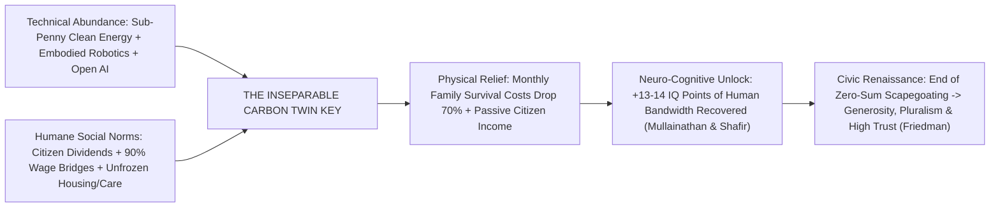
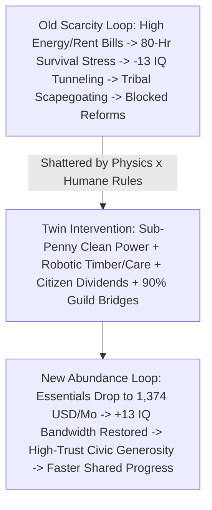

# CARBON EDITION (2026–2035): THE SYNERGY ENGINE & HUMAN AGENCY
## Healing the Zero-Sum Brain: Why Free Energy & Automation Are the Keys to Ending Human Scarcity Politics

> **The Cynic's Myth vs. The Behavioral & Historical Reality:** Cynics believe human beings are permanently condemned by evolutionary biology to be tribal, envious, fearful, and zero-sum—insisting that no matter how cheap we make clean electricity or how smart we make robots, politics will stay polarized, angry, and exclusionary forever. Hard behavioral science and two centuries of economic history prove the exact opposite. In landmark field and lab experiments published in *Science* (2013), **Prof. Sendhil Mullainathan** and **Prof. Eldar Shafir** demonstrated that chronic financial scarcity literally **taxes 13 to 14 IQ points of human cognitive bandwidth**—a deeper mental impairment than losing an entire night of sleep—hijacking ordinary, decent people into short-term survival tunneling. Across two hundred years of history, **Prof. Benjamin M. Friedman** (*The Moral Consequences of Economic Growth*) proved that when broadly shared material abundance lifts families out of survival dread, societies reliably grow **more generous, tolerant, open, and democratically reformist**. That is the unifying thesis of *OneOfMany*: **the social and the technical are inseparable—moving toward essentially free clean energy and physical/knowledge automation, paired with universal citizen ownership, is what physically heals the zero-sum human scarcity mindset.**

> *"Scarcity doesn't just mean having less money in your wallet—it captures the mind itself, taxing thirteen IQ points of mental bandwidth. Relieve chronic material scarcity, and you don't make people lazy; you give human beings their full intelligence, patience, and generosity back."*
> — **Prof. Sendhil Mullainathan**, Professor of Computation and Behavioral Science, MIT & Co-Author of *Scarcity* (*Science*, 2013)

---

## 1. Two Versions of the Exact Same Human Being: Youngstown & Tamil Nadu

Before debating political tribalism, watch what happens inside the nervous system of the **exact same human being** when chronic survival fear lifts—first in rural South India, and then in industrial Ohio.

* **Villupuram & Tiruvannamalai Districts, Tamil Nadu, India (The *Science* Harvest Discovery):**
  * When economists **Anandi Mani, Sendhil Mullainathan, Eldar Shafir, and Jiaying Zhao** tested **464 Indian sugarcane farmers** right *before* harvest—when family cash reserves were exhausted, moneylenders were knocking, and every rupee had to be rationed—the farmers scored poorly on Raven's Progressive Matrices fluid-intelligence tests and executive-impulse puzzles, snapping more easily at family members and struggling to plan months ahead.
  * Did those farmers lack innate intelligence or moral character? **No!** When researchers returned a few weeks *after* harvest to test the **exact same 464 men and women** once crop payments had cleared their debts, their fluid-intelligence scores **jumped by the equivalent of 13 to 14 IQ points**, their executive self-control rebounded, and their patience returned overnight! Today in **2026–2033**, coordinator **Ananya Nair** (36) watches that seasonal anxiety vanish permanently across those same Tamil Nadu villages as **agrivoltaic solar canopies** (`01-abundant-energy/agrivoltaics-shaded-harvests`), free solar-powered drip irrigation, and cooperative battery microgrids give farming households year-round zero-fuel income and steady breathing room.
* **Youngstown, Ohio (2024 Survival Tunneling vs. 2033 High-Trust Guild Stewardship):**
  * Look at **Derrick Hollis** (44), a third-generation metal-stamping machinist and Little League coach in the Mahoning Valley. In **2024**, after twenty years of regional factory closures, \$340 winter utility bills, and rumors that AI-guided robots would wipe out his remaining shop shifts, Derrick wasn't a "bad citizen"—his brain was working overtime under a **70-hour survival load**. Every newcomer moving into town felt like competition for scarce jobs; every clean-energy rule sounded like a threat to his electric bill; every town-hall meeting turned into a zero-sum shouting match.
  * Now step onto Derrick's porch in **May 2033**:
    1. **The Technical Floor Dropped Survival Costs by 70%:** Regional solar-iron microgrids and early commercial fusion contracts ([`fusion-power`](../../01-abundant-energy/fusion-power/REPORT.md)) cut Derrick's home power and heat to **\$14/month**; mass-timber infill and Direct Primary Care slashed his family's monthly nut from \$6,200 to **\$1,950/month** ([`hidden-consumer-surplus-abundance`](../hidden-consumer-surplus-abundance/REPORT.md)).
    2. **The Humane Social Convention Guaranteed His Share:** When humanoid stamping cells automated heavy press loading in 2029, Derrick didn't get thrown onto a 1990s unemployment cliff. Under Ohio's **Danish-style 90% Guild Wage Bridge** ([`displaced-worker-bridge`](../../04-social-norms/displaced-worker-bridge/REPORT.md)), he kept 90% of his machinist paycheck for six months while upgrading into a **Master Robotics & Tooling Guild Mentor**—and his two kids hold compounding **Baby Bonds** plus a **\$900/month household Citizen Compute & Energy Dividend** ([`universal-capital-dividends`](../../04-social-norms/universal-capital-dividends/REPORT.md)).
    3. **13 IQ Points of Civic Grace Returned:** Working 24 proud hours a week mentoring high-school robotics teams, Derrick co-chairs Youngstown's cross-partisan Citizens' Assembly ([`cynicism-to-agency`](../cynicism-to-agency/REPORT.md))—personally welcoming thirty immigrant technician families to his block because newcomers now expand a thriving town rather than rationing a shrinking lifeboat!

---

## 2. Three Scientific & Historical Pillars Proving Scarcity Politics Is Curable

Why do decent neighbors turn fearful during material squeezes and generous during shared abundance? Three bodies of peer-reviewed evidence connect neuroscience directly to macro-history:

### Pillar A: Cognitive Bandwidth Science (Mullainathan & Shafir, *Science* 2013)
* **Survival Tunneling Is a Bandwidth Tax, Not a Character Flaw:**
  * Think of human working memory like a computer's active RAM. When rent, insulin, electric bills, and job security are precarious, **60% of a person's background mental RAM runs an unceasing emergency daemon** (*"If the transmission dies Tuesday, do we skip the electric bill or short the rent?"*).
* **13–14 IQ Points Lost (>1 Full Night of Sleep Deprivation):**
  * In both New Jersey mall experiments (priming middle- and low-income shoppers with a \$1,500 vs. \$150 car-repair scenario) and Tamil Nadu harvest tracking, scarcity imposed a **0.75-to-0.85 standard-deviation drop (~13–14 IQ points)** on cognitive reasoning—more severe than pulling an all-nighter!
  * Under chronic tunneling, human brains physically lose the spare bandwidth required to evaluate nuanced policy, trust institutions, forgive a neighbor's mistake, or care about 2050 ecosystems.

### Pillar B: Two Centuries of Moral History (Benjamin M. Friedman, Harvard)
* **Broadly Shared Growth Breeds Generosity & Pluralism:**
  * In *The Moral Consequences of Economic Growth*, Harvard economist **Prof. Benjamin M. Friedman** audited 200+ years of American, British, French, and German history.
  * Whenever ordinary households experienced broad, tangible improvements in material security (such as post-WWII broad middle-class electrification and homebuilding), democracies consistently passed **civil-rights expansions, environmental protections, generous public schooling, and welcoming immigration norms**.
* **Stagnation & Zero-Sum Squeezes Breed Scapegoating:**
  * Conversely, nearly every ugly wave of nativism, Weimar collapse, exclusionary 1970s NIMBY downzoning, and modern populist rage erupted when median households felt trapped on a stagnant or downward escalator—convinced that **anyone else's gain had to come out of their children's hide**.

### Pillar C: Real-World Floor Pilots (Dauphin *Mincome*, Alaska PFD & Stockton SEED)
* **Dauphin, Manitoba's "Mincome" Audit (Prof. Evelyn Forget):**
  * When an entire Canadian town received a guaranteed material floor in the 1970s, people didn't quit working (only new mothers and high-school boys finishing diplomas paused hours—pushing graduation past 100% of surrounding towns!).
  * Even more telling, **hospitalizations dropped 8.5%**—led by dramatic declines in mental-health crises, domestic stress, and workplace accidents!
* **Stockton SEED & Alaska Permanent Fund (1982–2026):**
  * Giving Stockton households \$500/month unconditional breathing room *increased* full-time employment from 28% to 40% (because parents finally had the cognitive bandwidth to interview for better jobs!), while Alaska's universal oil dividend cut extreme poverty by 20%+ with cross-partisan 80% voter popularity across forty-four years.

---

## 3. Why Tech Alone Fails—and Social Rules Alone Fail (The Twin-Key Matrix)

Here is the central architectural insight of the **Carbon Edition**—why neither Silicon Valley techno-optimists nor zero-growth redistributionists can heal society alone:

| Societal Scenario | Technical Engine (Energy + Automation) | Social Convention (Ownership + Rules) | Inevitable Human & Political Outcome |
| :--- | :--- | :--- | :--- |
| **1. Status Quo Squeeze (1980–2024)** | Expensive peak fossil energy + manual stick-built housing & medical bureaucracy | Winner-take-all asset concentration + 1970s zoning & billing cartels | **Chronic -13 IQ Scarcity Tax:** 80-hr family survival grind, falling birthrates, NIMBY hoarding & bitter polarization. |
| **2. Redistribution Without Abundance (Zero-Growth Rationing)** | Stagnant expensive energy (\$0.25/kWh), slow manual construction, capped output | Heavy taxes & vouchers trying to slice a fixed, scarce physical pie | **Zero-Sum Tug-of-War Backlash:** Taxpayers resent every voucher ("your kid's gain = my kid's loss!"); waiting lists & rationing anger. |
| **3. Tech Abundance Without Humane Norms (Gilded Automation)** | Near-free solar/fusion + humanoid robots + superhuman AI labs | 0% citizen dividends, cliff layoffs, speculative land & patent monopolies | **Luddite Panic & Oligarchy:** Workers sabotage machines in terror of destitution while landlords soak up productivity gains. |
| **4. THE CARBON TWIN KEY (Abundance × Humane Norms)** | **Sub-penny clean energy (\$0.004/kWh) + embodied robotics + AI science** | **Citizen Compute/Energy Dividends + 90% Guild Bridges + YIMBY/Direct Care** | **+13 IQ Bandwidth Recovery & High Trust:** Survival costs drop 70%, every citizen profits from every robot, zero-sum fear dissolves! |

---

## 4. How Free Energy & Automation Physically Dissolve Zero-Sum Politics (2026–2035)

Look at four bitter political fights tearing democracies apart in 2026—and watch how pairing **free clean energy + automation** with **humane norms** dissolves the underlying zero-sum conflict at its root:

1. **Turning "Robots Steal Jobs" Into "Every Robot Funds My Family Dividend":**
   * *Old Zero-Sum Trap:* Under 20th-century wage-only rules, a machinist *had* to fear automation because machine productivity flowed exclusively to distant shareholders.
   * *Twin-Key Cure:* Under **Universal Sovereign Compute & Energy Funds** ([`universal-capital-dividends`](../../04-social-norms/universal-capital-dividends/REPORT.md)) + **Connecticut-style Baby Bonds** + **90% Danish Guild Bridges**, every new humanoid robot or fusion plant raises Derrick's monthly household dividend while cutting his workweek toward 22 joyful craft hours!
2. **Turning NIMBY Neighborhood Fear Into Pro-Neighbor YIMBY Welcome:**
   * *Old Zero-Sum Trap:* Neighbors fought new apartments when infrastructure was starved, mandated cars clogged streets, and renters feared gentrification displacement.
   * *Twin-Key Cure:* Pair **robotic mass-timber courtyards** and **\$0.20/mile electric pods** with **25% Community Land Trusts** and **Shoup Curb Tree Dividends** ([`bipartisan-yimby-parking-liberation`](../../04-social-norms/bipartisan-yimby-parking-liberation/REPORT.md)), and every new neighbor brings cooler streets, better cafés, and lower taxes.
3. **Turning Water & Climate Wars Into Positive-Sum Ecological Abundance:**
   * *Old Zero-Sum Trap:* Farmers and conservationists fought bitterly over scarce river water when desalination burned pricey fossil gas.
   * *Twin-Key Cure:* With **\$0.004/kWh solar and geothermal power** driving graphene desalination ([`aquifer-rivers-desalination`](../../01-abundant-energy/aquifer-rivers-desalination/REPORT.md)) and precision fermentation (`03-bioscience-regeneration`), cities get drought-proof water *and* return rivers and wild forests to nature!
4. **Turning Angry Online Outrage Into Rested Neighborhood Presence:**
   * *Old Zero-Sum Trap:* Exhausted adults carrying a -13 IQ scarcity tax after an 80-hour week have energy left only for angry 11:00 PM doomscrolling.
   * *Twin-Key Cure:* Give families back **50 freed hours a week** and unhurried financial safety, and citizens show up rested for youth sports, choral guilds, sortition assemblies, and elder care.

---

## 5. Answering Three Deep Philosophical & Skeptic Objections

1. **"Wait—aren't billionaires already rich, and some of them are still petty, status-obsessed, and zero-sum?"**
   * *Bandwidth vs. Status Distinction:* Mullainathan's and Friedman's research isn't about billionaire ego—it is about releasing **the bottom 85% of ordinary human beings** from acute monthly survival cortisol so working families have the mental room for patience, parenting, and democracy!
   * *Curing Positional Hoarding:* Billionaire status-hoarding thrives precisely when society measures human worth by scarce luxury tokens rather than **craft guilds, civic stewardship, and phone-free community belonging** ([`sacred-worth-contemplation`](../../04-social-norms/sacred-worth-contemplation/REPORT.md)).
2. **"If life becomes physically secure and affordable, won't human beings lose drive, grit, and purpose?"**
   * *Field Evidence Says the Opposite:* Did post-harvest farmers in Tamil Nadu, Dauphin *Mincome* teenagers, or Stockton SEED parents become passive couch potatoes once survival panic lifted? **Never—their high-school graduation rates, full-time job transitions, entrepreneurship, and neighborhood volunteering rose!**
   * *From Fear-Driven Grind to Purpose-Driven Mastery:* Fear makes brains tunnel downward; basic physical security paired with respected human guilds frees people to *build, explore the stars (`05-space-frontier`), restore watersheds, and create art*.
3. **"Can we afford citizen dividends and 90% wage bridges before fusion and full robotics arrive?"**
   * *Live Precedents Operating Right Now:* **Alaska has paid universal citizen dividends since 1982, Norway holds \$1.7T+ per citizen cohort, Denmark has run 90% Flexicurity for thirty years, and Connecticut's Baby Bonds are funded and compounding today in 2026!**
   * *Positive Feedback Flywheel:* Starting with modest spectrum, compute, and land trusts alongside YIMBY and Direct-Care cost relief unlocks the first wave of public trust immediately—which in turn accelerates clean-energy and robotic deployment.

---

### Phased Bandwidth-Recovery & Civic Trust Rollout (2026–2035)

| Rollout Horizon | Technical Abundance Milestone | Humane Ownership & Safety Convention | Measured Bandwidth & Civic Trust Gain |
| :--- | :--- | :--- | :--- |
| **Phase 1: Acute Cortisol Triage (2026–2028)** | Instant SolarAPP+ rooftop solar + pre-approved mass-timber starter kits | Municipal medical-debt buyouts + state **Baby Bonds** (CT model) + YIMBY parking repeal | Clears acute collection panic; unlocks **+\$800/mo** immediate family breathing room |
| **Phase 2: Transition Security (2028–2031)** | Regional iron-sodium 100-hr grids + embodied factory/logistics robotics | **90% Danish Flexicurity Guild Wage Bridges** + \$65/mo Direct Primary Care | Eliminates blue- and white-collar automation terror; union-guided retraining thrives |
| **Phase 3: Universal Dividend Lift (2031–2034)** | Sub-penny solar/geothermal + commercial fusion pilots + AI wet labs | **Sovereign Compute, Spectrum & Energy Citizen Dividends** (\$600–\$1,100/mo) | Restores full **+13–14 IQ cognitive bandwidth** across working-class zip codes |
| **Phase 4: High-Trust Flourishing (2035+)** | Core family essentials demonetized to **\$1,374/mo** across 6 pillars | 20-hour human craft guilds + sortition Citizens' Assemblies + folk sabbaticals | Friedman moral dividend: high volunteering, family fertility rebound & zero-sum peace |

### The Bottom Line

* **Scarcity Politics Is a Symptom, Not Our Soul:** Mullainathan and Shafir proved chronic material dread steals 13 to 14 IQ points of mental bandwidth, while Friedman proved two centuries of shared abundance reliably unlock human generosity and tolerance.
* **Two Halves of One Key:** Redistributing a stagnant pie breeds rationing resentment; automating without shared ownership breeds displacement terror.
* **The Unifying Promise of *OneOfMany*:** Pairing **essentially free clean energy and physical/knowledge automation** with **citizen dividends, 90% wage bridges, and unfrozen essentials** heals survival tunneling at its root—giving humanity back the mental space to trust our neighbors and build a generous civilization together.

---

## References & Verified Sources

* **Cognitive Bandwidth & Behavioral Scarcity Science:** [Anandi Mani, Sendhil Mullainathan, Eldar Shafir & Jiaying Zhao — *Science* (2013): "Poverty Impedes Cognitive Function" (+13–14 IQ Bandwidth Discovery)](https://www.science.org/doi/10.1126/science.1238041)
* **Macro-Historical & Dividend Precedents:** [Prof. Benjamin M. Friedman — Harvard Dept. of Economics (*The Moral Consequences of Economic Growth*)](https://economics.harvard.edu/people/benjamin-m-friedman) · [Alaska Permanent Fund Corporation (Universal Citizen Dividend Since 1982)](https://apfc.org/) · [Norges Bank Investment Management (Norway Sovereign Citizen Wealth Fund)](https://www.nbim.no/) · [Connecticut Baby Bonds Trust](https://portal.ct.gov/ott/ct-baby-bonds) · [Danish Agency for Labour Market and Recruitment — 90% Flexicurity System](https://star.dk/en/about-the-danish-agency-for-labour-market-and-recruitment/flexicurity/) · [Stockton Economic Empowerment Demonstration (SEED)](https://www.stocktondemonstration.org/) · [Commonwealth Fusion Systems](https://www.cfs.energy/)
* **Connected Carbon Pathways:** [From Doomscrolling to Agency: High-Trust Civic Action](../cynicism-to-agency/REPORT.md) · [Everyone an Owner: Sovereign AI/Compute Wealth Funds & Universal Baby Bonds](../../04-social-norms/universal-capital-dividends/REPORT.md) · [Compact High-Field Fusion Power & Clean Energy Abundance](../../01-abundant-energy/fusion-power/REPORT.md) · [The Invisible \$35,000 Raise: Consumer Surplus & Unfreezing Essentials](../hidden-consumer-surplus-abundance/REPORT.md)
