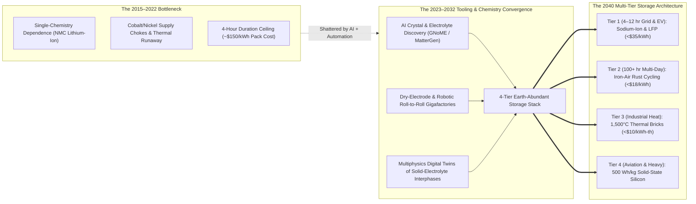
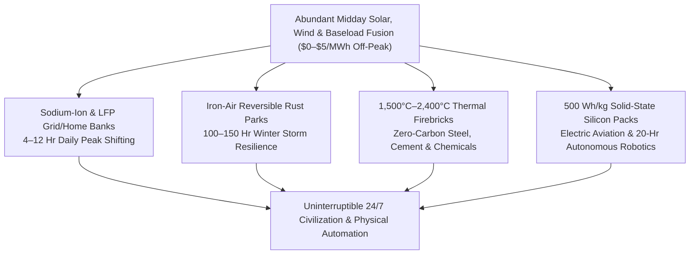

# VISION 01: ORDERS-OF-MAGNITUDE CHEAP-TO-FREE ENERGY
## Pathway 1D: Multi-Scale Energy Storage & Battery Chemistry Breakthroughs — *Turning Intermittent Abundance into 24/7 Civilization Baseload*

> **The Cynic's Objection:** *"Solar and wind might be cheap at noon, but the sun sets, the wind dies for a week in winter, and batteries are too expensive, too flammable, and require more lithium, cobalt, and nickel than the Earth's crust can ever supply. You can't run steel mills, cargo planes, or a winter grid on lithium-ion."*
>
> **The Core Thesis:** The "single-chemistry lithium bottleneck" is already dead. A rapid convergence of **AI-accelerated crystal discovery**, **automated roll-to-roll gigafactories**, and **earth-abundant multi-tier storage architectures**—spanning **sodium-ion** (from sea salt), **100-hour iron-air rust batteries** (from iron ore), **1,500 °C thermal firebricks** (from clay and sand), and **500 Wh/kg solid-state silicon cells**—has split energy storage into specialized, dirt-cheap layers. Together with cheap generation and robotics, storage converts intermittent electrons into firm, uninterruptible 24/7 power and industrial heat at **<\$15/MWh levelized storage cost**.

---

## ACT I: A BELIEVABLE NEAR-FUTURE VISION
### A January Cold Snap in 2040 — Unbreakable Power and Silent Skies

Imagine a freezing Tuesday in January **2040** in the American Midwest, Northern Germany, or Hokkaido. A five-day polar vortex has stalled over the region: temperatures sit at $-18\text{ °C}$ ($0\text{ °F}$), overcast skies block 80% of local solar, and wind turbines are becalmed.

In the 2020s, this weather meant natural gas price spikes, rolling blackouts, and emergency fossil peaker plants. In 2040, daily life doesn't flinch:

1. **The 100-Hour Iron-Air Reserve at the Edge of Town:**
   * On the footprint of a retired coal yard sits a quiet, low-profile enclosure of modular green steel containers.
   * Inside are **reversible iron-air batteries**—filled with nothing rarer than iron pellets, water, and potassium hydroxide electrolyte.
   * For the past 100 hours, as the iron slowly oxidizes (rusts) in controlled air streams, this single 1-gigawatt/100-gigawatt-hour reserve has discharged steady baseload electricity absorbed weeks earlier from pennies-per-megawatt-hour wind and solar surpluses.
   * When the wind returns on Friday, incoming current reverses the reaction, turning the rust back into metallic iron.
2. **The Zero-Smoke Cement & Steel Works Next Door:**
   * Beside the rail yard, a heavy forge and chemical plant pours molten steel and cures low-carbon cement 24 hours a day without burning a cubic foot of natural gas.
   * Its heat comes from an insulated vault of **stacked ceramic thermal firebricks** heated to $1,500\text{ °C}$ by off-peak electricity.
   * Superheated air and solid-state thermophotovoltaic (TPV) cells radiate continuous megawatts of process steam and power at **<\$10/MWh thermal equivalent**.
3. **Your Garage, Your Utility Buffer, and the Regional Skyport:**
   * In your driveway sits an electric family SUV built around a **sodium-ion and lithium-iron-manganese-phosphate (LMFP)** structural pack. It contains zero cobalt and zero nickel, cannot catch fire even if punctured by a nail, loses less than 5% range in sub-zero freezing weather, and adds **400 kilometers (250 miles) of range in 6 minutes** at the neighborhood plaza.
   * Overhead, a 90-seat regional electric airliner climbs silently out of the municipal airport, powered by **500 Wh/kg solid-state silicon-anode packs** that cut regional ticket prices in half.
4. **The Household Reality:**
   * Behind your utility meter sits a slim **40 kWh sodium-ion home buffer** that came pre-installed with your heat pump for the price of a 2024 dishwasher.
   * Your home automatically absorbs near-free midday or nighttime power and rides through any storm without a flicker.

---

## ACT II: THE CONVERGENCE BRIDGE — HOW IT CAME ABOUT (2021–2038)
### AI Materials Discovery, Earth-Crust Chemistries, and Robotic Gigafactories

### 1. The Rapid Convergence of Scientific, Mathematical & Physical Tooling
For over a century, finding a new battery cathode or solid electrolyte required decades of manual wet-lab trial and error. Between 2022 and 2026, three mutually reinforcing toolsets converged to turn battery engineering from an artisanal craft into a high-speed information and robotics discipline:

* **Mathematical & AI Materials Discovery:**
  * Graph neural networks and generative diffusion models—such as Google DeepMind's **GNoME** (which identified 380,000 stable new inorganic crystal structures) and Microsoft's **MatterGen / Azure Quantum Elements** (which screened 32 million candidates to synthesize a novel solid-state electrolyte with 70% less lithium in days)—rewrote the periodic table of storage.
  * Paired with Lawrence Berkeley Lab's **A-Lab** autonomous robotic synthesis, AI compressed 20 years of electrolyte and interphase screening into weeks.
* **Multiphysics Interphase Simulation:**
  * Historically, high-capacity silicon anodes pulverized themselves by swelling 300% during charging, and solid-state lithium metal grew microscopic dendrites that short-circuited cells.
  * Atomistic neural-network potentials allowed engineers to simulate the **Solid-Electrolyte Interphase (SEI)** atom by atom, designing nano-porous silicon-carbon scaffolds (**Sila**, **Group14**) and ceramic-polymer separators (**QuantumScape**, **Factorial**) that breathe mechanically over thousands of cycles.
* **Physical Tooling & Dry-Electrode Gigafactories:**
  * On the factory floor, solvent-free **dry-electrode coating**, high-speed laser tabless welding, and vision-guided robotic cell-to-pack (CTP) assembly slashed factory floor space and curing energy by 40%.
  * Manufacturing yield rates climbed above 99%, driving a relentless **28% Wright's Law cost drop for every doubling of global cumulative GWh**.

### 2. The 2025–2026 Global State of the Art (SOTA) — Real Factories & Grid Deployments
By 2026, battery prices had already plunged below **\$55/kWh at the LFP cell level** in major manufacturing hubs, while four distinct storage tiers entered commercial scale simultaneously:

| Storage Tier & Global Leaders | Core Chemistry / Architecture | Verified 2024–2026 Milestone | Commercial Scale & Grid/Transport Pathway |
| :--- | :--- | :--- | :--- |
| **LFP & Fast-Charge EV/Grid** *(CATL, BYD, Tesla, EVE Energy)* | Lithium Iron Phosphate (LFP / LMFP) Cell-to-Pack | **2024–2026:** CATL *Shenxing Plus* & *TENER* (zero-degradation 5-yr grid container); BYD *Blade 2.0*; LFP cell costs hit **\$48–\$55/kWh** with **4C–6C (10-min) charging**. | Dominant global grid BESS (4–8 hr) & mass-market EVs; zero cobalt/nickel; 10,000+ cycle stationary life. |
| **Sodium-Ion (Zero-Lithium)** *(CATL Naxtra, BYD, Natron, HiNa)* | Sodium-Ion ($\text{Na}^+$ Prussian White / Layered Oxide / Polyanion) | **2025–2026:** CATL launched *Naxtra* mass-production sodium-ion brand (**175 Wh/kg**, works at **$-40\text{ °C}$**, 5C charge); HiNa deployed **100+ MWh** utility sodium grid banks. | **<\$35/kWh** trajectory using abundant soda ash/sea salt; immune to lithium price spikes; cold-climate EVs & home/grid buffers. |
| **Multi-Day Iron-Air (100-Hr)** *(Form Energy)* | Reversible Iron-Air ($\text{Fe} + \text{O}_2 \leftrightarrow \text{Fe(OH)}_2$ / Rust Cycling) | **2024–2026:** Form Factory 1 (Weirton, WV) ramped commercial manufacturing; \$405M+ Series F; broke ground on multi-MW **100-hour utility installations** in MN, WV, GA, and CA. | **<\$20/kWh** capital cost (1/10th of Li-ion); eliminates multi-day wind/solar lulls ("Dunkelflaute") and retires gas peakers. |
| **Solid-State & Silicon Anode** *(QuantumScape, Factorial, Amprius, Sila, Group14, CATL)* | Solid-State Lithium-Metal & Nano-Composite Silicon Anodes | **2024–2026:** QuantumScape shipped *QSE-5* B-samples (>800 Wh/L, 12-min charge) with VW PowerCo; Amprius delivering **450–500 Wh/kg** silicon cells; CATL *Condensed* battery in aviation tests. | Regional electric aviation, eVTOLs, autonomous robotics, and 1,000-km EVs with intrinsic non-flammable solid separators. |
| **Industrial Thermal Bricks** *(Rondo Energy, Antora Energy, Fourth Power)* | $1,500\text{–}2,400\text{ °C}$ Refractory Brick + Solid-State TPV | **2024–2026:** Rondo operating commercial *Heat Batteries* & scaling **90 GWh/yr** factory capacity; Antora delivering >40% efficient solid-state thermophotovoltaic (TPV) cells. | Decarbonizes heavy industry (steel, cement, chemicals) at **<\$15/kWh-thermal**, turning cheap curtailed solar/wind into 24/7 process steam & power. |
| **Flow & Hybrid Long-Duration** *(ESS Inc., Invinity, Noon Energy, EnerVenue)* | Iron-Flow, Vanadium-Flow, Carbon-Oxygen & Nickel-Hydrogen | **2024–2026:** EnerVenue scaling 30,000-cycle aerospace $\text{Ni-H}_2$ vessels; Noon Energy demonstrating ultra-compact $\text{CO}_2$-splitting carbon-oxygen storage; ESS/Invinity utility rollouts. | 10-to-24-hour utility substation shifting with 25-year zero-capacity-fade lifespans and zero fire risk. |
| **AI Electrolyte & Recycling Loop** *(Redwood Materials, Ascend Elements, DeepMind/MatterGen)* | Direct Hydro-to-Cathode Closed Loop & AI-Designed Solid Electrolytes | **2024–2026:** Redwood Materials & Ascend Elements operating commercial US plants recovering **>95% of Li, Ni, Co, Cu** at lower cost & carbon than mined ore. | Creates a permanent, closed-loop urban mineral reservoir—once mined, battery metals circulate indefinitely at >95% efficiency. |

---

## ACT III: PHASED ROLLOUT ROADMAP (2026–2050) & ECONOMIC CASCADE
### How Multi-Tier Storage Scales Without Resource Bottlenecks

Because each storage duration is matched to the most abundant element on the periodic table for that job—**Sodium** (2.3% of Earth's crust) for daily cycling, **Iron** (5.0% of Earth's crust, the cheapest refined metal in human history) for multi-day reserves, **Silicon/Clay** (27% of Earth's crust) for industrial heat, and **recycled Lithium/Silicon** for high-density mobility—humanity never hits a mining wall.

| Rollout Phase | Timeline | Global Installed Storage Scale | Benchmark Capital Cost (\$/kWh) | Levelized Cost of Storage (LCOS) | Societal & Grid Thresholds Unlocked |
| :--- | :--- | :--- | :--- | :--- | :--- |
| **Phase 1: The LFP & Reconductoring Surge** | **2026–2030** | **1.5 – 3 TWh** global BESS; first GWh-scale Sodium-ion, Iron-Air & Thermal Brick plants online. | **\$50 – \$75/kWh** (LFP/Na) **\$22/kWh** (Iron-Air) **\$15/kWh-th** (Thermal) | **\$45 – \$65 / MWh** | Solar + 4-hr storage undercuts new gas peakers globally; California & South Australia prove >80% renewable grids without blackouts. |
| **Phase 2: The Sodium & 100-Hour Inflection** | **2031–2037** | **8 – 15 TWh** deployed; robotic gigafactories output 4+ TWh/yr of Na-ion, LMFP & Iron-Air modules. | **\$28 – \$40/kWh** (Na/LFP) **\$14/kWh** (Iron-Air) **\$8/kWh-th** (Thermal) | **\$18 – \$30 / MWh** | **24/7 Firm Clean Power** (<\$35/MWh combined generation + storage) beats existing coal and gas dispatch worldwide; 6-minute EV charging becomes standard. |
| **Phase 3: Solid-State Mobility & Industrial Heat** | **2038–2045** | **35 – 60 TWh** cumulative; closed-loop recycling supplies >65% of new lithium/transition metals. | **\$18 – \$25/kWh** (Na-ion) **\$9/kWh** (Iron-Air) **\$45/kWh** (500 Wh/kg SS) | **\$8 – \$14 / MWh** | Heavy industry (cement, glass, chemicals, steel) runs on thermal brick storage; regional electric aviation & long-haul autonomous freight fully electrified. |
| **Phase 4: Ubiquitous Zero-Marginal-Cost Buffer** | **2045–2050+** | **100+ TWh** planetary buffer integrated into every building, substation, ship, and factory. | **<\$15/kWh** (Stationary) **<\$6/kWh** (Multi-Day) | **<\$5 / MWh** | Weather intermittency is permanently erased; energy storage acts like municipal water reservoirs—invisible, maintenance-free, and universally abundant. |

### The Self-Compounding Feedback Loop: Free Energy + Automation Building Storage
Why do battery costs continue falling well into the 2030s and 2040s?
1. **Zero-Curtailment Economics:**
   * In the 2020s, solar- and wind-rich grids regularly threw away (curtailed) gigawatt-hours of midday or nighttime electricity at **\$0/MWh or negative prices**.
   * Low-CAPEX iron-air (\<\$20/kWh) and thermal firebrick (\<\$10/kWh-th) systems soak up those free electrons, turning wasted energy into high-value winter heat and firm nighttime power.
2. **Robotic Factories Powered by Their Own Buffers:**
   * Over 35% of the cost of refining battery-grade materials and coating electrodes is electrical and thermal energy.
   * As automated gigafactories pair on-site clean generation with their own thermal and electrochemical storage, **clean energy + robotics manufacture the next generation of batteries at near-zero marginal labor and energy cost.**

---

## ACT IV: THE DEEPER HORIZON & SMOOTH SOCIETAL TRANSITION
### Why This Transition Happens Quietly, Smoothly, and Without Disruption

Unlike historical infrastructure overhauls that required tearing up cities or rationing consumer habits, multi-tier battery storage is a **frictionless, drop-in upgrade**:

* **No Lifestyle Sacrifice, Only Better Hardware:**
  * Families don't switch to EVs or induction heat pumps out of guilt; they switch because a sodium/LMFP vehicle costs **\$8,000 less upfront than a combustion car**, charges in 6 minutes, never needs an oil change, and can power their house for four days during an ice storm.
* **Substation Drop-In Replacement (Zero New Land Wars):**
  * Containerized sodium-ion and iron-air banks drop directly onto the concrete pads of retiring urban gas peaker plants and existing utility substations.
  * Communities in low-income urban corridors watch polluting, noisy combustion peaker turbines get replaced over a single weekend by silent, zero-emission battery parks—immediately cutting neighborhood asthma rates while stabilizing local voltage.
* **Empowering the Global South Without Waiting for Continental Grids:**
  * Across Sub-Saharan Africa, South Asia, and island nations, villages, clinics, water-purification plants, and agricultural cold-storage hubs no longer have to wait 30 years for centralized high-voltage transmission towers.
  * A shipping container of solar panels paired with a fireproof, $-40\text{ °C}\text{ to }+60\text{ °C}$ sodium-ion bank delivers **instant, sovereign 24/7 First-World electricity** in 48 hours.
* **Unshackling Autonomous Robotics & Physical Abundance:**
  * You cannot run a humanoid robot, an autonomous agricultural tractor, an electric mining loader, or an automated construction crane on a power cord.
  * High-density **450–500 Wh/kg solid-state silicon batteries** are the literal metabolic heart of physical automation—allowing robotic fleets to work 20-hour shifts, recharge in 8 minutes from free solar/grid buffers, and build housing, infrastructure, and reforestation projects at fractional cost.

---

### Summary for the Skeptic
1. **We Will Never Run Out of Raw Materials:** Sodium comes from sea salt and soda ash; iron-air batteries use ordinary iron oxide (rust); thermal batteries use clay and sand; and >95% of lithium and copper in existing batteries is already being recovered in closed-loop domestic recycling plants (**Redwood Materials, Ascend Elements**).
2. **The Multi-Day Winter Problem Is Solved:** **Form Energy's** 100-hour iron-air plants and **Rondo/Antora's** 1,500 °C thermal bricks are not lab concepts—they are operating commercial factories and utility installations in 2025–2026 at **1/5th to 1/10th the cost** of lithium-ion.
3. **Fire Safety & Cold Weather Are Solved:** Modern **LFP, sodium-ion (*CATL Naxtra*), and solid-state (*QuantumScape/Factorial*)** cells eliminate volatile liquid organic/cobalt thermal runaway and operate smoothly down to $-40\text{ °C}$.
4. **The Economics Are Unstoppable:** Driven by AI crystal discovery and robotic roll-to-roll manufacturing, battery storage is following the exact same exponential cost collapse as solar PV and silicon microchips—turning abundant clean energy into a rock-solid, 24/7 planetary foundation.
