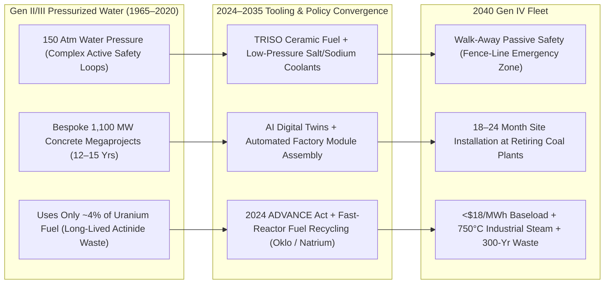
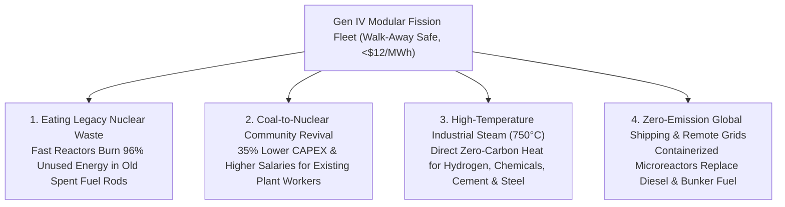

# VISION 01: ORDERS-OF-MAGNITUDE CHEAP-TO-FREE ENERGY
## Pathway 1E: Generation IV Advanced Fission, Modular SMRs & Fuel Recycling — *"The Believable Future, How It Came About, and the Deeper Horizon"*

> **The Cynic's Challenge:** *"Nuclear fission is the definition of slow and expensive. Legacy gigawatt reactors take 15 years and \$15+ billion to build, run at 150 atmospheres of water pressure where loss of coolant risks a meltdown, leave behind 100,000-year nuclear waste, and get strangled by red tape. How could nuclear fission ever become fast, factory-cheap, meltdown-proof, and waste-free?"*

This report directly answers that **"HOW."** Fission carries the highest energy density of any commercial fuel on Earth today: **a single uranium- or thorium-fuel pebble the size of a golf ball contains more energy than 150 barrels of oil or 50 tons of coal.** The problem with 20th-century nuclear was never the atom—it was **1950s pressurized-water submarine engineering** built as bespoke concrete cathedrals on site. Between 2023 and 2036, the convergence of **meltdown-proof Generation IV physics (TRISO ceramic pebbles and atmospheric-pressure molten salts/liquid metals), automated shipyard/gigafactory serial manufacturing, bipartisan licensing reform (the 2024 ADVANCE Act), and fast-spectrum fuel recycling** transformed fission into a walk-away-safe, assembly-line industrial heat and electricity engine.

---

## ACT I: A BELIEVABLE NEAR-FUTURE VISION
### A Busy Industrial Morning in 2040 — Walk-Away-Safe Atomic Abundance

Imagine visiting an inland industrial corridor in Wyoming—or East Tennessee, Ontario, Texas, Poland, or South Korea—on a crisp morning in **2040**.

You are looking at an industrial heartland producing zero-carbon steel, synthetic aviation fuel, exascale AI compute, and 24/7 grid power. Four everyday realities stand out:

1. **The Repowered Coal Town (Kemmerer & Beyond):**
   Where a smoke-belching 1960s coal boiler once stood, a clean, seismic-isolated building houses a **345-megawatt sodium-cooled fast reactor coupled to a 500-megawatt molten-salt thermal storage tank**. The town's former coal plant operators run the control room using the original high-voltage grid switchyard. When regional wind and solar surge at midday, the reactor banks its 550°C heat into giant tanks of solar salt; when evening demand spikes, it dispatches **500 MWe of peaking power**—acting as both a 24/7 baseload generator and a giant grid battery.
2. **The Meltdown-Proof Chemical & Steel Park:**
   Adjacent to a petrochemical and green-hydrogen refinery sits a cluster of four **80-megawatt high-temperature gas reactors** fueled by ceramic **TRISO pebbles**. Even if every operator walked out the door and every cooling pump lost power simultaneously, natural convective air currents and negative thermal reactivity physically prevent the fuel from ever approaching its $1,800^\circ\text{C}$ silicon-carbide containment limit. Because meltdown is physically impossible, the emergency evacuation zone ends at the **plant fence line**, allowing $750^\circ\text{C}$ nuclear steam to pipe directly into industrial chemical reactors 200 meters away.
3. **The "Waste Vault" Turned Into a 500-Year Fuel Mine:**
   Remember the 90,000 metric tons of "spent" nuclear fuel rods sitting in dry casks across the United States in 2026? Because 20th-century water reactors only extracted **~4% of the energy** in those rods before fission products poisoned the reaction, 96% of the energy remained unused. In 2040, compact **metallic fast-fission powerhouses** electro-refine and burn that exact stockpiled "waste" as fuel—powering entire states while shrinking the remaining radiotoxicity lifespan from **100,000 years down to under 300 years**.
4. **The Containerized Arctic & Maritime Microreactor:**
   Two thousand miles north, an Alaskan coastal village that once burned \$9/gallon barged diesel all winter now runs its grid and district heating for a decade on a single **5-megawatt heat-pipe microreactor** delivered on the back of a flatbed truck—with zero refueling and zero emissions.

---

## ACT II: THE CONVERGENCE BRIDGE — HOW IT CAME ABOUT (2021–2038)
### Intrinsic Physics Safety, Factory Mass Production, and the 2024 Regulatory Unlock

Why did nuclear fission break out of its 40-year Western construction freeze between 2024 and 2032? Because three structural shifts replaced custom civil megaprojects with standardized industrial products:

### 1. The Materials & Physics Shift: Low-Pressure Coolants + TRISO "Containment Inside Every Pebble"
Legacy Light Water Reactors (LWRs) cool the core with water pressurized to **150+ atmospheres (~2,200 psi)**. If a pipe ruptures, water flashes to steam, requiring massive, redundant active pumping systems and a $2.5\text{-billion}$ reinforced concrete containment dome. Generation IV reactors eliminate that hazard through fundamental physics:
* **TRISO (Tristructural Isotropic) Fuel:** Used by **X-energy**, **Kairos Power**, and **BWXT**, uranium oxycarbide kernels the size of poppy seeds are individually triple-coated in pyrolytic carbon and **silicon carbide ($\text{SiC}$)**—one of the hardest ceramics known. Tested at Oak Ridge National Laboratory up to **$1,800^\circ\text{C}$** ($200^\circ\text{C}$ hotter than the maximum temperature a pebble-bed reactor can physically reach even without cooling), **zero TRISO particles ruptured.** Every fuel pebble carries its own indestructible containment vessel.
* **Atmospheric-Pressure Molten Salt & Liquid Sodium:** **Kairos Power** (molten $\text{FLiBe}$ salt, boiling point $>1,400^\circ\text{C}$) and **TerraPower / Oklo** (liquid sodium, boiling point $883^\circ\text{C}$) operate at **near-atmospheric pressure (1 atm)**. There is no high pressure to drive a leak, the coolants cannot boil away during an accident, and natural buoyancy drives passive air cooling indefinitely without pumps or external electricity.

### 2. The Manufacturing & AI Convergence: From Construction Site to Assembly Line
* **Eliminating Nuclear-Grade Civil Sprawl:** Because safety is handled passively by fuel physics and low-pressure coolants within a compact reactor vessel, 80% of the balance-of-plant (steam turbines, switchgear, salt tanks) can be built to **standard commercial industrial codes (ASME)** rather than bespoke nuclear-grade specs—cutting steel and concrete volumes per megawatt by over 60%.
* **Automated Factory Serial Production:** **Kairos Power** (Albuquerque & Oak Ridge manufacturing facilities), **Oklo**, **X-energy** (TRISO-X automated fuel fab), and **Radiant / Westinghouse** use robotic welding, laser powder-bed additive manufacturing, and AI ultrasonic inspection to build standardized 15–345 MWe reactor modules on factory floors—shipping them by rail or truck for 18-to-24-month site installation.

### 3. The 2024–2026 Global State of the Art (SOTA)
Driven by surging 24/7 power demand from hyperscale AI data centers and heavy industry—and accelerated by the bipartisan **U.S. ADVANCE Act of July 2024** (which slashed NRC licensing fees, mandated faster review timelines, and streamlined coal-to-nuclear siting)—commercial deployment is underway right now:

| Company / Reactor | Region | Gen IV Architecture | Verified 2024–2026 Milestone | Commercial Deployment & Offtake |
| :--- | :--- | :--- | :--- | :--- |
| **Kairos Power** (*Hermes / KP-FHR*) | USA (CA / TN / NM) | Fluoride Salt-Cooled High-Temp Reactor (TRISO + $\text{FLiBe}$ Molten Salt) | **2023–2024:** First non-water reactors in 50+ years to win **NRC Construction Permits** (*Hermes 1* & two-unit *Hermes 2* in Oak Ridge, TN); **500 MW PPA signed with Google (Oct 2024)**. | **2027:** *Hermes* operational; **2030–2035:** 500 MWe commercial fleet delivering 24/7 power to Google data centers. |
| **TerraPower** (*Natrium*) | USA (WY) | 345 MWe Sodium Fast Reactor + 500 MWe Molten-Salt Thermal Storage | **June 2024:** Broke ground on non-nuclear construction at retiring **Naughton coal plant in Kemmerer, WY**; NRC accepted construction permit; \$4B+ public-private backing. | **2030:** First 345–500 MWe *Natrium* unit online in Wyoming; agreements with Sabey Data Centers & PacifiCorp for multi-unit rollout. |
| **X-energy** (*Xe-100*) | USA (TX / WA) | 80 MWe (320 MWe 4-pack) High-Temp Gas Pebble-Bed (TRISO) | Backed by **Amazon (\$500M+ investment, Oct 2024)** to deploy **>5 GW of SMRs by 2039**; building 4-unit plant with **Dow Chemical** at Seadrift, TX; TRISO-X fuel facility in build. | **Late 2020s / Early 2030s:** Dow Texas industrial steam + power plant & Energy Northwest (WA) grid units for Amazon. |
| **Oklo** (*Aurora*) | USA (ID / OH) | 15–75 MWe Liquid-Metal Fast Reactor (Metallic Fuel & Waste Recycling) | Publicly listed (NYSE: OKLO); site permit & fuel award at **Idaho National Lab (INL)**; **>2,100 MW** of commercial customer pipeline (Equinix, Switch, Diamondback Energy). | **2027–2028:** First *Aurora* powerhouse at INL; commercial fast-fuel recycling facility to turn spent nuclear waste into clean energy. |
| **Westinghouse (*eVinci*), BWXT & Radiant** | USA | Transportable Heat-Pipe & High-Temp Gas Microreactors (1–5 MWe) | **BWXT *Project Pele*** assembling transportable TRISO microreactor for 2026–2027 INL testing; **Westinghouse *eVinci*** & **Radiant *Kaleidos*** completing DOME testbed prep at INL. | **2026–2029:** Drop-in diesel generator replacements for remote towns, mines, defense bases, and disaster response. |
| **GE Vernova Hitachi (*BWRX-300*) & China (*Linglong One / HTR-PM*)** | Canada / China / Global | 300 MWe Modular BWR / Commercial Pebble-Bed HTGR | **China's *HTR-PM*** (world's first Gen IV pebble-bed) operating commercially & **ACP100 (*Linglong One*)** finishing build; **OPG Darlington (Canada)** site work active for 4x *BWRX-300*. | **2026–2029:** First grid-scale Western & Asian modular SMR fleets proving serial Nth-of-a-Kind factory economics. |

---

## ACT III: PHASED ROLLOUT ROADMAP (2026–2050) & ECONOMIC CASCADE
### From Bespoke Megaprojects to the Shipyard Learning Curve

When reactors shrink from 1,200 MWe stick-built civil monuments to 50–345 MWe factory modules, they move off the bespoke construction inflation curve and onto the **aircraft / gas-turbine serial learning curve (~15–20% cost reduction per doubling of factory units)**. Four structural cost drivers push Generation IV fission down toward **\$6–\$12/MWh**:

1. **Atmospheric Pressure Eliminates Nuclear-Grade Civil Megastructures:**
   * Legacy pressurized-water reactors required massive, custom-forged 500-ton steel pressure vessels and meter-thick reinforced concrete containment domes to hold back 150 atmospheres of flashing steam.
   * Because **Kairos Power** ($\text{FLiBe}$ molten salt) and **TerraPower / Oklo** (liquid sodium) operate at **ordinary atmospheric pressure (1 atm)** with walk-away passive air cooling, reactor vessels are thin-walled stainless steel fabricated on automated robotic welding lines, and the balance-of-plant uses standard commercial industrial components.
2. **Higher Thermal Efficiency ($>42\text{–}48\%$) & Molten-Salt Peaking Revenue:**
   * Legacy water reactors operate around $300^\circ\text{C}$, limiting steam-turbine thermal efficiency to ~32%.
   * Generation IV reactors run at **$550^\circ\text{C}\text{ to }750^\circ\text{C}+$**, boosting thermal-to-electric conversion efficiency to **42%–48%** (yielding 35% more electricity per megawatt of core heat) while storing heat in cheap molten-salt tanks (**Natrium**) to capture high-value evening peaking prices.
3. **Standardized Fleet Licensing (The 2024 ADVANCE Act Multiplier):**
   * Under the bipartisan **ADVANCE Act of 2024**, once an SMR design is certified by the NRC, subsequent Nth-of-a-Kind (NOAK) factory modules deployed at pre-approved industrial or retiring coal sites bypass redundant multi-year design reviews—slashing regulatory overhead by $>80\%$.
4. **Near-Zero Fuel Cost via High Burnup & Spent-Fuel Recycling:**
   * Fast-spectrum reactors extract up to **20x more energy per ton of mined uranium** than legacy water reactors—and when fueled by recycled spent LWR fuel rods, raw fuel acquisition cost drops near zero:

| Rollout Phase | Timeline | Manufacturing & Fleet Scale | Installed CAPEX (\$/kW) | Baseload LCOE & Process Steam | Unlocked Societal & Industrial Thresholds |
| :--- | :--- | :--- | :--- | :--- | :--- |
| **Phase 1: Gen IV Commercial Proof** | **2026–2030** | First commercial demonstrators & early 4-packs (*Hermes, Aurora, Natrium, Xe-100, BWRX-300*). | \$4,200 – \$5,800/kW | **\$55 – \$78 / MWh** | 24/7 zero-carbon power for hyperscale AI data centers (Google, Amazon, Microsoft, Switch) & Dow chemical steam. |
| **Phase 2: Coal-to-SMR Repowering Wave** | **2031–2037** | Automated module factories producing 50–100 cores/yr; DOE found **80% of retiring US coal sites** qualify for drop-in SMR repowering (saving 35% CAPEX). | \$2,200 – \$3,100/kW | **\$28 – \$42 / MWh** | Seamless replacement of retiring coal boilers; $550^\circ\text{C}\text{–}750^\circ\text{C}$ nuclear heat decarbonizes steel, glass, and petrochemicals. |
| **Phase 3: Fast-Breeder & Waste-Burner Fleet** | **2038–2045** | Commercial pyroprocessing/electro-refining closes the fuel cycle; fast reactors burn existing spent LWR fuel stockpiles; 600+ GW Gen IV global fleet. | \$1,100 – \$1,700/kW | **\$14 – \$22 / MWh** | Existing nuclear waste stockpiles become centuries of domestic fuel; nuclear-powered cargo ships eliminate bunker oil. |
| **Phase 4: Autonomous Atomic Abundance** | **2045–2055+** | 60-to-80-year amortized modular plants built by robotic shipyards; Uranium-from-seawater & Thorium/Breeder fuel loops. | **<\$800 / kW** | **\$6 – \$12 / MWh** *(+\$1.50/MMBtu 750°C Heat)* | Inexhaustible, weather-proof power & high-temperature industrial heat for 10,000+ years with zero mining required. |

---

## ACT IV: THE DEEPER HORIZON & SMOOTH SOCIETAL TRANSITION
### Eliminating Nuclear Waste, Decarbonizing Heavy Heat, and Repowering Coal Towns

1. **Turning the "Nuclear Waste Problem" Into a \$10 Trillion Energy Asset:**
   * **Why Old Reactors Left 96% Behind:** The public's #1 fear about nuclear power is 100,000-year nuclear waste. Yet solid fuel rods in 20th-century water reactors had to be pulled out after extracting only **~4% of their energy** because gaseous fission products built up inside the cladding. **96% of the original fissionable energy remains unused inside the cask.**
   * **Fast-Spectrum Actinide Burners:** Fast-neutron reactors (like **Oklo's *Aurora***, **TerraPower's *Natrium***, and molten-chloride fast reactors) use unmoderated high-energy neutrons to split long-lived transuranic actinides (plutonium, americium, neptunium, curium).
   * **150+ Years of Zero-Mining Fuel & 300-Year Decay:** By recycling existing US spent fuel stockpiles through compact pyroprocessing/electro-refining, humanity unlocks **enough carbon-free electricity to power the entire United States for over 150 years without mining or enriching a single new pound of uranium**—while the tiny remaining volume of fission products decays below the radioactivity of natural uranium ore in **under 300 years**.
2. **The DOE Coal-to-Nuclear Masterplan (Zero Ghost Towns):**
   * **80% of Retiring Coal Sites Qualify:** A landmark U.S. Department of Energy study evaluated every retiring coal plant in America and found that **80% of coal sites (over 300 gigawatts of capacity)** are directly suitable to host advanced SMRs.
   * **35% Lower CAPEX & Local Prosperity:** Reusing a coal station's existing high-voltage grid switchyard, transmission corridors, cooling water intake, and industrial land permits cuts nuclear plant CAPEX by **15% to 35%**, saves 5–8 years of transmission permitting, and increases permanent local payroll and county tax revenues by over 60% (already underway at **Kemmerer, Wyoming**).
3. **$750^\circ\text{C}$ High-Temperature Steam for Hard-to-Abate Industry & Water:**
   * **Direct Industrial Co-Location:** Electricity is only half of industrial energy demand; chemical refineries (like **Dow's Seadrift complex** in Texas), ammonia plants, steel mills, and High-Temperature Steam Electrolysis (HTSE) hydrogen plants require continuous $500^\circ\text{C}\text{–}800^\circ\text{C}$ process steam.
   * **Fence-Line Safety Boundary:** Because Gen IV TRISO pebble-bed and molten-salt reactors physically cannot melt down, their emergency planning zone ends at the **plant fence line**—allowing them to sit directly inside chemical complexes, desalination hubs, and AI data center campuses.
4. **Zero-Emission Global Shipping, Remote Microgrids & Inexhaustible Seawater Fuel:**
   * **Atomic Merchant Shipping:** Approximately 3% of global $\text{CO}_2$ emissions (plus massive sulfur and particulate pollution) comes from burning heavy bunker oil in 60,000 ocean cargo ships. Atmospheric-pressure molten-salt and heat-pipe reactors sealed inside ship hulls propel container ships at 25+ knots for 20 years without refueling.
   * **4 Billion Tons of Uranium in Seawater:** Beyond existing spent-fuel stockpiles and abundant crustal Thorium, Earth's oceans hold **4.5 billion metric tons of dissolved uranium** ($3.3\text{ parts per billion}$), continuously replenished by rivers eroding continental rock. Passive amidoxime polymer braids suspended in coastal desalination brine outflows extract uranium at parity with terrestrial mining—making nuclear fission **geologically inexhaustible for tens of thousands of years**.

---

## SUMMARY FOR THE SKEPTIC
Twenty-first-century fission bears almost no resemblance to 1970s pressurized water reactors:
1. **Meltdown Is Eliminated by Physics:** TRISO ceramic fuel pebbles withstand **$1,800^\circ\text{C}$** (hotter than a passive reactor can ever get), and molten-salt/sodium coolants operate at ordinary atmospheric pressure.
2. **Permits & Steel Are in the Ground:** **Kairos Power** holds full NRC construction permits for *Hermes 1 & 2* in Tennessee (with a 500 MW Google PPA), **TerraPower** broke ground in Wyoming in 2024, and **X-energy** is backed by Amazon and Dow for >5 GW.
3. **The Law Changed:** The bipartisan **2024 ADVANCE Act** modernized NRC licensing for factory-built modular reactors and coal-site repowering.
4. **Waste Becomes Fuel:** Fast reactors consume stockpiled nuclear waste, turning a 100,000-year storage liability into centuries of clean, high-density energy abundance.
