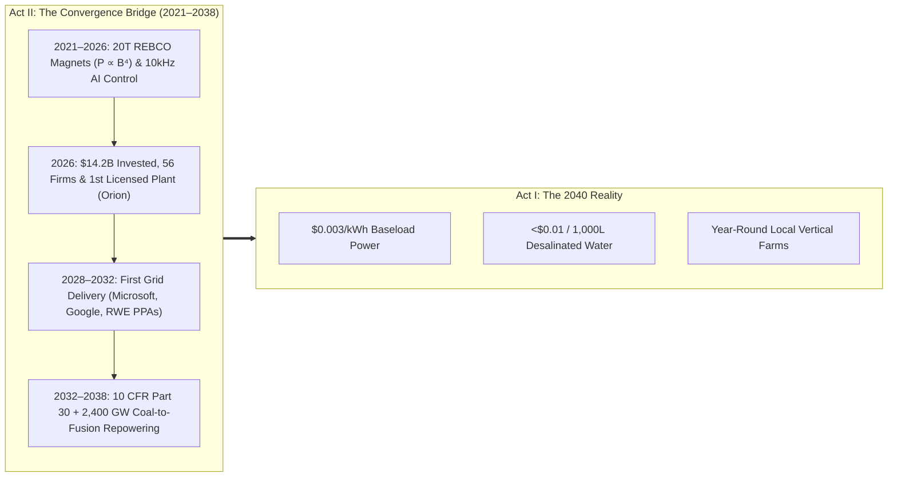

# VISION 01: ORDERS-OF-MAGNITUDE CHEAP-TO-FREE ENERGY
## Pathway 1A: Commercial Fusion — *The Believable Future, How It Came About, and the Deeper Horizon*

> **The Cynic's Challenge:** *"Okay, I can imagine a world with unlimited clean energy. I just don't see HOW we get there. Fusion has been '30 years away' for 70 years, nuclear plants take 15 years and \$15 billion to build, and even if one lab machine works, scaling it globally will take a century."*
>
> **Core Thesis:** Between 2021 and 2026, three independent curves—**20-Tesla REBCO High-Temperature Superconducting magnets ($P \propto B^4$)**, **10 kHz Deep Reinforcement Learning plasma control**, and **solid-state pulsed/inductive energy recovery**—shattered the 50-year fusion stalemate simultaneously. Coupled with **10 CFR Part 30 particle-accelerator licensing** and **Coal-to-Fusion repowering of 2,400+ GW of retiring thermal plants**, commercial fusion scales down Wright's Law to deliver `<\$4/MWh` (`\$0.003/kWh`) baseload energy by the 2040s.

---

## ACT I: A BELIEVABLE NEAR-FUTURE VISION (THE WORLD OF 2040)
### A Tuesday Morning in 2040 — Life at \$0.003 per Kilowatt-Hour

Imagine standing on a coastal bluff in Southern California—or Southern Spain, Sonora, Western Australia, or Northern Chile—on a warm morning in **2040**.

Nothing around you looks like a bizarre science-fiction fantasy. The cars, timber-and-steel buildings, orchards, and power lines are immediately recognizable. Yet three quiet realities have transformed everyday life:

1. **The Former Power Plant Down the Coast:**
   Two miles away sits the brick turbine hall and high-voltage switchyard of a retired 1970s thermal power station. The smokestacks and coal piles are gone, replaced by a riverside park. Bolted beside the original steam turbine hall is a clean, brushed-steel building the size of a neighborhood gymnasium. Inside, two factory-built **400-megawatt compact fusion cores** hum quietly inside a molten-salt tank, consuming a few pounds of deuterium extracted from seawater and lithium bred on-site.
2. **The New River Flowing Inland:**
   Next to the fusion hall sits a modular reverse-osmosis desalination plant. Because wholesale off-peak electricity from the fusion cores costs **\$3 per megawatt-hour (\$0.003/kWh)**, the energy required to turn **1,000 liters (264 gallons) of Pacific seawater into pure drinking water costs less than one cent.** A crystal-clear aqueduct flows inland into the valley, recharging aquifers that were nearly dry in the 2020s and irrigating thousands of acres of terraced citrus, avocado, and olive groves. Water rationing is a memory.
3. **The Neighborhood Market & Your Monthly Utility Bill:**
   In town, a three-story glass-and-timber building glows warmly with agricultural LEDs. Because indoor lighting and climate control now cost pennies, this neighborhood vertical farm harvests crisp organic strawberries, leafy greens, and tomatoes 365 days a year—using **95% less water, zero pesticides, and zero diesel trucking across continents.** A pound of fresh organic produce costs *less* than processed food did in 2026. At home, your electric, heating, cooling, and EV charging bill is a **flat \$12/month grid maintenance fee**—like residential fiber internet.

---

## ACT II: HOW IT ACTUALLY CAME ABOUT (2021–2038)
### The Three Physics Inflections, the 2026 Industrial Breakout, and the Repowering Shortcut

### Step 1: Why the 50-Year Stalemate Broke (2021–2026)
For half a century, fusion was stuck because conventional low-temperature superconducting magnets ($\text{NbTi}$ and $\text{Nb}_3\text{Sn}$) maxed out around **5 to 12 Tesla**. Because magnetic pressure was weak, reactors had to be cathedral-sized megaprojects (like ITER's $840\text{ m}^3$ plasma chamber) costing \$25B+ and taking 20 years to build.

Three converging scientific, mathematical, and physical breakthroughs shattered that ceiling simultaneously:
* **The $B^4$ Magnetic Field Law (20-Tesla REBCO Tape):** In magnetic confinement, fusion power density scales with the **fourth power of the magnetic field ($P_{\text{fusion}} \propto \beta^2 B^4$)**. When Rare-Earth Barium Copper Oxide (**REBCO**) high-temperature superconducting tape reached industrial scale (proven at 20 Tesla by MIT & Commonwealth Fusion Systems in 2021–2026, Tokamak Energy in the UK, and Energy Singularity in Shanghai), doubling the magnetic field boosted power density **$16\times$ to $39\times$**—shrinking the reactor core **$40\times$ smaller** (from $840\text{ m}^3$ down to ~$20\text{ m}^3$).
* **Millisecond Deep Reinforcement Learning Control:** Superheated plasma at 150 million °C is subject to nonlinear tearing modes and instabilities. Starting with DeepMind + EPFL and Princeton (PPPL), AI neural controllers learned to predict plasma instabilities hundreds of milliseconds in advance, adjusting magnetic coils **$>10,000\text{ times per second}$** while NVIDIA/Siemens digital twins compressed years of plasma tuning into weeks.
* **Direct Inductive & Solid-State Pulsed Recovery:** Systems like **Helion Energy** eliminated the steam turbine entirely—compressing field-reversed configuration (FRC) plasmas so the fusion expansion pushes back against the magnetic field, inducing electricity directly into capacitor banks via Faraday's Law at **>80% efficiency**. Meanwhile, solid-state laser and pulsed-magnetic drivers (**Pacific Fusion**, **Inertia Enterprises**, **Zap Energy**) capitalized on Lawrence Livermore's repeatable target ignition ($Q_{\text{target}} > 4$).

### Step 2: The 2026 Global Industrial Breakout (Real Steel, Concrete & Licenses)
By mid-2026, fusion had already left the laboratory and entered commercial construction across four continents. According to the **Fusion Industry Association (FIA) July 2026 Report**, **56 private fusion companies** had raised **\$14.24 billion**—including a record **\$4.48 billion in a single 12-month period (2025–2026)**—with over **16,000 employees** and binding contracts with the world's largest industrial power buyers:

| Global Leader | Region | Architecture | Verified 2025–2026 Milestone | Commercial Grid Pathway |
| :--- | :--- | :--- | :--- | :--- |
| **Helion Energy** | USA (WA) | Pulsed Magneto-Inertial ($\text{D–}^3\text{He}$ / Direct Inductive) | **Feb 2026:** *Polaris* achieved **150M °C** & D-T fusion. **June 2026:** World's **first licensed commercial fusion power plant** (*Orion*, Malaga, WA); \$465M Series G (\$15.5B valuation). | **2028:** 50 MWe *Orion* plant delivering contracted power to **Microsoft** + 500 MWe **Nucor Steel** partnership. |
| **Commonwealth Fusion Systems (CFS)** | USA (MA / VA) | Compact 20T REBCO HTS Tokamak (D-T) | Installed 48-ton *SPARC* vacuum vessel & 24-ton 20T TF magnet; raised ~\$3B total (\$863M B2 + **Google PPA** & equity investment). | **2026–2027:** *SPARC* net energy ($Q > 1$, target $Q \approx 11$). **Early 2030s:** 400 MWe *ARC* plant in Chesterfield, VA. |
| **Proxima Fusion** | Germany / EU | Quasi-Isodynamic HTS Stellarator (D-T) | **July 2026:** Closed **€411M (\$518M)** round with **Google** & **RWE**; MoU with Bavaria & Max Planck IPP for *Alpha* demonstrator. | **2031:** *Alpha* demonstrator. **2030s:** *Stellaris* commercial plant repowering the retired **Gundremmingen** nuclear site. |
| **Energy Singularity** | China (Shanghai) | All-HTS Compact Tokamak (D-T) | Built **HH70** (world's first operational all-HTS tokamak); achieved **1,337-second** steady-state plasma operation & 20T magnet. | **2027:** **HH170** targeting $Q > 10$. **Early 2030s:** Commercial demonstration reactor. |
| **BEST / ASIPP / Neo Fusion** | China (Hefei) | Superconducting Burning-Plasma Tokamak | Passed 50% final assembly of nested vacuum vessel & magnets in 2026 following EAST's 1,000s+ H-mode confinement records. | **2027:** *BEST* completion ($Q \approx 5$ burning plasma). **~2030:** Pilot electricity generation. |
| **Type One Energy & Zap Energy** | USA (TN / WA) | 3D HTS Stellarator / Magnet-Free Z-Pinch | **Type One** partnered with **TVA** to site *Infinity* at the retired Bull Run coal plant; **Zap** operating liquid-metal wall *FuZE-3* units. | Drop-in repowering of retiring coal and thermal power stations (50–350 MWe modules). |
| **Pacific Fusion & Inertia Enterprises** | USA (CA) | Pulsed Magnetic / High-Gain Laser IFE | **Pacific Fusion** (\$900M Series A) & **Inertia** (\$450M Series A, Feb 2026) scaling NIF's repeatable $Q > 4$ target ignition. | Early-to-mid 2030s high-gain commercial inertial fusion plants. |
| **UKAEA STEP, Tokamak Energy & Kyoto Fusioneering** | UK & Japan | Spherical HTS Tokamak / Heliotron / Supply Chain | UK **STEP** (£2.5B+) at retired West Burton coal site; Japan's **JT-60SA** operating & **Kyoto Fusioneering** exporting gyrotrons/blankets globally. | 2030s grid-connected pilot plants + global standardized Balance-of-Plant supply chain. |

---

## ACT III: PHASED ROLLOUT ROADMAP (2026–2050) & ECONOMIC CASCADE

Why didn't regulatory delays and grid interconnection queues stall fusion for 50 years?
1. **The Legal Unlock (10 CFR Part 30):** Because a fusion chamber contains less than **one gram** of plasma fuel at any instant, a runaway chain reaction or core meltdown is physically impossible, and no long-lived spent nuclear fuel rods are created. In 2023, the U.S. NRC voted unanimously (codified by the 2024 **ADVANCE Act** and mirrored by the UK and Japan) to regulate fusion under **10 CFR Part 30**—alongside hospital particle accelerators, **not** fission reactors.
2. **Liquid Walls & Replaceable Cores:** Flowing liquid lithium / molten **FLiBe** salt blankets ($\text{TBR} > 1.1$) breed more fuel than consumed while absorbing neutron heat without solid crystal cracking, alongside demountable HTS magnet joints that let crews swap a compact inner vacuum core in a 2-week outage.
3. **The Coal-to-Fusion Repowering Shortcut (2,400+ GW):** Worldwide, over 2,400 GW of coal and aging fission plants retire between 2026 and 2045. Those sites already own **gigawatt high-voltage grid switchyards, steam turbines/cooling towers, and industrial land permits.** Dropping factory-built 50–400 MWe fusion cores straight into retiring coal plants (pioneered at **TVA Bull Run, UK West Burton, Virginia Chesterfield, and Germany's Gundremmingen**) cuts plant CAPEX by **~40%** and bypasses 8-year transmission queues.

| Rollout Phase | Timeline | Manufacturing & Grid Scale | Capital Cost (\$/kW) | Levelized Cost of Energy (LCOE) | Unlocked Societal & Industrial Thresholds |
| :--- | :--- | :--- | :--- | :--- | :--- |
| **Phase 1: Scientific & Pilot Proof** | **2026–2030** | First-of-a-Kind (FOAK) demonstration & early commercial plants (*Polaris/Orion, SPARC, BEST, HH170, Alpha*). | \$5,000 – \$7,000/kW | **\$65 – \$95 / MWh** | High-value 24/7 AI data centers (Microsoft, Google PPAs), industrial steel heat, defense/maritime. |
| **Phase 2: Coal-to-Fusion Repowering** | **2031–2037** | Early gigafactories producing 50–100 cores/yr; drop-in repowering of retiring coal/gas plants globally. | \$1,800 – \$2,800/kW | **\$22 – \$35 / MWh** | Undercuts combined-cycle natural gas and coal globally; rapid grid decarbonization; municipal desalination. |
| **Phase 3: Serial Terawatt Scale** | **2038–2045** | Automated multi-gigawatt reactor shipyards; HTS & solid-state pulsed power down 85% via Wright's Law; 2,000+ GW deployed. | \$700 – \$1,200/kW | **\$7 – \$15 / MWh** | Green hydrogen at `<\$0.50/kg`; synthetic e-fuels cheaper than pumped crude oil; continental desert irrigation. |
| **Phase 4: Post-Scarcity Energy Baseline** | **2045–2055+** | Fully amortized 40-year reactor fleets built by autonomous robotics using near-free process energy; 15+ TW global fusion. | **<\$450 / kW** | **\$2 – \$5 / MWh** *(~\$0 off-peak)* | Atmospheric $\text{CO}_2$ drawdown at gigaton scale; universal vertical farming; elemental plasma recycling; cost-of-living collapse. |

---

## ACT IV: THE DEEPER HORIZON & SMOOTH SOCIETAL TRANSITION

Once humanity crosses the threshold where clean, weather-independent energy is **10 to 50 times more abundant** and costs less than **\$0.003/kWh**, five deeper civilizational transformations unlock:
1. **Turning the Sky into Fuel & Reversing the Climate Clock:** With off-peak fusion energy at `\$3/MWh`, pulling a ton of $\text{CO}_2$ out of ambient air (~1,800 kWh/ton) drops to **\$5.40 per ton** in energy cost—enabling `<\$0.45/gal` carbon-neutral synthetic jet fuel and 10–20 Gt/yr planetary carbon drawdown.
2. **Returning One Billion Hectares to Wild Nature:** Climate-immune vertical agro-towers and precision fermentation grow 40–60% of urban produce and proteins on 99% less land, allowing humanity to rewild over 1 billion hectares of marginal farmland into native forests and watersheds.
3. **10,000 °C Plasma Waste Dissociation & Brine Mining:** Municipal plasma torches dissociate unrecycled trash and PFAS into pure hydrogen and inert basalt stone, while electrolytic desalination brine mining extracts lithium, magnesium, and potassium without open-pit scars.
4. **Dignified Workforce Continuity:** Coal-to-Fusion repowering keeps boiler technicians, turbine operators, and high-voltage linemen employed in their own hometowns at higher wages with zero toxic coal ash.
5. **The Geopolitical Peace Dividend:** Because one gallon of ordinary seawater holds the fusion energy equivalent of **300 gallons of gasoline**, every nation on Earth gains sovereign, inexhaustible energy independence.
