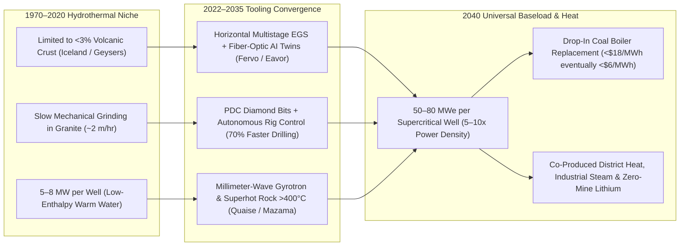
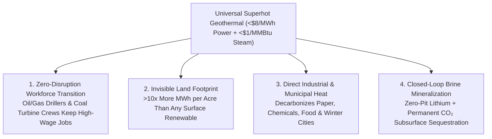

# VISION 01: ORDERS-OF-MAGNITUDE CHEAP-TO-FREE ENERGY
## Pathway 1D: Next-Generation & Superhot Rock Geothermal — *"The Believable Future, How It Came About, and the Deeper Horizon"*

> **The Cynic's Challenge:** *"Geothermal works great if you happen to live on top of an active volcano in Iceland, New Zealand, or Northern California. Everywhere else, drilling three to ten kilometers into hard crystalline granite breaks drill bits, costs tens of millions of dollars per well, and risks micro-seismic tremors. How could geothermal ever scale from a 0.5% geographic niche to a universal, near-free global baseload engine?"*

This report directly answers that **"HOW."** Beneath every square kilometer of Earth's crust sits an inexhaustible furnace: the top 10 kilometers of rock hold **more than $50,000\times$ the thermal energy of all global oil, gas, and coal reserves combined**, kept continuously hot (`150°C to 500°C+`) by primordial heat and radioactive decay. Between 2022 and 2036, the convergence of **polycrystalline diamond compact (PDC) horizontal drilling, AI fiber-optic fracture control, closed-loop subsurface radiators, and millimeter-wave gyrotron rock vaporization (borrowed directly from fusion reactors)** unlocked this heat everywhere on Earth—turning retiring coal stations into zero-emission geothermal power plants overnight.

---

## ACT I: A BELIEVABLE NEAR-FUTURE VISION
### A Crisp Autumn Morning in 2040 — The Furnace Beneath Every Town

Imagine standing in the heart of a former coal-mining valley in West Virginia—or the Ruhr Valley in Germany, Silesia in Poland, Datong in China, or the Latrobe Valley in Australia—on a cool October morning in **2040**.

Nothing about the town's skyline has been erased, and no massive land footprint was required. Instead, four quiet transformations define daily life:

1. **The Repowered Coal Station on the River:**
   Down by the river, the iconic 800-megawatt coal power station built in 1978 is still running at 98% capacity factor. Its high-voltage switchyard, synchronous steam turbines, and cooling system are unchanged—and the same union turbine mechanics and electrical engineers still work the shift. Only the boiler is gone. In the former coal-pile yard sits a **two-acre wellhead pad** no taller than a shipping container. Six kilometers straight down in $430^\circ\text{C}$ granite, closed and fractured superhot rock loops send supercritical steam rushing up to spin the existing turbines 24/7/365 with zero smoke, zero carbon, and zero fuel bills.
2. **Snow-Free Streets & Tropical Greenhouses in Winter:**
   After the $430^\circ\text{C}$ steam spins the high-pressure electricity turbines, the $110^\circ\text{C}$ residual thermal water doesn't get wasted up a cooling tower. It flows through an insulated municipal district-heating loop that warms every home, school, hospital, and factory in the county for a flat **\$8/month connection fee**, melts winter ice off highway bridges automatically, and heats 200 acres of glass greenhouses growing local citrus, peppers, and berries in the middle of January.
3. **Zero-Emission Lithium & Mineral Recovery from Brine:**
   At a sister geothermal wellhead twenty miles away, mineral-rich geothermal brine circulates through a closed-loop Direct Lithium Extraction (DLE) membrane module before returning underground—producing battery-grade lithium, silica, and manganese with **zero open-pit mining and zero evaporation ponds**.
4. **The Skeptic's Question:**
   To an observer from 2026, this sounds too seamless: *"Wait—how did we go from taking 100 days to drill a single granite well in Utah to drilling 8 kilometers deep anywhere on Earth and repowering coal plants at \$18/MWh?"*

Here is the exact physical, mathematical, and industrial convergence that made it happen.

---

## ACT II: THE CONVERGENCE BRIDGE — HOW IT CAME ABOUT (2021–2038)
### Diamond Bits, Fiber-Optic AI Twins, and Fusion-Beam Rock Vaporization

For a century, conventional "hydrothermal" geothermal required a rare geological lottery ticket: natural hot water, natural permeable fractures, and shallow volcanic depth all in the same spot. Starting in 2022, three converging breakthroughs allowed engineers to **manufacture permeability anywhere** and drill $5\times$ to $10\times$ faster through basement granite:

### 1. The Drilling & AI Convergence: PDC Diamond Bits + Distributed Acoustic Sensing (DAS)
* **Polycrystalline Diamond Compact (PDC) & Robotic Rigs:** Originally perfected by the US shale oil revolution, synthetic diamond cutter bits paired with high-torque downhole motors and automated rig-floor robotics were adapted for hard igneous granite at **DOE's Utah FORGE** and **Fervo Energy's** Nevada/Utah sites. Between 2022 and 2025, Fervo cut granite drilling times by **over 70%** (drilling a two-mile deep horizontal well in under 17 days) and reduced well costs from \$13M to under \$4.8M.
* **AI Subsurface Digital Twins:** By cementing high-temperature **fiber-optic cables** down the full length of every injection and production wellbore, Distributed Acoustic and Temperature Sensing (DAS/DTS) listens to fluid flow across 50+ multistage fractures in real time. Physics-informed AI controllers dynamically throttle valves at each fracture zone so water sweeps evenly through the hot rock—preventing thermal short-circuiting and suppressing induced seismicity below human perception.

### 2. The Physics Multiplier: Superhot Rock ($>400^\circ\text{C}$) & Directed-Energy Gyrotron Drilling
* **The Supercritical $10\times$ Leap:** Above **$374^\circ\text{C}$ and 22.1 MPa**, water enters its **supercritical phase**—behaving like a dense gas with zero surface tension, drastically lower viscosity, and **4 to 5 times higher specific enthalpy** than $200^\circ\text{C}$ liquid water. Because the fluid carries far more heat and converts to electricity at $>45\%$ Carnot/Rankine efficiency instead of $12\%$, **a single superhot geothermal well produces 40 to 60+ MWe—up to $10\times$ the power output of a conventional geothermal well.**
* **Fusion Gyrotrons Pointed Downward:** To reach $400^\circ\text{C}\text{–}500^\circ\text{C}$ rock anywhere on Earth (located at 3–5 km depth in the American West/Rift valleys, or 8–15 km depth under New England, Europe, or China) where mechanical steel drill strings soften, **Quaise Energy** adapted the **1-megawatt millimeter-wave gyrotron**—originally developed at MIT to heat fusion plasmas to 100 million degrees. Guided down a simple hollow waveguide tube with argon purge gas, the millimeter-wave beam **spalls, melts, and vaporizes basement granite into vitrified glass** with zero mechanical bit wear, automatically lining the borehole wall as it descends.

### 3. The 2024–2026 Global State of the Art (SOTA)
Next-generation geothermal has already transitioned from DOE test wells to multi-hundred-megawatt commercial grid plants backed by tech giants and sovereign utilities:

| Company / Initiative | Region | Subsurface Architecture | Verified 2024–2026 Milestone | Commercial Scale Pathway |
| :--- | :--- | :--- | :--- | :--- |
| **Fervo Energy** | USA (NV / UT) | Horizontal Multistage Enhanced Geothermal (EGS) + Fiber-Optic AI | **Project Red (NV)** delivering 24/7 power to Google since 2023; **Cape Station (UT)** drilled record 16-day granite wells, expanded to **500+ MW** (320 MW SCE PPA); raised \$500M+. | **2026 Phase I (100 MW)** & **2028 Phase II (400+ MW)** grid delivery at Cape Station; multi-GW pipeline across Western US. |
| **Eavor Technologies** | Canada / Germany | **Eavor-Loop™** Deep Closed-Loop Subsurface Radiator (Zero Fracking) | Drilling commercial multi-lateral closed loops in **Geretsried, Bavaria** (`~4.5 km` deep, >\$350M financing backed by EU Innovation Fund, EIB & Chubu Electric). | **2025–2026:** First commercial Eavor-Loop delivering electricity + district heat in Germany; scalable in any geology with zero water loss. |
| **Quaise Energy** | USA (MA / TX / OR) | Millimeter-Wave Gyrotron Directed-Energy Drilling (Superhot Rock) | Demonstrated 100 kW–1 MW gyrotron granite vaporization in field trials; selected Newberry Volcano (OR) for **500°C superhot rock** demonstration; raised \$95M+. | **2026–2028:** 500°C supercritical steam demonstration; **2030s:** 10–15 km deep drop-in coal-plant repowering globally. |
| **Sage Geosystems** | USA (TX) | **Geopressured Geothermal System (GGS)** — Earth Storage + Baseload | Completed commercial-scale geopressured mechanical energy storage & heat trials in Texas; signed **150 MW baseload agreement with Meta (2024–2025)**. | **2027:** First 150 MW Geopressured Geothermal phase powering Meta data centers + 18-hour grid storage. |
| **Mazama Energy** | USA (OR) | Superhot Rock ($>380^\circ\text{C}$) Enhanced Geothermal | Demonstrated sustained operations and thermal stimulation in **$385^\circ\text{C}+$ superhot rock** at Newberry, Oregon using high-temp cements and directional tools. | Commercial 50 MWe-per-well superhot modular blocks scaling to multi-GW Western interconnect capacity. |
| **Controlled Thermal Resources (CTR) & EnergySource** | USA (CA — Salton Sea) | Geothermal Baseload + Closed-Loop Direct Lithium Extraction (DLE) | Breaking ground on **Hell's Kitchen** (500 MW geothermal + 25,000+ t/yr battery-grade lithium hydroxide) with Stellantis/GM partnerships. | **2026–2028:** Co-producing 24/7 carbon-free electricity and domestic zero-mine EV lithium from a single brine loop. |
| **DOE *Utah FORGE* & Sinopec *Fushen-1*** | USA (UT) / China (Hainan) | Deep Crystalline Granite Testbed / 5,200m Ultra-Deep EGS | **Utah FORGE** proved 100% inter-well EGS circulation at $220^\circ\text{C}+$; **Sinopec** completed China's 5,200-meter *Fushen-1* scientific ultra-deep geothermal well (`>190°C`). | Open-source drilling bit, cement, and stimulation playbooks driving global learning curves down 25%/yr. |

---

## ACT III: PHASED ROLLOUT ROADMAP (2026–2050) & ECONOMIC CASCADE
### Transferring Trillions in Subsurface Oil & Gas Tooling to Clean Heat

Unlike technologies that must build a brand-new workforce from scratch, next-generation geothermal **directly employs the global oil and gas drilling industry's 2+ million engineers, directional drillers, rig fleets, and tubular supply chains.** As horizontal EGS and millimeter-wave superhot drilling ride the industrial learning curve, four economic multipliers drive baseload LCOE below **\$8/MWh**:

1. **The Shale-to-Granite Drilling Learning Curve (>25% Cost Drop per Year):**
   * At **Fervo Energy's** Cape Station in Utah, drilling the fourth horizontal granite well took **70% fewer days** than the first well just two years prior—repeating the exact multi-well pad learning curve that made US shale drilling the fastest subsurface industrialization in history.
   * Automated rig-floor pipe handling, AI rate-of-penetration (ROP) optimization, and long-life synthetic diamond PDC bits turn deep granite drilling into a predictable, repeatable manufacturing process.
2. **The Supercritical Enthalpy Multiplier ($5\text{–}10\times$ Fewer Wells per Gigawatt):**
   * In conventional $180^\circ\text{C}$ geothermal, a utility must drill **15 to 20 production and injection wells** to generate 100 MWe.
   * In a **$400^\circ\text{C}\text{–}500^\circ\text{C}$ superhot rock reservoir** (accessed via hybrid PDC + **Quaise** millimeter-wave gyrotron drilling or **Mazama** deep directional tools), supercritical water carries $5\times$ more thermal energy and converts to electricity at $>45\%$ efficiency—requiring **only 2 to 3 wells to generate 100+ MWe** and slashing subsurface CAPEX per megawatt by up to 75%.
3. **Zero Fuel Cost & Built-In Subsurface Thermal Storage:**
   * Not only is the Earth's heat 100% free and immune to commodity price spikes, but a fractured EGS or geopressured geothermal reservoir (**Sage Geosystems**) acts as a giant **underground pressure and thermal battery**—able to throttle output up and down within minutes to firm wind and solar on the regional grid.
4. **40% CAPEX Savings via Drop-In Coal Turbine Repowering:**
   * Drilling superhot geothermal loops directly adjacent to retiring coal power stations reuses the existing steam turbine, condenser, cooling towers, and gigawatt grid switchyard—eliminating nearly half the surface plant capital cost:

| Rollout Phase | Timeline | Drilling Depth & Temperature | Plant CAPEX (\$/kW) | Baseload LCOE (24/7 Firm) | Unlocked Societal & Industrial Thresholds |
| :--- | :--- | :--- | :--- | :--- | :--- |
| **Phase 1: Horizontal EGS Breakout** | **2026–2030** | 3 – 5 km depth (`180°C – 260°C`); PDC diamond bits; 5–10 GW global pipeline (*Cape Station, Geretsried, Meta/Google PPAs*). | \$3,200 – \$4,500/kW | **\$48 – \$68 / MWh** | 24/7 clean baseload for AI data centers and Western/Rift grids; cheaper than new gas peakers + carbon capture; zero-mine DLE lithium. |
| **Phase 2: Superhot Rock First Wave** | **2031–2036** | 4 – 8 km depth (`375°C – 450°C` supercritical water); hybrid PDC + spallation/gyrotron drilling; 40+ MWe per well. | \$1,900 – \$2,700/kW | **\$24 – \$36 / MWh** | Undercuts combined-cycle natural gas across 40% of global landmass; first 100 GW of coal power plant boiler replacements. |
| **Phase 3: Universal Deep Crust Access** | **2037–2044** | 8 – 15 km depth (`450°C – 520°C`); autonomous 1 MW gyrotron rigs vaporizing basement granite anywhere; 800+ GW deployed. | \$950 – \$1,500/kW | **\$11 – \$18 / MWh** | Every retiring coal/gas plant on Earth can be repowered in place; universal city district heating & snow-free northern infrastructure. |
| **Phase 4: Planetary Crustal Tap** | **2045–2055+** | Fully automated deep-crust heat exchangers; 50-year well lifespans; multi-TW electricity + thermal heat. | **<\$650 / kW** | **\$4 – \$8 / MWh** *(+\$1/MMBtu Heat)* | Virtually free 24/7 electricity and industrial process steam in every nation regardless of weather, latitude, or surface land scarcity. |

---

## ACT IV: THE DEEPER HORIZON & SMOOTH SOCIETAL TRANSITION
### The Ultimate "Just Transition" for Fossil Fuel Workers and Coal Towns

1. **1-to-1 Career Continuity for Oil, Gas, and Coal Communities:**
   * **Zero Stranded Workers:** The hardest social friction in the clean energy transition is the fear that millions of skilled oilfield drillers, mud engineers, geologists, roughnecks, and coal-plant operators will be left behind. Geothermal solves this completely: **a geothermal well is drilled by the exact same crews, using the exact same rigs, mud pumps, and directional software, as an oil and gas well.**
   * **Drop-In Coal Boiler Replacement:** Over 45% of the capital cost of a coal-fired power station sits in its steam turbine, generator, condenser, cooling towers, and high-voltage grid switchyard. When a superhot geothermal loop ($400^\circ\text{C}\text{–}500^\circ\text{C}$) is drilled next to a retiring coal plant, supercritical geothermal steam replaces the coal boiler directly—cutting geothermal plant CAPEX by **35% to 45%**, bypassing 8-year grid interconnection queues, and keeping the existing union utility workforce on the job for another 40 years.
2. **Smallest Surface Land Footprint on Earth (>10x More MWh per Acre):**
   * **Subsurface Scale, Surface Invisibility:** Because the entire heat exchanger sits 3 to 12 kilometers underground, a **500-megawatt superhot geothermal plant requires less than 5 to 10 acres of surface wellhead pads**—producing over $10\times$ more annual megawatt-hours per surface acre than wind or ground-mounted solar.
   * **Preserving Wild Nature & Urban Density:** Compact geothermal pads can be sited directly inside industrial parks, adjacent to metropolitan data-center corridors, or tucked beside forested valleys—leaving 99% of the surface landscape untouched for biodiversity, rewilding, and agriculture.
3. **Direct Industrial Steam, Municipal District Heating & Desalination:**
   * **Cascaded Thermal Abundance:** Nearly half of global energy consumption is thermal heat, not electricity. After $450^\circ\text{C}$ supercritical water spins high-pressure electricity turbines, its $100^\circ\text{C}\text{–}180^\circ\text{C}$ exhaust heat is piped directly into paper mills, food processing plants, chemical refineries, thermal seawater desalination units, and municipal district heating networks.
   * **Weather-Proof Northern Cities & Year-Round Agriculture:** Just as Reykjavik uses geothermal water to heat 90% of its buildings and keep streets snow-free all winter, deep closed-loop and EGS wells bring virtually free winter heating and heated glass greenhouses to cities across Canada, the Northern US, Central/Eastern Europe, and Northern Asia.
4. **Closed-Loop Brine Mining & Carbon-Negative $\text{sCO}_2$ Plumes:**
   * **Zero-Pit Lithium & Critical Minerals:** In deep sedimentary and rift basins (like California's Salton Sea, the Rhine Graben in Europe, and the Smackover formation), hot geothermal brines are rich in dissolved lithium, manganese, zinc, and potassium. Direct Lithium Extraction (DLE) sorption columns extract battery-grade lithium inside a closed room before re-injecting 100% of the brine back underground—eliminating open-pit mines and evaporation ponds.
   * **Carbon-Negative Electricity via Supercritical $\text{CO}_2$ ($\text{sCO}_2$):** Instead of circulating water, deep EGS loops can circulate captured atmospheric **supercritical carbon dioxide ($\text{sCO}_2$)**. Because $\text{sCO}_2$ has low viscosity and high thermal expansion, it creates a natural buoyant thermosiphon that drives compact surface turbines at higher efficiency while a portion of the $\text{CO}_2$ permanently mineralizes into solid carbonate rock deep underground—turning baseload electricity generation into an active atmospheric carbon sink.

---

## SUMMARY FOR THE SKEPTIC
Geothermal is no longer confined to volcanic hot spots:
1. **Drilling Speed Flipped:** At Cape Station in Utah, **Fervo Energy** already cut granite drilling times by **>70%** using synthetic diamond PDC bits and horizontal oilfield techniques, signing 500+ MW of utility and Google contracts.
2. **Closed-Loop & Geopressured Work Anywhere:** **Eavor** is completing its commercial closed-loop radiator in Bavaria with zero fracking, and **Sage Geosystems** signed a 150 MW baseload contract with Meta.
3. **Superhot Rock Multiplies Output $5\text{–}10\times$:** Above $374^\circ\text{C}$, supercritical water turns a single well into a 40–60 MWe powerhouse, while **Quaise Energy's** fusion-derived gyrotron beams vaporize granite to reach $500^\circ\text{C}$ rock at 10+ km depth.
4. **The Smoothest Human Transition:** By employing the oil and gas drilling workforce to repower retiring coal turbines in place, geothermal turns yesterday's fossil-fuel infrastructure into tomorrow's inexhaustible clean heat engine.
