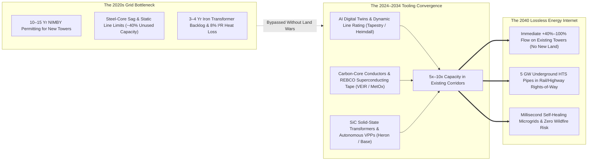
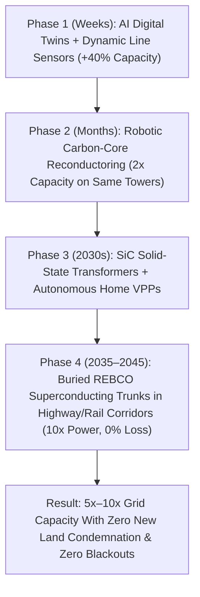

# VISION 01: ORDERS-OF-MAGNITUDE CHEAP-TO-FREE ENERGY
## Pathway 1E: Lossless Superconducting Grids, Solid-State Routing & Autonomous VPPs — *Upgrading the World's Nervous System Without Waiting 15 Years for New Towers*

> **The Cynic's Objection:** *"Even if fusion, solar, and batteries make electricity almost free at the power plant, we can't move it! Over 2,600 gigawatts of clean energy are stuck in 7-year grid interconnection queues, transformers have a 4-year factory backlog, high-voltage transmission lines take 15 years of NIMBY lawsuits to permit, and 8% to 10% of all electricity is lost as heat in copper and aluminum wires."*
>
> **The Core Thesis:** We do not have to condemn a single new acre of land or wait 15 years for steel lattice towers to triple the capacity of the global grid. A rapid convergence of **AI grid digital twins**, **carbon-core reconductoring & dynamic line sensors**, **Silicon Carbide solid-state transformers**, and **zero-resistance High-Temperature Superconducting (REBCO) underground cables** allows humanity to push **2x to 10x more power through existing towers, highway medians, and rail corridors**. Paired with autonomous residential Virtual Power Plants (VPPs), the grid transforms from a brittle 1920s copper bottleneck into a self-healing, lossless energy internet.

---

## ACT I: A BELIEVABLE NEAR-FUTURE VISION
### A Summer Heatwave in 2040 — The Invisible, Lossless Grid

Imagine a scorching August afternoon in **2040** in Texas, California, Southern Europe, or India. Temperatures hit $43\text{ °C}$ ($110\text{ °F}$). Air conditioners, gigawatt AI data centers, desalination plants, and fast-charging electric trucks are all drawing peak power simultaneously.

In the 2020s, this afternoon meant emergency conservation alerts, wildfire shutoffs from sagging overhead wires, and distribution delivery fees that doubled household electric bills. In 2040, the grid is invisible, silent, and effortless:

1. **The Green Greenway Where High-Voltage Pylons Used to Stand:**
   * Running alongside the interstate highway into the city is a shaded bicycle path and native wildflower corridor.
   * Five feet beneath the soil lies a pair of **cryogenic High-Temperature Superconducting (HTS) cables** only 15 centimeters (6 inches) in diameter.
   * Using **REBCO superconducting tape** cooled by closed-loop liquid nitrogen, this single narrow trench carries **5 gigawatts of power**—equivalent to five massive nuclear plants or ten legacy 500-kV overhead tower corridors—with **zero resistive energy loss ($R = 0$)** and zero wildfire spark risk.
2. **The Suitcase-Sized Solid-State Substation:**
   * At the neighborhood corner and the nearby AI compute park, the sprawling, oil-filled 1970s iron transformer yards—which once took 3 to 4 years to manufacture—have vanished.
   * In their place sit quiet, modular **Silicon Carbide (SiC) Solid-State Transformers (SSTs)** the size of a commercial refrigerator.
   * Operating like high-speed internet routers for electrons, they convert high-voltage AC and DC in microseconds, isolate faults before a single spark can form, and feed direct DC power straight into data centers and EV plazas at **99.2% efficiency**.
3. **Existing Regional Towers Carrying Triple the Power:**
   * Out across rural mountain passes, the original steel transmission towers built in the 1960s still stand on their existing rights-of-way—no new forests were cleared.
   * Yet robotic line-stringing drones restrung those towers years ago with **carbon-fiber composite core conductors** studded with glowing **spherical AI sensor orbs**, tripling the power flowing through the exact same corridor with zero thermal sag.
4. **Your Home as an Autonomous Revenue Node:**
   * When desert solar peaks 1,500 kilometers away, continental HVDC and superconducting trunks deliver those electrons to your city with less than 2% loss.
   * Your home's **autonomous VPP gateway** charges your domestic buffer at \$0.004/kWh and automatically synchronizes with 500,000 neighboring homes to absorb micro-fluctuations, earning you a quarterly stability credit that zeroes out your grid delivery fee.

---

## ACT II: THE CONVERGENCE BRIDGE — HOW IT CAME ABOUT (2021–2038)
### How Materials Science, Power Semiconductors, and AI Unblocked the Grid

### 1. The Rapid Convergence of Scientific, Mathematical & Physical Tooling
Why did the "15-year transmission bottleneck" dissolve so much faster than legacy utility planners predicted? Because three exponential technologies converged on the grid from outside traditional utility engineering:

* **Mathematical & AI Tooling (Physics-Informed Digital Twins):**
  * For a century, utilities ran transmission lines at conservative "static seasonal ratings"—leaving **30% to 50% of existing wire capacity unused** for fear of overheating on a hot, windless day, while taking 5 years to run manual engineering studies for each new solar or fusion plant in the interconnection queue.
  * AI platforms like Alphabet X's **Tapestry** and **Pearl Street Technologies** ingested decades of phasor measurements and weather physics into unified neural grid simulations—shrinking 5-year interconnection studies into **48-hour automated simulations** and routing power dynamically around congestion like Waze routes traffic around a highway jam.
* **Materials Science Symbiosis (Carbon Composites & Fusion-Born REBCO Tape):**
  * First, replacing heavy, heat-sagging steel cores inside overhead wires with ultra-light **trapezoidal aluminum around a carbon-fiber composite core** (**TS Conductor**, **CTC Global**) allowed utilities to double ampacity on existing towers without reinforcing the steel pylons.
  * Second, the commercial fusion boom (**CFS**, **Energy Singularity**) triggered a **20x manufacturing scale-up of Rare-Earth Barium Copper Oxide (REBCO)** superconducting tape (**MetOx**, **Faraday**, **SuperPower**). Grid engineers realized that the exact same REBCO tape used for 20-Tesla fusion magnets could be wound into coaxial power cables (**VEIR**, **SuperNode**) that conduct **5 to 10 times more current than copper with zero electrical resistance ($R = 0$)** at liquid-nitrogen temperatures ($77\text{ K}$).
* **Physical & Semiconductor Tooling (SiC Power Electronics & Robotic Reconductoring):**
  * Wide-bandgap **Silicon Carbide (SiC)** and **Gallium Nitride (GaN)** semiconductors—scaled by the EV inverter revolution—enabled **Solid-State Transformers (SSTs)** (**Heron Power**, **DG Matrix**) that switch megawatts at tens of kilohertz, shrinking transformer iron mass by 80% and moving production from artisanal hand-wound coil shops to automated electronics assembly lines.
  * Simultaneously, **live-line robotic stringing rigs and heavy-lift drones** allowed crews to install sensors and restring carbon-core cables without de-energizing corridors.

### 2. The 2025–2026 Global State of the Art (SOTA) — Deployed Hardware & Software
By 2026, these technologies were no longer theoretical papers—they were actively unlocking gigawatts across North America, Europe, and Asia:

| Technology Layer & Leaders | Core Hardware / Software Architecture | Verified 2024–2026 Milestone | Grid Capacity & Cost Impact |
| :--- | :--- | :--- | :--- |
| **Superconducting Transmission** *(VEIR, SuperNode, MetOx, Ultera)* | Evaporative/Cryogenic Liquid-$\text{N}_2$ Cooled **REBCO HTS Cables** | **2024–2026:** VEIR completed full-scale 1,000-Amp HTS overhead/buried trials & commercial data-center feeder contracts; MetOx scaling multi-thousand-km REBCO tape lines. | **5x–10x power** in 1/5th the right-of-way width at lower voltage; **0% resistive line loss**; drops into existing trenches & data-center corridors. |
| **Dynamic Line Rating (DLR) & GETs** *(Heimdall Power, LineVision, Smart Wires)* | Live-Line AI Sensor Orbs (*"Neuron"*) + LiDAR + Modular Power Flow Control | **2024–2026:** Heimdall Power & LineVision deployed across US (Great River Energy, AES, National Grid) & European utilities, unlocking **+30% to +42% line capacity** in weeks. | **<\$100k/mile** (vs. \$3M+/mile for new lines); unlocks hundreds of GW on existing towers immediately with zero permitting delay. |
| **Advanced Carbon Reconductoring** *(TS Conductor, CTC Global ACCC)* | Carbon-Fiber Composite Core + Annealed Trapezoidal Aluminum | **2024–2026:** CTC Global surpassed **175,000 km** deployed in 65+ countries; NextEra, AEP & Montana-Dakota Utilities scaling TS Conductor; U.S. FERC Order 1920 & DOE *Speed to Power* Mandate. | **2x ampacity** on existing towers & **28%–35% lower line losses**; installed in 18–24 months at <50% the cost of new transmission lines. |
| **Solid-State Transformers (SST)** *(Heron Power, DG Matrix, Amperesand)* | Medium-Voltage Silicon Carbide (SiC) Solid-State Power Routers | **2025–2026:** Drew Baglino's **Heron Power** & **DG Matrix** commercializing modular multi-MW solid-state transformers for gigawatt AI data centers, solar & storage hubs. | **75% smaller footprint**, automated factory production (ending 4-yr transformer backlogs), native AC/DC conversion & microsecond fault isolation. |
| **HVDC Supergrids & Breakers** *(Hitachi Energy, Siemens Energy, GE Vernova)* | $\pm 800\text{–}1,100\text{ kV}$ Ultra-High-Voltage DC & Hybrid Solid-State Breakers | **2024–2026:** Multi-GW HVDC interconnectors (*Champlain Hudson, SunZia, NeuConnect, China UHVDC*) moving 3–12 GW over 1,000–3,000 km at <3% loss. | Connects sunny deserts, windy plains, and offshore hubs across time zones; shares continental reserves seamlessly. |
| **AI Grid Digital Twins** *(Tapestry [Alphabet X], Pearl Street, Camus)* | Physics-Informed Neural Power Flow & Automated Interconnection | **2024–2026:** Tapestry deployed with PJM, National Grid, CEN (Chile) & AusGrid; automated interconnection tools cutting study queues from **4+ years to days**. | Clears the 2,600 GW global clean-energy backlog; predicts weather/load spikes hours ahead and prevents cascading blackouts. |
| **Autonomous VPP & Microgrids** *(Base Power, Lunar Energy, Span, Octopus)* | Distributed Residential/Commercial Battery Swarms + AI Dispatch | **2025–2026:** **Base Power** deploying 25+ kWh home batteries across ERCOT (Texas) for <\$600 upfront, aggregating into a fast-responding multi-hundred-MW virtual power plant. | Turns consumer homes into paid grid infrastructure; shaves peak distribution load by 40% without upgrading neighborhood wires. |

---

## ACT III: PHASED ROLLOUT ROADMAP (2026–2050) & ECONOMIC CASCADE
### From Squeezing Existing Wires to a Lossless Continental Supergrid

The brilliance of the modern grid transition is its **chronological sequencing**: we do not wait for superconducting cables to fix today's grid. Software and sensors unlock +35% capacity in *weeks*; carbon reconductoring doubles capacity in *months*; and solid-state transformers + HTS corridors scale across the 2030s.

| Rollout Phase | Timeline | Primary Grid Upgrade Mechanism | Effective Corridor Capacity Gain | Transmission & Distribution Loss | Societal & Industrial Thresholds Unlocked |
| :--- | :--- | :--- | :--- | :--- | :--- |
| **Phase 1: Sensor & Software Unlock** | **2026–2029** | AI Interconnection Twins (**Tapestry**) + Dynamic Line Rating (**Heimdall/LineVision**) + FERC 1920 mandates. | **+30% to +45%** on existing lines *(in <6 months)* | Drops from ~8.5% to **~6.8%** | **1,000+ GW of queued solar, wind & batteries** connected to existing grids without building new tower corridors. |
| **Phase 2: Carbon Reconductoring & SSTs** | **2029–2035** | Robotic restringing of **500,000+ km** with Carbon-Core (**TS/CTC**) + factory rollout of SiC **Solid-State Transformers** (**Heron/DG Matrix**). | **2.0x to 2.5x** on existing towers *(zero new land)* | Drops to **~4.5%** | Transformer backlogs permanently eliminated; gigawatt AI data centers, fusion plants & EV depots plug in within 90 days. |
| **Phase 3: HTS Super-Pipelines & HVDC** | **2035–2042** | Buried **REBCO Superconducting (HTS)** trunks (**VEIR/SuperNode**) along rail/highway rights-of-way + continental HVDC meshes. | **5x to 10x** per meter of corridor width | Drops to **~2.0%** | Ugly urban high-voltage pylons dismantled & returned to parkland; wildfire power-line ignition risk reaches **0%**. |
| **Phase 4: Lossless Planetary Energy Web** | **2042–2050+** | Fully autonomous self-healing VPP microgrids linked by transcontinental HTS/HVDC backbones across time zones. | **10x+ Global Throughput** | **<1.0%** *(Near-Lossless)* | Midday desert solar and coastal fusion flow across continents for **<\$0.002/kWh delivery cost**; blackouts become extinct. |

### The Self-Compounding Feedback Loop: Free Energy + Robotics Upgrading the Grid
Why do grid expansion costs drop exponentially across Phases 2 through 4?
1. **Fusion & Superconducting Grids Share the Exact Same Supply Chain:**
   * Commercial fusion reactors require thousands of kilometers of 20-Tesla **REBCO superconducting tape** per plant.
   * As automated physical vapor deposition (PVD) and ion-beam-assisted deposition (IBAD) factories scale REBCO production by $50\times$, the cost per kiloamp-meter collapses via Wright's Law—making zero-loss underground HTS grid cables cheaper per megawatt-mile than conventional high-voltage copper or aluminum.
2. **Robotic Trenching & Live-Line Drone Deployment:**
   * Autonomous tunnel-boring micro-moles lay 15-cm cryogenic HTS pipes beneath highway shoulders at $5\times$ the speed and $1/4\text{th}$ the civil-engineering cost of legacy open-cut street trenching.
   * Heavy-lift line-stringing drones and robotic climbers restring existing transmission towers while lines remain energized, eliminating costly grid downtime.

---

## ACT IV: THE DEEPER HORIZON & SMOOTH SOCIETAL TRANSITION
### Why Upgrading the Grid Heals Landscapes and Slashes Household Bills

In the 2020s, electric utility bills rose in many regions not because generating electricity got more expensive—solar and wind were the cheapest power in history—but because **grid delivery, wildfire liability, and antiquated transformer maintenance costs ballooned.** The convergent grid overhaul reverses that equation:

* **Zero Eminent Domain Wars (Using the Bones We Already Built):**
  * Rural farmers, Indigenous communities, and suburban towns no longer face 15-year legal battles over 150-foot steel transmission towers slicing through farms and forests.
  * First, carbon-core reconductoring doubles power on *existing* towers. Next, 15-cm underground superconducting pipes slide silently beneath existing highway medians, railroad tracks, and pipeline easements.
* **The End of Grid-Sparked Wildfires & Storm Blackouts:**
  * Hot, sagging bare-metal lines striking dry trees caused some of the deadliest wildfires of the early 21st century.
  * Carbon-core conductors do not sag under high heat; solid-state transformers cut off fault currents in **microseconds** (1,000x faster than mechanical breakers, before an arc can ignite dry brush); and underground HTS cables eliminate overhead weather exposure entirely.
* **Reclaiming Urban Land & Beautifying Cities:**
  * As narrow underground superconducting cables replace wide, buzzing overhead high-voltage corridors in metropolitan areas, tens of thousands of acres of blighted urban utility easements are converted into linear parks, housing, and tree-lined greenways.
* **Turning Every Household from a Passive Ratepayer into a Paid Grid Partner:**
  * Through models pioneered by **Base Power**, **Lunar Energy**, and **Octopus**, utilities no longer spend billions building peak distribution substations used only 20 hours a year.
  * Instead, millions of homes get subsidized plug-and-play battery gateways that guarantee uninterruptible backup power during storms while sharing a fraction of their buffer to keep neighborhood distribution lines cool and cheap for everyone.

---

### Summary for the Skeptic
1. **We Don't Need 15 Years of Permitting to Expand the Grid Today:** Dynamic Line Rating (**Heimdall Power, LineVision**) and advanced carbon-core reconductoring (**CTC Global, TS Conductor**) are already unlocking **+40% to +100% more capacity on existing towers** in months, at less than half the cost of new lines.
2. **The Transformer Backlog Is Being Solved by Semiconductors:** Just as solid-state flash memory replaced spinning hard drives, Silicon Carbide **Solid-State Transformers** (**Heron Power, DG Matrix**) replace custom hand-wound iron-and-oil tanks with mass-manufactured power electronics.
3. **Fusion & Superconducting Grids Share the Exact Same Supply Chain:** The multi-billion-dollar scale-up of **REBCO high-temperature superconducting tape** (**MetOx, VEIR, SuperNode**) means zero-resistance, 5-gigawatt underground cables are riding the exact same Wright's Law cost collapse as compact fusion reactors.
4. **AI Runs the Grid at the Speed of Light:** Physics-informed digital twins (**Alphabet X Tapestry**) and autonomous residential VPPs (**Base Power**) transform a rigid, century-old copper machine into an adaptive, self-healing network ready for an era of limitless energy.
