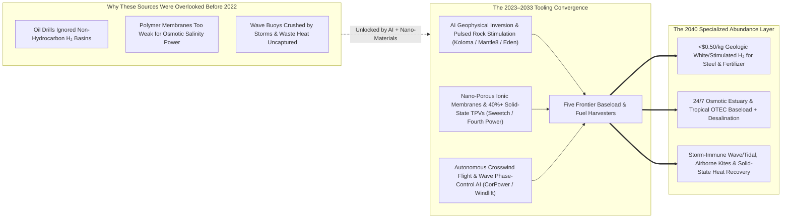
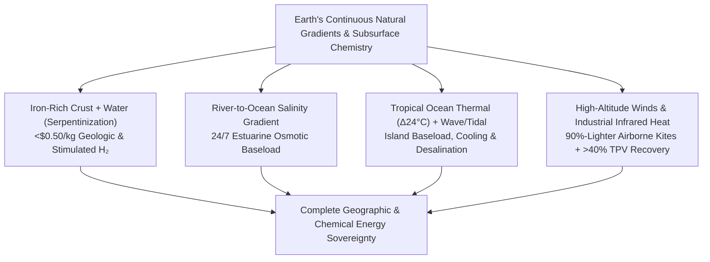

# VISION 01: ORDERS-OF-MAGNITUDE CHEAP-TO-FREE ENERGY
## Pathway 1F: Frontier & Unconventional Clean Harvesters — *Geologic White Hydrogen, Osmotic Estuaries, Ocean Thermal, Airborne Wind & Solid-State Heat Recovery*

> **The Cynic's Objection:** *"Even with solar, wind, and fusion, what about heavy chemicals, fertilizer, and steel that need millions of tons of cheap clean hydrogen today? Electrolyzed green hydrogen costs \$5 to \$8 per kilogram, tropical island nations have no land for massive solar farms, northern coastlines face dark stormy winters, and half of all industrial energy is still thrown away into the sky as waste heat."*
>
> **The Core Thesis:** Beyond solar, wind, fission, fusion, and geothermal lies a massive, untapped frontier of **continuous planetary energy gradients and subsurface chemical reservoirs**. A rapid convergence of **AI geophysical basin modeling**, **nano-fluidic osmotic membranes**, **40%+ efficient solid-state thermophotovoltaics (TPVs)**, and **autonomous flight/marine control algorithms** has unlocked five breakthrough harvesters: **\$0.50/kg Geologic "White/Gold" Hydrogen** pumped straight from Earth's crust, **24/7 Osmotic & Ocean Thermal (OTEC) baseload**, **biomimetic wave/tidal arrays**, **airborne wind kites**, and **solid-state waste-heat recovery**. Together, they fill every geographic and industrial niche that mainstream renewables leave behind.

---

## ACT I: A BELIEVABLE NEAR-FUTURE VISION
### A Global Tour in 2040 — Harvesting the Planet's Hidden Gradients

Imagine visiting four very different communities in **2040**—none of which rely on sprawling solar fields or giant nuclear stations for their primary industrial lifeblood:

1. **The Mid-Continent Green Ammonia & Steel Belt (Kansas, Mali, South Australia, or France):**
   * Out on a quiet prairie sits a wellhead no larger than a backyard gazebo, connected directly to an existing natural-gas pipeline and a regional fertilizer cooperative.
   * One kilometer underground, water reacting naturally with iron-rich olivine rock (**serpentinization**) continuously generates **96%-pure geologic "White" Hydrogen**.
   * Pumped to the surface at **\$0.45 per kilogram**—requiring zero electrolyzers, zero grid electricity, and emitting zero carbon—this clean hydrogen reduces iron ore into green steel and synthesizes carbon-free ammonia fertilizer that cut regional food production costs by 40%.
2. **The River Delta Port (The Rhône, Mississippi, Nile, or Mekong Estuary):**
   * Where fresh river water flows into the salty ocean sits a silent architectural pavilion housing modular banks of **biomimetic nano-fluidic osmotic membranes**.
   * Harnessing the natural salinity pressure gradient between fresh and salt water (**equivalent to a 270-meter-high waterfall**), this **Osmotic "Blue Energy"** plant generates 500 megawatts of 24/7, weather-immune baseload electricity without damming a single fish migration route.
3. **The Tropical Island & Coastal Archipelago (Caribbean, Indonesia, Hawaii, or Okinawa):**
   * Three kilometers offshore floats a low-profile **Ocean Thermal Energy Conversion (OTEC)** platform and a synchronized line of **phase-controlled wave buoys**.
   * By pairing warm $28\text{ °C}$ surface seawater with icy $4\text{ °C}$ deep ocean water pumped from 1,000 meters down, the OTEC hub delivers continuous 24/7 electricity, pipes free chilled deep seawater ashore for district air-conditioning and desalinated drinking water, and permanently ended the island's dependence on imported diesel barges.
4. **The Zero-Waste Foundry & Remote Arctic Sensor Web:**
   * Back in an industrial glass and silicon factory, panels of **solid-state Thermophotovoltaic (TPV) cells** line the furnace flues—absorbing infrared glow and converting waste heat directly into electricity at **42% efficiency** with zero moving parts.
   * Meanwhile, deep in ocean trenches and bridge foundations, structural sensors run for 50 years without maintenance on **diamond betavoltaic micro-cells** made from recycled nuclear graphite.

---

## ACT II: THE CONVERGENCE BRIDGE — HOW IT CAME ABOUT (2021–2038)
### How AI Geophysics, Nano-Membranes, and Autonomous Control Unlocked the Frontier

### 1. The Rapid Convergence of Scientific, Mathematical & Physical Tooling
Why did five seemingly unrelated energy technologies—geologic hydrogen, osmotic blue energy, marine wave/OTEC, airborne wind, and solid-state heat recovery—all cross the commercial threshold between 2024 and 2030? Because they were unlocked by the **exact same triad of modern tooling**:

* **Mathematical & AI Geophysical / Control Models:**
  * For a century, petroleum geologists drilled exclusively in sedimentary basins and didn't even equip mud-gas detectors to measure hydrogen ($\text{H}_2$). Beginning in 2023–2026, startups like **Koloma** and **Mantle8** trained physics-informed AI inversion models on continental gravity, magnetic, and seismic datasets—pinpointing deep Precambrian iron-rich cratons where Earth's crust generates millions of tons of clean hydrogen via serpentinization ($\text{3FeO} + \text{H}_2\text{O} \rightarrow \text{Fe}_3\text{O}_4 + \text{H}_2$).
  * In the ocean and sky, real-time reinforcement learning controllers allowed **CorPower Ocean's** wave buoys to detune themselves in milliseconds during 18-meter storm waves and phase-lock with normal swells to amplify energy capture by **$300\%$**, while autonomous flight computers (**Windlift**, **Kitepower**) flew tethered carbon-fiber wings in figure-eight crosswind loops at $300\text{–}500\text{ meters}$ altitude where winds are twice as strong and steady.
* **Materials Science at the Atomic Scale (Nano-Membranes & III-V TPV Semiconductors):**
  * Osmotic salinity-gradient power stalled in the 2000s because conventional plastic membranes produced less than $1\text{ W/m}^2$. **Sweetch Energy** combined nano-fluidics with abundant bio-sourced cellulosic materials (**INOD technology**) to create ionic channels that boosted power density **$10\times$ to $20\times$** at a fraction of the cost.
  * Simultaneously, multi-junction **III-V semiconductor Thermophotovoltaic (TPV) cells** containing backside gold infrared mirrors (**MIT / Fourth Power / Antora**) crossed the **40% efficiency threshold**—reflecting unusable low-energy infrared photons back into the heat source while converting high-energy photons directly into DC electricity.
* **Physical & Subsurface Robotic Tooling:**
  * Where natural geologic hydrogen traps lacked permeability, **Eden GeoPower** and **ARPA-E's Geologic $\text{H}_2$ teams** deployed pulsed high-voltage electric stimulation and directional catalysis—injecting trace water/CO₂ into hot iron-rich peridotite rock to stimulate *in-situ* "Gold/Orange" hydrogen on demand while mineralizing carbon underground.

### 2. The 2025–2026 Global State of the Art (SOTA) — Verified Projects & Leaders
By 2026, billions of dollars in institutional capital (Breakthrough Energy, ARPA-E, EDF, Equinor, Toyota, BHP, Mitsubishi) had moved these frontier harvesters into field operations:

| Frontier Modality & Leaders | Physical / Chemical Mechanism | Verified 2024–2026 Milestone | Commercial Cost & Niche Unlocked |
| :--- | :--- | :--- | :--- |
| **Geologic "White" Hydrogen** *(Koloma, Mantle8, HyTerra, Gold Hydrogen)* | Subsurface Serpentinization & Radiolysis ($\text{Fe}^{2+}$ Rock + $\text{H}_2\text{O} \rightarrow \text{H}_2$) | **2024–2026:** **Koloma** raised **\$395M+** (Breakthrough Energy, Amazon, United); **HyTerra** & **Gold Hydrogen** drilling multi-well campaigns in Kansas (Nemaha Ridge) & South Australia; **Mantle8** mapping European cratons. | **\$0.50 – \$1.00 / kg $\text{H}_2$** with near-zero carbon footprint; direct feedstock for green ammonia fertilizer, steel & aviation fuel. |
| **Stimulated In-Situ Hydrogen** *(Eden GeoPower, ARPA-E $\text{Geo-H}_2$, Lavoisier)* | Pulsed Electrical Permeability + Catalyzed Subsurface Serpentinization | **2024–2026:** U.S. DOE **ARPA-E** awarded \$20M+ across 16 projects to accelerate stimulated subsurface $\text{H}_2$ production; **Eden** field-testing pulsed electro-stimulation in mafic rock. | Turns global ultramafic/peridotite rock formations into inexhaustible, engineered underground hydrogen reactors. |
| **Osmotic Salinity "Blue Energy"** *(Sweetch Energy, SaltPower)* | Nano-Fluidic Ionic Exchange Across River/Seawater Salinity Gradients | **2024–2026:** **Sweetch Energy** & **Compagnie Nationale du Rhône (CNR) / EDF** launched first grid-connected osmotic pilot at the **Rhône River delta (Barcarin, France)**. | **~2,600 TWh/yr** global estuarine potential; continuous 24/7 baseload right at major coastal port cities with zero visual or ecological footprint. |
| **Ocean Thermal (OTEC)** *(Global OTEC, Makai Ocean Engineering)* | Closed-Cycle Rankine Engine Between $28\text{ °C}$ Surface & $4\text{ °C}$ Deep Seawater | **2024–2026:** **Global OTEC** advancing *Dominique* barge for São Tomé and Príncipe & EU *PLOTEC* storm-resistant hull; **Makai** operating OTEC test facility in Kona, Hawaii. | **24/7 tropical baseload + free desalinated water + deep-water cooling** for 1,000+ island & equatorial coastal regions replacing \$0.40/kWh diesel. |
| **Biomimetic Wave & Tidal Stream** *(CorPower Ocean, Orbital Marine Power)* | Phase-Controlled Resonant Wave Buoys & Floating 2-MW Tidal Turbines | **2024–2026:** **CorPower C4** survived 18.5m Atlantic storms in Portugal while tripling power capture; **Orbital Marine O2** delivering continuous grid power in Orkney, Scotland & scaling US/EU arrays. | Predictable winter-peaking coastal power that complements solar (waves and tides peak precisely when winter sunlight is lowest). |
| **Airborne Wind Energy (AWES)** *(Windlift, Kitepower, SkySails Power)* | Autonomous Crosswind Tethered Drones / Kites at $300\text{–}600\text{ m}$ Altitude | **2024–2026:** **Kitepower** (*Hawk* battery-integrated container) & **Windlift** operating autonomous commercial & defense microgrid units using **90% less mass** than steel wind towers. | Rapidly deployable clean power in remote communities, islands, disaster zones, and offshore vessels without heavy cranes or concrete foundations. |
| **Solid-State TPV & Betavoltaics** *(Fourth Power, Antora Energy, Arkenlight)* | >40% Multi-Junction Thermophotovoltaics & Carbon-14 Diamond Cells | **2024–2026:** **Fourth Power** demonstrated **>40% TPV efficiency** with $2,400\text{ °C}$ liquid-tin/carbon blocks; **Arkenlight** & UKAEA fabricated multi-decade **Carbon-14 diamond betavoltaic** batteries. | Captures industrial furnace waste heat as cheap electricity; powers structural, subsea & medical IoT sensors for **50+ years** without wire or battery swaps. |

---

## ACT III: PHASED ROLLOUT ROADMAP (2026–2050) & ECONOMIC CASCADE
### Filling Every Geographic and Chemical Gap in the Global Energy Matrix

| Rollout Phase | Timeline | Commercial Deployment Scale | Benchmark Cost Metrics | Societal & Industrial Thresholds Unlocked |
| :--- | :--- | :--- | :--- | :--- |
| **Phase 1: Basin Discovery & Coastal Pilots** | **2026–2030** | First commercial geologic $\text{H}_2$ fields (Kansas, Mali, Australia, France); 10–50 MW Osmotic, OTEC & Wave/Tidal arrays. | **\$0.80–\$1.20/kg** Geologic $\text{H}_2$ **\$65–\$95/MWh** Marine/Osmotic | Undercuts dirty Steam-Methane Reforming (grey $\text{H}_2$) without subsidies; tropical islands begin retiring diesel generator barges. |
| **Phase 2: Pipeline Integration & Port Scale** | **2031–2037** | **15+ Mt/yr** geologic & stimulated $\text{H}_2$; multi-GW osmotic plants at major world river deltas; TPV heat recovery on heavy furnaces. | **\$0.45–\$0.70/kg** Geologic $\text{H}_2$ **\$32–\$48/MWh** Osmotic/Wave **\$18/MWh** TPV Waste-Heat Power | Global nitrogen fertilizer and direct-reduced green steel decouple permanently from natural gas volatility. |
| **Phase 3: Stimulated Crustal & Ocean Maturity** | **2038–2045** | **100+ Mt/yr** clean subsurface $\text{H}_2$; 200+ GW combined OTEC, Osmotic, Wave & Airborne Wind across coastal/island belts. | **<\$0.35/kg** Stimulated $\text{H}_2$ **\$15–\$25/MWh** 24/7 Ocean/Estuary | Every tropical archipelago and winter-bound northern coastline achieves 100% weather-resilient local energy & water sovereignty. |
| **Phase 4: Planetary Gradient Equilibrium** | **2045–2050+** | Fully automated subsurface $\text{H}_2$ loops, ubiquitous industrial TPV heat recycling & maintenance-free betavoltaic sensor webs. | **<\$0.25/kg** $\text{H}_2$ \| **<\$10/MWh** Marginal Gradient Power | Zero industrial waste heat lost; zero-carbon chemical feedstocks, plastics, and fertilizers become dirt-cheap planetary commodities. |

### The Self-Compounding Feedback Loop: Free Energy + Automation Unlocking the Earth
1. **Repurposing Oil & Gas Drilling Fleets and Pipelines:**
   * Rather than stranding the skills of millions of geoscientists, directional drillers, and pipeline workers, **geologic and stimulated hydrogen** uses the exact same rotary drilling rigs, wellheads, and gas pipeline networks—guided by AI subsurface models and automated drilling rigs to extract clean $\text{H}_2$ instead of fossil methane.
2. **Roll-to-Roll Nano-Manufacturing:**
   * Both **Sweetch Energy's** osmotic membranes and **Fourth Power / Antora's** solid-state TPV wafers are manufactured on high-speed automated roll-to-roll and semiconductor foundry lines—meaning their costs plummet along the same 20%+ Wright's Law learning curve as solar cells and Li-ion foils.
3. **Autonomous Offshore Deployment & Maintenance:**
   * Uncrewed surface vessels (USVs) and subsea robotics install and inspect **CorPower** wave anchors, **Orbital Marine** tidal moorings, and **Global OTEC** cold-water pipes at a fraction of legacy offshore oil-rig marine charter costs.

---

## ACT IV: THE DEEPER HORIZON & SMOOTH SOCIETAL TRANSITION
### Why Frontier Harvesters Make the Transition Inclusive for Every Geography and Worker

A single-technology energy transition risks leaving behind regions without sunny deserts, workers in fossil drilling basins, or island nations crippled by fuel imports. These frontier harvesters ensure **no region and no workforce is left behind**:

* **A Just, High-Paying Transition for Oil & Gas Communities:**
  * In Texas, Oklahoma, Alberta, the Gulf Coast, and Australia, drilling crews do not have to abandon their towns or take pay cuts.
  * The exact same subsurface engineering expertise transitions seamlessly to drilling geologic white-hydrogen wells and stimulated peridotite reservoirs.
* **Cheap, Sovereign Fertilizer for Global Food Security:**
  * Historically, whenever natural gas prices spiked, ammonia fertilizer prices skyrocketed—triggering food inflation and hunger across the developing world.
  * Because iron-rich Precambrian cratons exist across **West and East Africa, Brazil, India, and the American heartland**, local geologic hydrogen wells allow farming regions to synthesize their own carbon-free nitrogen fertilizer on-site at **<\$0.50/kg $\text{H}_2$**, insulating global food supply from geopolitical gas shocks forever.
* **Paradise Restored for Island & Coastal Nations:**
  * Over 700 million people live on islands or tropical coastlines where land is too scarce and ecologically precious to pave over with solar panels, and where imported diesel costs \$0.35–\$0.50/kWh.
  * Offshore **OTEC**, **wave buoys**, and **airborne wind kites** sit quietly on the horizon—delivering 24/7 electricity, free deep-ocean air-conditioning, nutrient-rich aquaculture water, and desalinated drinking water while leaving island rainforests and beaches untouched.
* **Turning Nuclear Graphite Waste & Industrial Heat into Permanent Assets:**
  * Instead of burying legacy nuclear graphite waste, **Carbon-14 diamond betavoltaic cells** (**Arkenlight**) upcycle it into 50-year maintenance-free micro-batteries for pacemakers, deep-sea cables, and civil infrastructure sensors.
  * Meanwhile, solid-state **TPV arrays** capture the 50% of industrial energy previously lost up smokestacks as waste heat.

---

### Summary for the Skeptic
1. **Earth Is Already Making Clean Hydrogen for Us:** Since the famous Bourakebougou discovery in Mali (where a natural 98%-pure hydrogen well has powered a town for over a decade with zero pressure drop), AI geophysics (**Koloma, Mantle8, HyTerra**) and ARPA-E stimulated serpentinization (**Eden GeoPower**) have proven that geologic hydrogen is a vast, regenerable planetary resource at **<\$1/kg**.
2. **Estuaries & Tropical Oceans Are Giant 24/7 Batteries:** Every river mouth holds a massive osmotic salinity gradient (**Sweetch Energy + EDF** on the Rhône), and every tropical ocean holds a $24\text{ °C}$ thermal gradient (**Global OTEC**) that never stops at night or during calm weather.
3. **Solid-State Semiconductors Replaced Moving Engines:** With **>40% efficient Thermophotovoltaic (TPV)** cells (**Fourth Power, Antora**), capturing industrial furnace heat and thermal storage no longer requires complex steam turbines—just silent solid-state wafers.
4. **Every Geography Wins:** When you combine solar, wind, fusion, multi-tier batteries, superconducting grids, and these frontier gradient harvesters, **there is no longer a single square kilometer on Earth that is "energy poor."**
