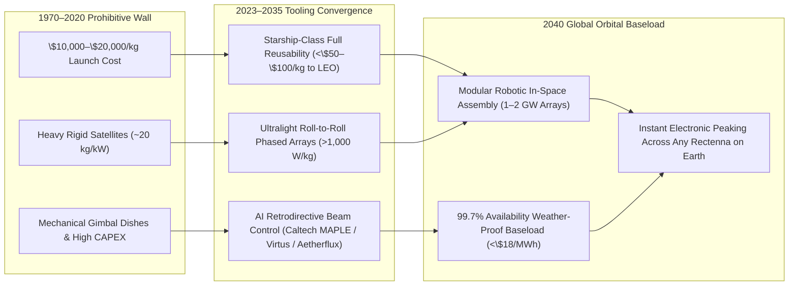
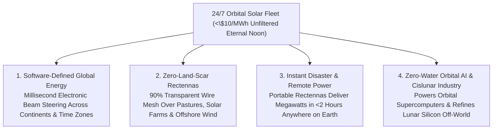

# VISION 01: ORDERS-OF-MAGNITUDE CHEAP-TO-FREE ENERGY
## Pathway 1C: Space-Based Solar Power (SBSP) & Orbital Power Beaming — *"The Believable Future, How It Came About, and the Deeper Horizon"*

> **The Cynic's Challenge:** *"Space-based solar power has been a NASA slide-deck fantasy since 1968. Launching thousands of tons of solar panels into orbit costs a fortune, space assembly is impossibly complex, and beaming gigawatts of microwave or laser energy down through the atmosphere sounds like a science-fiction death ray. How could orbital solar ever compete with power plants on the ground?"*

This report directly answers that **"HOW."** Above Earth's atmosphere, sunlight is **1,361 $\text{W/m}^2$—unfiltered by air, clouds, dust, or weather, and available 24 hours a day, 365 days a year** (yielding **$5\times$ to $8\times$ more annual energy per square meter** than the average terrestrial panel). For fifty years, that prize was locked behind a \$20,000/kg launch wall. Between 2023 and 2036, the rapid convergence of **fully reusable super-heavy rockets (`<\$50–\$100/kg` to orbit), ultralight roll-to-roll phased-array membrane satellites, and solid-state microwave/infrared power beaming** turned orbital solar into the ultimate dispatchable, weather-independent global baseload utility.

---

## ACT I: A BELIEVABLE NEAR-FUTURE VISION
### A Freezing Midwinter Night in 2040 — 24/7 Sunlight from Orbit

Imagine standing outside a northern industrial port city—Glasgow, Sapporo, Warsaw, Anchorage, or Stockholm—on a pitch-black, windless January evening in **2040**.

On the ground, the sun set at 3:30 PM, temperatures sit at $-12^\circ\text{C}$, and a week-long high-pressure winter *Dunkelflaute* (dark wind drought) covers Northern Europe. Yet the city and its surrounding countryside are thriving with continuous, cheap, carbon-free power:

1. **The Translucent Pasture Rectenna:**
   Ten kilometers outside town, stretching across 2,500 acres of snowy pastureland where sheep and cattle graze freely, sits a light, wire-mesh **receiving antenna (rectenna)** suspended three meters above the grass. It has no moving parts, makes zero noise, and lets 90% of sunlight and rainfall pass straight through to the soil.
2. **The Invisible Beam from Eternal Noon:**
   Thirty-six thousand kilometers overhead in geostationary orbit (and complemented by sun-synchronous medium-orbit relays), a kilometer-scale **modular orbital solar array** bathes in brilliant, uninterrupted 24-hour sunlight. Using solid-state electronic phase steering, the array beams **1.5 gigawatts of 5.8 GHz RF energy** down through the thick winter clouds with zero atmospheric attenuation, converting directly into DC grid electricity on the ground at **88% rectenna efficiency**.
3. **Physics-Safe, Nature-Safe Power:**
   At the center of the rectenna field, the microwave power density is capped at **~100 to 250 $\text{W/m}^2$**—roughly **one-fourth the intensity of ordinary midday summer sunlight** and well within IEEE/ICNIRP human safety standards. When a flock of geese flies through the beam or a farmer drives a tractor underneath the mesh, they feel nothing more than a faint, imperceptible warmth.
4. **Instant Global Dispatch:**
   At 11:00 PM local time, when residential heating demand in Warsaw peaks and Glasgow's industrial shifts wind down, the orbital array electronically re-phases its beam in **milliseconds—with zero moving parts**—shifting 500 megawatts of baseload capacity across borders without stringing a single new cross-continental transmission cable.

---

## ACT II: THE CONVERGENCE BRIDGE — HOW IT CAME ABOUT (2021–2038)
### The Launch Cost Collapse, Ultralight Metamaterials, and Solid-State Beaming

Why did a concept invented by Dr. Peter Glaser in 1968 suddenly transition from paper studies to orbital hardware between 2023 and 2030? Because three independent exponential curves intersected at once:

### 1. The Launch Revolution: Starship & the 200x Mass-to-Orbit Cost Collapse
In the Space Shuttle era, launching 1 kilogram to Low Earth Orbit (LEO) cost **~\$20,000/kg**. Since a legacy 1-gigawatt solar power satellite weighed ~10,000 metric tons, launch alone would have cost **\$200 billion per plant**.
* **Full Rapid Reusability:** SpaceX's **Falcon 9** first cut commercial launch costs by an order of magnitude (`~\$1,500–\$2,500/kg`), followed by **Starship / Super Heavy** (and emerging reusable heavy lifters like Blue Origin's *New Glenn* and Chinese methane-oxygen boosters) designed for airline-style rapid turnaround with 100–200 ton payloads.
* **The Economic Threshold:** As high-cadence reusable super-heavy launch pushes LEO delivery from **\$1,500/kg $\rightarrow$ \$200/kg (late 2020s) $\rightarrow$ \$40–\$80/kg (2030s)** with automated orbital refueling to Geostationary Transfer Orbit (GTO) or Molniya/MEO orbits, launch cost drops from 90% of project CAPEX to **less than 15% of levelized electricity cost**.

### 2. Ultralight "Sandwich Tile" Satellites & Retrodirective Phased Arrays
Instead of launching massive steel trusses and giant mechanical parabolic dishes, modern SBSP architectures (pioneered by the **Caltech Space Solar Power Project** and **Naval Research Laboratory**) compress the entire satellite into a paper-thin, flexible **3-layer "sandwich tile"** weighing less than **1 to 2 kilograms per kilowatt** ($>500\text{–}1,000\text{ W/kg}$):
* **Layer 1 (Sunward):** Ultralight flexible perovskite/III-V thin-film photovoltaics with integrated micro-concentrators.
* **Layer 2 (Middle):** Solid-state CMOS/GaN DC-to-RF oscillator chips that convert DC electricity directly into microwave RF (2.45 GHz or 5.8 GHz) or eye-safe near-infrared laser light without heavy copper wiring across the satellite.
* **Layer 3 (Earthward):** Flat printed patch antennas that form a **coherent retrodirective phased array**.
* **Mathematical/AI Beam Locking:** The ground rectenna transmits a weak encrypted pilot beacon up to the satellite. Onboard AI phase-conjugation chips read the exact wavefront distortion and lock millions of tiny transmitter tiles in phase so the beam can **physically only focus on the authorized ground beacon**. If the pilot signal is interrupted or an object tampers with the system, the beam instantaneously de-phases into harmless background radio noise.

### 3. The 2024–2026 Global State of the Art (SOTA)
Orbital power beaming is no longer theoretical—it has already been demonstrated in space and backed by national agencies and private startups across the US, Europe, and Japan:

| Organization / Venture | Region | Architecture & Frequency | Verified 2024–2026 Milestone | Commercial Deployment Pathway |
| :--- | :--- | :--- | :--- | :--- |
| **Caltech Space Solar Power Project (SSPP)** | USA (CA) | Ultralight Modular Membrane + 10 GHz Flexible Phased Array (*SSPD-1 / MAPLE*) | **2023–2024:** Completed historic *SSPD-1* orbital mission; **beamed power in space and detected microwave power on Earth** from orbit using ultralight *MAPLE* array and tested *DOLCE* deployable structure. | Foundational flight-proven architecture for ultralight (`>1,000 W/kg`) roll-out orbital arrays. |
| **Aetherflux** | USA (CA) | LEO Sun-Synchronous Constellation + Eye-Safe Infrared Laser Beaming | Founded by Baiju Bhatt (Robinhood co-founder); raised **\$60M+ (Series A, 2025)** to launch modular LEO power-beaming satellites using existing ground solar panels as receivers. | **2026–2027:** First orbital infrared laser power-beaming demonstration; scalable modular constellation for remote/peaking grids. |
| **Virtus Solis** | USA (MI) | High-Eccentricity Molniya Orbit + 1.6m Modular Hexagonal Phased-Array Tiles | Engineered automated robotic orbital assembly of mass-produced 1.6-meter hexagonal tiles; targeting **<\$150/kg** launch + manufacturing economics. | **2027–2030:** Orbital pilot array scaling to multi-hundred-MW Northern Hemisphere baseload receivers. |
| **Space Solar (UK) & Reykjavik Energy** | UK / Iceland | **CASSIOPeiA** 360° Electronic-Steering Helical Phased Array (2.45 / 5.8 GHz) | Demonstrated 360° solid-state beam steering (no moving parts); partnered with **Reykjavik Energy / Transition Labs (2024–2025)** for first commercial receiver. | **2030:** 30 MW orbital demonstrator delivering power to Iceland/UK, scaling to **GW commercial arrays by 2036**. |
| **JAXA / JSS (*OHISAMA* Project)** | Japan | LEO Satellite + 5.8 GHz Retrodirective Microwave Beaming to Ground Rectennas | Completed multi-kilometer terrestrial horizontal/vertical microwave beaming trials; finalizing **OHISAMA** small-satellite orbital demonstration. | **2026–2028:** Orbital-to-ground kilowatt beaming test, followed by 2030s commercial utility modules. |
| **ESA *SOLARIS* & Thales Alenia Space** | European Union | GEO Modular Robotic-Assembled GW Solar Satellites + RF Rectennas | Completed technical/economic feasibility studies proving SBSP can supply **800+ TWh/yr** of European winter baseload; demonstrated long-range wireless power beaming in Munich. | European ministerial roadmap for in-orbit sub-scale demonstrator (~2030) and utility-scale fleet in the 2030s. |
| **U.S. NRL (*PRAM* / *Arachne*)** | USA | Sandwich Tile RF Conversion in Orbit | **PRAM** experiment flew aboard orbital test vehicle confirming continuous space solar-to-RF thermal/conversion performance; **Star Catcher** demonstrated orbital power beaming for in-space data centers (2025–2026). | Dual-use orbital power grids (powering orbital AI compute hubs + terrestrial microgrids). |

---

## ACT III: PHASED ROLLOUT ROADMAP (2026–2050) & ECONOMIC CASCADE
### From High-Value Peaking to Planetary Baseload

Unlike terrestrial nuclear or hydro megaprojects that must be built on-site from scratch, Space-Based Solar Power separates **mass manufacturing** from **site geography**. Millions of identical 1-meter hexagonal sandwich tiles are stamped out on automated terrestrial semiconductor/solar lines, packed flat into Starship payload fairings (150 tons per launch), and snapped together in orbit by autonomous free-flying assembly robots.

Three compounding economic drivers push orbital baseload LCOE from niche peaking down below **\$10/MWh**:
1. **The $8\times$ Orbital Capacity Factor Multiplier:**
   * Because geostationary and high-energy Molniya arrays sit in **unfiltered $1,361\text{ W/m}^2$ sunlight 99.7% of the year** (experiencing only brief equinox shadow minutes that are easily predicted and shared across orbital planes), a single square meter of solar cell in orbit harvests **$5\times$ to $8\times$ more annual kilowatt-hours** than the same cell on Earth—and requires **zero gigawatt-hour battery banks** to survive the night or winter.
2. **Semiconductor-Style Mass Production of Hexagonal Tiles:**
   * A 1-gigawatt orbital array is not a single giant bespoke spacecraft; it is a modular tessellation of **~400,000 identical 1.6-meter sandwich tiles** (such as the **Virtus Solis** or **Caltech MAPLE** architecture).
   * Building 400,000 identical solid-state tiles on a roll-to-roll electronics assembly line unlocks the **20–24% Wright's Law learning rate** of consumer electronics and terrestrial photovoltaics, driving satellite hardware costs below **\$250/kW**.
3. **High-Thrust Electric Orbital Transfer & In-Space Resource Bootstrapping:**
   * Instead of burning expensive chemical propellant to climb from Low Earth Orbit (LEO) to Geostationary/Molniya operational orbit, deployed solar arrays use their own abundant electricity to fire high-impulse **Hall-effect / krypton / argon ion thrusters**, self-raising into operational orbit at a fraction of traditional transfer cost:

| Rollout Phase | Timeline | Launch Cost & Orbital Scale | Satellite Specific Power | Delivered Ground LCOE | Unlocked Societal & Industrial Thresholds |
| :--- | :--- | :--- | :--- | :--- | :--- |
| **Phase 1: Orbital Demo & Niche Grids** | **2026–2030** | \$250 – \$500/kg to LEO; 1 MW to 30 MW LEO/MEO demonstrators (*Aetherflux, OHISAMA, Space Solar*). | 300 – 500 W/kg | **\$90 – \$180 / MWh** | Remote Arctic/island towns, disaster relief power-on-demand, and zero-emission power for **orbital AI data centers**. |
| **Phase 2: First Commercial GW Arrays** | **2031–2036** | \$80 – \$150/kg; 100 MW – 1 GW Molniya/GEO arrays built by autonomous orbital tugs. | 700 – 1,000 W/kg | **\$35 – \$55 / MWh** | High-latitude winter *Dunkelflaute* baseload in UK, Northern Europe, Japan, and Canada; replaces LNG imports. |
| **Phase 3: Terawatt Orbital Fleet & In-Space Manufacturing** | **2037–2044** | \$30 – \$60/kg; automated tile gigafactories + early lunar/NEO silicon refining; 500+ GW in orbit. | 1,200 – 1,800 W/kg | **\$14 – \$24 / MWh** | 24/7 dispatchable baseload competitive with any terrestrial source; instant cross-border load balancing across time zones. |
| **Phase 4: Post-Scarcity Orbital Ring** | **2045–2055+** | **<\$20 / kg** (plus autonomous in-space refining of lunar/asteroid regolith); multi-TW orbital fleet. | **>2,000 W/kg** | **\$5 – \$11 / MWh** *(24/7 Anywhere)* | Zero-land-scar global baseload; instant gigawatt power beamed to any desert desalination hub, polar facility, or developing nation on Earth. |

---

## ACT IV: THE DEEPER HORIZON & SMOOTH SOCIETAL TRANSITION
### Software-Defined Global Energy & The Cislunar Economy

When clean energy can be harvested continuously in space and beamed to cheap wire-mesh rectennas anywhere on Earth, four civilizational advantages emerge that no ground-locked power source can match:

1. **Software-Defined Energy Routing (Zero Transmission Bottlenecks):**
   * **Beaming Over Grid Queues:** On Earth, permitting and building a 1,000-mile high-voltage transmission line takes 10 to 15 years. An orbital solar array in geostationary or Molniya orbit has unobstructed line-of-sight to **an entire hemisphere**.
   * **Cross-Border Load Balancing in Milliseconds:** An orbital array can beam 1 GW to a rectenna in Northern Germany during the morning industrial peak, then electronically re-phase a portion of its beam to a desalination rectenna in North Africa or a steel plant in Spain in milliseconds—turning electricity from a rigid pipeline commodity into **globally routable bandwidth**.
   * **Eliminating Seasonal Storage Overbuild:** In high-latitude countries (UK, Scandinavia, Canada, Japan, Northern China), winter solar output drops by $80\%$ just as heating demand peaks. Orbital solar bypasses winter cloud cover completely, saving trillions of dollars in seasonal battery overbuild.
2. **Harmonious Co-Existence with Agriculture, Solar & Offshore Wind:**
   * **90% Transparent Dual-Use Land:** Ground rectennas are simple dipole wire meshes that are **85–90% optically transparent** and represent less than 15% of total system CAPEX.
   * **Stacking Yields on One Parcel:** Rectennas can be suspended directly above cattle pastures, row crops, or existing terrestrial solar farms (capturing both daytime sunlight and 24/7 microwave power on the exact same land parcel), or floated as lightweight meshes between offshore wind turbines to keep undersea grid cables running at **95%+ capacity factor** when the wind stops blowing.
   * **Repowering Retiring Thermal Switchyards:** Rectenna meshes built on reclaimed coal strip-mines or adjacent to retiring thermal power stations feed directly into existing gigawatt grid transformers, preserving local utility jobs and municipal tax bases.
3. **Instant Humanitarian, Developing-Nation & Disaster-Response Power:**
   * **Megawatts in Two Hours:** When an earthquake, hurricane, or flood knocks out a region's terrestrial grid, emergency crews can unroll portable, containerized rectenna mats at hospitals and water-treatment plants and receive **megawatts of orbital power within two hours**—saving lives without waiting weeks for diesel fuel convoys.
   * **Leapfrogging Grid Infrastructure:** Developing nations and remote island or Arctic communities can plug a lightweight local rectenna into a town microgrid and lease 24/7 baseload power from an orbital array on day one—the exact same way developing regions leapfrogged copper landlines with satellite and mobile broadband.
4. **Bootstrapping Zero-Water Orbital Compute & Cislunar Industry:**
   * **Orbital AI Superclusters:** Before a single watt even touches the ground, cheap gigawatt orbital solar arrays directly power **zero-water-consumption orbital AI data centers** (radiating waste heat into the 3 Kelvin deep-space sink via infrared panels).
   * **Off-World Material Abundance:** Abundant orbital electricity powers high-thrust Hall-effect/magnetoplasmadynamic electric tugs and lunar regolith smelters—allowing humanity in the 2040s to refine abundant silicon, aluminum, and iron directly from the Moon and near-Earth asteroids, building multi-terawatt orbital energy rings with **zero mining footprint on Earth**.

---

## SUMMARY FOR THE SKEPTIC
Space-Based Solar Power is no longer waiting on science fiction—every building block has crossed into flight hardware:
1. **Orbital Beaming Is Flight-Proven:** Caltech's *SSPD-1 (MAPLE)* already beamed microwave power in orbit and detected it on Earth in 2023–2024, while **Aetherflux**, **Virtus Solis**, **JAXA**, and **Space Solar UK** are building 2026–2030 commercial demonstrators.
2. **The Launch Wall Collapsed:** Reusable super-heavy rockets (Starship) are driving mass-to-orbit costs down by **$100\times$ to $200\times$** compared to the Space Shuttle era.
3. **Safety Is Locked by Physics:** Retrodirective phased arrays physically cannot focus without an encrypted ground pilot beacon, and ground microwave intensity (`~100–250 W/m²`) is gentler than ordinary morning sunlight.
4. **Conquers Winter & Night Globally:** By harvesting 24/7 unfiltered sunlight above the clouds and beaming it through rain, snow, and winter darkness, SBSP completes the global clean energy puzzle.
