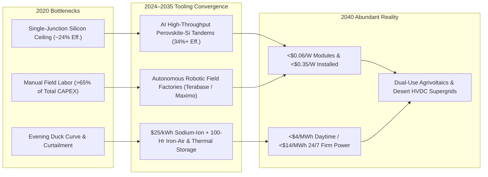
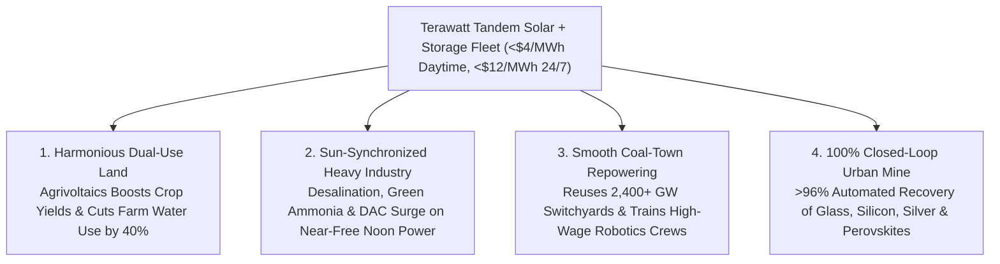

# VISION 01: ORDERS-OF-MAGNITUDE CHEAP-TO-FREE ENERGY
## Pathway 1B: Terawatt Terrestrial Solar, Perovskite Tandems & Autonomous Deployment — *"The Believable Future, How It Came About, and the Deeper Horizon"*

> **The Cynic's Challenge:** *"Solar is cheap at noon in the desert, sure. But silicon panels top out below 25% efficiency, paving over farmland triggers rural backlash, human installation labor now costs more than the panels themselves, and the sun sets every single evening. How could terrestrial solar ever become a near-free, 24/7 civilizational engine without covering the planet in glass and going dark at night?"*

This report answers that exact **"HOW."** It bridges the reality of 2026 to the world of 2040, showing how the rapid convergence of **computational materials discovery (perovskite-silicon tandem cells), terawatt-scale robotic gigafactories, autonomous field-installation machinery, and ultra-cheap sodium/iron storage** turns ordinary sand and sunlight into humanity's cheapest, fastest-scaling source of primary energy (`<\$4/MWh` daytime, `<\$14/MWh` firmed 24/7).

---

## ACT I: A BELIEVABLE NEAR-FUTURE VISION
### A Harvest Afternoon in 2040 — Life at \$0.004 per Kilowatt-Hour

Imagine standing on the edge of an agricultural valley in the American Southwest—or Castile in Spain, Rajasthan in India, the Murray-Darling Basin in Australia, or the Atacama corridor in Chile—on a bright afternoon in **2040**.

Nothing around you looks dystopian or industrialized into sterility. Instead, technology and landscape have braided together into four quiet realities:

1. **The Translucent Agrivoltaic Canopy:**
   Across 4,000 acres of thriving tomato, berry, and leafy-green farmland, elevated **34%-efficient bifacial perovskite-silicon tandem canopies** track the sun ten feet above the soil. Tuned to absorb high-energy blue and near-infrared photons while transmitting the exact red-orange wavelengths plants need for photosynthesis, the canopy shields crops from midday scorching heat and cuts soil water evaporation by **40%**. Farm yields are *higher* under the solar canopy than in open fields, and the farmer earns double income from every acre.
2. **The Autonomous Solar Foundry & Field Crew:**
   Five miles down the highway, a decommissioned coal rail spur now feeds a local automated solar-and-battery micro-hub. When a new 500-megawatt desert array was built last month, zero workers suffered heatstroke lifting 70-pound glass panels in 110°F heat. Instead, a fleet of **autonomous robotic assembly rovers**—guided by centimeter-accurate LiDAR and digital twins—unloaded pre-wired solar tables from flatbed trucks and locked 20,000 kilowatts of capacity into place per day, supervised by a local crew of twelve high-paid robotics technicians.
3. **The Daytime Industrial Surge & Nighttime Thermal Battery:**
   Between 8:00 AM and 5:00 PM, electricity on the regional grid is so abundant that its wholesale price sits at **\$3 to \$4 per megawatt-hour (\$0.003–\$0.004/kWh)**. Every energy-hungry process in the valley automatically surges during sun hours: modular reverse-osmosis desalination plants refill municipal reservoirs, electric arc furnaces smelt recycled steel, green-ammonia reactors synthesize carbon-free fertilizer right on the farm, and massive **sodium-ion batteries and 1,500°C carbon-block thermal stores** soak up gigawatt-hours of midday surplus to dispatch rock-steady electricity and industrial steam all night long.
4. **The Household Reality:**
   Your home's integrated solar roof shingles and bi-directional EV battery talk seamlessly to the local grid. You haven't paid a volumetric daytime electric bill since 2033; air conditioning during heatwaves, domestic hot water, and daily driving run on near-zero-marginal-cost photons harvested from your own roof and community canopy.

---

## ACT II: THE CONVERGENCE BRIDGE — HOW IT CAME ABOUT (2021–2038)
### Breaking the Shockley-Queisser Ceiling, the Soft-Cost Bottleneck, and Nighttime Intermittency

For decades, conventional single-junction crystalline silicon solar cells faced a hard thermodynamic wall—the **Shockley-Queisser limit (~29.4% theoretical, ~24–26% practical commercial ceiling)**—because a single semiconductor bandgap cannot efficiently capture both high-energy blue photons (which waste energy as heat) and low-energy red photons. Worse, by 2025, polysilicon modules had fallen so fast (`~\$0.09–\$0.11/W`) that **soft costs, racking, and manual field labor accounted for over 65% of utility solar project CAPEX**.

Between 2022 and 2035, three converging tooling revolutions—**AI-accelerated materials chemistry, autonomous field robotics, and post-lithium storage**—shattered all three constraints simultaneously:

### 1. The Materials & Mathematical Convergence: Perovskite-Silicon Tandem Cells (>34% Efficiency)
By stacking a tunable, wide-bandgap metal-halide **perovskite** top cell ($E_g \approx 1.68\text{ eV}$, harvesting blue/green light) directly onto a conventional **crystalline silicon** bottom cell ($E_g \approx 1.12\text{ eV}$, harvesting red/infrared light), the theoretical efficiency ceiling jumps from **29.4% to over 43%**.
* **AI-Guided Passivation & Stability:** Historically, perovskites degraded under moisture, heat, and UV light due to halide ion migration at grain boundaries. Between 2023 and 2026, automated robotic wet-chemistry labs paired with graph neural networks screened millions of 2D/3D molecular passivation layers and self-assembled monolayers (SAMs) in months rather than decades.
* **The Commercial Breakout:** By 2024–2026, **LONGi** achieved a certified **34.6% world-record efficiency** in two-terminal perovskite-silicon tandems; **Oxford PV** began commercial shipments of 24.5%+ full-size tandem modules (scaling toward 30%+ cells) from its Brandenburg line; and US innovators **Caelux**, **Swift Solar**, and **First Solar** industrialised tandem glass and roll-to-roll manufacturing. Boosting panel efficiency by nearly 40% relative to standard silicon automatically cuts land footprint, racking steel, cabling, and installation labor per megawatt by nearly a third.

### 2. The Physical Tooling Convergence: Terawatt Gigafactories & Autonomous Installation Robotics
* **Polysilicon & Wafer Automation:** Inside modern solar gigafactories, continuous fluidized-bed reactor (FBR) polysilicon production and diamond-wire wafer sawing are 98% automated, pushing global solar manufacturing capacity past **1.5 Terawatts per year by 2026**.
* **Robotic Field Construction:** To break the manual installation bottleneck, companies replaced piecemeal hand-bolting in extreme desert temperatures with mobile field automation. **Terabase Energy** (*Terafab*), **AES** (*Maximo* AI-vision installation robot), and **Charge Robotics** deployed portable, automated field assembly lines that weld, wire, and torque entire solar tracker blocks autonomously—cutting on-site construction time by **50%** and total installed solar CAPEX by **30–40%**.

### 3. The 2025–2026 Global State of the Art (SOTA)
The transition from commodity silicon to ultra-efficient tandems and robotic deployment is already operating in the field today:

| Company / Initiative | Region | Technology & Architecture | Verified 2024–2026 Milestone | Commercial Scale Pathway |
| :--- | :--- | :--- | :--- | :--- |
| **LONGi Green Energy** | China / Global | 2-Terminal Perovskite-Silicon Tandem & Back-Contact (HPBC) | Achieved certified **34.6% cell efficiency** (2024–2025) and **30.1% commercial-size wafer tandem**; >100 GW/yr automated wafer/module capacity. | High-volume tandem mass production lines scaling across global utility and rooftop markets by 2027–2030. |
| **Oxford PV** | UK / Germany | Perovskite-on-Silicon Heterojunction Tandem | **2024–2025:** Commenced **world's first commercial sales** of 72-cell perovskite-silicon tandem panels (24.5% module / >28.6% cell) from Brandenburg factory. | Gigawatt-scale tandem factory expansion targeting **>30% commercial module efficiency**. |
| **Caelux & Swift Solar** | USA (CA / CO) | Perovskite Active Glass & All-Perovskite Tandems | **Caelux** ramped commercial manufacturing of *Caelux One* active glass in Baldwin Park, CA; **Swift Solar** raised \$27M+ building domestic US tandem lines. | Drop-in 30%+ efficiency upgrade for existing silicon module assemblers and ultra-lightweight structures. |
| **Terabase Energy** | USA (CA / TX) | *Terafab* Automated Field Factory & Digital Twin | Deployed automated field assembly lines constructing hundreds of MWs of utility solar at **>2x speed** with zero manual heavy lifting. | Multi-gigawatt autonomous desert and agrivoltaic solar construction globally. |
| **AES (*Maximo*) & Charge Robotics** | USA | AI-Vision Heavy-Lift Solar Installation Robots | **AES *Maximo*** deployed on multi-hundred-MW utility sites (incl. 2 GW Bellefield); **Charge Robotics** operating portable containerised solar factories. | Eliminates outdoor heat-stress labor bottlenecks and slashes soft installation CAPEX by >35%. |
| **CATL / BYD & Form Energy** | China / USA | Sodium-Ion ($\text{Na-ion}$) & 100-Hour Iron-Air Storage | LFP & Na-ion battery cells plunged below **\$45–\$55/kWh** in 2025–2026; **Form Energy** opened Weirton, WV gigafactory for 100-hour iron-air rust batteries. | Pairs `<\$8/MWh` midday solar with `<\$20/kWh` storage to deliver **24/7 firm baseload below \$15–\$20/MWh**. |
| **Rondo Energy & Antora Energy** | USA (CA) | 1,500°C Firebrick & Solid-Carbon Thermal Batteries | **Rondo** commercial units operating & scaling to 90 GWh/yr factory capacity; **Antora** deployed solid-carbon thermophotovoltaic heat blocks. | Converts ultra-cheap daytime solar peaks into 24/7 zero-carbon **1,500°C industrial steam and cement/steel heat**. |

---

## ACT III: PHASED ROLLOUT ROADMAP (2026–2050) & ECONOMIC CASCADE
### Wright's Law Meets the Earth-Abundant Supply Chain

For 48 consecutive years (1976–2024), solar photovoltaics followed **Wright's Law** more reliably than almost any technology in history: **every doubling of cumulative global installed capacity reduced module cost by ~24%**. Because silicon (sand), perovskite precursors (calcium, lead/tin halides, carbon), sodium (salt), and iron (rust) are among the most abundant elements in Earth's crust, the combined solar + storage learning curve has zero geological resource ceiling.

$$\text{Cost}(Q) = C_0 \cdot \left(\frac{Q}{Q_0}\right)^{-\log_2(1 - 0.24)}$$

As autonomous robotic factories build the solar panels, and cheap solar electricity powers the polysilicon furnaces and aluminum/steel roll-formers, the system enters a self-compounding cost collapse driven by three reinforcing feedback loops:

1. **Zero-Fuel, Zero-Moving-Part Solid-State Physics:**
   * Unlike thermal turbines that require continuous fuel extraction and mechanical overhauls, a tandem solar wafer is a solid-state semiconductor that converts photons to electrons with zero moving parts and a **35-to-40-year operational lifespan**.
   * Annual operations and maintenance (O&M) — largely automated via self-cleaning dry robotic brushes deployed on every tracker row at night — drops below **\$3/kW-year**.
2. **Higher Efficiency Slashes Balance-of-System (BOS) Costs Automatically:**
   * Moving from a 22% silicon module to a **34%+ perovskite-silicon tandem module** packs $>50\%$ more watts into the exact same glass rectangle.
   * That means **35% fewer steel piles driven into the ground, 35% fewer tracker motors, 35% less copper trenching, and 35% fewer robotic installation cycles** per gigawatt of capacity.
3. **Solar Building Solar (The Embodied Energy Loop):**
   * The single largest cost input to refining metallurgical silicon into solar-grade polysilicon (`11N` purity) and float-glass is electricity.
   * When solar gigafactories run on their own `<\$6/MWh` solar-plus-sodium-storage microgrids, the cost of refining silicon, smelting aluminum frames, and synthesizing battery cathodes collapses in lockstep:

| Rollout Phase | Timeline | Global Installed Scale | Utility CAPEX (\$/W Installed) | Daytime / 24/7 Firm LCOE | Unlocked Societal & Industrial Thresholds |
| :--- | :--- | :--- | :--- | :--- | :--- |
| **Phase 1: Terawatt Silicon + LFP Breakout** | **2026–2030** | **3.5 – 7 TW** cumulative global solar; 1+ TW/yr annual additions. | \$0.55 – \$0.75/W (Solar) +\$90/kWh (4-hr BESS) | **\$12 – \$18 / MWh** (Day) **\$32 – \$45 / MWh** (Firm) | Cheapest new electricity in history across 90% of humanity; rapid displacement of daytime coal and peaker gas. |
| **Phase 2: Tandem & Robotic Inflection** | **2031–2036** | **10 – 20 TW** cumulative; 32%+ Perovskite-Si Tandems & 80% robotic install. | \$0.32 – \$0.45/W (Solar) +\$45/kWh (Na-ion BESS) | **\$6 – \$10 / MWh** (Day) **\$18 – \$26 / MWh** (Firm) | 1,500°C solar-thermal firebricks undercut natural gas for industrial steam, chemicals, food processing, and district heat. |
| **Phase 3: Continental HVDC & Agrivoltaics** | **2037–2044** | **30 – 50 TW** cumulative; multi-GW desert HVDC links & widespread agrivoltaics. | \$0.20 – \$0.28/W (Solar) +\$25/kWh (Na / Fe-Air) | **\$3.50 – \$6 / MWh** (Day) **\$11 – \$16 / MWh** (Firm) | Green hydrogen `<\$0.60/kg`; massive coastal desalination rivers; zero-carbon steel, aluminum, and ammonia fertilizer globally. |
| **Phase 4: Near-Zero Marginal Cost Grid** | **2045–2050+** | **70+ TW** cumulative; self-replicating robotic maintenance & recycling loops. | **<\$0.15 / W** (Solar) | **\$2 – \$4 / MWh** (Day) **<\$10 / MWh** (24/7 Firm) | Midday electricity is effectively free (`~\$0/MWh`) for 8–10 hours daily; automated atmospheric $\text{CO}_2$ drawdown and desert greening. |

---

## ACT IV: THE DEEPER HORIZON & SMOOTH SOCIETAL TRANSITION
### Why "Free Energy + Automation" Solves Scarcity Without Disrupting Communities

The true magic of terrestrial solar paired with robotics is that **it does not require waiting for mega-projects**: it scales fractally from a single rural village roof in Sub-Saharan Africa to a 20-gigawatt desert HVDC hub in Australia or Nevada.

1. **Harmonious Land Use (Agrivoltaics & Brownfield Repowering):**
   * **Double-Harvest Farmland:** Rather than competing with farmers for prime soil, elevated semi-transparent tandem arrays **increase agricultural resilience** against heatwaves, frost, and hail while cutting irrigation demand by up to 40%.
   * **Zero-Delay Grid Reuse:** Placing gigawatt solar-plus-battery hubs around retiring coal mines, highway medians, and irrigation canals (like California's *Project Nexus*, which cuts canal water evaporation while cooling the panels above) reuses existing high-voltage grid interconnects and keeps property-tax revenues inside traditional energy communities.
   * **Floatovoltaics on Hydro Reservoirs:** Covering just **10% of the world's existing man-made hydropower reservoirs** with floating tandem solar panels adds over **4,000 GW of capacity** while plugging directly into existing hydroelectric dam turbines and transmission lines.
2. **Batch-Dispatchable Heavy Industry (Following the Sun):**
   * **The Midday Industrial Surge:** Unlike household lighting, the world's largest energy consumers—**seawater desalination, electrolytic hydrogen and ammonia production, aluminum smelting, Direct Air Capture ($\text{CO}_2$), and AI foundation-model training**—do not need to run at identical capacity at 3:00 AM.
   * **Stockpiling Embodied Energy:** When midday solar drops to **\$2–\$4/MWh**, autonomous industrial plants ramp to 100% capacity during peak solar hours, absorbing terawatts of practically free photon energy to stockpile fresh drinking water in reservoirs, liquid e-fuels in tanks, refined metals, and trained neural weights.
   * **On-Farm Fertilizer Synthesis:** Modular containerized Haber-Bosch reactors powered by farm-canopy solar split irrigation water and atmospheric nitrogen ($78\%$ of air) to brew zero-carbon ammonia fertilizer right at the farm gate—insulating global food prices from natural gas shocks forever.
3. **East-West Ultra-High-Voltage DC (UHVDC) Supergrids:**
   * **Continental Time-Zone Sharing:** Modern $\pm 800\text{ kV}$ and $\pm 1,100\text{ kV}$ UHVDC transmission lines (already operating across 3,000+ km corridors in China, Brazil, and Europe) lose less than **3% of their power per 1,000 km**.
   * **Cutting Storage Needs in Half:** Linking sunny desert time zones across continents allows late-afternoon sun in New Mexico or Western Australia to power evening demand 2,500 km to the east, while superconducting and HVDC cables turn regional grids into self-balancing continental networks.
4. **100% Closed-Loop Automated Recycling & Workforce Elevation:**
   * **The Self-Renewing Urban Mine:** Every component of a tandem solar module—glass, aluminum frame, copper/silver interconnects, and silicon/perovskite wafers—is recovered at end-of-life by automated optical-sorting and thermal-delamination lines (pioneered by **SOLARCYCLE**) at **>96% material recovery efficiency**.
   * **From Heat Exhaustion to Robotic Orchestration:** Instead of manual laborers suffering heatstroke carrying heavy panels in $110^\circ\text{F}$ deserts, field crews transition into high-paid **autonomous fleet technicians**, supervising robotic rovers from climate-controlled mobile command centers.

---

## SUMMARY FOR THE SKEPTIC
You do not have to guess whether terrestrial solar can reach abundance—the curve is already mid-flight:
1. **The Physics Ceiling Broke:** Perovskite-silicon tandem cells have already passed **34.6% certified efficiency** (LONGi) and entered commercial production (Oxford PV, Caelux, Swift Solar).
2. **Labor & Soft Costs Are Automating:** Autonomous installation robots (Terabase Energy, AES Maximo, Charge Robotics) are building utility arrays in the field today at twice the speed and a fraction of manual labor cost.
3. **Storage & Heat Joined the Same Curve:** Sodium-ion batteries (`<\$45/kWh`), 100-hour iron-air batteries (Form Energy), and $1,500^\circ\text{C}$ thermal firebricks (Rondo, Antora) turn cheap daytime photons into 24/7 electricity and industrial steam.
4. **The Transition Is Immediate and Inclusive:** By pairing farmers (agrivoltaics), retiring coal grid switchyards, and automated domestic manufacturing, terrestrial solar delivers the fastest, least disruptive bridge to near-free global energy.
