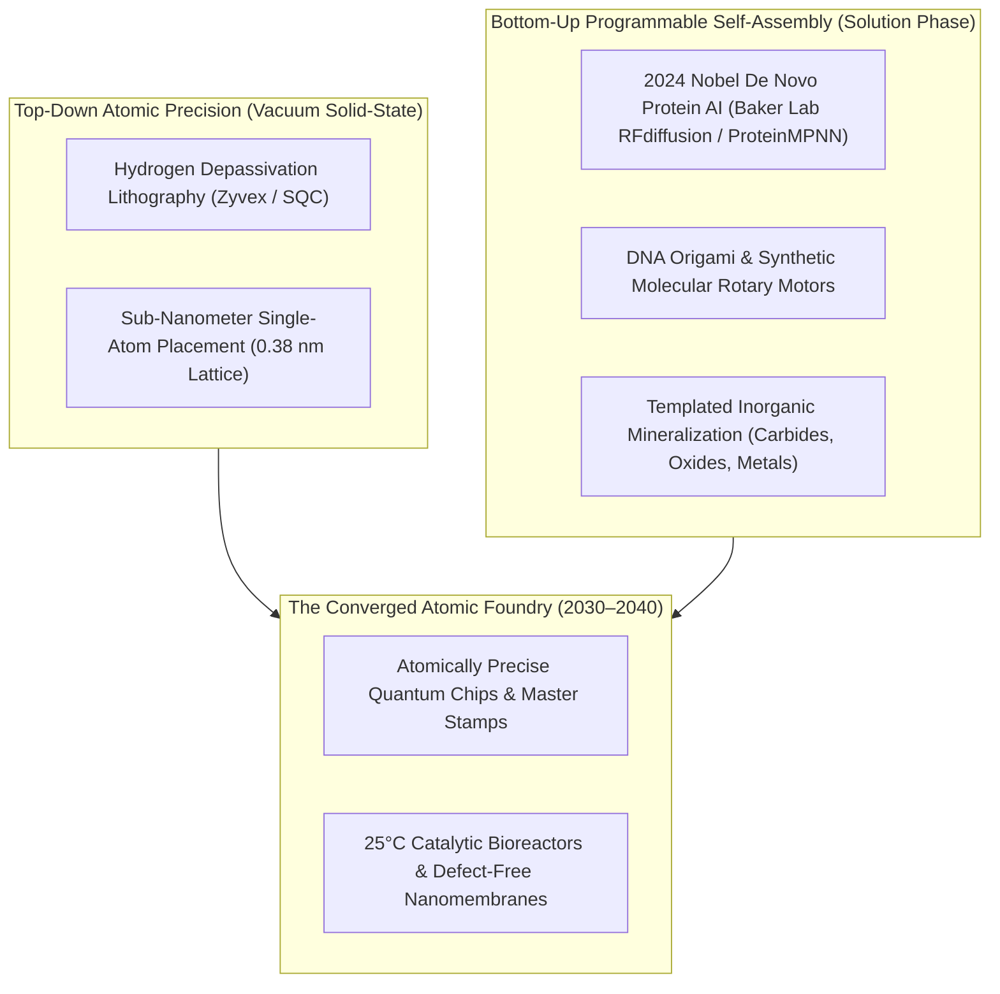
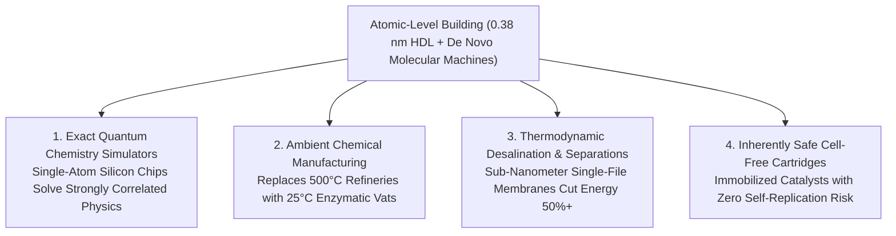

# VISION 01: ATOMIC-LEVEL BUILDING & PROGRAMMABLE MOLECULAR MACHINES
## Pathway 2D: Where Top-Down Scanning-Probe Lithography Meets Bottom-Up De Novo Protein Nanorobotics

> **Executive Framing & Core Thesis:**
> * **The Cynic's Objection:** *"Drexlerian 'molecular assemblers' have been sci-fi vaporware for forty years. You cannot build macroscopic products one atom at a time with a scanning tunneling microscope—it would take a million years to make a penny—and biological proteins instantly denature outside lukewarm water."*
> * **The Core Thesis (The Top-Down / Bottom-Up Convergence):** The 40-year impasse between "too-slow scanning probes" and "too-fragile biology" has been broken from **both directions at once**. From the **top down**, multi-tip scanning-probe **Hydrogen Depassivation Lithography (HDL)** now places individual phosphorus and silicon atoms with zero-defect precision to build solid-state quantum processors and atomic-scale master templates. From the **bottom up**, **2024 Nobel Prize-winning AI de novo protein design (RFdiffusion / AlphaFold 3)** and **DNA origami** enable humanity to program self-assembling molecular motors, rotary enzymes, and non-biological mineralizing scaffolds that operate at room temperature with **near-$k_B T$ thermodynamic efficiency**—turning solution-phase chemistry into a programmable, self-assembling atomic factory.

---

## ACT I: A BELIEVABLE NEAR-FUTURE VISION (THE WORLD OF 2040)
### A Friday Morning in 2040 — Room-Temperature Nitrogen Fixation, Zero-Defect Quantum Sensors, and Biomimetic Diamond Composites

Imagine visiting a coastal clean-manufacturing park and a neighboring agrarian cooperative in **2040**.

You will not see sci-fi "grey goo." Instead, you see quiet stainless-steel vats operating at ambient temperature and pressure alongside ultra-high-vacuum semiconductor tools, quietly delivering three civilizational breakthroughs:

1. **The End of the $500\text{ °C}$ Haber-Bosch Furnace (Ambient Molecular Factories):**
   * In 2026, making nitrogen fertilizer for global agriculture required the century-old Haber-Bosch process—crushing nitrogen and hydrogen gas together at **$450\text{ °C}$ and $200\text{ atmospheres}$ of pressure**, consuming ~2% of all global energy and emitting hundreds of millions of tons of $\text{CO}_2$.
   * At the 2040 agrarian cooperative, a farmer draws liquid nitrate fertilizer from a silent, solar-and-fusion-powered **Cell-Free Enzymatic Bioreactor** operating at **$25\text{ °C}$ and $1\text{ atmosphere}$**.
   * Inside the reactor, trillions of AI-designed, hyper-stable **de novo metallo-enzymes** anchored onto a conductive carbon-nanotube lattice split the $\text{N}\equiv\text{N}$ triple bond using low-voltage electrons and ambient air at **>85% thermodynamic efficiency**.
   * Every rural community synthesizes its own clean fertilizer on-site from air, water, and electricity.
2. **The Atomically Perfect Quantum MRI in Every Clinic:**
   * At the local health clinic, a doctor waves a handheld wand over a patient's chest to image single-cell metabolic activity and coronary blood flow at millisecond resolution—without a \$3 million liquid-helium superconducting magnet tunnel.
   * Inside the wand sits a wafer of **Atomically Precise Diamond & Silicon**, where arrays of individual phosphorus and nitrogen-vacancy (NV) dopant atoms were placed onto exact crystal lattice sites with **zero-angstrom error** via automated Hydrogen Depassivation Lithography.
3. **Growing Mother-of-Pearl Structural Armor & Desalination Membranes at Room Temperature:**
   * In the coastal water plant, seawater passes through a paper-thin **Biomimetic Aquaporin-Graphene Membrane** that contains billions of atomically identical, sub-nanometer pores templated by self-assembling DNA-protein rings.
   * Because every pore is atomically uniform, water molecules slip through in single file with **zero salt leakage and 40% less pumping pressure** than 2020s polymer membranes—bringing desalination right down to the thermodynamic minimum energy limit ($\sim 1\text{ kWh/m}^3$).

---

## ACT II: THE CONVERGENCE BRIDGE — HOW IT CAME ABOUT (2021–2038)
### How 1-Atom Silicon Lithography and AI De Novo Molecular Machines Met in the Middle

### Step 1: How Nature Proved Atomic Manufacturing Was Possible All Along
Skeptics who claimed atomically precise manufacturing violated physics overlooked an obvious fact: **every ribosome and ATP synthase rotary motor in your body is an atomically precise nanomachine**.
* **The Thermodynamic Gap ($10^9\times$ Energy Advantage):** A biological ribosome reads digital RNA code at 20 amino acids per second with an error rate below $10^{-4}$, snapping covalent bonds together at $37\text{ °C}$ in water near the **Landauer/thermodynamic energy floor ($\sim 10\text{–}20\ k_B T \approx 10^{-19}\text{ J}$ per bond)**. By contrast, 2020s industrial semiconductor fabs used **$10^9\times$ more energy per placed atom** by boiling extreme-ultraviolet tin plasma in high-vacuum chambers.
* **The Historical Roadblock:** For decades, humanity could not use biology's atomic machinery for industrial engineering because we could neither **predict how amino-acid sequences fold** nor **design brand-new proteins that never existed in nature** to assemble inorganic metals, semiconductors, and ceramics.

### Step 2: The Dual 2024–2026 Breakthroughs (Nobel Proteins + Single-Atom Silicon)
Between 2022 and 2026, two historic breakthroughs solved both halves of the puzzle:
* **Bottom-Up: The 2024 Nobel Revolution in De Novo Protein Nanomachines:**
  Using generative diffusion models (**RFdiffusion**, **ProteinMPNN**, **RoseTTAFold All-Atom**, and **AlphaFold 3**), David Baker's Institute for Protein Design (awarded the **2024 Nobel Prize in Chemistry**) moved beyond static shapes to design **programmable multi-state molecular machines, rotary protein axles, custom allosteric switches, and self-assembling icosahedral nanocages** from scratch. Even more critically, researchers demonstrated that de novo proteins and **DNA origami lattices** can act as **atomic breadboards**—grabbing gold, silicon, iron-nitride, and titanium ions out of water and templating them into exact 3D crystalline arrays with sub-nanometer precision.
* **Top-Down: Commercial Single-Atom Lithography (HDL):**
  Simultaneously, **Zyvex Labs** (*ZyVector* 20-bit atomic-precision control system) and Michelle Simmons' **Silicon Quantum Computing (SQC)** in Australia perfected **Hydrogen Depassivation Lithography**. Using a scanning tunneling microscope tip to pluck single hydrogen atoms off a silicon-28 surface and dose phosphine gas, SQC fabricated multi-qubit quantum processors and analog quantum simulators with **0.38-nanometer (single-atom) precision**—proving deterministic, solid-state atomic placement is a commercial engineering reality.

### Step 3: 2024–2026 Global State of the Art (SOTA) in Atomic-Level Building

| Organization / Pioneer | Modality & Scale | Verified 2024–2026 Milestone | Commercial & Scaling Pathway |
| :--- | :--- | :--- | :--- |
| **Institute for Protein Design (David Baker Lab / UW)** | Bottom-Up De Novo Protein Nanomachines & Scaffolds | **2024 Nobel Prize in Chemistry**; designed synthetic rotary protein motors, custom enzymes (*Nature* 2023–2025), and self-assembling 2D/3D crystalline protein arrays that template inorganic minerals. | Programmable ambient-temperature biocatalysts, targeted therapeutic nanocages, and self-assembling nano-electronics scaffolds. |
| **Silicon Quantum Computing (SQC)** (Australia — UNSW) | Top-Down Single-Atom Phosphorus-in-Silicon Manufacturing | Built atomic-precision quantum integrated circuits simulating the Fermi-Hubbard model & chemistry molecules; delivered commercial **watermelon-seed-sized quantum processors with 0.38 nm accuracy**. | Fault-tolerant solid-state silicon quantum computers and exact quantum chemistry co-processors by 2028–2033. |
| **Zyvex Labs (*ZyVector* / *ZyvexLitho1*)** (USA — TX) | Automated Scanning-Probe Hydrogen Depassivation Lithography | Deployed commercial automated STM atomic-lithography systems capable of **zero-defect single-atom patterning** and parallel MEMS-cantilever tip arrays (DARPA Tip-Based Nanofabrication lineage). | Atomic-precision photomask repair, ultra-low-loss superconducting qubits, and master nano-imprint templates. |
| **Wyss Institute (Harvard) & Tilting Point / Cache DNA** | Programmable DNA Origami & Nucleic Acid Nanorobotics | Demonstrated centimeter-scale hierarchical **crisscross DNA origami polymerization** with sub-nanometer addressability; *Nature* 2024–2025 DNA rotary motors and targeted logic-gated drug payloads. | Sub-nanometer lithographic masks, single-molecule diagnostic arrays, and high-density molecular data storage. |
| **2016–2026 Artificial Molecular Motors Lineage** (Feringa / Leigh / Stoddart Labs) | Synthetic Covalent & Supramolecular Mechanosynthesis | Demonstrated autonomous chemically fueled **synthetic molecular walkers and sequence-specific small-molecule peptide synthesizers** operating along molecular tracks. | Synthetic non-biological ribosomes capable of stitching together high-strength carbon/aramid/silicon polymers sequence-by-sequence. |
| **Generate:Biomedicines, EvolutionaryScale (*ESM3*) & Cradle** | Generative AI Foundation Models for Programmable Matter | *ESM3* (2024) simulated 500M years of evolution to generate functional fluorescent proteins & enzymes; Generate:Biomedicines advanced **>15 de novo protein programs** into preclinical/clinical pipelines. | On-demand compilation of thermally stable industrial enzymes operating in organic solvents and up to $100\text{ °C}+$. |

---

## ACT III: PHASED ROLLOUT ROADMAP (2026–2050) & ECONOMIC CASCADE

| Rollout Phase | Timeline | Precision & Mechanism | Throughput & Cost Metrics | Societal Thresholds Unlocked |
| :--- | :--- | :--- | :--- | :--- |
| **Phase 1: Single-Atom Quantum & De Novo Enzymes** | **2026–2030** | Top-down HDL ($0.38\text{ nm}$) + bottom-up de novo protein/DNA cages | Single-atom quantum chips; custom industrial enzymes designed in **<4 weeks with >50% wet-lab hit rate** | Exact quantum simulators for nitrogenase/catalysts; zero-defect diamond quantum sensors; targeted oncology nanocages. |
| **Phase 2: Hybrid Top-Down / Bottom-Up Lithography** | **2030–2036** | Parallel MEMS scanning-probe arrays + DNA/protein-templated metal/oxide masks | **$10^{15}$ self-assembled atomic features per batch** on 300mm wafers; sub-1nm device pitch | Post-EUV semiconductor fabrication at 1/10th the capital cost; biomimetic single-file desalination membranes. |
| **Phase 3: Synthetic Ribosomes & Ambient Bioreactors** | **2036–2043** | Sequence-defined non-biological polymerases & immobilized metallo-enzyme arrays | Ambient ($25\text{ °C}$, $1\text{ atm}$) synthesis of ammonia, plastics, and pharmaceuticals near **$k_B T$ energy limits** | Decentralization of heavy chemical refineries into quiet, zero-emission municipal reactors powered by cheap electricity. |
| **Phase 4: Hierarchical Macro-Scale Atomic Compilers** | **2043–2050** | Vascularized micro-fluidic scaffolds guiding trillion-fold parallel molecular assembly | Macroscopic kg-scale structural composites grown with **<1 part-per-billion atomic defect density** | Defect-free carbon/boron-nitride structural fibers ($10\times$ steel strength at $1/5$ weight) grown in ambient vats. |

---

## ACT IV: THE DEEPER HORIZON & SMOOTH SOCIETAL TRANSITION

### 1. How Atomic-Level Building Amplifies the Entire Automation Flywheel
Atomic-Level Building is where **digital information and physical matter become literally identical** (one bit of genetic or scanning-probe instruction = one placed functional group or atom):
* **Supercharging Automated Research:** When **Silicon Quantum Computing (SQC)** and **Zyvex** place individual phosphorus atoms in silicon-28 with $0.38\text{ nm}$ accuracy, they create **exact analog quantum simulators** that solve strongly correlated electron equations (like high-temperature superconductivity) that even classical exascale supercomputers cannot approximate.
* **Partnering with Self-Driving Labs:** An AI designs a de novo enzyme on a screen (*Automated Research*); a robotic wet lab synthesizes and tests 1,000 variants overnight (*Automated Physical Sciences*); the winning enzyme then self-assembles into a 2D catalytic sheet (*Atomic-Level Building*); and a parallel microfluidic printer packages that sheet into a municipal reactor cartridge (*Micro-Assembly*).
* **Multiplying Free Energy:** Replacing $500\text{ °C}$ thermal chemical plants and high-pressure reverse osmosis with atomically precise room-temperature catalysts and aquaporin membranes cuts the energy required to produce humanity's water, fertilizer, and chemicals by **50% to 80%**—making abundant fusion and solar power stretch two to five times further.

### 2. Why "Grey Goo" Is Physically Impossible Here (Inherent Thermodynamic Safety)
Skeptics and the public often worry about self-replicating nanobots running wild in nature:
* **Non-Self-Replicating Cell-Free Architecture:** Modern atomic-level building does **not** use free-roaming, self-replicating mechanical robots. It uses **immobilized, cell-free enzymes and DNA origami scaffolds** bolted onto solid cartridge plates inside sealed reactors, fed by external electrical voltage and purified chemical feedstocks. Outside the reactor's specific pH and feedstock stream, they have zero genetic machinery and zero ability to replicate or persist.

### 3. Summary for the Skeptic
Forget 1980s science-fiction drawings of tiny mechanical claws grabbing atoms in mid-air. Look at **David Baker's 2024 Nobel Prize in Chemistry for AI-designed de novo protein machines**, **Harvard's centimeter-scale DNA origami**, and **UNSW/Zyvex placing single phosphorus atoms in silicon at 0.38-nanometer precision today**. By uniting top-down atomic lithography with bottom-up biomolecular self-assembly, humanity is learning to program matter at the ultimate resolution of the universe.

---

## APPENDIX: QUANTITATIVE THERMODYNAMICS & ATOMIC PRECISION MATRIX (2026 VS. 2040)

To understand why uniting top-down scanning-probe lithography with bottom-up de novo molecular machines represents the ultimate physical manufacturing horizon, compare their metrics against conventional industry:

| Manufacturing Parameter | Conventional Thermal / EUV Fab (2024) | Hybrid Atomic & De Novo SOTA (2025–2026) | Converged Atomic Matter Compiler (2040) |
| :--- | :--- | :--- | :--- |
| **Spatial Placement Precision** | $2.0\text{–}13.5\text{ nm}$ (stochastic EUV shot noise) | **$0.38\text{ nm}$ (single silicon lattice site, *SQC/Zyvex*)** | **$0.1\text{–}0.38\text{ nm}$** across wafer-scale hybrid templates |
| **Energy Cost per Covalent Bond** | $\sim 10^8\text{–}10^9\ k_B T$ (plasma/furnace boiling) | **$10\text{–}50\ k_B T$** (solution-phase de novo enzymes) | **$\sim 10\text{–}20\ k_B T$** (near-Landauer thermodynamic floor) |
| **Operating Temperature & Pressure** | $450\text{–}1,600\text{ °C}$ at $10^{-9}\text{–}200\text{ bar}$ | $25\text{–}90\text{ °C}$ at $1\text{ bar}$ (*Baker Lab / ESM3* enzymes) | **$25\text{ °C}$, $1\text{ bar}$** for heavy chemicals, polymers & minerals |
| **De Novo Protein Design Hit Rate** | $<0.1\%$ (pre-deep-learning Rosetta) | **$10\%\text{–}50\%+$** (*RFdiffusion + AlphaFold 3*) | **$>90\%$** functional multi-state molecular motors on first pass |
| **Membrane Pore Uniformity ($\sigma_r$)** | $\pm 50\%$ pore size dispersion (polymer RO) | **$\pm 0.02\text{ nm}$** (DNA origami / aquaporin channels) | **Atomically identical ($0.0\text{ \AA}$ variance)** across $\text{km}^2$ sheets |

### The Thermodynamic Efficiency Law of Programmable Matter
In classical heavy industry, driving a chemical reaction over an activation barrier $E_a$ required heating the entire bulk reactor volume to high temperature $T$, wasting $>95\%$ of input energy as ambient heat. Atomically precise metallo-enzymes and mechanosynthetic tips apply electrostatic and mechanical fields directly along the reaction coordinate $\vec{r}$, lowering $E_a$ selectively:

$$k_{\text{reaction}} = A \exp\left(-\frac{E_a - \vec{F}_{\text{atomic}}\cdot\Delta\vec{r}}{k_B T}\right) \implies \text{High-rate synthesis at } T = 298\text{ K (25 °C)}$$

When powered by $\$0.003/\text{kWh}$ clean electricity, this $10\times\text{–}100\times$ reduction in activation energy allows any community on Earth to synthesize fertilizers, polymers, medicines, and ultra-pure water locally in silent, room-temperature cartridges.

### Cross-Domain Synergy Summary Across the Vision 01 Automation Stack
* **Top-Down Meets Bottom-Up:** Scanning-probe Hydrogen Depassivation Lithography (*SQC / Zyvex*) patterns zero-defect solid-state quantum simulators and master templates at $0.38\text{ nm}$ resolution, while AI-designed de novo proteins (*Baker Lab RFdiffusion*) and DNA origami (*Wyss Institute*) self-assemble trillions of catalytic and structural units in solution at room temperature.
* **Closed-Loop Verification:** Self-Driving Laboratories (*01-automated-physical-sciences*) synthesize and stress-test thousands of de novo enzyme and DNA-origami mineralizing variants per day, feeding 100% of positive and negative stability data back into formal biomolecular foundation models (*01-automated-research*).
* **Macro-Scale Packaging:** Parallel microfluidic and two-photon assembly lines (*01-micro-assembly*) integrate these atomically precise membranes and catalytic sheets into meter-scale municipal water, fertilizer, and medical cartridges.
* **Energy Multiplier:** By operating near the $k_B T$ thermodynamic floor at $25\text{ °C}$ and $1\text{ atm}$, programmable molecular factories reduce industrial chemical and desalination energy demand by $50\%\text{–}80\%$, amplifying the impact of abundant clean energy (*vision-01-abundant-energy*).
