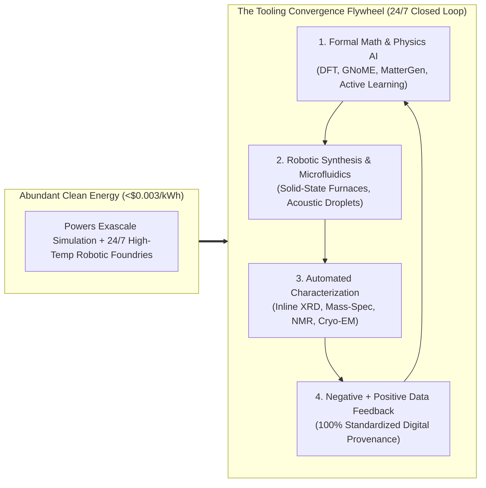
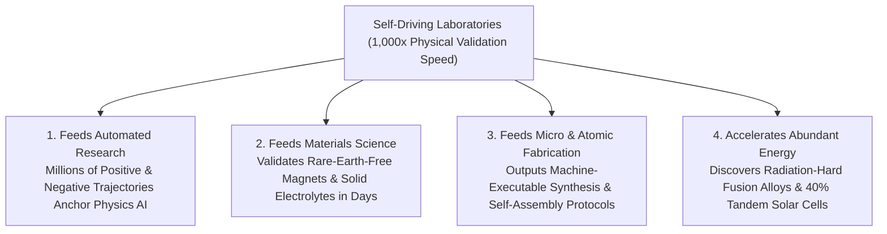

# VISION 01: AUTOMATED PHYSICAL SCIENCES & SELF-DRIVING LABORATORIES
## Pathway 2A: Closing the Loop Between Digital Intelligence and Wet/Solid-State Reality

> **Executive Framing & Core Thesis:**
> * **The Cynic's Objection:** *"AI is great at writing poetry and predicting protein shapes on a screen, but the physical world is messy. Synthesizing a new battery electrolyte, catalyst, or biologic still takes a human PhD five years of pipetting, furnace baking, and failed crystallography in a wet lab. Computation hits a brick wall at the lab bench."*
> * **The Core Thesis (The Tooling Convergence Flywheel):** The bottleneck of physical experimentation is being shattered by **Self-Driving Laboratories (SDLs)**—autonomous facilities where formal mathematical models, generative physics AI, robotic synthesis arms, and high-throughput characterization instruments (XRD, NMR, mass spectrometry, electron microscopy) operate in a closed, 24/7 active-learning loop. Powered by cheap, abundant energy, every physical experiment refines the AI's world model, and every improved model directs more precise robotic experiments—accelerating physical discovery by **$100\times$ to $1,000\times$** and turning empirical trial-and-error into a programmable engineering discipline.

---

## ACT I: A BELIEVABLE NEAR-FUTURE VISION (THE WORLD OF 2040)
### A Thursday Afternoon in 2040 — When Local Problems Get Custom Physical Solutions in 72 Hours

Imagine visiting a municipal water-and-agriculture innovation center in a mid-sized river valley town in **2040**.

Nothing in the building looks like magic; it looks like a clean, quiet server room merged with an automated micro-brewery. Yet the way physical science serves this community has changed beyond recognition:

1. **The 72-Hour Custom Remediation Catalyst:**
   * Last week, sensors in a legacy 20th-century industrial site upstream detected a complex plume of fluorinated organophosphate runoff.
   * In 2026, designing, synthesizing, and validating a selective catalytic membrane to break down that exact molecular cocktail without fouling in local mineral water would have required a multi-year federal grant and a university consortium.
   * On Monday morning, the municipal engineer uploaded the water's exact spectroscopic profile to the regional **Cloud Self-Driving Lab**. Within four hours, an ensemble of physics-informed foundation models proposed 1,200 candidate metal-organic framework (MOF) catalysts.
   * Over the next 48 hours, inside a sealed glass bay, high-speed microfluidic synthesis robots mixed, crystallized, and tested 400 physical variants under real river-water flow conditions, using automated X-ray diffraction and inline mass spectrometry to measure degradation efficiency after every cycle.
   * By Thursday noon, a verified, non-toxic iron-manganese catalyst recipe—complete with scaled synthesis parameters—is downloaded into the water plant's local reactor unit.
2. **The Regional Hospital's Overnight Biologics Bay:**
   * Across town at the community clinic, a patient presents with a rare, drug-resistant fungal infection.
   * Instead of waiting for a blockbuster pharmaceutical economics case that will never come, the hospital's compact, refrigerator-sized **Autonomous Wet-Lab Module** synthesizes and screens 2,000 cell-free peptide variants against the isolated pathogen overnight.
   * By 7:00 AM, it delivers a validated, patient-specific therapeutic formulation for **under \$150 in total compute and reagent energy costs**.
3. **The Builder's Custom Soil-Cement:**
   * A local housing cooperative building flood-resilient timber-and-stone homes needs a zero-carbon geopolymer binder tailored to the exact clay chemistry of their excavation site.
   * They mail a 50-gram soil sample to an automated materials foundry; 36 hours later, they receive the exact alkali-activation recipe verified across 500 automated compressive-strength and freeze-thaw cycles.
4. **Why It Works:**
   * Because off-peak electricity from compact fusion and solar-storage grids costs **\$0.003/kWh**, running continuous high-temperature robotic furnaces, automated cryo-EM beams, and exascale Bayesian active-learning clusters costs pennies on the dollar. Physical experimentation is no longer a scarce artisanal craft—it is a public utility.

---

## ACT II: THE CONVERGENCE BRIDGE — HOW IT CAME ABOUT (2021–2038)
### How Mathematical AI, Robotic Synthesis, and Automated Spectroscopy Fused into a Single Instrument

### Step 1: Breaking the Three Historical Bottlenecks of Physical Science
For two centuries, chemistry, physics, and biology suffered from three structural bottlenecks that kept discovery linear even as computers grew exponentially faster:
* **The "Artisanal Hands" Bottleneck:** Over 80% of a bench scientist's week was spent moving microliters of clear liquid between tubes, weighing powders, scraping crucibles, and waiting for ovens to cool.
* **The Characterization Lag:** Synthesizing a molecule or alloy took hours, but verifying its actual atomic structure via X-ray diffraction (XRD), nuclear magnetic resonance (NMR), or electron microscopy required manual sample preparation and days in an instrument queue.
* **The "Dark Data" Tragedy:** Human scientists only published successful experiments. The **90%+ of failed syntheses**—which contain the most critical boundary information about thermodynamic stability and reaction kinetics—were thrown in the trash or buried in paper lab notebooks, starving AI models of negative training data.

### Step 2: The 2023–2026 Breakout of Self-Driving Labs (SDLs)
Between 2023 and 2026, the convergence of **foundation models for physical science**, **low-cost industrial robotics**, and **inline automated characterization** closed the loop for the first time in history:
* **Autonomous Solid-State Synthesis (LBNL's *A-Lab*):**
  In late 2023 and expanding through 2025, Lawrence Berkeley National Laboratory's **A-Lab** combined DeepMind's GNoME crystal predictions with natural-language models trained on decades of synthesis literature, robotic powder-dispensing arms, automated tube furnaces, and an automated X-ray diffractometer. Operating 24/7 without human intervention, A-Lab synthesized **41 novel inorganic compounds in 17 days**—achieving a >70% success rate by autonomously learning from failed heating profiles and adjusting precursor ratios in real time.
* **Acoustic Droplet Microfluidics & Picomolar Wet Labs:**
  Instead of plastic pipette tips, automated wet labs adopted **acoustic droplet ejection** (firing picoliter droplets using focused ultrasound at 500 Hz) and digital microfluidics. This shrank reaction volumes by **$10,000\times$**, cutting chemical reagent costs and waste by 99.9% while running 50,000 reaction conditions on a single credit-card-sized chip.
* **Active Learning & Epistemic Uncertainty Routing:**
  Instead of brute-force screening, SDLs use **Bayesian optimization** ($\arg\max_x [\mu(x) + \kappa \sigma(x)]$). The AI specifically designs physical experiments in regions of chemical space where its own mathematical physics equations have the highest epistemic uncertainty $\sigma(x)$—maximizing information bits gained per gram of reagent and per kilowatt-hour of furnace time.

### Step 3: 2025–2026 Global State of the Art (SOTA) in Autonomous Physical Science
By 2026, government national labs, cloud-lab utilities, and billions in venture capital had established operational Self-Driving Laboratories across North America, Europe, and Asia:

| Platform / Organization | Sector & Focus | Verified 2024–2026 Milestone | Commercial & Scaling Pathway |
| :--- | :--- | :--- | :--- |
| **LBNL *A-Lab* & Materials Project** (USA) | Autonomous Solid-State Inorganic Synthesis | Synthesized **41 novel inorganic materials in 17 days** (100–200x human speed) via closed-loop AI + robotic furnaces + automated XRD. | National user facility backbone; federated autonomous synthesis network across US DOE national labs. |
| **Lila Sciences** (USA — Cambridge, MA) | Autonomous Science & AI-Driven Physical Labs | Emerged in **2025 with \$200M+ seed funding** (Flagship Pioneering); deployed closed-loop autonomous AI lab clusters across materials, catalysts, and life sciences. | Commercial "Autonomous Science-as-a-Service" platforms discovering green hydrogen catalysts, carbon capture sorbents, and biologics. |
| **Acceleration Consortium** (Univ. of Toronto / Canada) | Global SDL Standards, Organic Electronics & Electrochemistry | Secured **\$200M CAD federal grant**; demonstrated closed-loop discovery of organic solid-state lasers and battery electrolytes across 6 modular SDLs. | Open-source SDL hardware/software protocols (*ivoryOS*) standardizing modular self-driving labs worldwide. |
| **Periodic Labs & Radical AI** (USA) | Autonomous Materials & Physics Discovery | Founded by top DeepMind/OpenAI researchers (2024–2026) integrating physics-informed neural networks directly with high-throughput robotic synthesis lines. | End-to-end proprietary discovery of high-temperature superconductors, thermal coatings, and next-gen alloys. |
| **Emerald Cloud Lab (ECL) & Strateos** (USA) | Software-Defined Remote Wet Laboratories | Over **200+ automated instrument types** (HPLC, NMR, mass-spec, flow cytometry) controllable via single lines of symbolic code from any laptop. | "AWS for Wet Chemistry & Biology"—enabling AI agents to submit, execute, and analyze physical experiments via API. |
| **Insilico Medicine (*Chemistry42* + Robotics Lab)** | Autonomous Drug Discovery & Validation | Fully automated 6-room robotic lab (Suzhou/Abu Dhabi) linking generative chemistry with automated cell imaging; lead fibrosis drug reached **Phase IIb/III clinical trials**. | Compressing preclinical drug discovery from 4.5 years and \$50M+ down to **12–18 months** at <10% historical cost. |
| **Argonne *Polybot* & Liverpool *Mobile Robotic Chemist*** (USA / UK) | Autonomous Polymer & Photocatalyst Discovery | Cooper Group's free-roaming robotic chemist navigated human lab benches for **8 days straight**, performing 688 experiments to discover a **6x more active hydrogen photocatalyst**. | Drop-in humanoid and mobile cobots retrofitting existing university and industrial laboratories without rebuilding infrastructure. |

---

## ACT III: PHASED ROLLOUT ROADMAP (2026–2050) & ECONOMIC CASCADE

As robotic hardware standardizes around common digital APIs and off-peak energy costs plummet, the cost per validated physical experiment follows a steeper Wright's Law curve than genome sequencing did in the 2000s:

| Rollout Phase | Timeline | Infrastructure Scale | Throughput & Cost Metrics | Societal Thresholds Unlocked |
| :--- | :--- | :--- | :--- | :--- |
| **Phase 1: Specialized Industrial & National SDLs** | **2026–2030** | ~250 flagship SDLs across pharma, battery, and national labs | **$100\times$ human throughput**; cost per characterized synthesis drops from \$2,500 to **\$45** | Rapid discovery of PFAS-free coatings, sodium-ion battery electrolytes, and low-iridium water electrolyzers. |
| **Phase 2: API-Driven Cloud Lab Utilities** | **2030–2035** | 2,500+ regional Cloud SDLs accessible via universal API | **$1,000\times$ throughput**; 100% negative-result data capture; **\$2.50** per experiment | Every high school, startup, and clinic can run physical wet/solid experiments via API without owning a lab. |
| **Phase 3: Convergence with Atomic & Micro-Fab** | **2035–2042** | 25,000+ modular container SDLs co-located at clean-energy hubs | **$10,000\times$ throughput**; sub-\$0.15 per microfluidic/thin-film test cycle | Instant local remediation catalysts, personalized overnight phage/peptide therapies, custom regional construction geopolymers. |
| **Phase 4: Ubiquitous Autonomous Matter Compilers** | **2042–2050** | Decentralized municipal & hospital autonomous synthesis bays | Real-time closed-loop physical compilation at **marginal energy cost (<\$0.003/kWh)** | End of empirical scarcity: any thermodynamically stable molecule, catalyst, or biologic can be discovered and validated on demand. |

---

## ACT IV: THE DEEPER HORIZON & SMOOTH SOCIETAL TRANSITION

### 1. The Exponential Cross-Improvement Flywheel Across All Five Domains
Automated Physical Sciences do not evolve in isolation; they act as the **physical truth engine** for every other domain of automation:
* **Feeding Automated Research:** Every million verified reaction trajectories (both successes and failures) generated by robotic labs feeds directly back into formal mathematical physics models, eliminating AI hallucinations in quantum chemistry and biological folding.
* **Feeding Materials Science & Micro-Assembly:** When an SDL discovers a new high-temperature ceramic or biocompatible hydrogel, it outputs not just the chemical formula, but the **exact, machine-verified robotic synthesis protocol** (heating ramps, shear rates, precursor purities) ready for instant scale-up in micro-assembly and industrial plants.
* **Powered by Free Energy, Creating Cheaper Energy:** Cheap electricity powers the energy-intensive plasma torches, vacuum furnaces, and synchrotron light sources of the SDLs; in return, the SDLs discover the higher-temperature superconducting tapes, radiation-hardened fusion first-wall alloys, and 40%-efficient perovskite tandem cells that make energy cheaper still.

### 2. Safety, Biosecurity, and the Evolution of the Human Scientist
A natural concern is safety: *What prevents an autonomous cloud lab from synthesizing hazardous toxins or dangerous pathogens?*
* **Hardware-Enforced Cryptographic Screening:** Unlike a manual basement lab, API-driven Self-Driving Labs enforce **mandatory, cryptographic sequence and precursor screening at the firmware level** (expanding the 2024–2026 International Gene Synthesis Consortium standards to all chemical and biological synthesis). Requests matching restricted toxin, energetic, or pathogen motifs are blocked mathematically before a single valve opens.
* **Closed-Containment Negative-Pressure Bays:** Because human hands never enter the synthesis zone, reaction chambers operate inside hermetically sealed argon or negative-pressure gloveboxes with inline plasma neutralization of all micro-effluents—reducing laboratory chemical exposure and accident rates by **>99%**.
* **Elevating Human Scientists from Pipettors to Architects:** Just as compilers liberated programmers from punching binary paper tape so they could architect operating systems, Self-Driving Labs liberate human scientists from repetitive manual benchwork. Scientists transition into **high-level experimental architects and hypothesis philosophers**—asking *what* humanity should solve next, while the autonomous physical-digital flywheel handles the exhaustive search through matter.

### 3. Summary for the Skeptic
You do not need to believe in sci-fi nanobots to see why physical science is accelerating by three orders of magnitude. Look at **Berkeley's A-Lab synthesizing 41 novel crystals in 17 days**, **Emerald Cloud Lab running 200+ instruments by code**, and **Lila Sciences and the Acceleration Consortium scaling autonomous labs today**. When you connect generative physics AI to robotic arms and inline X-ray/mass-spec sensors—and power them with abundant clean energy—the physical world becomes just as iterable, searchable, and debuggable as software.

---

## APPENDIX: QUANTITATIVE ECONOMICS & THE CONVERGENCE MATRIX (2026 VS. 2040)

To ground why Self-Driving Laboratories achieve a $1,000\times$ reduction in discovery cost and time, compare the end-to-end physical-digital unit economics across the 2026–2040 transition:

| Metric / Operational Stage | Traditional Human Wet/Solid Lab (2024) | First-Gen Self-Driving Lab (2026 SOTA) | Converged Autonomous Matter Foundry (2040) |
| :--- | :--- | :--- | :--- |
| **Hypothesis & Precursor Selection** | 2–4 weeks of manual literature reading | Hours via LLMs + GNoME / MatterGen | **Seconds** via Formally Verified Physics Swarms |
| **Reagent Volume per Assay** | $100\ \mu\text{L} - 10\text{ mL}$ (pipette / beaker) | $1\text{–}10\ \mu\text{L}$ (robotic liquid handler) | **$10\text{ pL} - 1\text{ nL}$** (acoustic / digital microfluidics) |
| **Characterization Latency (XRD/MS/NMR)** | 2–7 days (manual queue & prep) | 15–30 minutes (inline robotic transfer) | **$<5\text{ seconds}$** (on-chip optical/synchrotron inline readout) |
| **Negative Data Capture Rate** | $<5\%$ (unpublished notebook waste) | $>95\%$ (standardized JSON provenance) | **$100\%$** (real-time global active-learning updates) |
| **Energy Cost per 1,000 Furnace-Hours** | ~\$1,800 (industrial retail grid) | ~\$1,200 (grid PPA) | **~\$30** (co-located $\$0.003/\text{kWh}$ fusion/solar off-peak) |
| **Total Cost per Validated Novel Compound** | \$50,000 – \$250,000 | \$1,500 – \$5,000 | **$<\$5.00$** (marginal energy + picomolar feedstock) |

### The Active-Learning Information Gain Law
In an autonomous physical laboratory, discovery speed scales not merely with robotic arm speed ($f_{\text{robot}}$), but with the product of experimental throughput, inline characterization fidelity, and Bayesian epistemic information gain ($\mathcal{I}$):

$$\text{Discovery Velocity} \propto f_{\text{robot}} \times \eta_{\text{inline-sensor}} \times \mathbb{E}\left[\mathcal{I}(\text{Model} \mid \text{Positive} \cup \text{Negative Data})\right]$$

Because every neighboring domain in the **Vision 01 Automation Flywheel** improves one of these three multipliers—**Automated Research** sharpens the prior model, **Micro-Assembly** shrinks the microfluidic chip volume by $10^4$, **Materials Science** supplies higher-temperature furnace elements, and **Abundant Energy** removes the power cost—physical science transitions permanently from linear craft to exponential compilation.
