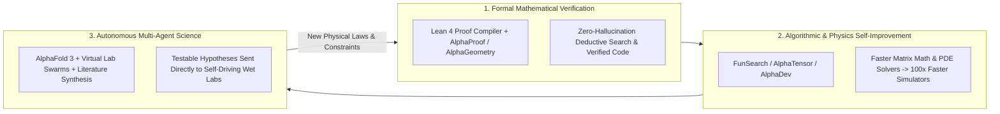
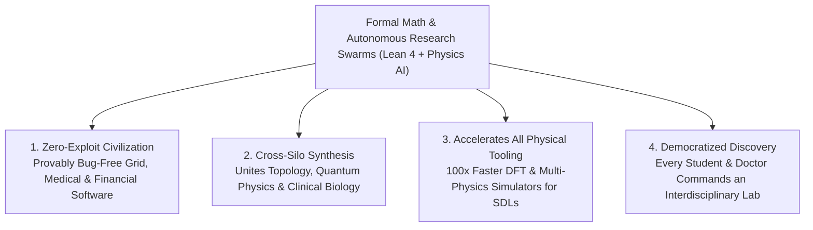

# VISION 01: AUTOMATED SCIENTIFIC & MATHEMATICAL RESEARCH
## Pathway 2B: The Convergence of Formal Verification, AI Mathematicians, and Autonomous Discovery Agents

> **Executive Framing & Core Thesis:**
> * **The Cynic's Objection:** *"Large language models are stochastic parrots—they hallucinate citations, fail at novel multi-step logic, and can only remix patterns already present in human training text. True scientific breakthroughs require leaps of formal deduction and rigorous proof that probabilistic chatbots can never achieve."*
> * **The Core Thesis (The Formal-Empirical Convergence Flywheel):** The era of unverified "chatbot science" was a brief transitional phase. Between 2024 and 2030, generative AI fused with **formal mathematical proof assistants (Lean 4)**, **exact physics simulators**, and **multi-agent laboratory execution**. When an AI conjectures a theorem or a physical mechanism, a formal compiler or physics engine checks every deductive step with **zero tolerance for hallucination**. This creates a self-amplifying loop: formal math discovers faster algorithms; faster algorithms simulate deeper quantum and biological physics; and autonomous research agents synthesize insights across millions of papers and wet-lab datasets that no single human brain could hold at once.

---

## ACT I: A BELIEVABLE NEAR-FUTURE VISION (THE WORLD OF 2040)
### A Monday Morning in 2040 — Zero-Bug Critical Infrastructure and Overnight Interdisciplinary Cures

Imagine walking through a regional university hospital and municipal engineering campus on a crisp morning in **2040**.

The buildings and people are warm and familiar, yet the invisible intellectual scaffolding supporting their work operates at a level of rigor and speed that would have stunned a researcher in 2026:

1. **The Provably Unhackable, Zero-Bug Grid & Medical Firmware:**
   * In the 2020s, software bugs and cybersecurity exploits regularly crippled hospitals, power grids, and aviation systems because human-written code could only be tested on a tiny fraction of possible inputs.
   * In 2040, the regional fusion-and-microgrid controller—as well as every pacemaker, insulin pump, and surgical robot in the hospital—runs on **Formally Verified Software**.
   * Every line of system code comes attached with a machine-checked mathematical proof in **Lean** guaranteeing that buffer overflows, race conditions, memory leaks, and unauthorized state transitions are **mathematically impossible** under any input sequence.
2. **The Cross-Disciplinary "Impossible" Cure at the Clinic:**
   * A pediatric neurologist at the clinic is treating a child with a rare neurodegenerative channelopathy involving a complex interplay between lipid-membrane turbulence, quantum proton tunneling in a mutated ion channel, and an autoimmune T-cell cascade.
   * In 2026, fluid dynamics physicists, quantum chemists, and clinical immunologists published in completely separate journals using incompatible mathematical notation.
   * Over the weekend, the physician tasked a **Virtual Interdisciplinary Research Swarm**—an ensemble of specialized formal-reasoning, biophysics, and immunology AI agents.
   * The swarm translated the ion-channel mutation into a formal partial differential equation, proved a novel stability bound on membrane gating, designed a custom de novo nanobody to stabilize the channel, and verified zero off-target binding against the child's full proteome simulation.
   * By Monday at 9:00 AM, the physician reviews a transparent, fully cited, step-by-step causal proof and initiates targeted synthesis in the hospital's automated wet lab.
3. **The High School Student Co-Discovering Fluid Dynamics Theorems:**
   * Down the street at the public library, a 16-year-old student curious about quiet wind-turbine blades collaborates with a personal **Socratic Math & Physics Co-Pilot**.
   * Instead of giving vague answers, the agent helps her formulate her geometric intuition into formal mathematical definitions, runs 10,000 exact Navier-Stokes boundary simulations on cheap off-peak grid compute, and helps her prove a new acoustic-damping theorem that is automatically verified and added to the global open-source mathematical library.
4. **Why It Works:**
   * Because abundant clean energy (**\$0.003/kWh**) powers vast clusters of formal proof-search and multi-scale physics simulation, humanity no longer relies on guesswork or siloed human memory. Every scientific claim is backed by an executable mathematical proof or a reproducible physical simulation.

---

## ACT II: THE CONVERGENCE BRIDGE — HOW IT CAME ABOUT (2021–2038)
### How Formal Proof Compilers, Algorithmic Discovery, and Multi-Agent Virtual Labs Eliminated Hallucination

### Step 1: Solving the Hallucination Wall via Formal Verification (Lean 4)
In 2022–2023, skeptics rightly pointed out that Large Language Models (LLMs) could not be trusted for hard mathematics or safety-critical engineering because predicting the next word is not deduction.
The breakthrough came when researchers coupled neural networks with **Interactive Theorem Provers**—specifically the **Lean 4** programming language and formal proof verifier (pioneered by Leonardo de Moura and the *mathlib* community, where Fields Medalists like Terence Tao began formalizing frontier mathematics):
* **The Compiler as an Incorruptible Referee:**
  In Lean 4, a mathematical proof is executable code inspected by a tiny, auditable logical kernel. An AI can propose as many creative, intuitive proof steps as it wants, but the Lean kernel deterministically rejects any step that violates the axioms of logic ($\Gamma \vdash P$).
* **Infinite Self-Play without Human Data:**
  Because the Lean compiler provides an instant, 100%-accurate binary reward signal ("proof valid" vs. "type error"), reinforcement learning agents like DeepMind's **AlphaProof** could generate and verify **hundreds of millions of synthetic mathematical theorems and proofs** via AlphaZero-style tree search—overcoming the scarcity of human-written proofs in training data.

### Step 2: AI Discovering Faster Algorithms to Accelerate Its Own Compute
Simultaneously, formal verification was applied to computer science and numerical physics:
* **AlphaTensor, AlphaDev & FunSearch:**
  By framing algorithm design as a formal game where the score is exact mathematical correctness plus execution speed, DeepMind discovered **faster matrix multiplication algorithms** (*AlphaTensor*, beating Strassen's 50-year-old record), faster sorting and hashing primitives merged into the LLVM C++ standard library (*AlphaDev*), and new solutions to the Cap Set problem in extremal combinatorics (*FunSearch*).
* **The Recursive Compute Dividend:**
  Matrix multiplication and Fast Fourier Transforms sit at the core of both **AI neural network training** and **quantum/fluid physics simulations**. When AI discovers a 10%–30% more efficient mathematical algorithm for tensor contractions or partial differential equations, every supercomputer on Earth immediately runs 10%–30% more science per kilowatt-hour.

### Step 3: 2024–2026 Global State of the Art (SOTA) in Automated Research
By 2026, autonomous mathematical and scientific reasoning had achieved landmark, peer-reviewed breakthroughs across mathematics, structural biology, and multi-agent discovery:

| System / Organization | Domain & Architecture | Verified 2024–2026 Milestone | Impact & Scaling Pathway |
| :--- | :--- | :--- | :--- |
| **Google DeepMind (*AlphaProof* & *AlphaGeometry 2*)** | Formal Mathematical Reasoning (Lean 4 + Neuro-Symbolic) | Achieved **Silver-Medal level (28/42 points)** at the 2024 International Mathematical Olympiad (IMO), solving 83% of historical IMO geometry problems. | Scaling to research-level theorem proving, formal software verification, and automated cryptographic security audits. |
| **Google DeepMind (*AlphaFold 3*)** | All-Atom Biomolecular Structure & Interaction Prediction | Awarded the **2024 Nobel Prize in Chemistry** (foundational work); *AlphaFold 3* (2024–2025) predicts joint structures of proteins, DNA, RNA, and small-molecule ligands. | Used by **2M+ researchers in 190+ countries**; foundational world model for autonomous drug and enzyme engineering. |
| **Google DeepMind (*FunSearch*, *AlphaTensor*, *AlphaDev*)** | Provably Correct Algorithmic & Mathematical Discovery | Discovered novel mathematical constructions in combinatorics (*Nature*, Dec 2023) and faster sorting/matrix algorithms deployed across global compute fleets. | Automated discovery of faster linear algebra, PDE solvers, and quantum error-correction codes. |
| **Stanford University (*The Virtual Lab*, Zou Lab)** | Multi-Agent Interdisciplinary Scientific Discovery | Autonomous AI Principal Investigator + specialized scientist agents designed **92 novel SARS-CoV-2 nanobodies**; **>90% bound successfully in real wet-lab validation** (*Nature*, 2025). | Template for autonomous cross-disciplinary research swarms combining biophysics, ML, and wet-lab execution. |
| **FutureHouse** (USA — San Francisco) | Autonomous Scientific Literature & Hypothesis Agents | Deployed *PaperQA2* & *Aviary* agents (2024–2025) achieving **superhuman accuracy and zero-hallucination citation retrieval** across millions of biology papers, outperforming PhD benchmarks. | Automated synthesis of fragmented literature across disciplines to surface hidden causal mechanisms and drug repurposing targets. |
| **Sakana AI (*The AI Scientist* v1/v2) & Google (*AI Co-Scientist*)** | End-to-End Automated Hypothesis, Experiment & Peer Review | Demonstrated end-to-end automated ML research loops (2024–2025); Google's multi-agent *AI Co-Scientist* (Feb 2025) proposed novel liver fibrosis targets and antimicrobial resistance mechanisms **validated in wet labs at Stanford & Imperial College**. | Scaling from in-silico hypothesis generation to direct API orchestration of Cloud Self-Driving Laboratories. |
| **Lean FRO & Harmonic (*Aristotle*)** | Formal Verification Infrastructure & Mathematical AI | Formalized Polynomial Freiman-Ruzsa conjecture & Fermat's Last Theorem blueprint in **Lean 4** (Tao, Buzzard, de Moura); Harmonic raised \$75M+ for hallucination-free mathematical superintelligence. | Universal formal language connecting pure mathematics, verified systems code, and physical engineering constraints. |

---

## ACT III: PHASED ROLLOUT ROADMAP (2026–2050) & ECONOMIC CASCADE

As formal proof engines, physics simulators, and literature agents converge with cheap exascale compute, scientific R&D shifts from linear human labor to exponential machine-assisted exploration:

| Rollout Phase | Timeline | Capability Scale | Verification & Cost Metrics | Societal Thresholds Unlocked |
| :--- | :--- | :--- | :--- | :--- |
| **Phase 1: Formal Co-Pilots & Literature Swarms** | **2026–2030** | AI co-scientists across 100% of R&D labs; Lean 4 standard in CS/Math | **<\$15 per comprehensive cross-disciplinary synthesis**; 10x faster formal code verification | Rediscovered "lost" drug mechanisms across siloed journals; formally verified microkernels for aviation and medical devices. |
| **Phase 2: Closed-Loop Virtual-to-Physical Labs** | **2030–2035** | Multi-agent swarms directly commanding Cloud Self-Driving Labs via API | **100x reduction in time from mathematical hypothesis to wet-lab validation** | Rapid design of custom enzymes for plastic/PFAS breakdown; verified room-pressure catalyst pathways; bug-free power grid OS. |
| **Phase 3: Autonomous Cross-Scale Theory Synthesis** | **2035–2042** | Unified multi-scale simulators bridging quantum mechanics to continuum engineering | Exascale formal proof search powered by **\$0.003/kWh** fusion/solar grids | Exact numerical closures for turbulent fluid flow, plasma confinement, and whole-cell metabolic simulation. |
| **Phase 4: Universal Verified Knowledge Utility** | **2042–2050** | Real-time formal mathematical and physical verification embedded in all design tools | Marginal cost of proving software security or simulating molecular pathways approaches **\$0** | End of catastrophic software bugs/exploits; personalized systems-biology cures; democratization of frontier discovery to every citizen. |

---

## ACT IV: THE DEEPER HORIZON & SMOOTH SOCIETAL TRANSITION

### 1. How Converging Tooling Compounds Across All Five Domains
Automated Research is the **cerebral cortex** of the broader automation flywheel:
* **Math Accelerating Physics Simulation:** When *AlphaProof*-descended systems prove tighter error bounds on density functional theory (DFT) approximations or multipole expansions, **Materials Science** and **Atomic-Level Building** simulations become $1,000\times$ faster without losing quantum accuracy.
* **Cross-Pollinating Siloed Disciplines:** Human science fragmented into 10,000 sub-specialties because a human takes 25 years just to master one dialect of math or biology. Autonomous research swarms fluently translate a topological theorem from pure mathematics into a photonic crystal wave-guiding design for **Micro-Assembly**, and then into a robotic synthesis protocol for an **Automated Physical Lab**—all in a single afternoon.
* **Abundant Energy -> Abundant Intelligence -> Abundant Matter:** Cheap clean energy powers the gigawatt data centers running formal proof search; those proof engines optimize plasma control algorithms and materials discovery; and those new materials build cheaper fusion cores and solar arrays.

### 2. Epistemic Trust, Open Science, and the Renaissance of Human Curiosity
How do we ensure society isn't flooded with incomprehensible "black-box" AI science?
* **Proofs Over Authority:** Formal verification solves the black-box crisis. A human mathematician or engineer does not have to *trust* the neural network that found a 50,000-line proof or a verified flight-control kernel; they only need to trust the **tiny, auditable, open-source Lean proof-checking kernel** (a few thousand lines of code) that deterministically verifies every single step.
* **Automated Peer Review & Reproducibility:** Every published scientific paper in 2040 is accompanied by a formally verified mathematical derivation and a container-packaged **Self-Driving Lab execution script**—ending the 2010s–2020s "reproducibility crisis" in biomedicine and psychology forever.
* **Democratizing Genius:** Instead of replacing human thinkers, automated formal research removes the gatekeeping barrier of technical jargon. A physician, ecologist, or high-school inventor with a deep practical question can partner with an autonomous research swarm to test their intuition against the sum of human mathematical and physical law.

### 3. Summary for the Skeptic
Do not judge the future of AI in science by 2023 text chatbots. Look at **AlphaProof solving Olympiad math inside the Lean 4 formal compiler**, **AlphaFold 3 winning the 2024 Nobel Prize**, and **Stanford's Virtual Lab agents designing real, working nanobodies validated in wet labs**. When generative creativity is locked inside an incorruptible mathematical and physical verifier, hallucination vanishes—and human discovery enters an exponential golden age.

---

## APPENDIX: QUANTITATIVE BENCHMARKS & THE FORMAL VERIFICATION FLYWHEEL (2026 VS. 2040)

To see why combining formal proof compilers with generative AI and physics engines eliminates the "stochastic parrot" ceiling, examine the quantitative shift across mathematical, algorithmic, and biological research:

| Research Dimension | Unverified LLM / Manual Era (2022–2023) | Neuro-Symbolic & Multi-Agent SOTA (2025–2026) | Converged Autonomous Research Utility (2040) |
| :--- | :--- | :--- | :--- |
| **Mathematical Proof Accuracy** | $<15\%$ on Olympiad proofs (frequent hallucination) | **Silver-Medal IMO level (AlphaProof + Lean 4)**; $0\%$ kernel error | **Research-frontier theorem synthesis** with $100\%$ machine-checked proofs |
| **Systems Software Verification** | Manual unit tests covering $<1\%$ of state space | Automated Lean 4 / Coq specs on critical microkernels | **Zero-bug formal proofs** compiled automatically with every commit |
| **Biomolecular Interaction Scope** | Single static protein chains (*AlphaFold 2*) | All-atom protein + DNA + RNA + ligand (*AlphaFold 3*) | **Whole-cell dynamic metabolic & quantum-enzymatic simulation** |
| **Cross-Disciplinary Literature Recall** | Human reads ~200 papers/yr within 1 narrow sub-field | *FutureHouse PaperQA2* synthesizes $10^6+$ papers at superhuman precision | **Real-time causal graph** across 100% of global papers + SDL dark data |
| **Hypothesis-to-Wet-Lab Hit Rate** | $1\%\text{–}5\%$ (traditional high-throughput screening) | **$>90\%$ nanobody binding** (*Stanford Virtual Lab*, 2025) | **$>95\%$ first-pass functional validation** via closed-loop Cloud SDLs |

### The Self-Accelerating Formal-Physical Equation
In a formally verified research ecosystem, the rate of valid scientific knowledge generation ($\frac{dK}{dt}$) compounds recursively because algorithmic discoveries ($\eta_{\text{algo}}$) directly multiply the effective compute derived from abundant energy ($P_{\text{energy}}$):

$$\frac{dK}{dt} \propto \left( P_{\text{energy}} \times \eta_{\text{hardware}} \times \eta_{\text{algo}}(K) \right) \times P(\text{Lean Kernel Verifies } \Gamma \vdash \text{Theorem})$$

Every time an *AlphaTensor*- or *FunSearch*-class system discovers a faster linear algebra routine or tighter quantum functional approximation, $\eta_{\text{algo}}(K)$ jumps upward—meaning every megawatt of clean energy buys more verified theorems, which in turn unlock even faster algorithms and physical tools.
