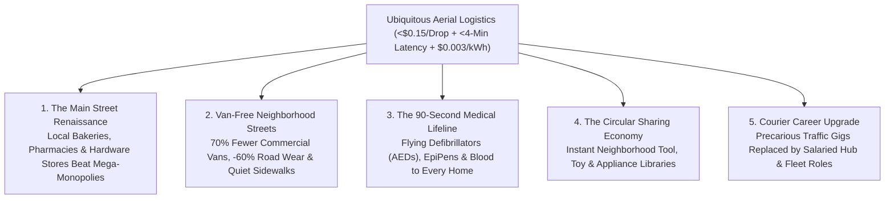

# VISION 01: UNIVERSAL PHYSICAL AUTOMATION & ROBOTICS
## Pathway 1E: Autonomous Aerial Logistics & Drone Delivery — *Ending the Absurdity of Moving a 3-Ton Van for a 2-Pound Burrito*

> **Executive Framing & Core Thesis:**
> * **The Cynic's Objection:** *"Delivery drones are a gimmick that will blot out the sky with buzzing wasps, crash into power lines, get grounded by rain, and never beat the economics of a delivery van dropping fifty boxes on a suburban block."*
> * **The Core Thesis:** In the 2020s, humanity used a **6,000-pound (3-ton) internal-combustion or heavy battery van** driven by a human to deliver a **2-pound pharmacy prescription, grocery bag, or hot meal**—a **3,000-to-1 vehicle-to-payload mass penalty** that choked neighborhood streets, pulverized road pavement, and burned billions of gallons of fuel. Between 2021 and 2026, autonomous aerial logistics solved noise, precision, and airspace scaling simultaneously through **high-altitude hover + tethered micro-droids** (**Zipline Platform 2**), **curbside autoloader networks** (**Alphabet Wing**, **Manna**), and **autonomous blended-wing middle-mile cargo aircraft** (**Elroy Air**, **Natilus**). Having already surpassed **2 million commercial autonomous deliveries** with zero fatalities, aerial logistics paired with **\$0.003/kWh** clean energy drops local delivery latency to **under 6 minutes for \$0.15 per drop**—removing 70% of commercial vans from residential streets and placing every home on Earth within three minutes of emergency medicine.

---

## ACT I: A BELIEVABLE NEAR-FUTURE VISION (THE WORLD OF 2040)
### A Tuesday Afternoon in 2040 — The 4-Minute Invisible Supply Line

Imagine standing on a quiet residential street in suburban Dallas, Dublin, Kigali, or Osaka on a rainy Tuesday afternoon in **2040**.

Look up and down the neighborhood sidewalk. Notice what is missing: there are no double-parked delivery vans blocking bike lanes, no diesel exhaust idling in driveways, and no buzzing quadcopters hovering five feet above your rosebushes. Instead, three seamless layers of aerial logistics operate almost invisibly:

1. **The 4-Minute Pharmacy & Kitchen Drop (Tethered Micro-Droid Precision):**
   Inside your home, your six-year-old wakes up from a nap with a $102^\circ\text{F}$ ear infection. A rapid home strep/ear diagnostic confirms the exact targeted antibiotic needed. Three minutes and forty seconds after the clinician approves the script, an autonomous fixed-wing aircraft (**Zipline P2** class) glides silently at **350 feet** above your street—completely inaudible over the light rain. While the main aircraft stays high overhead, a tiny, aerodynamic **tethered delivery droid** lowers on a micro-braided line, using onboard optical-flow and active fan thrusters to set the insulated medicine pouch gently onto a **12-inch patio tile** with zero wind-wash, then zips back into the aircraft belly and flies on. Total delivery cost: **\$0.12** (powered by $0.25\text{ kWh}$ of **\$0.003/kWh** electricity).
2. **The Local Micro-Merchant Renaissance:**
   At 6:15 PM, you order fresh sourdough bread and hot ramen from an independent family bakery and noodle shop four miles away. Instead of paying 35% in gig-app fees for a 45-minute lukewarm car delivery, the baker slips the order into an automated **rooftop dock**. Four minutes later, the piping-hot meal arrives on your back deck for a **15-cent aerial transit fee**—allowing neighborhood family restaurants and hardware stores to out-compete mega-warehouses on speed and freshness.
3. **Middle-Mile Sky Freight (Connecting Rural & Island Supply Chains):**
   Fifty miles away at a regional cooperative farm and rural clinic, a hybrid-electric VTOL cargo drone (**Elroy Air Chaparral** / **Natilus Kona** class) autonomously picks up a 1,500-pound aerodynamic cargo pod of freshly harvested berries and delivers medical supplies without needing an airport runway—cutting rural supply-chain costs by 65%.
4. **The Skeptic's Question:**
   *"In 2022, people joked that drone delivery had been promised by tech giants for ten years without showing up at their house. How did it go from regulatory red tape and noisy prototypes to millions of silent, dinner-plate-accurate drops?"*

Here is the exact physical, algorithmic, and regulatory chain of events from 2021 to 2038.

---

## ACT II: THE CONVERGENCE BRIDGE — HOW IT CAME ABOUT (2021–2038)
### Solving the "Last 50 Feet," BVLOS Airspace, and the 3,000:1 Mass Penalty

```mermaid
flowchart LR
    subgraph Tooling["2021–2026: The Rapid Convergence of Tooling"]
        T1["Physical & Acoustic Tooling<br>300-Ft Hover + Active Tethered Droids (Zipline P2) & Quiet Rotors"]
        T2["Mathematical & Airspace Tooling<br>Onboard Acoustic/Optical DAA + FAA BVLOS (Part 108) UTM"]
        T3["Autonomous Ground Docks<br>Zero-Touch Curbside Autoloaders (<15s Turnaround)"]
    end

    subgraph Breakout["2024–2026: Verified Commercial Million-Delivery Scale"]
        B1["Zipline (>1.2M Deliveries, 100M+ Miles)<br>Walmart, Cleveland Clinic, Panera, Memorial Hermann"]
        B2["Alphabet Wing & Manna (500k+ Drops)<br>DFW Metro, Dublin & EU 3-to-6 Min Suburban Grids"]
        B3["Hospital & Middle-Mile Cargo<br>Matternet Lab Pipelines + Elroy Air & Natilus Cargo"]
    end

    subgraph Maturity["2030–2040: The Energy + Aerial Logistics Grid"]
        M1["<$0.15 / Delivery (at $0.003/kWh) & <5-Minute Urban/Rural Latency"]
        M2["70% Fewer Neighborhood Delivery Vans & Universal Medical Access"]
    end

    Tooling ==> Breakout ==> Maturity
```

### Step 1: The Three Converging Inflections That Solved Noise, Accuracy, and Airspace (2021–2026)

Early delivery drones (2014–2020) failed in suburbs for three practical reasons: descending all the way into a backyard full of trees, dogs, and patio umbrellas was dangerous and loud; human staff had to manually load every drone; and aviation regulators required human visual observers on the ground. Between 2022 and 2026, three innovations solved all three problems:

* **Physical & Mechatronic Tooling (The High-Altitude Tethered Droid & Quiet Propulsors):**
  Instead of bringing a 50-pound aircraft down into a cluttered backyard, **Zipline unveiled Platform 2 (P2)**: the main winged aircraft hovers quietly **300+ feet in the air** (where its multi-blade propellers blend into ambient street noise at $<50\text{ dBA}$), and lowers a small, self-stabilizing **autonomous tethered droid** equipped with its own downward cameras and quiet maneuvering fans. Even in 25-mph gusts, the droid actively steers itself to place a fragile carton of eggs or hot soup onto a **dinner-plate-sized target**, releases the latch, and reels back into the fuselage in seconds.
* **Mathematical & Airspace Tooling (Onboard Detect-and-Avoid + Automated UTM / FAA Part 108):**
  Using lightweight edge neural processors, onboard acoustic microphones, ADS-B, and millimeter-wave radar, drones gained autonomous **Detect-and-Avoid (DAA)** capability—spotting uncooperative small aircraft, birds, and cranes in real time. This enabled regulators (FAA in Dallas-Fort Worth, EASA in Europe, CAAC in China) to authorize **Automated Unmanned Traffic Management (UTM)** and **Beyond Visual Line of Sight (BVLOS / FAA Part 108)** operations, where multiple competing drone fleets share digital sky lanes automatically with **1 human supervisor monitoring 20 to 50+ aircraft**.
* **Automated Dock & Autoloader Tooling:**
  **Alphabet Wing** (via its curbside **Autoloader**) and **Zipline** (via automated building docks that slide directly into hospital laboratories or restaurant kitchens) eliminated human ground handling—allowing a store employee to hook a bag onto a window dock in 5 seconds while the drone charges and picks up the payload autonomously.

### Step 2: The 2025–2026 Global State of the Art (Verified Multi-Million Delivery Networks)

By 2025–2026, autonomous drone delivery had already logged **over 2 million commercial customer deliveries** and **100+ million autonomous flight miles** across four continents:

| Global Leader | Flagship System & Payload | Key Technical Architecture | Verified 2024–2026 Milestone | Commercial Partners & Active Markets |
| :--- | :--- | :--- | :--- | :--- |
| **Zipline** | **Platform 1** (Fixed-Wing) & **Platform 2 (P2 Zip)** (Hover + Tethered Droid; 8 lb payload) | 10-mi urban radius (in 10 mins); 300-ft quiet hover + active maneuvering tether droid; automated indoor/outdoor dock charging. | Surpassed **1.25+ million commercial deliveries** and **100 million autonomous commercial miles** with zero serious injuries; contracted for **60M+ prescriptions/items**; reduced maternal hospital death from hemorrhage in Rwanda by **>50%**. | **Walmart** (Pea Ridge & DFW), **Cleveland Clinic**, **Memorial Hermann Health**, **Panera Bread**, **Sweetgreen**, **Chipotle**, **Jet's Pizza**, and **NHS UK**. |
| **Alphabet Wing** | **Wing Hummingbird** Series + **Curbside Autoloader** (2.5–5 lb payload) | 12 lift rotors + 2 cruise props (65 mph); lightweight tether release; modular parking-spot Autoloader network. | Surpassed **400,000+ commercial deliveries**; launched **largest US metro drone network across Dallas-Fort Worth** with **Walmart** (covering millions of residents within 30 mins of Supercenters) and integrated directly into the **DoorDash** app. | **Walmart** (DFW Supercenter grid), **DoorDash** (US & Australia), **Coles**, **Walgreens**, and **Lusk/Dublin**. |
| **Manna Drone Delivery** | **Manna Aero Gen 4** (Custom High-Speed Suburban Drone; 8.8 lb payload) | 50 mph cruise; dual-redundant winch; weather-hardened for Irish/North Atlantic rain and 35-mph winds; 1-to-20 human-to-drone ratio. | Surpassed **165,000+ suburban deliveries** in **Dublin, Ireland** (Balbriggan/Blanchardstown—reaching **>35% of all households** in operating towns) and expanded to **Dallas-Fort Worth (Texas)** & mainland Europe with **3-minute average flight times**. | **Tesco**, **Samsung**, **Boomerang**, local independent pharmacies, coffee shops, and restaurants across Ireland, EU & Texas. |
| **Matternet** | **M2 Drone** + **Matternet Station** Portal (4.4 lb medical payload) | Point-to-point automated hospital lab dome; biometric/QR secure payload lockbox exchange. | Obtained **FAA Type Certification & Production Certificate**; operating continuous daily hospital lab specimen pipelines in **Switzerland, Berlin (Labor Berlin), and US clinics (WakeMed, UPS Flight Forward, AmerisourceBergen)**. | Hospital systems, central pathology laboratories, and urgent blood/oncology infusion centers. |
| **Elroy Air & Natilus** | **Chaparral** (Hybrid-Electric VTOL) & **Natilus Kona** (Blended-Wing Cargo) | **Elroy Chaparral:** 300–500 lb autonomous pod over 300 miles; **Natilus Kona:** 3.8-ton (8,000 lb) payload blended-wing body (50% less fuel/cost). | **Elroy Air** completed transition flight testing with **\$2B+ in pre-orders (FedEx, Bristow, LCI, USAF)**; **Natilus** unveiled full-scale **Kona** regional aircraft with **\$7B+ order book**. | Middle-mile autonomous warehouse-to-warehouse, island, disaster-relief, and rural air freight. |
| **Meituan & DJI FlyCart** | **Meituan M-Drone Gen 4** & **DJI FlyCart 30** (Up to 66 lb heavy lift) | Urban kiosk-to-kiosk automated cabinets (Meituan) & high-altitude mountain cable/supply transport (DJI). | **Meituan** completed **300,000+ urban food/drink drops** across **Shenzhen & Shanghai** parks, offices, and universities; **DJI FlyCart 30** hauling oxygen and supplies up **Mount Everest** and rural mountain villages. | High-density Asian megacity kiosk delivery and extreme mountain/island logistics. |

---

## ACT III: PHASED ROLLOUT ROADMAP (2026–2050) & ECONOMIC CASCADE
### Replacing 3-Ton Steel Vans with 40-Pound Electric Aircraft

Why is aerial delivery fundamentally cheaper than road delivery once automated? Because an aircraft cruising at 60 mph in a straight line uses **~0.04 kWh per mile** (less energy than boiling a kettle of water), ignores traffic lights, and completes **5 to 8 deliveries per hour** compared to a road driver's 2 to 3 stops:

| Rollout Phase | Timeline | Annual Global Deliveries | All-In Cost per Delivery | Infrastructure & Societal Thresholds Unlocked |
| :--- | :--- | :--- | :--- | :--- |
| **Phase 1: Suburban Retail & Hospital Networks** | **2026–2029** | **50 Million – 350 Million / yr** | **\$1.20 – \$2.10 / drop** (already 50% cheaper than \$4.50+ human gig-car delivery) | Metro-wide Walmart/DoorDash/pharmacy coverage in 50+ US, EU, Asian & African regions; hospital blood/lab pipelines cut diagnostic turnaround by 60%. |
| **Phase 2: Universal Urban Docks & Middle-Mile Pods** | **2030–2034** | **3 Billion – 10 Billion / yr** | **\$0.40 – \$0.75 / drop** (1 human supervisor per 100 aircraft; automated rooftop docks) | Standard apartment and office buildings integrate window/roof Zipline-style docks; **Elroy/Natilus** middle-mile cargo drones connect rural towns directly to global ports. |
| **Phase 3: Energy-Coupled Instant Civic Logistics** | **2035–2042** | **40 Billion+ / yr** | **\$0.10 – \$0.18 / drop** (at **\$0.003/kWh** electricity; <\$0.001 energy cost per flight) | **70% of small-parcel delivery vans** removed from neighborhood streets; suburban road wear, package theft, and last-mile traffic emissions plummet by >75%. |
| **Phase 4: The Zero-Inventory Home & Instant AED Grid** | **2043–2050+** | **100 Billion+ / yr** (Aerial + Underground Tube Hybrid) | **<\$0.08 / drop** (bundled into municipal utility fees) | Every neighborhood within **90 seconds of an autonomous flying defibrillator (AED), EpiPen, or anti-venom**; households share neighborhood tool/appliance libraries delivered in 3 minutes on demand. |

### First-Principles Physics & Cost Breakdown: 6,000-lb Van vs. 40-lb Autonomous Wing
Over 80% of all e-commerce, pharmacy, and restaurant deliveries weigh **under 5 pounds (2.3 kg)**. Comparing a human-driven gig car/van in 2025 against an autonomous docked drone in 2038 reveals why the sky wins on every physical and economic metric:
* **Vehicle-to-Payload Mass Ratio:** A 6,000-lb van carrying a 2-lb meal moves **3,000 pounds of steel per pound of payload**. A 45-lb winged drone carrying a 5-lb package moves **9 pounds of airframe per pound of payload**—a **>300x improvement in mass efficiency**.
* **Energy Consumed per 4-Mile Round Trip:** Stop-and-go city driving consumes **~2.5 to 4.0 kWh** of fuel/battery energy. A winged electric drone cruising straight at 60 mph consumes **~0.18 to 0.25 kWh**—costing **\$0.0006 (six-hundredths of a cent)** at **\$0.003/kWh** clean baseload electricity.
* **Labor & Supervision Cost per Drop:** A human gig driver completing 2.5 orders per hour in traffic requires **\$6.00 to \$9.00 per drop** in wages/tips/fees. An automated dock-loaded drone completing 6 flights per hour with 1 remote airspace supervisor per 60 aircraft costs **\$0.03 per drop** in human oversight.
* **Airframe & Dock Amortization (\$4,500 Mass-Produced Aircraft over 40,000 Flights):** Adds just **\$0.11 per delivery** including battery replacement and automated maintenance—bringing the all-in cost to **~\$0.14 per delivery**.

---

## ACT IV: THE DEEPER HORIZON & SMOOTH SOCIETAL TRANSITION
### Empowering Local Main Street, Saving Lives, and Elevating Delivery Workers

### 1. The Great Equalizer for Local Small Businesses (Main Street vs. Monopoly)
In the 2020s, e-commerce monopolies and predatory gig-delivery apps charged local restaurants, independent pharmacies, and mom-and-pop hardware stores **25% to 35% commissions** per order—siphoning billions of dollars out of local towns and driving neighborhood merchants out of business.
* **Open-Access Municipal Sky Grids:** When municipalities regulate automated curbside and rooftop autoloaders as open-access common carriers (like fiber optic lines or postal boxes), any local merchant can ship a 5-pound order across town in **4 minutes for \$0.15**. Your local independent bookstore, bakery, farmstand, and hardware store suddenly enjoy *faster* and *cheaper* fulfillment than any continental warehouse conglomerate.
* **The Circular "Zero-Clutter" Home:** Why should every single household on a block buy and store a \$200 power drill, a carpet steamer, or a fondue pot that is used for 20 minutes a year? With 3-minute, 15-cent aerial delivery, neighborhoods run **automated community tool, medical-device, and kitchen-appliance libraries**—delivering the exact item to your porch when needed and whisking it back to sanitize and recharge when finished.

### 2. Universal Emergency Medicine: The 90-Second Cardiac & Trauma Grid
When a person suffers sudden cardiac arrest, survival drops by **10% for every minute** without defibrillation; ambulances stuck in traffic take 8 to 14 minutes on average.
* **Every Rooftop Dock is a Life-Saving Station:** By co-locating an emergency medical pod at every retail and municipal drone dock, calling 911 dispatches an autonomous **Flying Defibrillator (AED), naloxone kit, EpiPen, or hemorrhage clotting pack** that lands directly beside the patient in **under 90 seconds**—tripling out-of-hospital cardiac survival rates across both dense suburbs and remote rural valleys.

### 3. A Dignified Transition for Gig and Courier Workers
In 2026, gig-economy food and parcel couriers worked one of the most precarious, underpaid, and physically dangerous jobs in the modern economy—bearing their own gas, car depreciation, and high traffic fatality risk for sub-minimum net wages.
* **From Precarious Traffic Gig to Salaried Airspace & Hub Stewards:** As low-margin 2-pound burrito and prescription drops shift to the sky, municipal workforce boards and logistics operators transition former couriers into salaried, union-eligible roles as **Micro-Fulfillment Hub Specialists, Automated Dock Technicians, and Multi-Fleet Airspace Monitors**, while human couriers command higher wages focusing on white-glove furniture/appliance installation, bulky freight, and personal care delivery.

### 4. Summary for the Skeptic
Moving a 6,000-pound truck through stop-and-go traffic to deliver a 1-pound bottle of medicine will look to our grandchildren as absurd as heating a house by burning furniture. With over two million autonomous commercial drops already completed by Zipline, Wing, Manna, and Matternet, whisper-quiet aerial logistics is already making neighborhoods quieter, roads safer, local businesses stronger, and life-saving medicine instantaneous.

---

## APPENDIX: QUANTITATIVE BENCHMARK SCORECARD (2025 vs. 2032 vs. 2040)

| Core Aerial Logistics Metric | 2025–2026 Verified Baseline | 2032 Mid-Transition Target | 2040 Mature Abundance State |
| :--- | :--- | :--- | :--- |
| **Cumulative Commercial Drops** | **2.0 Million+ Autonomous Deliveries** (Zipline 1.25M+, Wing 400k+, Manna 165k+) | **5 Billion+ Annual Deliveries** | **40 Billion+ Annual Deliveries Globally** |
| **Vehicle-to-Payload Mass Ratio** | **3,000 : 1** (6,000-lb Van for 2-lb Meal) $\rightarrow$ **9 : 1** (Drone) | **7 : 1** (Composite Wing + Tethered Droid) | **300x Reduction in Moving Delivery Mass** |
| **Average Click-to-Porch Latency** | **35–50 Mins** (Gig Car) $\rightarrow$ **3–10 Mins** (Manna / Zipline P2 / Wing) | **<5 Minutes** Metro & Suburban Standard | **3 to 4 Minutes** (<90 Seconds for Emergency AEDs) |
| **All-In Cost per Local Delivery** | **\$5.50 – \$9.00** (Human Gig Car) / **\$1.80 – \$2.50** (Early Drone) | **\$0.40 – \$0.70 / drop** (1:60 Operator Ratio) | **\$0.12 – \$0.15 / drop** (at \$0.003/kWh electricity) |
| **Electricity Cost per 4-Mile Drop** | **\$0.03** (at \$0.12/kWh grid rate for 0.22 kWh flight) | **\$0.006** (at \$0.03/kWh solar/storage) | **\$0.0006 (0.06 cents)** (at \$0.003/kWh baseload power) |
| **Landing Precision & Ground Noise** | **<12-Inch Dinner-Plate Accuracy** & **<50 dBA** (Zipline P2 Droid at 300 ft) | **Universal Window/Roof/Patio Dock Compatibility** | **Zero Audible Ground Footprint** |
| **Middle-Mile Autonomous Air Cargo** | **300–500 lb** (Elroy Air Chaparral) & **3.8 Tons** (Natilus Kona) | **5,000+ Regional Autonomous Cargo Routes** | **65% Reduction in Rural & Island Supply-Chain Cost** |

### Key Verification Anchors (2024–2026)
1. **Multi-Million Commercial Delivery Proof:** Zipline surpassing 1.25 million commercial deliveries and 100 million autonomous miles across Rwanda, Ghana, Japan, and the US (Walmart, Cleveland Clinic, Memorial Hermann, Panera), with an independent Lancet/UPenn study confirming a >50% reduction in maternal postpartum hemorrhage deaths in Rwandan hospitals.
2. **Suburban Metro Density & Autoloaders:** Alphabet Wing deploying curbside Autoloaders across the Dallas-Fort Worth metroplex with Walmart and DoorDash; Manna Drone Delivery serving >35% of households in Balbriggan/Blanchardstown (Dublin) and expanding to DFW with 3-minute flight times.
3. **Hospital Pipelines & Middle-Mile Freight:** Matternet operating FAA Type-Certified M2 hospital lab networks in Switzerland, Berlin, and the US; Elroy Air (Chaparral) and Natilus (Kona) securing \$9B+ in combined regional autonomous cargo pre-orders.
