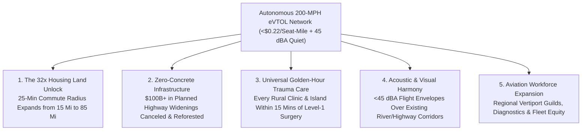

# VISION 01: UNIVERSAL PHYSICAL AUTOMATION & ROBOTICS
## Pathway 1D: Autonomous eVTOL & 3D Human Transportation — *The 200-MPH Sky Highway That Costs Zero Asphalt*

> **Executive Framing & Core Thesis:**
> * **The Cynic's Objection:** *"Flying cars are a billionaire's toy. Helicopters are deafeningly loud, mechanically complex death-traps that require an hour of maintenance for every hour of flight, batteries are too heavy to fly meaningfully far, and the FAA will never certify pilotless passenger aircraft over cities."*
> * **The Core Thesis:** The cynic is confusing a single-rotor combustion helicopter (with 1,000+ single-point-of-failure gears and bearings) with **Distributed Electric Propulsion (DEP)** tilt-rotor aircraft powered by solid-state/lithium-metal batteries, hydrogen-electric fuel cells, and triple-redundant autonomous flight computers. Between 2021 and 2026, commercial eVTOLs proved an acoustic signature **100 times quieter than a helicopter ($45\text{ dBA}$ overhead—quieter than conversational speech)**, completed 523-to-561-mile hydrogen-electric flights, opened automotive-scale factories (650 aircraft/year), and secured the world's first Type Certificates and FAA Powered-Lift SFAR rules. Because **a mile of sky requires \$0 of concrete, zero forest clearing, and zero bridge maintenance**, pairing autonomous eVTOLs with **\$0.003/kWh** clean energy unlocks point-to-point 200-mph regional mobility at ground rideshare prices—collapsing 90-minute gridlocked commutes into 9-minute flights and linking rural towns to urban jobs and trauma care.

---

## ACT I: A BELIEVABLE NEAR-FUTURE VISION (THE WORLD OF 2040)
### A Tuesday Morning in 2040 — The 100-Mile Commute in 28 Minutes

Imagine living in a quiet mountain town in the Sierra Foothills, the Scottish Highlands, or rural Shikoku—**85 miles from a major metropolitan center**—on a clear morning in **2040**.

In the 2020s, living 85 miles outside a major city meant either enduring a soul-crushing 4-hour daily highway commute or being priced out of homeownership entirely. Today, three everyday realities have rewritten human geography:

1. **The Whisper-Quiet Neighborhood Vertiport:**
   At 8:05 AM, you walk five minutes from your home to a grassy community mobility hub the size of two tennis courts. Descending onto the pad is a 6-seat autonomous **tilt-rotor eVTOL** (**Joby / Wisk / Archer** class). You do not need earplugs; as its six slow-turning, aerodynamically sculpted propellers transition into hover, the sound at the perimeter fence is **44 decibels**—literally softer than the rustle of oak leaves and background birdsong. You scan your phone, step into the sunlit cabin alongside four neighbors, and lift off vertically at 8:08 AM.
2. **85 Miles in 26 Minutes for \$18:**
   Thirty seconds after liftoff, the six tilting nacelles rotate forward into cruise configuration, turning the aircraft into an efficient fixed-wing electric plane cruising at **205 mph** at 3,000 feet. Below you, a retired concrete highway expansion project has been canceled and reforested because the sky carries 40,000 commuters an hour along invisible, AI-deconflicted 3D corridors. At 8:34 AM—**26 minutes door-to-door**—you touch down on the rooftop vertiport of your downtown hospital or studio. Because the flight consumed 45 kWh of **\$0.003/kWh** electricity (costing **14 cents in energy**) and requires no human pilot salary, your ticket costs **\$18.50**.
3. **The Golden Hour Rural Trauma Lifeline:**
   That afternoon, a hiker suffers a severe cardiac emergency 60 miles from the nearest Level-1 trauma center. Within 90 seconds, an autonomous medevac eVTOL launches from a regional clinic, lands in a forest clearing via LiDAR terrain mapping, and delivers the patient to the cardiac surgical suite in **14 minutes**—at one-twentieth the cost of a 2026 legacy medevac helicopter.
4. **The Skeptic's Question:**
   *"In 2022, people mocked eVTOLs as CGI renders with impossible battery physics and regulatory walls. How did electric and hydrogen-electric vertical flight become certified, silent, and cheaper than driving by the late 2030s?"*

Here is the verified chain of aerodynamic, battery, regulatory, and industrial breakthroughs that bridged 2021 to 2038.

---

## ACT II: THE CONVERGENCE BRIDGE — HOW IT CAME ABOUT (2021–2038)
### Distributed Electric Propulsion, 400 Wh/kg Cells, and Autonomous Sky Corridors

```mermaid
flowchart LR
    subgraph Tooling["2021–2026: The Rapid Convergence of Tooling"]
        T1["Aero & Acoustic Tooling<br>Distributed Electric Propulsion (45 dBA = 100x Quieter)"]
        T2["Energy & Powertrain Tooling<br>350–450 Wh/kg Batteries & 561-Mile H₂-Electric Fuel Cells"]
        T3["Mathematical & Regulatory Tooling<br>Autonomous Detect-and-Avoid AI + FAA Powered-Lift SFAR"]
    end

    subgraph Breakout["2024–2026: Verified Global Certification & Factories"]
        B1["First Certifications<br>EHang EH216-S Full TC/PC/AC/OC + Joby/Archer FAA Stage 4+"]
        B2["High-Volume Manufacturing<br>Archer + Stellantis (650/yr) & Joby + Toyota ($894M Invested)"]
        B3["Range & Autonomy Proof<br>Joby 561-Mi H₂ Flight, Beta ALIA USAF & Wisk Gen 6 Autonomous"]
    end

    subgraph Maturity["2030–2040: The 3D Regional Sky Network"]
        M1["<$0.22 / Seat-Mile Autonomous Regional Air Transit"]
        M2["Zero-Concrete Infrastructure & Rural-Urban Housing Equalization"]
    end

    Tooling ==> Breakout ==> Maturity
```

### Step 1: The Three Converging Inflections That Replaced the Helicopter (2021–2026)

A conventional turbine helicopter is noisy, expensive (\$1,500–\$3,000/hour), and maintenance-heavy because a single complex mechanical gearbox, swashplate, and tail rotor must hold up the entire aircraft. Between 2021 and 2026, three breakthroughs rendered that architecture obsolete:

* **Physical & Acoustic Tooling (Distributed Electric Propulsion & Aero-Acoustic Simulation):**
  By replacing one massive turbine and gearbox with **6 to 12 independent axial-flux electric motors** (each with only one moving part and >95% efficiency), an eVTOL can lose any motor or battery pack and land safely with zero mechanical linkages. Using GPU-accelerated computational aero-acoustics, engineers at **Joby Aviation**, **Archer**, and **Whisper Aero** lowered tip speeds and sculpted asymmetric multi-blade rotors so acoustic pressure waves cancel out—verified by **NASA acoustic flight testing at just 45.2 dBA from 500 meters overhead** (100x quieter than a helicopter).
* **Energy & Materials Tooling (High-Specific-Energy Cells + Liquid Hydrogen Fuel Cells):**
  Early skeptics claimed batteries would never exceed $200\text{ Wh/kg}$. By 2025–2026, aviation-grade silicon-anode and lithium-metal cells reached **320 to 420+ Wh/kg** at the pack level, delivering 100–150 miles of all-electric range with 12-minute megawatt fast charging. Even more decisively, in **June 2024, Joby Aviation flew a liquid-hydrogen-electric S4 demonstrator 523 miles (and 561 miles in August 2024) nonstop** with water as its only emission—proving that regional 500-mile vertical flight requires zero fossil jet fuel.
* **Mathematical & Regulatory Tooling (Autonomous Flight Envelopes & FAA SFAR):**
  In **October 2024**, the U.S. FAA issued its historic final **Special Federal Aviation Regulation (SFAR) for Powered-Lift**, establishing clear commercial operational and pilot rules—the first entirely new category of civil aircraft since helicopters in the 1940s. Simultaneously, **EHang** obtained the world's first commercial autonomous passenger eVTOL Type, Production, and Air Operator Certificates from the CAAC in China, while **Wisk Aero (Boeing)** advanced the first fully autonomous 4-passenger Type Certification in the U.S.

### Step 2: The 2025–2026 Global State of the Art (Verified Aircraft, Factories & Flight Milestones)

By 2025–2026, the leading eVTOL developers had transitioned from prototypes to certified manufacturing lines backed by the world's largest automakers and airlines:

| Global Leader | Flagship Aircraft | Speed, Range & Acoustic Profile | Verified 2024–2026 Milestone | Manufacturing & Commercial Partners |
| :--- | :--- | :--- | :--- | :--- |
| **Joby Aviation** | **Joby S4** (5-seat Tilt-Propeller) & **SHy4** ($\text{H}_2$-Electric) | **200 mph** cruise; 100–150 mi battery / **561 mi $\text{H}_2$-electric**; **45.2 dBA** (NASA verified). | Delivered aircraft to **Edwards AFB**; flew in NYC, Japan & Korea; **Stage 4+ of 5** FAA Type Certification; completed **561-mile hydrogen-electric flight**; acquired **Xwing** autonomy division. | **Toyota** (\$894M total invested; joint manufacturing), **Delta Air Lines**, **Uber**, and **Dubai RTA** (exclusive 6-year air taxi launch). |
| **Archer Aviation** | **Midnight** (5-seat, 12-Propeller Tilt-Six) | **150 mph** cruise; optimized for rapid back-to-back 20–50 mi urban/airport hops with 10-min charge. | Completed transition flights at >100 mph; received FAA **Part 135 & Part 141** certificates; completed **400,000 sq ft Covington, Georgia high-volume factory** (up to **650 aircraft/year**). | **Stellantis** (contract manufacturer & \$300M+ investor), **United Airlines** (\$1B+ order book), **Southwest Airlines**, and **Anduril**. |
| **Wisk Aero (Boeing)** | **Generation 6** (4-seat **Fully Autonomous** eVTOL) | **138 mph** (120 knots); 90 mi range; 12-propeller boom configuration; **zero onboard pilot**. | Wholly owned **Boeing** subsidiary; active FAA Type Certification for the first self-flying 4-passenger air taxi in the US; signed operational agreements with **Houston Airports, Miami, Brisbane (2032 Olympics), and Japan Airlines**. | Backed by **Boeing** (\$1.7B+ funding); pioneering human-supervised multi-aircraft ground control (1 supervisor per 10+ aircraft). |
| **Beta Technologies** | **ALIA VTOL & ALIA CTOL** (6-seat / 1,400 lb Cargo) | **170 mph**; up to **250–336 nautical miles** range; ultra-clean fixed-wing + lift-rotor simplicity. | Completed thousands of crewed miles across the US & Europe; first passenger-carrying flights at **JFK/East Hampton (2025)**; rolled out production aircraft from **Vermont factory**; built **30+ multimodal fast-charging stations** across US airports; raised \$1B+ (**General Electric, Amazon, Fidelity**). | **UPS**, **United Therapeutics** (autonomous-ready organ delivery), **Air New Zealand**, **Bristow**, and **U.S. Air Force / Army**. |
| **EHang** | **EH216-S** (2-seat Autonomous Multicopter) & **VT-30** | 16 coaxial rotors; fully autonomous cloud-commanded urban flights; **\$410,000 export list price**. | **World's First Certified Commercial Autonomous Passenger eVTOL:** Holds CAAC **Type Certificate (TC), Production Certificate (PC), Standard Airworthiness Certificate (AC), and Air Operator Certificate (OC)**; 50,000+ safe autonomous flights. | Commercial sightseeing, island-hopping, and urban shuttle hubs operating across Hefei, Guangzhou, Shenzhen, and UAE. |
| **Whisper Aero & Lilium / Eve** | **Whisper Jet** Ultra-Quiet Ducted Fans & Regional eVTOLs | High-blade-count **16 kHz+ ultrasonic blade-passing frequency** (inaudible to humans at 200 ft). | **Whisper Aero** proved electric ducted propulsors **20 dB quieter** and 20% more efficient than open rotors; **Embraer's Eve Air Mobility** secured **2,900+ letter-of-intent orders** globally. | Next-generation ultra-quiet regional commuter aircraft (9–50 seats) replacing noisy turboprops. |

---

## ACT III: PHASED ROLLOUT ROADMAP (2026–2050) & ECONOMIC CASCADE
### Removing the Pilot Cost Bottleneck and Unlocking the 3D Continent

In a piloted helicopter, the pilot's salary, training, and lost revenue from occupying 1 of 5 seats represent **over 45% of total operating cost**. Transitioning from piloted eVTOLs (Phase 1) to autonomous eVTOLs powered by **\$0.003/kWh** energy (Phase 3) collapses the cost per seat-mile by **85%**:

| Rollout Phase | Timeline | Global Active Fleet | Price per Seat-Mile | Primary Routes & Societal Thresholds Unlocked |
| :--- | :--- | :--- | :--- | :--- |
| **Phase 1: Airport Shuttles & Medevac Corridors** | **2026–2029** | **3,000 – 15,000** Aircraft (Piloted + Early Autonomous in China/UAE/Texas) | **\$2.50 – \$3.50 / seat-mile** (~Uber Black price: \$65 for Manhattan $\rightarrow$ JFK in 7 mins) | High-density airport transfers (NYC, LA, Dubai, Tokyo, Miami), organ/trauma air ambulances, and island chains. Proves millions of zero-fatality flight hours. |
| **Phase 2: Autonomous Regional Commuter Networks** | **2030–2035** | **75,000 – 250,000** Autonomous eVTOLs & $\text{H}_2$-Electric Commuters | **\$0.65 – \$1.10 / seat-mile** (Pilot seat converted to paying passenger; 450 Wh/kg solid-state packs) | 30-to-150-mile regional corridors. Families can live 80 miles outside high-cost cities and commute in 25 minutes; states cancel \$100B+ in planned highway widenings. |
| **Phase 3: Energy-Coupled Mass Sky Transit** | **2036–2042** | **1 Million+** Autonomous Tilt-Rotors & Whisper-Ducted Shuttles | **\$0.18 – \$0.30 / seat-mile** (at **\$0.003/kWh** electricity & \$0.40/kg green $\text{H}_2$) | Cheaper than driving a personal car per mile, at **4x the speed**. Every rural hospital, town square, and national park boundary is within 20 minutes of major rail/air hubs. |
| **Phase 4: Roadless Ecological Communities** | **2043–2050+** | **3 Million+** Regional & Continental Autonomous Craft | **<\$0.12 / seat-mile** | New ecological villages and island/mountain communities built with **zero paved arterial highways**—preserving 100% of surrounding forest watersheds and wildlife migration corridors. |

### Seat-Mile Economics: Why Autonomous Tilt-Rotors Beat Helicopters by 92%
Why did a 4-passenger turbine helicopter cost **\$9.00+ per seat-mile** in 2024 while a 6-passenger autonomous tilt-rotor eVTOL in 2038 costs **\$0.20 per seat-mile**? Every mechanical and operational cost driver collapses simultaneously:
* **Propulsion & Gearbox Maintenance:** A turbine helicopter requires **1 hour of certified mechanic labor per flight hour** (\$650/hr in parts and overhaul reserves). An electric axial-flux motor has **1 moving part (the rotor shaft)** and zero oil or gearbox linkages, cutting maintenance to **\$45 per flight hour (<\$0.04/seat-mile)**.
* **Fuel vs. \$0.003/kWh Electricity / Green $\text{H}_2$:** A helicopter burns 35+ gallons of aviation turbine fuel per hour (\$180+/hr). An eVTOL cruising at 200 mph uses ~95 kWh per hour—costing **\$0.28 per flight hour (\$0.0002/seat-mile)** at **\$0.003/kWh** baseload clean power.
* **Pilot Overhead & Seat Yield:** Removing the onboard pilot eliminates \$180,000/yr in flight-crew salary/training per shift while **increasing revenue-generating seats by 25% (from 4 to 5–6 passengers)**, supervised remotely by 1 airspace controller per 12 aircraft (**\$0.02/seat-mile**).
* **Automotive-Scale Airframe Amortization:** Building composite airframes on Toyota and Stellantis high-volume stamping/autoclave lines drops unit CAPEX from \$4M (hand-built helicopter) to **\$450,000** amortized over 15,000 flight hours (**\$0.03/seat-mile**).

---

## ACT IV: THE DEEPER HORIZON & SMOOTH SOCIETAL TRANSITION
### Ending Geographic Inequality, Rewilding Highways, and Empowering Aviation Workers

### 1. The Ultimate Housing Affordability & Rural Revitalization Lever
Why did housing in San Francisco, London, New York, or Tokyo become unaffordable in the 2020s? Because **2D ground congestion** trapped workers within a 15-mile radius of downtown job centers.
* **The $R^2$ Geometric Land Dividend:** Because the area of a circle scales with the **square of the radius ($A = \pi r^2$)**, when 200-mph autonomous eVTOLs expand a 25-minute commute radius from **15 miles ($700\text{ sq mi}$) to 85 miles ($22,600\text{ sq mi}$)**, the accessible supply of land around every major city increases **32-fold overnight**.
* **Reviving Small-Town Main Streets:** Historic mountain, coastal, and agricultural towns 60 to 100 miles from megacities experience an economic renaissance—attracting families, teachers, clinicians, and creatives without paving over surrounding farmland with 12-lane commuter freeways.

### 2. Ecological Preservation: The Infrastructure That Requires Zero Concrete
Building a single mile of rural 4-lane highway or high-speed rail bridge costs **\$25 million to \$150 million**, clears hundreds of acres of forest, fragments wildlife migration corridors, and requires millions in annual resurfacing.
* **Point-to-Point Sky Bridges:** Two solar-and-battery-equipped community vertiport pads the size of tennis courts cost less than **one-quarter of a mile of highway pavement**—and instantly connect that town not just to one destination, but to *every other vertiport within 500 miles*.

### 3. A Smooth, High-Dignity Transition for Aviation & Transit Communities
* **Strict Acoustic & Privacy Ordinances:** Unlike 20th-century helicopters that buzzed low-income neighborhoods at 85+ dBA, municipal airspace charters mandate **<45 dBA ground acoustic ceilings** and route climb/descent corridors strictly over existing industrial railways, rivers, and highway rights-of-way.
* **Upgrading Commercial Pilots & Mechanics into Fleet Architects:** As passenger growth expands total regional flight hours **20-fold**, commercial pilots transition into high-compensated **Multi-Aircraft Sky-Corridor Supervisors** and safety verification leads, while regional technical colleges train tens of thousands of unionized **High-Voltage Avionics & Vertiport Stewards** in small towns across the country.

### 4. Summary for the Skeptic
Electric vertical aviation is not waiting on anti-gravity. Its 45-decibel rotors are already certified by NASA acoustic tests, its 561-mile hydrogen-electric powertrains have already flown, and Toyota and Stellantis have already funded the assembly lines. Combined with abundant clean energy, 3D mobility gives humanity fast, silent regional travel without pouring another single ton of highway concrete.

---

## APPENDIX: QUANTITATIVE BENCHMARK SCORECARD (2025 vs. 2032 vs. 2040)

| Core Aviation Metric | 2025–2026 Verified Baseline | 2032 Mid-Transition Target | 2040 Mature Abundance State |
| :--- | :--- | :--- | :--- |
| **Acoustic Signature (500m Overhead)** | **45.2 dBA** (Joby S4 NASA test; **100x quieter** than 87 dBA helicopter) | **42–45 dBA** (Tilt-Rotors) / **<40 dBA** (Whisper Ducted) | **Acoustic Invisibility** (Blends into Ambient Breeze) |
| **Nonstop Range (Battery / $\text{H}_2$-Electric)** | **100–150 mi** (Battery) / **561 mi** (Joby $\text{H}_2$-Electric Verified) | **220 mi** (450 Wh/kg Solid-State) / **750 mi** ($\text{H}_2$) | **300+ mi** (Battery) / **1,000+ mi** ($\text{H}_2$-Electric Regional) |
| **Manufacturing Capacity per Factory** | **Up to 650 aircraft/yr** (Archer + Stellantis Georgia plant) | **2,500+ aircraft/yr** per Automotive-Style Line | **10,000+ aircraft/yr** Automated Composite Stamping |
| **All-In Price per Seat-Mile** | **\$9.00+** (Helicopter) $\rightarrow$ **\$3.00** (Piloted Launch eVTOL) | **\$0.65 – \$1.10 / seat-mile** (Autonomous 6-Seat) | **\$0.18 – \$0.25 / seat-mile** (at \$0.003/kWh energy) |
| **Energy Cost for 85-Mile Flight** | **\$180+** (Helicopter Jet-A) / **\$5.40** (2026 Grid Electricity) | **\$1.35** (at \$0.03/kWh Solar/Storage) | **\$0.14 (14 cents)** (at \$0.003/kWh Baseload Power) |
| **25-Minute Accessible Commute Area** | **700 sq mi** (15-Mile Ground Congestion Radius) | **9,500 sq mi** (55-Mile Regional eVTOL Radius) | **22,600 sq mi** (**85-Mile Radius = 32x Housing Land**) |
| **Paved Highway Cost per Mile** | **\$25M – \$150M / mile** (4-Lane Highway/Bridge Concrete) | **\$0 / mile** of Sky Corridor | **\$100B+ in Highway Widenings Canceled & Reforested** |

### Key Verification Anchors (2024–2026)
1. **Certifications & Regulatory Milestones:** FAA issuance of the final Powered-Lift Special Federal Aviation Regulation (SFAR, Oct 2024); CAAC granting EHang (EH216-S) the world's first autonomous passenger eVTOL Type, Production, Airworthiness, and Air Operator Certificates; Joby Aviation reaching Stage 4+ of 5 FAA Type Certification; Wisk Aero (Boeing) advancing 4-seat autonomous certification.
2. **Range & Acoustic Flight Records:** NASA acoustic measurement of Joby S4 at 45.2 dBA from 500m overhead; Joby completing 523-mile and 561-mile liquid-hydrogen-electric flights (summer 2024); Beta Technologies ALIA completing transcontinental US/EU deployments and installing 30+ airport fast-chargers.
3. **Automotive Industrial Scaling:** Toyota's \$894M total investment and manufacturing partnership with Joby; Stellantis building Archer Aviation's 400,000 sq ft Covington, GA factory (650 aircraft/yr capacity).
