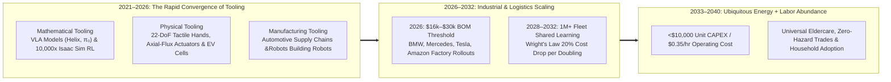
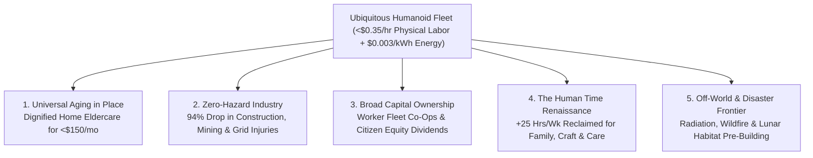

# VISION 01: UNIVERSAL PHYSICAL AUTOMATION & ROBOTICS
## Pathway 1A: General-Purpose Humanoid Robotics — *The Believable Future, The Convergence Bridge, and the Smooth Societal Transition*

> **Executive Framing & Core Thesis:**
> * **The Cynic's Objection:** *"Humanoid robots have been flashy viral demos for forty years. Bipedal walking is inefficient, dexterous hands are too fragile, batteries die in two hours, and real-world homes are too chaotic for rigid code. Even if they worked, they would only trigger mass unemployment."*
> * **The Core Thesis:** The cynic is judging 2026–2040 robotics by the era of hand-coded kinematics. Between 2021 and 2026, an exponential convergence of **mathematical tooling** (Vision-Language-Action foundation models, 10,000x real-time GPU physics simulation gyms) and **physical tooling** (quasi-direct-drive axial-flux actuators, 22-DoF tactile hands, high-silicon/solid-state cells, and automotive gigafactory tooling) shattered the dexterity and cost bottlenecks simultaneously. When general-purpose humanoids—built specifically to navigate staircases, doorways, and tools already designed for the human body—combine with near-zero-cost clean energy, the marginal cost of physical labor collapses toward the cost of electricity and raw materials. Paired with citizen and worker capital-ownership models, this unlocks dignified eldercare, injury-free industry, and a historic reclamation of human time.

---

## ACT I: A BELIEVABLE NEAR-FUTURE VISION (THE WORLD OF 2040)
### A Tuesday Morning in 2040 — Life When Physical Labor Costs \$0.35 per Hour

Imagine stepping into a three-generation family home and neighborhood in Ohio, Bavaria, or Osaka on an autumn morning in **2040**.

Nothing looks cold, sterile, or dystopian. Instead, you notice how warm, unhurried, and human-centered daily life has become because physical drudgery has been quietly offloaded:

1. **Dignified Aging in Place (The Household & Eldercare Revolution):**
   In the sunlit kitchen, your 84-year-old grandmother lives in her own home rather than an understaffed institutional nursing facility. Standing beside the counter is a 5-foot-6, soft-knit-clad domestic humanoid leased for **\$140/month** (less than a 2026 smartphone and car insurance bill). With compliant, force-sensing arms and warm silicone-skinned 24-DoF hands, it safely assists her out of bed, monitors her gait stability to prevent falls, prepares fresh breakfast to her nutritional profile, folds laundry, and scrubs the bathroom. Your grandmother keeps her privacy, autonomy, and dignity; your family spends visits talking and laughing with her instead of burning out as exhausted unpaid caretakers.
2. **Zero-Injury Municipal & Construction Craft:**
   Down the street, a historic brick schoolhouse is being renovated. Three ruggedized industrial humanoids carry 80-pound drywall sheets up narrow spiral stairs, tie rebar, and vacuum silica dust while two human master carpenters direct the architectural restoration and custom woodwork. Roof falls, crushed vertebrae, toxic inhalation, and repetitive-strain injuries—which crippled millions of tradespeople in the 2020s—have vanished from insurance tables.
3. **The Energy-Plus-Robotics Multiplier in Local Manufacturing:**
   At the edge of town, a compact regional micro-factory operates 24/7 powered by **\$0.003/kWh** clean baseload electricity. Inside, 150 humanoid and specialized robots assemble custom heat pumps, medical devices, and modular housing panels on reconfigurable lines that switch product SKUs in ten minutes via natural-language prompts. Because both the kilowatt-hours and the electromechanical labor cost pennies, custom local manufacturing is cheaper than 2026 offshore sweatshops.
4. **The Skeptic's Question:**
   *"How did a machine that cost \$250,000 and couldn't fold a towel reliably in 2022 become a \$12,000 household appliance and industrial backbone by the late 2030s?"*

Here is the verifiable chain of mathematical, material, and industrial breakthroughs that bridged 2021 to 2038.

---

## ACT II: THE CONVERGENCE BRIDGE — HOW IT CAME ABOUT (2021–2038)
### Where Multimodal Foundation Models Met Automotive-Scale Mechatronics

### Step 1: The Three Converging Inflections That Broke the 40-Year Bottleneck (2021–2026)

For decades, robotics was trapped in **"Moravec's Paradox"**: computers could beat grandmasters at chess, but a robot could not pick a ripe strawberry or clear a cluttered sink because engineers had to manually write differential equations for every contact angle. Between 2022 and 2026, three fields converged at once:

* **Mathematical & Algorithmic Tooling (End-to-End VLA Models & Sim-to-Real Gyms):**
  Instead of brittle hand-written code, researchers merged vision-language foundation models with high-frequency motor control into **Vision-Language-Action (VLA)** architectures—such as Physical Intelligence's **$\pi_0$**, Figure AI's **Helix**, Toyota Research Institute's **Large Behavior Models (LBMs)**, and NVIDIA's **Project GR00T**. Simultaneously, GPU-accelerated physics engines (**NVIDIA Isaac Lab**, **MuJoCo Playground**, **Genesis**) allowed a robot to practice walking on ice, recovering from shoves, or manipulating deformable objects across **10,000 parallel virtual clones—compressing 100 years of physical trial-and-error into 4 hours of wall-clock training.**
* **Physical & Mechatronic Tooling (High-Torque-Density Actuators & Tactile Skins):**
  Why build a humanoid instead of a wheeled box? Because **100% of human civilization's built environment**—stairs, ladders, 32-inch doorways, cabinets, wrenches, and vehicles—is already standardized around the human form factor. Between 2023 and 2026, custom **quasi-direct-drive (QDD) planetary and harmonic rotary/linear actuators**, axial-flux motors, and tendon-driven **22-to-24 degree-of-freedom (DoF) hands** with optical/magnetic multi-axis fingertips gave machines human-level compliance. Paired with silicon-anode and semi-solid-state 4680/pouch batteries ($>350\text{ Wh/kg}$), runtime jumped from 90 minutes to a full **6-to-8-hour shift** with 15-minute autonomous hot-swapping.
* **Cross-Improving Flywheels:**
  Better simulation algorithms designed lighter, thermally optimal actuator housings via generative topology optimization; cheaper smartphones and EV lidar/cameras flooded the supply chain with \$15 depth sensors; and early factory robots began assembling the wire harnesses and actuators of the next generation of robots.

### Step 2: The 2025–2026 Global State of the Art (Verified Hardware & Commercial Deployments)

By 2025–2026, humanoid robotics had decisively transitioned from R&D labs into paid automotive, logistics, and manufacturing deployments across North America, Europe, and Asia:

| Global Leader | Flagship Platform / AI | Key Technical Specs (2025–2026) | Verified 2024–2026 Milestone | Commercial & Scaling Pathway |
| :--- | :--- | :--- | :--- | :--- |
| **Tesla** | **Optimus Gen 2 / Gen 3** + End-to-End Neural Net | **22-DoF** tendon-driven forearm/hand; custom rotary & linear actuators; 2.3 kWh pack. | Deployed autonomously sorting battery cells & navigating Fremont/Austin factories; unveiled ultra-dexterous 22-DoF hand catching tennis balls. | Internal scaling to thousands of units across Tesla gigafactories (2026), targeting **<\$20,000 BOM** at 1M+/yr volume. |
| **Figure AI** | **Figure 02 / 03** + **Helix** Generalist VLA | **16-DoF** hands (25 kg payload); onboard dual-GPU inference; 2.25 kWh custom battery (+50% runtime). | **2024–2026:** Commercial work on **BMW Spartanburg** body shop line (sheet metal insertion at sub-millimeter tolerances); unveiled **Helix** controlling two robots collaboratively on unseen household items; \$2.6B–\$39B valuation trajectory. | High-volume BotQ manufacturing facility scaling toward 100,000 commercial and household units. |
| **Boston Dynamics + TRI** | **All-Electric Atlas** + **Large Behavior Models** | **56 DoF** with **360° rotating joints** (exceeding human range of motion); zero hydraulics. | **2024–2026:** Retired hydraulic Atlas; demonstrated fully autonomous engine-cover sequencing between supplier bins and dollies using single-model vision-to-action policies with **Toyota Research Institute**. | Commercial deployment inside **Hyundai** automotive metaplant (Georgia) and global industrial partners. |
| **Unitree Robotics** | **Unitree G1 & H1-2** | **23–43 DoF**; 3D LiDAR + depth vision; up to 120 N·m knee torque; folding compact frame. | **Mass-Manufacturing Cost Breakthrough:** Priced commercial **G1 at \$16,000** (shattering the \$150k industry floor); demonstrated zero-shot sim-to-real agile acrobatics and factory assembly. | Immediate high-volume global shipments to research labs, developers, and light industrial plants. |
| **Agility Robotics** | **Digit** + **Agility Arc** Cloud Fleet | Bipedal backward-knee morphology optimized for tote handling (16 kg payload); 1.75 m height. | Opened **RoboFab** (Salem, OR—capable of 10,000 units/yr); signed multi-year commercial Robotics-as-a-Service (RaaS) contract with **GXO Logistics** (Spanx facilities) and piloted with **Amazon** & **Schaeffler**. | Scaling dedicated warehouse tote-recycling, palletizing, and intralogistics fleets globally. |
| **Apptronik** | **Apollo** (Modular Humanoid) | 1.73 m, 73 kg, **25 kg payload**; swappable 4-hour battery packs; force-control safety architecture. | Partnered with **Mercedes-Benz** (piloting in Hungary/Germany plants), **GXO**, and **Jabil** (where Apollo robots help manufacture Apollo components); closed **\$403M Series A (early 2025)** backed by Google. | Modular deployment as full bipedal walker or stationary torso mount on existing factory lines. |
| **Sanctuary AI** | **Phoenix** (Gen 7/8) + **Carbon AI** | Miniaturized hydraulic hands with **21 DoF** and **<5 millinewton** haptics; sub-24-hour task learning. | Partnered with **Magna International** for automotive manufacturing; demonstrated fine-motor sorting, packaging, and tactile inspection rivaling human fingertips. | Licensing tactile dexterity hardware and Carbon generalist control models across hazardous industries. |
| **Physical Intelligence ($\pi$)** | **$\pi_0$ (Pi-Zero)** & **$\pi_{0.5}$** Foundation Models | Cross-embodiment flow-matching VLA model trained on 10,000+ hours of diverse robot dexterous data. | Demonstrated a single generalist neural weight set folding laundry, bussing tables, boxing items, and assembling electronics across 7+ distinct robot morphologies; raised \$400M+ at \$2.4B+ valuation. | Serving as the universal "Android/Linux brain" licensing layer for global hardware OEMs. |

---

## ACT III: PHASED ROLLOUT ROADMAP (2026–2050) & ECONOMIC CASCADE
### From Structured Factory Floors to Every Household on Earth

Because humanoids share components with electric vehicles (motors, inverters, SiC power electronics, batteries, cameras, and AI inference chips), they ride the steepest manufacturing learning curve in industrial history:

| Rollout Phase | Timeline | Global Active Fleet | Unit CAPEX & Hourly Operating Cost | Primary Domains & Societal Thresholds Unlocked |
| :--- | :--- | :--- | :--- | :--- |
| **Phase 1: Structured Industrial Beachhead** | **2026–2029** | **100,000 – 1.5 Million** | **\$22,000 – \$45,000** CAPEX **\$2.50 – \$4.50 / hr** (RaaS) | Automotive assembly (BMW, Hyundai, Tesla, Mercedes), 3PL warehouse tote handling (Amazon, GXO), and 24/7 machine tending. Solves acute demographic factory labor shortages in OECD & East Asia. |
| **Phase 2: Semi-Structured Commercial & Construction** | **2030–2034** | **5 Million – 25 Million** | **\$12,000 – \$20,000** CAPEX **\$0.90 – \$1.80 / hr** | Commercial kitchens, hospital supply logistics, retail restocking, modular home construction, and hazardous mining/grid maintenance. Fleet-wide shared cloud learning reaches superhuman reliability ($99.99\%$ task completion). |
| **Phase 3: Household & Eldercare Ubiquity** | **2035–2042** | **100 Million – 450 Million** | **\$6,500 – \$11,000** CAPEX **\$0.35 – \$0.65 / hr** | Certified soft-compliant home assistants. Universal aging-in-place support for the global $65+$ demographic wave; routine domestic chores (cleaning, cooking, laundry, yardwork) offloaded for **<\$150/month**. |
| **Phase 4: Post-Scarcity Physical Labor & Off-World** | **2043–2050+** | **1 Billion+ Units** | **<\$4,500** CAPEX **<\$0.15 / hr** (at \$0.003/kWh energy) | Self-replicating automated mines, solar/fusion plant construction, disaster response inside radiation/wildfire zones, and autonomous Lunar/Martian habitat pre-construction prior to human arrival. |

### Subsystem Bill-of-Materials (BOM) Collapse (2022 vs. 2026 vs. 2038)
How does a humanoid robot drop from **\$250,000** in 2021 to **\$7,500** in 2038? By eliminating custom aerospace hydraulics in favor of mass-produced automotive and smartphone supply chains:
* **Rotary & Linear Actuators (28–40 joints):** Fell from **\$90,000** (custom defense-grade harmonic drives) $\rightarrow$ **\$7,500** (2026 in-house planetary/cycloidal gearboxes & axial-flux motors) $\rightarrow$ **\$2,400** (2038 automated robotic winding and sintered neodymium-free/iron-nitride magnets).
* **Dexterous 22-DoF Hands & Tactile Skin (Pair):** Fell from **\$60,000** (fragile lab tendons) $\rightarrow$ **\$3,800** (2026 injection-molded polymer frames with optical/Hall-effect fingertip arrays) $\rightarrow$ **\$950** (2038).
* **Onboard AI Compute & Vision Sensors:** Fell from **\$25,000** (spinning LiDAR + workstation GPUs) $\rightarrow$ **\$1,800** (2026 dual automotive SoCs + multi-camera stereo vision) $\rightarrow$ **\$550** (2038).
* **Battery Pack & Structural Chassis:** Fell from **\$15,000** $\rightarrow$ **\$1,400** (2026 2.3 kWh cylindrical EV cells + stamped aluminum/polymer shells) $\rightarrow$ **\$600** (2038 solid-state pouch cells).

### The Energy + Automation Multiplier
When **Phase 3 and Phase 4** humanoids operate on **\$0.003/kWh baseload fusion and solar power**, an 8-hour workday consuming $4\text{ kWh}$ of electricity costs **1.2 cents in energy**. Even amortizing a \$7,000 robot over 20,000 operating hours (5 years) with maintenance yields an all-in physical labor cost of **~\$0.35 per hour**. Consequently:
* **Housing Construction Costs Fall by 55–70%:** Because on-site and factory labor represent roughly half the cost of new housing, round-the-clock robotic framing, plumbing, wiring, and finishing turns high-quality housing from a speculative scarcity asset into an affordable consumer good.
* **Supply-Chain Reshoring:** No nation needs to exploit low-wage labor overseas when domestic micro-factories produce goods at near-zero marginal labor cost next door to consumers.
* **Demographic Deflation Reversal:** Rapidly aging societies (Japan, South Korea, Europe, China, North America) no longer face pension insolvency or caregiver collapse; one working-age citizen supported by three robotic assistants generates the physical output of four 2020-era workers.

---

## ACT IV: THE DEEPER HORIZON & SMOOTH SOCIETAL TRANSITION
### Elevating Human Dignity, Expanding Ownership, and Reclaiming Time

A transition of this magnitude cannot succeed through technology alone; it requires deliberate social architecture so that families experience automation as **liberation rather than displacement**.

### 1. Broadening Capital Ownership (Citizen & Worker Equity Dividends)
If physical labor shifts from wages to robotic capital, households must own a stake in that capital. Throughout the 2030s, three concrete mechanisms bridge the transition:
* **Universal Robot & Sovereign Wealth Dividends:** Modeled on the Alaska Permanent Fund and national sovereign wealth funds, a modest productivity/compute dividend on autonomous commercial fleets funds universal household equity payouts and portable healthcare.
* **Employee & Cooperative Robot Ownership:** Tradespeople, nurses, and small businesses purchase or lease small fleets of 3–5 humanoids via low-interest SBA/cooperative loans—turning a solo plumber, carpenter, or eldercare specialist into an owner-operator directing a high-output robotic crew while keeping the enterprise profits.
* **Paid Transition Fellowships & Guild Apprenticeships:** Displaced routine assembly workers receive 18-month wage-replacement fellowships to transition into **Robotic Fleet Orchestration**, custom artisanal trades, or healthcare and educational mentorship.

### 2. The Great Re-Humanization of Care, Education, and Craft
In 2026, nurses spent 60% of their shifts lifting patients, fetching linens, and charting inventory; teachers spent evenings grading and managing logistics; parents spent 25 hours a week on laundry, dishes, and errands.
* **Restoring the Human Touch:** When humanoids absorb the mechanical burden of lifting, sanitizing, and fetching, human work shifts toward high-empathy, high-creativity domains where *human presence itself is the product*: bedside emotional care, small-group childhood mentorship, live performance, culinary craft, scientific inquiry, and neighborhood stewardship.
* **The 28-Hour Full-Pay Workweek:** As per-capita physical productivity triples between 2028 and 2040, standard full-time employment transitions smoothly from 40+ hours to a 4-day, 28-hour workweek with higher real purchasing power—since housing, food, energy, and manufactured goods cost 50% to 75% less.

### 3. Summary for the Skeptic
Humanoid robots are no longer waiting on a miraculous future invention. The actuators are spinning in automotive plants today, the VLA brains are learning across thousands of simulated years per afternoon, and the unit cost has already fallen below \$20,000 in early mass production. Combined with abundant clean energy and inclusive ownership policies, general-purpose robotics does not replace humanity—it finally frees humanity from treating human bodies like machines.

---

## APPENDIX: QUANTITATIVE BENCHMARK SCORECARD (2025 vs. 2032 vs. 2040)

| Core Metric / Benchmark | 2025–2026 Verified Baseline | 2032 Mid-Transition Target | 2040 Mature Abundance State |
| :--- | :--- | :--- | :--- |
| **Commercial Unit Price (CAPEX)** | **\$16,000** (Unitree G1) – **\$50,000+** (Industrial) | **\$12,000 – \$18,000** | **\$6,500 – \$9,500** |
| **All-In Physical Labor Cost / Hr** | **\$3.50 – \$6.50 / hr** (Early RaaS) | **\$0.95 – \$1.60 / hr** | **\$0.35 / hr** (at \$0.003/kWh energy) |
| **8-Hour Shift Electricity Cost** | **\$0.48** (at \$0.12/kWh grid power) | **\$0.12** (at \$0.03/kWh solar/storage) | **\$0.012 (1.2 cents)** (at \$0.003/kWh fusion/solar) |
| **Hand & Finger Dexterity** | **16 to 22 DoF** (Optimus Gen 3, Figure 02, Sanctuary) | **24 DoF** + Full Multi-Axis Tactile Skin | **27 DoF** Warm Compliant Biomimetic Skin |
| **Continuous Battery Shift Runtime** | **2.5 to 5.0 Hours** (2.3 kWh Li-ion pack) | **8.0 Hours** (400 Wh/kg Solid-State) | **12+ Hours** + 3-Min Autonomous Inductive Swap |
| **Sim-to-Real Training Compression** | **10,000x Real-Time** (NVIDIA Isaac Lab / Genesis) | **100,000x Real-Time** World-Model Gyms | **Instant Fleet-Wide Zero-Shot Skill Transfer** |
| **Unpaid Household Chore Burden** | **25.0 Hours / Week** per Family | **10.0 Hours / Week** per Family | **<3.0 Hours / Week** (Optional Craft Only) |

### Key Verification Anchors (2024–2026)
1. **Automotive & Logistics Factory Pilots:** Figure AI (Figure 02) operating on BMW Group's Spartanburg, SC body-shop line; Apptronik (Apollo) partnered with Mercedes-Benz and Jabil; Agility Robotics (Digit) deployed under commercial RaaS contract with GXO Logistics; Boston Dynamics (All-Electric Atlas) partnered with Hyundai and Toyota Research Institute (LBM).
2. **Hardware Cost & Dexterity Milestones:** Unitree Robotics commercial release of the G1 humanoid at \$16,000 (2024–2026); Tesla Optimus 22-DoF forearm/hand actuator architecture; Sanctuary AI hydraulic tactile feedback (<5 mN).
3. **Generalist Robot Foundation Models:** Physical Intelligence ($\pi_0$ flow-matching VLA across 7+ robot embodiments), Figure Helix multi-robot collaborative VLA, and NVIDIA Project GR00T / Isaac Lab GPU simulation suites.
