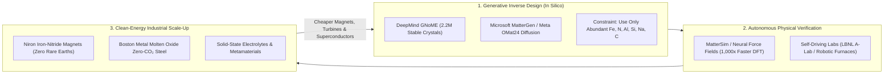
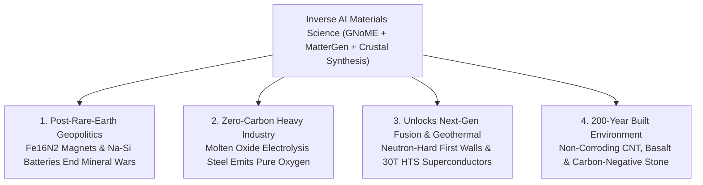

# VISION 01: INVERSE AI MATERIALS SCIENCE & POST-RARE-EARTH ABUNDANCE
## Pathway 2E: From 800 Years of Trial-and-Error to On-Demand Matter Compilation from Common Crustal Elements

> **Executive Framing & Core Thesis:**
> * **The Cynic's Objection:** *"Every green transition plans to trade oil dependence for rare-earth mineral wars. Electric motors need neodymium and dysprosium; electrolyzers need iridium and platinum; batteries need cobalt and nickel; and discovering a single replacement alloy historically takes 20 years of lucky guesswork."*
> * **The Core Thesis (The Inverse Materials Flywheel):** Between 2023 and 2030, materials science flipped from **forward trial-and-error** (*"What happens if we bake these rocks together?"*) to **AI Inverse Design** (*"Specify the exact magnetic, thermal, and mechanical properties we need—and generate a stable crystal structure made only of abundant iron, nitrogen, silicon, carbon, and aluminum"*). Led by **Google DeepMind's GNoME** (2.2 million new stable crystals), **Microsoft's MatterGen**, and **Meta's OMat24**—and physically validated by **Self-Driving Laboratories**—humanity is replacing geopolitically scarce rare earths with hyper-abundant crustal elements, unlocking zero-carbon electrolytic steel, rare-earth-free super-magnets, and ultralight structural metamaterials.

---

## ACT I: A BELIEVABLE NEAR-FUTURE VISION (THE WORLD OF 2040)
### A Saturday Morning in 2040 — Rare-Earth-Free Motors, Zero-Carbon Green Steel, and 1,200-Mile Solid-State Batteries

Imagine walking through a lively port city and commuter rail terminal on a bright Saturday morning in **2040**.

The vehicles, bridges, wind turbines, and apartment buildings around you look reassuringly solid, yet the materials inside them have quietly ended two centuries of extractive mining bottlenecks and rust:

1. **The Rare-Earth-Free EV, Wind Turbine & Maglev Fleet:**
   * Every electric car, heat-pump compressor, robotic actuator, and offshore wind turbine in the city spins using permanent magnets that are **18% stronger than 2020s neodymium magnets—yet contain zero neodymium, zero dysprosium, and zero mined rare-earth elements**.
   * Instead, their rotors are built from **$\alpha''\text{-Fe}_{16}\text{N}_2$ (Iron Nitride "Clean Earth" Magnets)**—synthesized entirely from ordinary iron and nitrogen pulled from the air.
   * Geopolitical rare-earth chokepoints and toxic radioactive tailing ponds are obsolete.
2. **The 1,200-Mile Sodium-Silicon Solid-State Battery:**
   * At the neighborhood transit hub, an electric regional shuttle charges in 6 minutes and runs on a non-flammable **Solid-State Sodium-Sulfur/Silicon Battery** with an energy density of **$600\text{ Wh/kg}$** and a 15,000-cycle lifespan—built without a single gram of cobalt, nickel, or scarce lithium brines.
   * The solid ceramic electrolyte inside was inverse-designed by a generative materials model in 2028 to maximize sodium-ion conductivity while mechanically blocking dendrites, costing **under \$28 per kilowatt-hour** at pack level.
3. **Zero-Carbon Electrolytic Steel & Non-Corroding Structural Composites:**
   * Down at the harbor, a new pedestrian bridge and affordable modular housing complex are rising.
   * The structural beams were forged in a **Molten Oxide Electrolysis (MOE)** foundry powered by off-peak fusion electricity (**\$0.003/kWh**)—splitting iron ore with electric current so the only byproduct is **pure breathable oxygen**, at **$30\%$ lower cost** than 2020s coal blast furnaces.
   * The bridge deck is reinforced with **aligned carbon-nanotube and basalt-geopolymer composites** that are $4\times$ lighter than steel, immune to saltwater corrosion for 200 years, and sequester atmospheric carbon directly inside the structural frame.

---

## ACT II: THE CONVERGENCE BRIDGE — HOW IT CAME ABOUT (2021–2038)
### How Graph Neural Networks, Generative Diffusion, and Self-Driving Foundries Mapped the Periodic Table

### Step 1: Why Human Materials Science Was Stuck at 48,000 Crystals for 200 Years
Across two centuries of chemistry, human scientists painstakingly discovered and cataloged only about **20,000 to 48,000 stable inorganic crystals** (recorded in the Inorganic Crystal Structure Database).
Why so few? Because checking whether a new arrangement of atoms is thermodynamically stable on the convex hull ($\Delta E_{\text{hull}} \le 0$) using quantum mechanical **Density Functional Theory (DFT)** took days of supercomputer time *per crystal*, and synthesizing it by hand took months. As a result, when engineers needed a high-performance magnet or catalyst, they relied on rare, exotic heavy elements (neodymium, iridium, platinum) whose raw atomic orbitals happened to work out of the box—rather than finding clever crystal geometries of abundant elements (iron, nitrogen, carbon, silicon).

### Step 2: The 2023–2026 Explosion of AI Materials Discovery (800 Years in Weeks)
Three converging breakthroughs between late 2023 and 2026 blew the periodic table wide open:
* **Mapping the Convex Hull (*GNoME* & *OMat24*):**
  In November 2023, Google DeepMind's **GNoME (Graph Networks for Materials Exploration)** used active-learning graph neural networks to discover **2.2 million new thermodynamically stable crystals**—including **380,000 materials strictly on the convex hull** (equivalent to **~800 years of human experimental discovery**), among them 52,000 new layered graphene-like compounds and 528 new lithium/sodium ion conductors. In late 2024, Meta released **Open Materials 2024 (OMat24)**, open-sourcing over **110 million DFT calculations** so any researcher on Earth could train universal atomic force fields.
* **True Inverse Design via Diffusion (*MatterGen* & *MatterSim*):**
  Instead of just screening random candidates, Microsoft Research introduced **MatterGen** (*Nature*, 2025) and **MatterSim**. Like an image generator for 3D atomic lattices, an engineer prompts *MatterGen* with target constraints—e.g., *"Generate a crystal with bulk modulus $>250\text{ GPa}$, magnetic density $>1.8\text{ T}$, containing zero rare-earth elements"*—and the diffusion model directly outputs novel, stable atomic coordinates, while *MatterSim* simulates their behavior across temperatures and pressures up to $5,000\text{ K}$ and $1,000\text{ GPa}$ at **$1,000\times$ the speed of quantum DFT**.
* **Earth-Abundant Substitution (*Niron Magnetics* & *Boston Metal*):**
  Armed with nanoscale phase-stabilization insights, companies like **Niron Magnetics** commercialized martensitic **$\alpha''\text{-Fe}_{16}\text{N}_2$ Iron Nitride magnets** (which possess an intrinsic magnetic flux density exceeding even neodymium, using only iron and nitrogen), while **Boston Metal** scaled **Molten Oxide Electrolysis** to turn raw iron ore directly into liquid steel using renewable electricity.

### Step 3: 2024–2026 Global State of the Art (SOTA) in AI Materials Science & Clean Metallurgy

| Platform / Company | Focus & Breakthrough | Verified 2024–2026 Milestone | Commercial & Scaling Pathway |
| :--- | :--- | :--- | :--- |
| **Google DeepMind (*GNoME*)** | Graph Neural Networks for Inorganic Crystal Stability | Discovered **2.2M stable crystals** (**380,000 ultra-stable on convex hull** = 800 years of human science); **736+ already synthesized independently** by global labs. | Open-sourced 380k structures to the **Materials Project**, feeding autonomous robotic synthesis labs worldwide. |
| **Microsoft Research (*MatterGen* & *MatterSim*)** | Generative Diffusion for Inverse Materials Design | Published in *Nature* (Jan 2025): conditional generation of novel materials across chemistry, symmetry, and mechanical/magnetic properties; **wet-lab verified novel $\text{TaCr}_2\text{O}_6$ oxide modulus**. | Direct property-to-crystal compilation for solid-state batteries, carbon capture sorbents, and aerospace alloys. |
| **Meta FAIR (*OMat24* & *Open Catalyst Project*)** | Open Foundation Datasets & Universal Neural Force Fields | Released **110M+ DFT calculations** (*OMat24*, Oct 2024) and *EquiformerV2* models predicting atomic forces and energies in milliseconds instead of hours. | Universal open-source physics engine powering startups and academic Self-Driving Labs globally. |
| **Niron Magnetics** (USA — Minneapolis, MN) | Rare-Earth-Free Iron Nitride ($\alpha''\text{-Fe}_{16}\text{N}_2$) Permanent Magnets | Opened **world's first commercial Clean Earth Magnet pilot facility (2024)**; backed by GM, Stellantis, Volvo, Samsung & \$172M+ DOE/tax credits for **1,500-ton/yr Sartell plant**. | Drop-in replacement for neodymium magnets in EV drivetrains, wind turbines, HVAC pumps, and consumer audio. |
| **Boston Metal** (USA / Brazil) | Molten Oxide Electrolysis (MOE) Zero-Carbon Steel & Critical Metals | Commissioned industrial multi-inert-anode MOE cells in Massachusetts & commercial niobium/tantalum recovery facility in Brazil; **>\$370M raised** (Breakthrough Energy, ArcelorMittal, Microsoft). | Zero-$\text{CO}_2$ electrolytic primary steel production competitive with coal blast furnaces wherever clean electricity is cheap. |
| **Orbital Materials & CuspAI** (UK / USA) | Generative AI for Carbon Capture, Sustainable Aviation & Water Materials | **Orbital** open-sourced *Orb* universal interatomic potential (2024) and deployed AI-designed amine-functionalized carbon capture fibers in data-center integration pilots; **CuspAI** raised \$100M+ for MOF climate materials. | Rapid deployment of low-energy Direct Air Capture (DAC) sorbents and PFAS filtration matrices. |
| **Huntsman / DexMat & BNNT LLC** | Macro-Scale Carbon Nanotube (CNT) & Boron Nitride Metamaterials | Scaled continuous solution-spun **Galvorn CNT conductive fibers** and high-purity Boron Nitride Nanotubes (BNNTs) with tensile strength $>3\text{–}6\text{ GPa}$ and extreme thermal/radiation resistance. | Ultralight grid transmission lines, corrosion-free rebar, and high-temperature aerospace/fusion shielding. |

---

## ACT III: PHASED ROLLOUT ROADMAP (2026–2050) & ECONOMIC CASCADE

| Rollout Phase | Timeline | Materials Discovery & Synthesis Scale | Performance & Cost Metrics | Societal Thresholds Unlocked |
| :--- | :--- | :--- | :--- | :--- |
| **Phase 1: Rare-Earth Substitution & Neural Potentials** | **2026–2030** | $10^7$ mapped stable structures; first 1,500-ton/yr $\text{Fe}_{16}\text{N}_2$ magnet plants | **$1,000\times$ faster crystal simulation**; rare-earth content in EV/wind motors cut by **30%–50%** | Elimination of neodymium/dysprosium supply-chain bottlenecks; non-iridium green hydrogen electrolyzers. |
| **Phase 2: Autonomous Inverse-to-Foundry Loops** | **2030–2036** | Generative AI (*MatterGen*) directly driving regional Self-Driving Foundries | Concept-to-certified alloy compressed from **15 years to <6 months**; **\$35/kWh** Na-ion solid-state batteries | Commercial zero-$\text{CO}_2$ Molten Oxide Electrolysis steel plants; 1,000-mile non-flammable EV & grid batteries from abundant sodium/silicon. |
| **Phase 3: Crustal-Element Super-Materials** | **2036–2043** | Industrial-scale CNT/geopolymer structural composites & ambient superconductors | Structural materials **$3\times$ stronger and $50\%$ lighter** than 2020 steel at **lower cost per ton** | Rust-proof bridges and modular housing lasting 200+ years; higher-temperature superconducting cables for lossless power grids. |
| **Phase 4: Programmable Crustal Abundance** | **2043–2050** | Universal local synthesis from common dirt/air/brine ($\text{Si, Al, Fe, C, N, Na, Mg}$) | Raw material scarcity premium drops to **~0%**; cost governed solely by **\$0.003/kWh** energy | Complete decoupling of human prosperity from extractive mining geopolitics; 100% circular, non-toxic material economy. |

---

## ACT IV: THE DEEPER HORIZON & SMOOTH SOCIETAL TRANSITION

### 1. How Materials Science Closes the Great Convergence Circle
Materials Science is both the **beneficiary** and the **physical multiplier** of the other four automation pillars:
* **Powered by Automated Research & Validated by Physical SDLs:** Formal mathematical advances (*Domain 2*) created equivariant graph neural networks (*GNoME*, *OMat24*, *MatterGen*). Those models hand their top crystal candidates directly to **Automated Physical Labs** (*Domain 1*, like Berkeley's *A-Lab*), which robotically bake and X-ray verify them in days.
* **Assembled at the Atomic & Micro Scales:** Why did Iron Nitride ($\alpha''\text{-Fe}_{16}\text{N}_2$) take decades to commercialize after its magnetic potential was first spotted? Because its crystal phase is metastable and requires precise **nanoscale and micro-scale grain engineering** (*Domains 3 & 4*) to lock the nitrogen atoms in place without decomposing under heat.
* **Directly Accelerating Abundant Energy:** What was the #1 bottleneck for **Commercial Fusion** and **Deep Geothermal**? First-wall alloys that resist 14 MeV neutron embrittlement, higher-critical-temperature superconducting tapes, and drill-bit metamaterials that survive $500\text{ °C}$ granite. Inverse AI materials science delivers those exact materials—making energy cheaper, which in turn makes electrolytic steel, titanium, and carbon-fiber smelting cheaper in a virtuous upward spiral.

### 2. The Geopolitical & Ecological Peace Dividend of "Crustal Universality"
Look at the composition of Earth's crust and atmosphere: **Oxygen, Silicon, Aluminum, Iron, Calcium, Sodium, Magnesium, Potassium, Titanium, Carbon, and Nitrogen make up over 99% of accessible matter everywhere on the planet.**
* **Ending Extractive Resource Colonialism:** In the 20th and early 21st centuries, industrial technology depended on trace elements (cobalt, neodymium, platinum, lithium) concentrated in a handful of mines, driving ecological scarring and geopolitical tension.
* **Every Nation Becomes Resource-Rich:** When AI Inverse Design teaches us how to arrange the **99% hyper-abundant elements** (like Iron + Nitrogen for super-magnets, or Sodium + Silicon + Sulfur for solid-state batteries) into crystal geometries that outperform scarce elements, every community on Earth can manufacture world-class infrastructure from local clay, sand, seawater brine, and air.

### 3. Summary for the Skeptic
You do not have to guess whether AI can invent real physical materials. **DeepMind's GNoME has already mapped 380,000 stable crystals** (with over 736 already synthesized in independent labs), **Microsoft's MatterGen** is already generating custom-property oxides verified in wet labs, **Niron Magnetics** is already manufacturing rare-earth-free Iron Nitride magnets in Minnesota, and **Boston Metal** is already making zero-carbon steel with electricity. Scarcity was never a shortage of atoms on Earth—it was only a shortage of recipes, and the recipe book just grew by 800 years.

---

## APPENDIX: QUANTITATIVE MATERIALS SUBSTITUTION & CRUSTAL ABUNDANCE MATRIX (2026 VS. 2040)

To see how AI inverse design and clean electro-metallurgy permanently eliminate critical-mineral chokepoints, compare the elemental composition, performance, and economics of 2024 legacy materials against 2040 crustal-abundant replacements:

| Industrial Application | 2024 Scarce / Carbon-Intensive Baseline | 2026–2040 AI-Designed Crustal Replacement | Elemental Abundance Boost & Performance Gain |
| :--- | :--- | :--- | :--- |
| **Permanent Traction & Wind Magnets** | $\text{Nd}_2\text{Fe}_{14}\text{B}$ + Dysprosium (mined rare earths) | **$\alpha''\text{-Fe}_{16}\text{N}_2$ Iron Nitride** (*Niron Magnetics*) | Iron + Atmospheric $\text{N}_2$ (**$>1,000\times$ more abundant**; $+18\%$ theoretical flux limit) |
| **EV & Grid Storage Batteries** | $\text{LiNi}_{0.8}\text{Mn}_{0.1}\text{Co}_{0.1}\text{O}_2$ (NMC) + liquid organic solvent | **Solid-State Sodium-Sulfur/Silicon** (*GNoME / MatterGen* electrolytes) | Sea-salt $\text{Na}$ + crustal $\text{Si}$ (**$1,000\times$ cheaper feedstock**; non-flammable; $<\$28/\text{kWh}$) |
| **Primary Structural Steel** | Blast Furnace ($\text{Fe}_2\text{O}_3 + \text{Coke} \to 1.9\text{ t CO}_2/\text{t steel}$) | **Molten Oxide Electrolysis** (*Boston Metal* MOE) | **$0.0\text{ t CO}_2$** (emits pure $\text{O}_2$); $-30\%$ cost at $\$0.003/\text{kWh}$ electricity |
| **Green Hydrogen Electrolyzers** | PEM requiring scarce **Iridium** ($0.001\text{ ppm}$ in crust) | **Non-PGM High-Entropy Oxide Catalysts** (*Lila / A-Lab*) | Earth-abundant $\text{Fe-Co-Ni-Mn-Mo}$ oxides (**$10,000\times$ lower catalyst cost**) |
| **Overhead Grid Conductors & Rebar** | Heavy steel-core aluminum (ACSR) & corroding steel rebar | **Aligned CNT (*Galvorn*) & Basalt-Geopolymer Composites** | **$3\text{–}5\times$ tensile strength** at $1/5\text{th}$ weight; 200-year zero-rust lifespan |

### The Convex Hull Inverse Discovery Equation
Historically, searching for a stable quaternary crystal across 80 elements required sampling $\sim 10^{12}$ combinations via expensive quantum Density Functional Theory ($\sim 100\text{ CPU-hours}$ per point). By combining conditional 3D diffusion (*MatterGen*) with universal equivariant neural potentials (*MatterSim / Orb / OMat24*), candidate generation is restricted directly to the thermodynamic convex hull ($\Delta E_{\text{hull}} \le 0$) conditioned on target property vector $\vec{y}^*$:

$$p_\theta(\text{Crystal } \mathcal{C} \mid \vec{y}^*, \text{Abundant Elements } \{\text{Fe, N, Si, Na, C, Al}\}) \xrightarrow{\text{MatterSim } (1,000\times \text{ DFT})} \text{Robotic SDL Synthesis}$$

This mathematical-physical shortcut compresses **800 years of trial-and-error metallurgy into weeks**—ensuring that human prosperity is never again bottlenecked by rare geology.

### Cross-Domain Synergy Summary Across the Vision 01 Automation Stack
* **Upstream Inputs:** Formal mathematical error bounds and equivariant neural potentials (*01-automated-research*) + Single-atom analog quantum simulators (*01-atomic-level-building*).
* **Midstream Validation:** Autonomous robotic powder synthesis, high-temperature tube furnaces, and inline X-ray diffraction (*01-automated-physical-sciences*).
* **Downstream Fabrication & Power:** Sub-micron grain-boundary and metamaterial structuring (*01-micro-assembly*) powered by $\$0.003/\text{kWh}$ fusion and solar electricity (*vision-01-abundant-energy*) to smelt zero-carbon steel, titanium, and rare-earth-free magnets at global scale.
