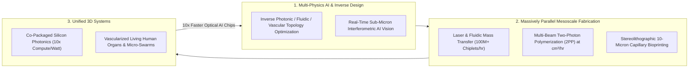
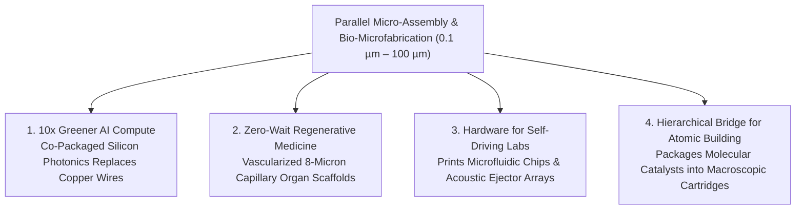

# VISION 01: HIGH-SPEED PARALLEL MICRO-ASSEMBLY & BIO-MICROFABRICATION
## Pathway 2C: Bridging the "Mesoscale Gap" from Sub-Micron Photonics to Vascularized Living Organs

> **Executive Framing & Core Thesis:**
> * **The Cynic's Objection:** *"We can etch flat silicon chips at 2 nanometers and bolt together 2-ton cars with factory robots, but building complex 3D systems at the micron scale—like wiring optical chiplets, printing living capillary beds, or assembling micro-surgical robots—is painfully slow, serial, and fragile. You can't build macroscopic products one micron at a time."*
> * **The Core Thesis (The Mesoscale Convergence Flywheel):** Between 2024 and 2035, humanity conquered the "Mesoscale Gap" ($0.1\ \mu\text{m}$ to $100\ \mu\text{m}$) by replacing serial pick-and-place needles with **massively parallel field-driven assembly, two-photon laser polymerization, and holographic bioprinting**. Guided by real-time AI optical metrology and powered by abundant clean energy, modern micro-foundries transfer **100 million chiplets per hour**, print sub-micron 3D metamaterials at centimeter scale, and fabricate living human organs with 10-micron capillary networks—fusing electronics, optics, mechanics, and biology into a single manufacturable substrate.

---

## ACT I: A BELIEVABLE NEAR-FUTURE VISION (THE WORLD OF 2040)
### A Wednesday Morning in 2040 — Zero-Wait Organ Transplants, Tetherless Micro-Surgeons, and 100x Greener Compute

Imagine stepping inside a regional medical center and an adjacent clean-tech micro-foundry in **2040**.

The tools inside do not rely on fictional "magic dust"; they are precision optical, acoustic, and fluidic machines operating quietly behind cleanroom glass, delivering three transformative realities to everyday life:

1. **The End of the Organ Transplant Waiting List:**
   * In the surgical wing, a 54-year-old patient with end-stage pulmonary fibrosis receives a newly transplanted lung lobe. Neither another human donor nor lifelong immunosuppressive drugs are required.
   * Ten days earlier, a biopsy of the patient's own stem cells was expanded in an automated bioreactor and fed into a **Holographic Two-Photon Micro-Bioprinter**.
   * Over 18 hours, parallel femtosecond laser sheets sculpted a full-scale, 4,000-layer hydrogel lung scaffold containing **300 million alveoli and a leak-free, 8-micron capillary network**, seeded with the patient's own endothelial and epithelial cells.
   * Organ rejection is zero; the transplant waitlist—which cost tens of thousands of lives annually in the 2020s—is history.
2. **The Tetherless Cerebrovascular Micro-Surgeon:**
   * In the adjacent interventional suite, a stroke patient with a deep, inoperable brainstem blood clot does not undergo open craniotomy.
   * Instead, a neurologist injects a single $300\ \mu\text{m}$ **3D-printed magneto-acoustic micro-catheter swimmer** into the arterial pathway.
   * Guided by external low-field electromagnetic coils and real-time ultrasound AI tracking, the micro-device swims smoothly through millimeter vessels directly to the clot, mechanically emulsifies the thrombus via localized acoustic cavitation, and is retrieved safely in 20 minutes—turning a fatal stroke into an outpatient procedure.
3. **The 10-Watt Personal Supercomputer & Smart Structural Skin:**
   * Across the street at the regional hardware foundry, sheets of recycled glass and polymer roll through a **Parallel Fluidic & Laser Micro-Assembly Line**.
   * In a single pass, the machine deposits millions of microscopic gallium-nitride LEDs, silicon-photonic optical transceivers, piezoelectric strain sensors, and solid-state micro-batteries at **sub-micron alignment accuracy**.
   * Data centers now wire chiplets together with light instead of copper—cutting AI compute energy consumption by **90%**—while architectural window glass doubles as a transparent solar harvester, acoustic noise canceller, and high-resolution display for **under \$18 per square meter**.

---

## ACT II: THE CONVERGENCE BRIDGE — HOW IT CAME ABOUT (2021–2038)
### How Holographic Lasers, Fluidic Self-Assembly, and AI Metrology Shattered the Serial Bottleneck

### Step 1: Why the Micron Scale Used to Be an Industrial Dead Zone
Historically, human manufacturing had a blind spot between **nanometer lithography** (which could pattern billions of transistors, but only on flat 2D silicon wafers using \$350M EUV machines) and **macro-robotics** (which could assemble 3D parts larger than a millimeter).
Whenever engineers tried to assemble 3D components between **1 micron and 100 microns**—such as wiring micro-LEDs, stacking heterogeneous optical chiplets, or printing blood capillaries ($5\text{–}10\ \mu\text{m}$ diameter)—traditional robotic pick-and-place failed for two physical reasons:
* **Van der Waals & Electrostatic Stiction ($F_{\text{adhesion}} \gg F_{\text{gravity}}$):** Below $100\ \mu\text{m}$, surface adhesion forces scale with radius ($R$), whereas mass/gravity scales with volume ($R^3$). At $10\ \mu\text{m}$, surface stiction overwhelms gravity by **$10,000\times$**, so a mechanical gripper cannot simply "let go" of a micro-part.
* **The Serial Speed Trap:** Placing 25 million micro-components one at a time at 10 parts per second takes **29 days** for a single square meter.

### Step 2: Three Converging Breakthroughs That Parallelized the Micron Scale (2023–2026)
* **Laser-Induced Forward Transfer (LIFT), Elastomeric Stamp & Fluidic Self-Assembly:**
  Instead of mechanical tweezers, pioneers like **VueReal**, **X-Celeprint**, and **Uniqarta** perfected non-contact laser pulses, micro-transfer cartridges, and surface-tension fluidic wells that transfer **tens of millions of 5-to-20-micron chiplets per hour** with $<0.5\ \mu\text{m}$ placement accuracy—turning micro-assembly from a serial process into a rotary printing press.
* **Multi-Focus Two-Photon Polymerization (2PP):**
  Femtosecond lasers focus inside a liquid photoresist so that solidification occurs *only* at the sub-micron focal point where two photons arrive simultaneously (scaling with intensity squared, $I^2$). By splitting the laser into **dozens of holographic beamlets** controlled by high-speed spatial light modulators (**UpNano**, **Nanoscribe**, **Boston Micro Fabrication**), 3D nano-printing throughput jumped **$1,000\times$**—allowing sub-micron lattices, micro-lenses, and mechanical metamaterials to be printed across centimeter volumes in minutes.
* **Co-Packaged Silicon Photonics & Vascular Bioprinting:**
  Using sub-micron active optical alignment, **TSMC (COUPE)**, **Ayar Labs**, and **Celestial AI** fused optical waveguides directly onto silicon compute dies, breaking the copper interconnect energy wall. Simultaneously, **United Therapeutics** and **3D Systems** adapted high-resolution projection stereolithography to print the world's first full-scale, 44-trillion-voxel vascularized lung scaffolds.

### Step 3: 2025–2026 Global State of the Art (SOTA) in Micro-Assembly & Bio-Microfabrication

| Organization / Platform | Core Micro-Assembly Technology | Verified 2024–2026 Milestone | Commercial & Scaling Pathway |
| :--- | :--- | :--- | :--- |
| **TSMC (*COUPE*) & Ayar Labs / Celestial AI** | Sub-Micron Silicon Photonics & Co-Packaged Optics (CPO) | TSMC validated **COUPE** (Compact Universal Photonic Engine) stacking optical dies at sub-micron tolerances; Ayar Labs & Celestial AI demonstrated **terabit/s optical I/O at 1/10th copper power**. | Standard interconnect backbone for 2026–2030 exascale AI supercomputers, slashing data-center energy per token. |
| **United Therapeutics & 3D Systems (*Print to Perfusion*)** | High-Resolution Vascularized 3D Micro-Bioprinting | Printed world's most complex living-scale object: a **4,000-layer, 44-trillion-voxel human lung scaffold** with functional alveolar & capillary channels tested in preclinical perfusion. | First-in-human clinical trials for 3D-bioprinted autologous/universal lung and solid organ transplants in the late 2020s–2030s. |
| **Nanoscribe (BICO) & UpNano (*NanoOne*)** | Multi-Photon 3D Lithography (2PP) & Quantum Aligned Optics | Nanoscribe's *Quantum X align* achieved **automated sub-100 nm 3D printing of freeform micro-optics directly onto optical fibers/chips**; UpNano reached $>450\text{ mm}^3/\text{hr}$ throughput. | High-volume wafer-scale 3D printing of endoscopic micro-cameras, photonic wirebonds, and cell-growth scaffolds. |
| **VueReal (*MicroSolid Printing*) & X-Celeprint** | Massively Parallel Micro-Chiplet Transfer Printing | Demonstrated **>99.999% transfer yield** of $<10\ \mu\text{m}$ micro-LEDs and silicon micro-ICs from native wafers to glass/flexible substrates at millions of units per hour. | Transforming displays, automotive smart glass, and distributed wearable sensor skins into low-cost roll-to-roll manufacturing. |
| **Boston Micro Fabrication (BMF)** | Projection Micro-Stereolithography ($\text{P}\micro\text{SL}$, $2\ \mu\text{m}$ resolution) | Deployed industrial $2\ \mu\text{m}$-resolution 3D printers across **1,800+ global customers** for microfluidic lab-on-a-chip valves, micro-connectors, and ophthalmic implants. | Replacing expensive micro-injection molding with zero-tooling digital micro-manufacturing. |
| **ETH Zurich (Bradley Nelson Lab) & Bionaut Labs** | Untethered Magnetic Micro-Robots & Endovascular Swarms | **Bionaut Labs** received FDA Investigational Device Exemption (IDE) & humanitarian clearances for remote magnetic micro-robots treating brain tumors/Dandy-Walker syndrome; ETH demonstrated soluble magnetic micro-swarms for stroke thrombolysis. | Minimally invasive precision neurosurgery, targeted brain drug delivery, and micro-catheter robotic interventions. |

---

## ACT III: PHASED ROLLOUT ROADMAP (2026–2050) & ECONOMIC CASCADE

| Rollout Phase | Timeline | Fabrication Scale & Resolution | Throughput & Cost Metrics | Societal Thresholds Unlocked |
| :--- | :--- | :--- | :--- | :--- |
| **Phase 1: Photonic Chiplets & Micro-Optics** | **2026–2030** | $0.2\text{–}2\ \mu\text{m}$ alignment across 300mm wafers & bio-scaffolds | **$10^7$ chiplets/hr**; optical AI interconnect energy drops from $5\text{ pJ/bit}$ to **$<0.5\text{ pJ/bit}$** | 10x greener AI data centers; commercial roll-out of micro-LED smart displays and FDA-cleared magnetic neuro-microbots. |
| **Phase 2: Roll-to-Roll Heterogeneous Micro-Fab** | **2030–2036** | Meter-scale parallel fluidic & multi-beam 2PP assembly | **$10^9$ micro-elements/hr**; micro-assembled smart surfaces at **<\$50/m²** | First FDA-approved 3D-bioprinted vascularized tissue/organ grafts; tetherless micro-surgical swarms for stroke and oncology. |
| **Phase 3: Autologous Organ Foundries & Smart Matter** | **2036–2042** | Hospital-integrated bioprinters + structural metamaterial lines | Full human organ capillary scaffold printed in **<12 hours for <\$3,500** in energy/bio-ink | Elimination of solid-organ transplant waiting lists; buildings and aircraft clad in active micro-fluidic/piezo structural skins. |
| **Phase 4: Converged Atomic-to-Macro Compilers** | **2042–2050** | Seamless hierarchical assembly from $1\text{ nm}$ to $10\text{ m}$ | Marginal fabrication cost approaches raw feedstock + **\$0.003/kWh** energy | Every macro-object (vehicles, prosthetics, habitats) contains embedded vascular cooling, self-healing micro-capsules, and optical nervous systems. |

---

## ACT IV: THE DEEPER HORIZON & SMOOTH SOCIETAL TRANSITION

### 1. The Recursive Feedback Loop Across All Five Automation Domains
Micro-Assembly is the **physical bridge** that turns nanoscale breakthroughs into macroscopic human products:
* **Accelerating Automated Research & AI Compute:** When TSMC, Ayar Labs, and Nanoscribe use sub-micron optical assembly to wire AI chips with laser light instead of copper wires, **AI supercomputers run $10\times$ faster per megawatt**. That faster compute immediately powers deeper *AlphaFold* and *MatterGen* simulations.
* **Building the Hardware for Self-Driving Labs:** Every microfluidic lab-on-a-chip, acoustic droplet ejector, and miniature mass-spectrometer array inside an **Automated Physical Lab** is manufactured using $2\ \mu\text{m}$ micro-stereolithography and parallel chiplet bonding.
* **Scaling Up Atomic-Level Building:** As **Atomic-Level Building** synthesizes novel molecular motors and atomically precise catalysts, **Parallel Micro-Assembly** provides the hierarchical vascular channels and electrode arrays that organize trillions of those nanomachines into a working macroscopic battery, artificial lung, or water purifier.

### 2. Healthcare Equity and Decentralization of High-Tech Manufacturing
* **Ending Geographic Monopoly on Advanced Hardware:** Traditional semiconductor fabs cost \$20B+ because they force every function (logic, memory, RF, optics, power) onto a single monolithic silicon die. Parallel micro-assembly allows regional micro-foundries costing **<\$50M** to mix-and-match commodity chiplets onto low-cost glass or polymer substrates—democratizing hardware manufacturing across developing and developed nations alike.
* **From Lifelong Chronic Dialysis to One-Time Curative Replacement:** In 2026, kidney dialysis and end-stage organ failure consumed hundreds of billions of dollars annually in palliative maintenance. Automated vascular micro-bioprinting shifts medicine from chronic scarcity management to one-time curative tissue regeneration, paying for its own infrastructure many times over.

### 3. Summary for the Skeptic
Micro-assembly is not waiting on a theoretical physics miracle. **TSMC's COUPE and Ayar Labs** are already bonding sub-micron optical chiplets to power next-generation AI clusters; **VueReal** is already transferring millions of micro-components per hour; and **United Therapeutics and 3D Systems** have already printed 44-trillion-voxel vascularized human lung scaffolds. By parallelizing the micron scale with light, fluidics, and AI vision, humanity is learning to build with the same hierarchical elegance as living nature.

---

## APPENDIX: QUANTITATIVE MESOSCALE BENCHMARKS & CONVERGENCE MATRIX (2026 VS. 2040)

To see how parallel optical, fluidic, and bioprinting tools conquer the mesoscale bottleneck, compare the key physical metrics across electronics, optics, and bio-manufacturing:

| Mesoscale Domain | Serial Legacy Assembly (2020–2023) | Parallel Micro-Assembly SOTA (2025–2026) | Converged Hierarchical Foundry (2040) |
| :--- | :--- | :--- | :--- |
| **Micro-Chiplet Transfer Rate** | $10^3\text{–}10^4\text{ units/hr}$ (pick-and-place) | **$>10^7\text{ units/hr}$** (*VueReal / LIFT* at $>99.999\%$ yield) | **$>10^9\text{ units/hr}$** (roll-to-roll fluidic/laser self-assembly) |
| **3D Sub-Micron Printing Speed** | $<0.1\text{ mm}^3/\text{hr}$ (single-beam 2PP) | **$>450\text{ mm}^3/\text{hr}$** (*UpNano / Nanoscribe* multi-beam) | **$>10,000\text{ mm}^3/\text{hr}$** (holographic light-sheet 2PP) |
| **Chip-to-Chip Interconnect Energy** | $5.0\text{–}10.0\text{ pJ/bit}$ (electrical copper trace) | **$0.4\text{–}0.8\text{ pJ/bit}$** (*TSMC COUPE / Ayar Labs* optical) | **$<0.05\text{ pJ/bit}$** (3D photonic wirebonded metamaterials) |
| **Vascular Bioprinting Resolution** | $>150\ \mu\text{m}$ (extrusion nozzles; no capillaries) | **$8\text{–}15\ \mu\text{m}$** (*United Therapeutics / 3D Systems* 44T voxels) | **$<3\ \mu\text{m}$** (full autologous solid organs printed in $<12\text{ hrs}$) |
| **Endovascular Micro-Robot Scale** | $>1.5\text{ mm}$ tethered mechanical catheters | **$200\text{–}500\ \mu\text{m}$** untethered magnetic (*Bionaut / ETH*) | **$20\text{–}100\ \mu\text{m}$** biodegradable acoustic-magnetic swarms |

### The Mesoscale Parallelization Law
Why did two-photon polymerization (2PP) and fluidic self-assembly unlock three orders of magnitude in throughput simultaneously? Because nonlinear two-photon absorption scales with the square of local photon intensity ($R_{\text{2PP}} \propto I^2$), allowing a high-power femtosecond laser driven by cheap electricity to be split by a Spatial Light Modulator into $N$ parallel focal spots ($N = 64 \to 10,000$):

$$\text{Volumetric Fabrication Rate} = N_{\text{beamlets}} \times v_{\text{scan}} \times \Delta V_{\text{voxel}}(I^2) \propto P_{\text{laser-energy}} \times \eta_{\text{AI-metrology}}$$

As **Materials Science** delivers higher-damage-threshold nonlinear optical crystals and **Automated Research** optimizes inverse holographic phase masks in real time, $N_{\text{beamlets}}$ scales from dozens to tens of thousands—printing centimeter-scale organs and optical supercomputers with nanometer precision in minutes.

### Cross-Domain Synergy Summary Across the Vision 01 Automation Stack
* **Upstream Inputs:** Formal mathematical proofs (*01-automated-research*) + Single-atom quantum chemistry simulation (*01-atomic-level-building*) + Inverse crystal diffusion (*01-materials-science*).
* **Midstream Execution:** Parallel two-photon holographic printing and fluidic chiplet mass-transfer (*01-micro-assembly*).
* **Downstream Validation & Power:** Closed-loop Self-Driving Lab perfusion/metrology (*01-automated-physical-sciences*) running on $\$0.003/\text{kWh}$ baseload clean energy (*vision-01-abundant-energy*).
