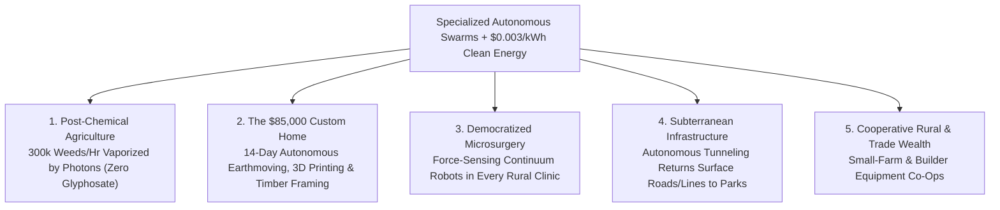

# VISION 01: UNIVERSAL PHYSICAL AUTOMATION & ROBOTICS
## Pathway 1B: Specialized Non-Humanoid Form Factors — *Where Purpose-Built Morphology Outperforms the Human Body*

> **Executive Framing & Core Thesis:**
> * **The Cynic's Objection:** *"Why invent a zoo of specialized robots if humanoids can use human tools? Conversely, haven't industrial robots existed for fifty years as blind, bolted-down arms inside safety cages that cost millions to reprogram?"*
> * **The Core Thesis:** Evolution did not stop at one body plan—cheetahs, octopuses, earthworms, and honeybees exist because specialized physics demands specialized geometry. A two-legged humanoid will never excavate 500 tons of bedrock per hour, thread a 2-millimeter flexible endoscope through a beating human heart, vaporize 200,000 agricultural weeds per hour with sub-millimeter lasers, or move 3,000 warehouse pallets at 25 miles per hour. Between 2021 and 2026, the ** exact same mathematical brains** that unlocked humanoids (multimodal foundation models, 10,000x GPU physics gyms, and real-time spatial perception) merged with **purpose-built non-humanoid morphologies**: wheeled-legged quadrupeds, autonomous earthmoving & 3D-printing swarms, agricultural laser/soft-gripper gantries, cellular warehouse swarms, and force-sensing surgical continuum arms. Powered by abundant **\$0.003/kWh** clean energy, this Cambrian explosion of specialized machines eliminates chemical herbicides, drops housing and infrastructure construction costs by >65%, and democratizes world-class microsurgery everywhere on Earth.

---

## ACT I: A BELIEVABLE NEAR-FUTURE VISION (THE WORLD OF 2040)
### A Tuesday Morning in 2040 — The Invisible Symphony of Purpose-Built Machines

Travel across a regional corridor from the farmlands of California's Central Valley (or the Loire Valley, or Queensland) into a mid-sized city on a clear morning in **2040**.

You quickly realize that while humanoid robots assist inside homes and clinics, the heavy lifting of civilization is carried out by a breathtaking ecosystem of **non-humanoid specialists**:

1. **Zero-Herbicide, Zero-Backbreak Agriculture at Dawn:**
   Rolling silently across a 400-acre organic vegetable farm at 5:30 AM is an autonomous electric gantry tractor pulling a **multi-kilowatt solid-state laser array** alongside a swarm of soft-pneumatic harvesting rovers. Using multispectral computer vision, the laser gantry identifies and vaporizes the meristems of **300,000 microscopic weeds per hour** without a single drop of glyphosate or chemical runoff—and without compacting the living topsoil. Behind it, octopod soft-gripper rovers gently twist ripe strawberries and heirloom tomatoes off the vine at peak brix sweetness. Farmworkers are no longer hunched over in 105°F heat inhaling pesticides; they are agronomic fleet owners and soil ecologists.
2. **The 14-Day Custom Neighborhood Home:**
   On an infill lot in town, an autonomous electric excavator and trenching rover finish grading the foundation by noon—guided by millimeter-wave ground-penetrating radar and LiDAR. Beside them, a multi-axis **robotic 3D architectural printer** extrudes carbon-negative geopolymer concrete walls with integrated insulation channels, while tracked robotic gantry cranes set mass-timber roof trusses. A seismically resilient, architecturally warm 2,200-square-foot home is completed in **14 days for \$85,000 in total construction cost**.
3. **Sub-Millimeter Tele-Autonomous Surgery & Underground Grid Guardians:**
   At the local community hospital, a patient undergoes a scarless, incision-free tumor resection via a **flexible continuum snake robot** equipped with 10,000x computing power and sub-gram tactile force feedback—bringing Mayo Clinic surgical precision to a rural town. Meanwhile, 40 feet beneath the street, explosion-proof **quadruped and wheeled-legged inspection robots** patrol high-voltage tunnels, sewer mains, and offshore wind substations 24/7, fixing micro-leaks before a single pipe ever bursts.
4. **The Skeptic's Question:**
   *"In 2020, agricultural and construction equipment required full-time human operators, surgical robots were purely passive tele-manipulators, and warehouse automation took two years of custom steel bolting. How did specialized robots become adaptive, autonomous swarms by the late 2030s?"*

Here is the engineering and economic bridge that made it happen.

---

## ACT II: THE CONVERGENCE BRIDGE — HOW IT CAME ABOUT (2021–2038)
### One Shared AI Foundation Brain Across a Thousand Superhuman Body Plans

### Step 1: The Three Converging Inflections That Freed Specialized Robots from Their Cages (2021–2026)

Historically, non-humanoid robots were split between **dumb heavy iron** (tractors, excavators) and **blind factory cages** (SCARA/6-axis arms bolted to concrete). Three converging breakthroughs unified them into intelligent autonomous agents:

* **Mathematical Tooling (Cross-Embodiment Foundation Models & Deformable Physics Sim):**
  Breakthroughs like Physical Intelligence's **$\pi_0$**, Google DeepMind's **RT-X (Open X-Embodiment)**, and **NVIDIA Isaac Lab** proved that a single spatial-reasoning foundation model can transfer policy weights across radically different body plans—from a 4-legged dog to a 6-axis surgical arm or a 30-ton excavator. Furthermore, GPU simulation of **granular media (soil, sand, wet concrete) and deformable biological tissue** allowed excavators and surgical robots to train across millions of edge cases before touching real earth or real patients.
* **Physical & Photonic Tooling (Directed Energy, Soft Robotics, and Continuum Mechanics):**
  Why use a mechanical hoe when a **150W $\text{CO}_2$/diode laser** guided by neural vision can thermally rupture weed cells in $5\text{ milliseconds}$? Why use rigid steel claws on soft fruit when **electro-pneumatic elastomer grippers** with embedded barometric/optical skin conform gently to berries and glassware? And in medicine, shape-memory nitinol tendons and **force-sensing trocar instruments** replaced rigid laparoscopic rods.
* **The EV & Smartphone Sensor Dividend:**
  The autonomous vehicle and smartphone industries drove 3D solid-state LiDAR, RTK-GPS modules, thermal cameras, and silicon-carbide high-voltage powertrains down in cost by **>90% between 2018 and 2026**, making it economical to bolt an autonomous perception suite onto every tractor, bulldozer, and warehouse bot.

### Step 2: The 2025–2026 Global State of the Art (Verified Non-Humanoid Leaders)

By 2025–2026, specialized autonomous form factors were already generating billions in commercial revenue and outperforming human biology across five foundational sectors:

| Sector & Form Factor | Global Leaders (2025–2026) | Key Architecture & Physics Advantage | Verified 2024–2026 Milestone | Commercial Impact & Pathway |
| :--- | :--- | :--- | :--- | :--- |
| **Quadrupeds & Wheeled-Legged Hybrids** | **Boston Dynamics** (*Spot*), **ANYbotics** (*ANYmal X*), **Swiss-Mile / RIVR** | 4-legged dynamic stability + locking motorized wheels for fast flat-ground transit & stair climbing. | **1,500+ Spot** & **ANYmal** units inspecting BP, Shell, SLB, and national power grids; **ANYmal X** certified **ATEX/IECEx explosion-proof**; Swiss-Mile rolling at 14 mph & standing on hind wheels. | Eliminating human entry into toxic gas, high-radiation, and offshore HV facilities globally. |
| **Autonomous Earthmoving & 3D Construction** | **Built Robotics** (*Exosystem*), **Bedrock Robotics**, **ICON** (*Vulcan / Phoenix*), **Diamond Age** | Bolt-on autonomous guidance for 40-ton excavators/trenchers; multi-story robotic concrete printers & gantry bricklayers. | **Built Robotics** piling utility-scale solar farms across the US; **ICON** completed **100-home Wolf Ranch** 3D-printed community in Texas & unveiled multi-story *Phoenix* printer at **<\$80/sq ft** wall/roof target. | Slashing utility-scale solar installation and residential shell construction time and cost by **50–65%**. |
| **Precision Ag: Laser-Weeding & Soft Harvesting** | **Carbon Robotics** (*LaserWeeder*), **Advanced Farm**, **Tortuga AgTech** | High-res neural vision + **30 high-power lasers**; octopod wheeled platforms with soft vacuum/elastomer fruit grippers. | **Carbon Robotics** deployed across 100+ farms on 3 continents, firing every **50 ms** to destroy **200,000+ weeds/hour** with **zero chemicals** (saving up to 80% weed control cost); **Advanced Farm** harvesting commercial strawberry fields day and night. | Total elimination of chemical herbicides, soil compaction, and seasonal agricultural labor bottlenecks. |
| **Surgical & Luminal Continuum Robotics** | **Intuitive Surgical** (*Da Vinci 5* & *Ion*), **EndoQuest Robotics**, **Johnson & Johnson** (*Ottava*) | Sub-millimeter articulated wrists & flexible luminal catheters with real-time haptic force feedback. | **FDA cleared Da Vinci 5 (2024–2026)** featuring **10,000x compute power** and integrated **Force Feedback** (reducing tissue push/pull trauma by up to **43%**); **Ion** endoluminal catheter reaching deep peripheral lung nodules without chest incisions. | Transitioning from human tele-operation to AI-guarded surgical co-piloting and rural tele-surgery. |
| **Tactile Warehouse & Dark-Factory Swarms** | **Symbotic**, **Amazon Robotics** (*Proteus, Sequoia & Vulcan*), **AutoStore** | High-speed 3D cellular shuttles (25 mph) + autonomous mobile robots (AMRs) + force-sensing tactile stowing arms. | **Amazon** deployed **750,000+ mobile robots** and unveiled **Vulcan** (2025)—its first tactile-sensing warehouse robot capable of feeling and picking 75% of a 1-million-SKU inventory; **Symbotic** scaling \$22B+ backlog with Walmart. | Compressing warehouse footprint by **60%** while cutting order-to-dispatch latency to under 15 minutes. |
| **Subsea & Pipeline Resident Drones** | **Saab Seaeye**, **Nauticus Robotics** (*Aquanaut*), **PipeDream** | Untethered shape-shifting subsea AUVs & high-speed underground hyper-tube logistics pods. | **Nauticus Aquanaut** performing tetherless acoustic/optical subsea valve manipulation at 3,000m ocean depth. | Zero-diver subsea energy maintenance and invisible underground municipal logistics. |

---

## ACT III: PHASED ROLLOUT ROADMAP (2026–2050) & ECONOMIC CASCADE
### How Specialized Form Factors Rebuild the Physical Foundation of Civilization

| Rollout Phase | Timeline | Core Deployment Milestone | Cost & Productivity Metric | Societal Thresholds Unlocked |
| :--- | :--- | :--- | :--- | :--- |
| **Phase 1: Brownfield Retrofit & High-Value Tasks** | **2026–2029** | Bolt-on autonomy kits on 100,000+ tractors/excavators; 1M+ tactile warehouse bots; 15,000+ force-sensing surgical systems. | **80% reduction** in farm herbicide spend; **43% less** surgical tissue trauma; **2x** solar farm trenching speed. | Immediate payback (<18 months) in organic farming, utility solar buildouts, e-commerce logistics, and minimally invasive surgery. |
| **Phase 2: Coordinated Multi-Morphology Swarms** | **2030–2035** | Heterogeneous jobsite swarms (excavator + 3D printer + crane + quadruped inspector) orchestrated by a single site world model. | **45–60% drop** in housing & civil infrastructure build time; **24/7** quiet electric operation. | Solves the global affordable housing shortage and accelerates grid/water infrastructure renewal without noise or diesel exhaust. |
| **Phase 3: Energy-Coupled Autonomous Biosphere & Med** | **2036–2042** | Solar/fusion-powered autonomous agro-ecology fleets; supervised autonomous microsurgery in rural clinics globally. | **Near-\$0 marginal energy/labor cost** per calorie grown; rural surgical outcomes match top urban hospitals. | Global phase-out of toxic broad-spectrum herbicides/pesticides; topsoil microbiome restoration; universal precision surgical care. |
| **Phase 4: Planetary Terraforming & Subterranean Cities** | **2043–2050+** | Autonomous tunneling borers, subsea mineral/kelp harvesters, and regolith 3D-printing swarms. | **80% reduction** in underground utility/transit tunneling cost; zero-human-risk extreme engineering. | High-voltage lines, freight roads, and water aqueducts moved underground, returning surface land to parks, forests, and pedestrian neighborhoods. |

### Why Specialized Geometry Beats Bipedalism in Five Core Domains
To understand why non-humanoid robots remain 70%+ of industrial robotics tonnage in 2040, consider the first-principles physics of five fundamental tasks:
* **Heavy Earthmoving & Trenching (Tracked & Hydraulic Geometry):** Moving 100 tons of wet clay per hour requires a low center of gravity, high ground-contact traction, and 400+ bar hydraulic force multiplication. A tracked autonomous excavator (**Built / Bedrock**) delivers **50x the continuous mechanical work per kilowatt-hour** of a bipedal walker.
* **High-Throughput Flat-Floor Logistics (Wheeled & Cellular Geometry):** On smooth concrete warehouse floors, motorized wheels and rail-guided 3D shuttles (**Symbotic / Amazon Proteus**) lose near-zero energy to vertical center-of-mass oscillation—moving pallets at **25 mph with 92% drivetrain efficiency**.
* **Multi-Terrain Industrial Inspection (Quadruped & Wheeled-Legged Geometry):** A four-legged robot (**Spot / ANYmal / Swiss-Mile**) is statically stable when standing still (requiring zero balancing energy) and dynamically stable over stairs, rubble, and slippery offshore grates while locking into wheeled mode for fast corridor transit.
* **Precision Agriculture (Wide-Span Gantry + Directed Photons):** Spanning 6 crop rows simultaneously with a 30-laser thermal array (**Carbon Robotics**) or 16 soft-pneumatic picking arms (**Advanced Farm**) achieves **20x the area coverage per hour** of single-body walkers while distributing weight on wide low-pressure tires.
* **Minimally Invasive Medicine (Continuum & Catheter Geometry):** Inside the human body, rigid links cannot navigate tortuous blood vessels or bronchial trees. Tendon-driven flexible continuum robots (**Intuitive Ion / Da Vinci 5 / EndoQuest**) snake through natural orifices to operate at sub-millimeter precision without opening the patient's chest or abdomen.

---

## ACT IV: THE DEEPER HORIZON & SMOOTH SOCIETAL TRANSITION
### Synergizing Specialized Machines, Free Energy, and Human Flourishing

### 1. The Energy + Specialized Morphology Multiplier
In 2026, killing weeds with lasers, boring underground utility tunnels, or extruding carbon-negative mineral concrete at scale was constrained by diesel fuel and industrial electricity prices.
* **Swapping Chemicals for Photons:** When **\$0.003/kWh clean energy** powers electric agricultural gantries, farmers replace millions of tons of petroleum-derived herbicides and fungicides with pure light and computer vision—ending agricultural chemical runoff into rivers and aquifers forever.
* **The Subterranean City:** With autonomous electric micro-tunneling borers operating 24/7 on near-free power, municipalities bury unsightly high-voltage transmission lines, municipal waste pipes, and freight corridors underground for **80% less cost** than 2020s cut-and-cover trenching.

### 2. A Fair, Optimistic Transition for Farmers, Builders, and Clinicians
Rapid deployment of specialized robotics succeeds socially when the people closest to the land, the jobsite, and the patient share directly in the productivity gains:
* **From Hired Hands to Cooperative Fleet Stewards:** Through regional agricultural equipment co-ops and fractional RaaS leasing, family farms of 40 to 80 acres gain access to the exact same autonomous laser-weeding and soft-harvesting swarms as 10,000-acre corporate farms—restoring the economic viability of small family stewardships and high-diversity organic polyculture.
* **Eliminating the "Body Tax" in Construction, Mining & Utilities:** Before 2030, heavy equipment operators, trench workers, subsea divers, and high-voltage linemen suffered some of the highest mortality and chronic disability rates on Earth. Moving human workers out of the trench and blast zone into the role of **Multi-Swarm Site Architects and Equity Co-Owners** raises take-home pay while extending healthy working lifespans by more than a decade.
* **Empowering Rural Surgeons & Nurses:** Rather than centralizing healthcare in megacity hospitals, AI-stabilized surgical continuum systems allow local clinicians in small towns and developing nations to perform world-class procedures with real-time supervisory backup from global specialists.

### 3. Summary for the Skeptic
We do not need to force every robot to look like C-3PO. By pairing a universal mathematical foundation brain with the ideal physical morphology for each law of physics—wheels on flat floors, four legs on stairs, lasers on weeds, continuum snakes in arteries, and 3D extruders on home foundations—humanity is already building a cleaner, safer, and radically more affordable physical world today.

---

## APPENDIX: QUANTITATIVE BENCHMARK SCORECARD (2025 vs. 2032 vs. 2040)

| Sector & Metric | 2025–2026 Verified Baseline | 2032 Mid-Transition Target | 2040 Mature Abundance State |
| :--- | :--- | :--- | :--- |
| **Precision Ag Weed Destruction** | **200,000 weeds/hr** (Carbon Robotics 30-laser array, 0 chemicals) | **300,000 weeds/hr** (Solar/Battery Autonomous Swarm) | **100% Herbicide-Free Global Row-Crop & Orchard Farming** |
| **Residential Wall/Roof 3D Build** | **100-Home Wolf Ranch** completed; **<\$80/sq ft** target (ICON Phoenix) | **21-Day Full Home Shell** (**-40% Build Cost**) | **14-Day Custom Home** (**\$85,000 Total Cost**, -60% vs. 2025) |
| **Surgical Compute & Tissue Force** | **10,000x Compute** & **-43% Tissue Force** (Intuitive Da Vinci 5) | **AI Co-Piloted Anastomosis & Tumor Margin Guidance** | **Scarless Luminal Microsurgery in Every Rural Clinic** |
| **Industrial Quadruped Fleet** | **1,500+ Spot & ANYmal** units active (ATEX explosion-proof) | **75,000+ Wheeled-Legged & Quadruped Inspectors** | **Zero Human Entry into High-Voltage, Toxic, or Subsea Zones** |
| **Warehouse Tactile SKU Coverage** | **750,000+ AMRs** + **75% SKU Tactile Pick** (Amazon Vulcan) | **98% Autonomous Lights-Out Fulfillment** | **60% Smaller Warehouse Footprint & <10-Min Dispatch** |
| **Underground Utility Tunneling** | Legacy Cut-and-Cover (**\$5M–\$15M / mile**) | Autonomous Electric Micro-Boring (**-50% Cost**) | **-80% Tunneling Cost** (Power Lines & Freight Moved Underground) |

### Key Verification Anchors (2024–2026)
1. **Agricultural Photonic & Soft Robotics:** Carbon Robotics LaserWeeder firing every 50 milliseconds across 100+ commercial farms; Advanced Farm and Tortuga AgTech autonomous soft-gripper berry harvesting.
2. **Autonomous Earthmoving & Construction:** Built Robotics Exosystem piling utility-scale solar farms; Bedrock Robotics autonomous excavators; ICON completing the 100-home Wolf Ranch 3D-printed community in Georgetown, TX and unveiling the multi-story Phoenix system.
3. **Surgical, Quadruped & Tactile Swarm Milestones:** FDA clearance of Intuitive Surgical Da Vinci 5 with force-sensing instruments; ANYbotics ANYmal X ATEX-certified offshore deployments; Amazon Robotics unveiling the tactile-sensing Vulcan stowing robot alongside 750,000+ mobile units.
