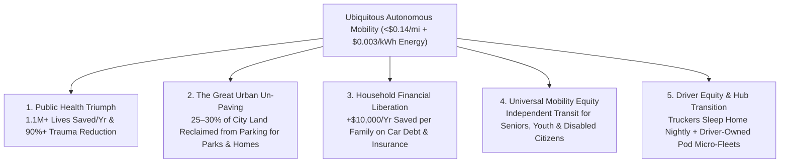

# VISION 01: UNIVERSAL PHYSICAL AUTOMATION & ROBOTICS
## Pathway 1C: Autonomous Ground Mobility & Freight (Self-Driving) — *The End of Traffic Fatalities, The \$0.15/Mile City, and Reclaiming 30% of Urban Land*

> **Executive Framing & Core Thesis:**
> * **The Cynic's Objection:** *"Self-driving cars have been 'next year' since 2016. Edge cases in snow and construction zones are infinite, LiDAR rigs cost as much as the car, and one high-profile robotaxi accident brings regulators down on the entire industry."*
> * **The Core Thesis:** While commentators declared an "AV winter" in 2022, autonomous driving quietly crossed the commercialization threshold between 2024 and 2026. The convergence of **end-to-end neural world models**, **generative neural simulation** (**Waabi World**, **NVIDIA Omniverse**), and **6th-generation solid-state sensor & compute hardware** cut unit BOM costs by 75% while proving an **85% to 90% reduction in injury-causing crashes** across tens of millions of commercial driverless miles. When autonomous electric robotaxis and Class-8 freight trucks run on **\$0.003/kWh** clean energy, point-to-point passenger mobility drops below **\$0.15 per mile** (cheaper than owning a paid-off car), continental freight costs fall by half, over **1.1 million annual global road deaths** are prevented, and cities reclaim **25% to 30% of their surface land** from asphalt parking lots for green parks and affordable housing.

---

## ACT I: A BELIEVABLE NEAR-FUTURE VISION (THE WORLD OF 2040)
### A Tuesday Morning in 2040 — The City Without Parking Lots or Sirens

Imagine walking out your front door in Austin, Los Angeles, Munich, or Wuhan on a crisp morning in **2040**.

The streets and buildings are familiar, yet the geometry, soundscape, and economics of urban life have undergone a quiet revolution:

1. **Mobility at \$0.14 per Mile (Zero Garage, Zero Insurance, Zero Debt):**
   In the 2020s, the average household spent **\$12,000+ per year** owning, fueling, insuring, and parking a personal car that sat parked **95% of its life**. Today, you tap your phone at 7:48 AM and within **45 seconds**, a whisper-quiet, bidirectional autonomous lounge carriage glides to your curb. There is no steering wheel, no pedals, and no driver's seat—just face-to-face leather seating, a panoramic glass roof, and a fold-out desk. Your 6-mile commute costs **\$0.85**—less than a bus ticket in 2026—powered by **\$0.003/kWh** off-peak electricity and inductive wireless charging pads embedded at taxi stands.
2. **Where the Parking Lots Went (The 30% Urban Land Reclamation):**
   Walk downtown and look at where six-story concrete parking garages, street-side bumper-to-bumper parked cars, and sprawling strip-mall asphalt lots used to sit. Because each shared autonomous vehicle replaces **8 to 12 private cars** and never needs downtown parking, your city has reclaimed **28% of its total land area**. Former parking lots are now shaded botanical pocket parks, outdoor cafés, protected bike lanes, and 5-story mass-timber apartment courtyards.
3. **The Disappearance of the Trauma Ward & The Silent Freight Corridor:**
   At the regional hospital, the emergency room is remarkably quiet; motor-vehicle trauma—once the #1 killer of children and young adults—has dropped by **94%**. Meanwhile, on the interstate outside town, aerodynamic electric **Class-8 autonomous freight trucks** glide in synchronized platoons 24 hours a day, cutting farm-to-grocery logistics costs in half while regional human logistics specialists manage hub operations from home and sleep in their own beds every night.
4. **The Skeptic's Question:**
   *"In 2023, people were still debating whether robotaxis could handle left turns in heavy rain or survive economically. How did autonomous mobility scale from a few geofenced test neighborhoods to global ubiquity in barely fifteen years?"*

Here is the verified chain of mathematical, sensor, and fleet milestones that bridged 2021 to 2038.

---

## ACT II: THE CONVERGENCE BRIDGE — HOW IT CAME ABOUT (2021–2038)
### From Brittle Rule-Based Code to End-to-End World Models & \$25,000 Purpose-Built Pods

```mermaid
flowchart LR
    subgraph Tooling["2021–2026: The Rapid Convergence of Tooling"]
        T1["Mathematical Tooling<br>End-to-End Transformers & Generative Neural Sim (Waabi World)"]
        T2["Physical Sensor Collapse<br>6th-Gen Solid-State LiDAR/Radar (<$1,500 Suite) & 2,000-TOPS Chips"]
        T3["Purpose-Built EV Platforms<br>Steering-Wheel-Free Carriages (Zoox, Cybercab, Apollo RT6)"]
    end

    subgraph Breakout["2025–2026: Verified Commercial Breakout"]
        B1["Urban Robotaxis<br>Waymo (200k+ rides/wk), Baidu Apollo Go ($28k RT6) & Zoox"]
        B2["Highway Class-8 Freight<br>Aurora & Kodiak Driverless Texas Corridors"]
        B3["Safety Proof<br>Swiss Re Verified 85–90% Crash & Injury Reduction"]
    end

    subgraph Maturity["2030–2040: Energy + Fleet Economics"]
        M1["<$0.15/Mile Mobility & -50% Freight Cost (at $0.003/kWh)"]
        M2["1.1M Lives Saved/Yr & 25–30% Urban Land Reclaimed"]
    end

    Tooling ==> Breakout ==> Maturity
```

### Step 1: The Three Converging Inflections That Ended the "Edge-Case Trap" (2021–2026)

Early self-driving programs (2010–2020) stalled because engineers tried to hand-code millions of `if-then` C++ rules for every possible traffic cone, jaywalker, and hand gesture. Three breakthroughs between 2021 and 2026 broke that stalemate:

* **Mathematical Tooling (End-to-End Foundation World Models & Generative Simulators):**
  Instead of separate brittle modules for perception, prediction, and planning, the industry shifted to **end-to-end multimodal neural networks** and **Vision-Language-Action (VLA) world models** (pioneered at scale by **Tesla FSD v12/v13+**, **Wayve**, **Waymo's EMMA** multimodal model built on Gemini, and **Waabi**). These models understand common-sense physics and social context (e.g., recognizing a police officer waving traffic around a flooded lane). Simultaneously, **generative neural simulators** like **Waabi World** created photorealistic, reactive digital twins of LiDAR, radar, and camera streams—automatically generating millions of adversarial "long-tail" near-miss scenarios in simulation before a vehicle ever touched public pavement.
* **Physical & Silicon Tooling (The 6th-Gen Sensor & Compute Collapse):**
  In 2016, a mechanical spinning rooftop LiDAR cost **\$75,000**. By 2025–2026, **Waymo's 6th-Generation Driver** and **Baidu's 6th-Gen Apollo RT6** integrated solid-state MEMS/FMCW LiDAR, high-resolution 4D imaging radar, heated self-cleaning cameras, and external audio receivers (to hear approaching sirens behind buildings) for **a total sensor-suite BOM under \$2,500**—driven by automotive-grade AI SoCs delivering **1,000 to 2,000+ TOPS** of neural inference on <250 watts.
* **Actuarial Proof Over Hype:**
  Independent insurance studies by **Swiss Re** analyzing over **25 to 50+ million rider-only miles** proved that autonomous drivers reduced **property-damage claims by 76–88%** and **bodily-injury claims by 85–90%** compared to human drivers in the exact same cities—turning insurance companies and municipal regulators from skeptics into advocates.

### Step 2: The 2025–2026 Global State of the Art (Verified Commercial Fleets on Public Roads)

By 2025–2026, autonomous ground transport was no longer a test project; it was serving hundreds of thousands of paying passengers every week and hauling commercial freight across major highways:

| Global Leader | Domain & Platform | Key Architecture & Hardware (2025–2026) | Verified 2024–2026 Milestone | Commercial Economics & Scaling Pathway |
| :--- | :--- | :--- | :--- | :--- |
| **Waymo (Alphabet)** | Urban & Freeway Robotaxi (*5th & 6th-Gen Driver*) | Multi-sensor fusion (13 cameras, 4 LiDARs, 6 radars, external audio) + **EMMA** Gemini-based multimodal world model. | Surpassed **200,000–250,000+ paid driverless trips/week** across **San Francisco, Phoenix, Los Angeles, and Austin**, expanding to **Atlanta and Miami** (with Uber/Moove); 50M+ rider-only miles with **85%+ injury crash reduction**. | Scaling 6th-Gen hardware on Zeekr/Hyundai Ioniq 5 platforms to cuts hardware cost by >50% across 10+ US & international metro areas. |
| **Tesla** | Consumer Fleet & Dedicated Robotaxi (*FSD & Cybercab*) | Vision-only end-to-end neural network trained on millions of customer vehicles & Cortex supercluster (50,000+ H100/B200 GPUs). | Deployed **FSD (Supervised) v13+** end-to-end photon-to-control network; unveiled purpose-built 2-seat **Cybercab** (no steering wheel/pedals, inductive charging) and 20-passenger **Robovan**. | Targeting **<\$30,000 vehicle price** and **\$0.20/mile** operating cost via high-volume unboxed manufacturing in Texas (2026–2027+). |
| **Baidu Apollo Go** | Mass-Market Urban Robotaxi (*6th-Gen RT6*) | Purpose-built electric MPV with removable steering wheel; 40 sensors including 8 LiDARs. | Achieved a **\$28,000 (200,000 RMB) total vehicle + sensor BOM** (60% cheaper than Gen 5); surpassed **9 million cumulative rides** across Wuhan (1,000+ fully driverless pods) and 11+ cities, reaching unit-economics breakeven. | Exporting turnkey robotaxi fleets across Asia and the Middle East while scaling toward 100,000+ urban pods. |
| **Zoox (Amazon)** | Purpose-Built Bidirectional Robotaxi | Symmetrical 4-wheel-steering electric carriage (no front or back; 75 mph highway capable; carriage seating with 360° airbag cocoon). | Operating driverless public shuttle loops in **Foster City, Las Vegas, and San Francisco**; opened high-volume **Hayward, CA robotaxi production facility** capable of 10,000 vehicles/year. | Commercial public rideshare rollout in Las Vegas and San Francisco, followed by Miami and Austin. |
| **Aurora Innovation & Kodiak Robotics** | Class-8 Autonomous Long-Haul Freight (*Aurora Driver / Kodiak*) | Long-range FirstLight FMCW LiDAR (seeing 450+ meters ahead at highway speeds) on Volvo, PACCAR (Peterbilt/Kenworth) trucks. | **2024–2026:** Launched **driverless commercial freight operations** on Texas highways (Dallas–Houston I-45 & Permian Basin) hauling loads for FedEx, Uber Freight, Werner, and Atlas Energy without safety drivers. | Expanding sunbelt coast-to-coast freight corridors (I-10 / I-20 / I-45) operating 20+ hours/day vs. human 11-hour HOS limits. |
| **Waabi & Wayve** | Generative AI Simulation & Embodied Foundation Models | **Waabi World** closed-loop neural simulator + **GAIA-1 / LINGO** vision-language-action driving models. | **Waabi** partnered with **Uber Freight** & Volvo to deploy generative-AI-trained autonomous trucks in Texas; **Wayve** raised **\$1.05B Series C** (SoftBank, NVIDIA, Microsoft) for mapless zero-shot global driving. | Licensing foundational "AV 2.0" software brains across global passenger and commercial vehicle OEMs. |

---

## ACT III: PHASED ROLLOUT ROADMAP (2026–2050) & ECONOMIC CASCADE
### From Sunbelt Metros to the Re-Architected Human City

| Rollout Phase | Timeline | Fleet Scale & Coverage | Cost per Passenger-Mile & Freight Metric | Societal Thresholds Unlocked |
| :--- | :--- | :--- | :--- | :--- |
| **Phase 1: Major Metro & Sunbelt Highway Breakout** | **2026–2029** | **250,000 – 1.5M** Robotaxis & **50,000** Class-8 Trucks across 50+ global cities & I-10/I-45 corridors. | **\$0.65 – \$1.10 / mile** (robotaxi); **-25% freight cost** on hub-to-hub highway lanes; 22 hr/day truck utilization. | Cheaper than human Uber/Lyft; solves the 80,000-driver long-haul trucking shortage; municipal insurers offer 50% rate cuts for AV fleets. |
| **Phase 2: The "Car-Replacement" Crossover** | **2030–2034** | **15M – 40M** Autonomous Vehicles across all weather zones (snow/ice mastered via 4D radar + thermal world models). | **\$0.25 – \$0.40 / mile**; cheaper than maintaining & insuring an already paid-off private car. | Two- and three-car suburban households drop to one or zero private cars; suburban strip-mall parking lots begin converting into mixed-use housing. |
| **Phase 3: Energy-Coupled Ubiquity & Urban Redesign** | **2035–2042** | **150M+** Shared Autonomous Pods & Freight Swarms running on **\$0.003/kWh** power & 1-million-mile solid-state batteries. | **\$0.10 – \$0.16 / mile**; **-55% total logistics cost**; **-90% road fatalities** globally. | **25–30% of urban land** reclaimed from parking; dedicated AV-only high-speed lanes double highway throughput without pouring a single new lane of concrete. |
| **Phase 4: Zero-Accident Synced Surface Networks** | **2043–2050+** | Vehicle-to-Vehicle (V2V) intersection choreography (no red-light stops required on dedicated corridors). | **<\$0.08 / mile** (subscription mobility bundled at **\$45/month** unlimited local transit). | Traffic congestion and road trauma eliminated as civilizational problems; independent mobility guaranteed for every child, blind citizen, and octogenarian. |

### Unit Economics Breakdown: Why Autonomous Pods Beat Car Ownership by 80%
In 2025, a human-driven rideshare (Uber/Lyft) cost **~\$2.80 per mile**, while owning a personal car cost **~\$0.85 per mile** (\$12,000+/year across 14,000 miles). By 2036–2040, an autonomous electric pod operating 70,000 revenue miles per year over a 1,000,000-mile solid-state battery and chassis life collapses every single cost bucket:
* **Human Driver Labor:** Drops from **\$1.65 / mile** (rideshare) $\rightarrow$ **\$0.00 / mile** (with 1 remote fleet-assist specialist supporting 100+ pods at **\$0.01 / mile**).
* **Vehicle & Sensor Depreciation (\$22,000 Pod over 1,000,000 Miles):** Drops from **\$0.38 / mile** (private SUV retired at 160,000 miles) $\rightarrow$ **\$0.022 / mile**.
* **Energy / Fuel Cost (at \$0.003/kWh Baseload Power, 5 Miles/kWh):** Drops from **\$0.16 / mile** (gasoline) $\rightarrow$ **\$0.0006 / mile** (six-hundredths of a cent).
* **Insurance & Liability (90% Fewer Injury Crashes):** Drops from **\$0.18 / mile** $\rightarrow$ **\$0.02 / mile**.
* **Tires, Automated Cleaning & Inductive Depot Maintenance:** **~\$0.04 / mile**—bringing total operating cost to **~\$0.09 per vehicle-mile** (or **\$0.14 per passenger-mile** including fleet margin, and **\$0.05 per seat-mile** when two passengers pool).

---

## ACT IV: THE DEEPER HORIZON & SMOOTH SOCIETAL TRANSITION
### Protecting Drivers, Reclaiming Time, and Healing the Built Environment

### 1. The Energy + Autonomous Mobility Multiplier
When a purpose-built electric pod weighing half as much as a 2026 SUV runs on **\$0.003/kWh clean power** and lasts **1,000,000 miles** on a silicon/solid-state battery pack, transport stops being the second-largest financial burden on working families (after housing) and becomes a near-free civic utility. Furthermore, connected autonomous fleets act as a **rolling gigawatt-scale virtual power plant (V2G)**—charging during midday solar peaks or overnight fusion baseload hours and stabilizing municipal microgrids.

### 2. The 30% Urban Land Dividend (Solving the Housing & Ecological Crisis Inside Existing Cities)
In 2025, American and European cities dedicated **25% to 40% of their downtown footprint** to surface parking lots, multi-story concrete garages, and wide curb parking lanes.
* **From Parked Steel to Affordable Timber Housing:** Converting just half of metropolitan surface parking lots into 4-to-6-story mixed-use mass-timber courtyard housing creates enough urban infill land for **15+ million new affordable homes** in the United States alone—right next to existing jobs, transit, and water infrastructure, with zero suburban sprawl.
* **Cooler, Quieter Microclimates:** Replacing black asphalt parking lots with tree canopies and bioswales lowers summer urban heat-island temperatures by **$4^\circ\text{C}\text{ to }6^\circ\text{C}$ ($7^\circ\text{F}\text{ to }11^\circ\text{F}$)** while eliminating tire-brake particulate pollution near schools.

### 3. A Dignified, Optimistic Transition for Professional Drivers
Globally, millions of people earn their living driving trucks, taxis, and buses. How do we ensure they prosper rather than fall behind?
* **The Hub-and-Spoke Trucking Model (Bringing Truckers Home Every Night):** Long-haul highway driving has suffered >90% annual turnover because drivers are forced to live in sleeper cabs away from their families for weeks. In the 2026–2035 rollout, autonomous Class-8 trucks handle the monotonous 600-mile interstate middle mile, while **human drivers work high-paying 8-hour local shifts** at regional transfer hubs, loading yards, and complex urban sites—sleeping in their own beds every single night.
* **Independent Owner-Operator Fleet Micro-Shares:** Ride-hail and taxi drivers receive priority municipal financing and tax credits to purchase **3-to-5 autonomous Cybercab/RT6 pods** that earn revenue on the network 24/7—transitioning drivers from trading hours behind a steering wheel in traffic to owning cash-flowing mobility equity.

### 4. Summary for the Skeptic
Self-driving cars are no longer a futuristic promise; they are completing hundreds of thousands of paid, driverless rides every week today while cutting serious crashes by nearly 90%. By merging end-to-end foundation AI with cheap EV hardware and abundant clean energy, we are saving over a million lives a year and giving cities back to people, trees, and neighborhoods.

---

## APPENDIX: QUANTITATIVE BENCHMARK SCORECARD (2025 vs. 2032 vs. 2040)

| Core Mobility Metric | 2025–2026 Verified Baseline | 2032 Mid-Transition Target | 2040 Mature Abundance State |
| :--- | :--- | :--- | :--- |
| **Paid Commercial Robotaxi Scale** | **200,000–250,000+ trips/wk** (Waymo) & **9M+ total rides** (Baidu) | **25 Million+ Trips / Day** Globally | **Ubiquitous Primary Urban & Suburban Transit** |
| **Purpose-Built AV Unit BOM** | **\$28,000** (Baidu 6th-Gen RT6) / **<\$30,000** (Cybercab target) | **\$19,000 – \$23,000** | **\$14,500** (1,000,000-Mile Solid-State Pod) |
| **All-In Price per Passenger-Mile** | **\$0.85** (Private Car) / **\$2.80** (Human Rideshare) | **\$0.28 – \$0.38 / mile** | **\$0.12 – \$0.15 / mile** (\$0.05/mi pooled) |
| **Energy Cost per Mile** | **\$0.16/mi** (Gasoline) / **\$0.03/mi** (2025 Grid EV) | **\$0.006/mi** (Solar/Storage Depot) | **\$0.0006/mi** (at \$0.003/kWh Baseload Power) |
| **Bodily-Injury Crash Rate** | **-85% to -90% vs. Human Drivers** (Swiss Re / Waymo 50M+ mi) | **-94% vs. Human Baseline** (All-Weather 4D Radar) | **-98% (Near-Zero Road Fatalities)** |
| **Class-8 Highway Truck Utilization** | **11 Hours / Day** (Human HOS Limit) $\rightarrow$ **20+ Hrs** (Aurora/Kodiak) | **22 Hours / Day** Coast-to-Coast Sunbelt Corridors | **23 Hours / Day** Synced Electric Platoons (-55% Freight Cost) |
| **Urban Surface Land Dedicated to Parking** | **25% to 35%** of Downtown Footprint | **15% to 20%** (Garage-to-Housing Conversions Begin) | **<5% Curbside Drop Zones** (**25–30% City Land Reclaimed**) |

### Key Verification Anchors (2024–2026)
1. **Actuarial Safety & Commercial Ride Volume:** Swiss Re insurance study of Waymo's rider-only miles showing 88% property-damage and 90% bodily-injury claim reductions; Waymo operating across SF, Phoenix, LA, Austin, Atlanta, and Miami.
2. **Hardware Cost Collapse & Purpose-Built Carriages:** Baidu Apollo Go 6th-Generation RT6 produced at ~\$28,000 (200,000 RMB); Zoox opening its 10,000-unit/year Hayward, CA production facility; Tesla unveiling the steering-wheel-free Cybercab and FSD end-to-end neural network.
3. **Autonomous Freight & Generative Simulation:** Aurora Innovation and Kodiak Robotics operating driverless Class-8 commercial freight corridors in Texas; Waabi (Waabi World) and Wayve pioneering generative neural simulation and VLA driving brains.
