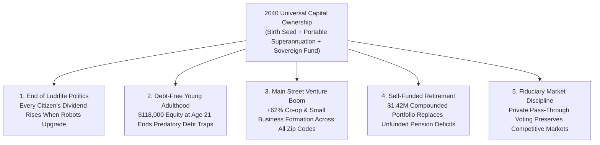

# VISION 01 — SOCIAL ARCHITECTURE: UNIVERSAL CAPITAL OWNERSHIP & COMPOUNDING DIVIDENDS
## Pathway 5B: Moving Every Citizen from Wage-Only Dependence to an Ownership Stake in the Automated Economy

> **Executive Framing & Philosophical Premise:**
> * **The Paradox of Social Reality:** For two centuries, economic orthodoxy treated the divide between "laborers" (who live paycheck-to-paycheck selling hours of their life) and "capitalists" (who own compounding equity in productive machinery) as an immutable law of nature. Yet corporate charters, index funds, sovereign trusts, and retirement accounts are **100% human inventions**. Ownership architecture is upgradeable social software.
> * **The Cynic's Objection:** *"As AI and robotics capture an ever-larger share of national income—pushing labor's share of GDP from 64% down toward 35%—all the wealth will inevitably concentrate in the hands of a tiny trillionaire elite while ordinary families are left behind."*
> * **The Core Thesis:** If machines are going to do an increasing share of the work, **every citizen must own a piece of the machines.** By combining **at-birth Universal Citizen Capital Accounts ("Invest in America" Baby Bonds)**, **mandatory portable employer/automation equity matches (modeled on Australia's \$3.9T Superannuation system)**, and **National Sovereign Automation Dividends (modeled on Alaska and Norway)**, we smoothly turn every working family into a compounding capital owner—without seizing a single dollar of private property.

---

## ACT I: A BELIEVABLE NEAR-FUTURE VISION
### Turning 21 in 2040 — A Generation Born With an Portfolio

Imagine attending a backyard graduation party in Phoenix, Arizona—or Manchester, Brisbane, or Hartford—on a warm Saturday evening in **2040**.

Your 21-year-old niece has just finished her apprenticeship in bio-fabrication and community architecture. Neither of her parents was wealthy; in the 2020s, her father drove a delivery truck and her mother worked as a medical receptionist. Yet as she steps into adulthood, three quiet financial realities separate her life from the paycheck-to-paycheck anxiety of 2026:

1. **Her "Invest in America" Birth Account Just Vested at \$118,000:**
   On the day she was born, her **Universal Citizen Capital Account** was automatically seeded with **\$7,500** and received an automatic **\$2,000 annual top-up** through childhood, invested in a low-fee, globally diversified index of productive equities, AI infrastructure, and energy utilities. Compounding at an average real return of 7.8% across two decades of rapid automation growth, she turns 21 with **\$118,400 in locked-in productive capital**—usable to buy debt-free home equity, launch a business, or keep compounding for life.
2. **A Dual-Engine Household Income (Wages + Monthly Capital Dividends):**
   Her parents still work part-time in roles they enjoy, but human wages are only **half** of their household cash flow. Every quarter, their household receives **\$1,450 per month (\$17,400/year)** in combined **Sovereign Automation Trust Dividends** and **Portable Superannuation Equity Yield**—representing their direct ownership share in the fusion plants, robotic warehouses, and AI foundation models operating across the nation.
3. **The Psychological Shift from Fear to Alignment:**
   When a news alert announces that a new generation of autonomous surgical and logistics robots has boosted corporate earnings by 18%, nobody at the barbecue panics about "the machines taking over." Instead, every person at the table knows their family's capital account and monthly dividend just went up. **Every citizen is on the same side of the balance sheet as technological progress.**
4. **The Skeptic's Question:**
   To someone in 2026—when the bottom 50% of Americans owned less than **1% of all stock market equities**—this sounds like a daydream. *"How could we possibly afford to seed capital accounts for every child and worker without printing trillions of inflationary dollars or socializing the stock market?"*

Here is the exact mathematical, institutional, and historical bridge that built universal capital ownership between 2026 and 2038.

---

## ACT II: THE TRANSITION BRIDGE — COMPOUNDING MATHEMATICS & PROVEN SOVEREIGN RAILS (2026–2038)
### Solving Thomas Piketty's $r > g$ Inequality Equation by Universalizing $r$

```mermaid
flowchart LR
    subgraph Problem["The 2026 Piketty Trap (r > g)"]
        P1["Return on Automated Capital (r ≈ 8–11%) >> Wage Growth (g ≈ 1–2%)"]
        P2["Top 10% Own 93% of Equities; Bottom 50% Own <1%"]
        P3["Automation Growth Fuels Populist Backlash & Panic"]
    end

    subgraph Engine["Three-Pillar Ownership Architecture (2026–2036)"]
        E1["Pillar 1: At-Birth 'Invest in America' Capital Accounts ($7.5k Seed + Auto-Match)"]
        E2["Pillar 2: Universal Portable Superannuation (12% Wage + Automation Match)"]
        E3["Pillar 3: National Commonwealth Fund (Equity Warrants + Spectrum/Energy Rents)"]
    end

    subgraph Outcome["2040 Universal Capitalist Democracy"]
        O1["Median Household Holds $380,000+ in Productive Equity"]
        O2["$1,200–$1,800/mo Passive Dividend Floor per Adult"]
        O3["Public Cheerleads Faster AI & Robotics Rollout"]
    end

    Problem ==> Engine ==> Outcome
```

### Step 1: The Unbeatable Mathematics of Early Compounding
In 2014, economist Thomas Piketty famously showed that when the rate of return on capital ($r$) consistently exceeds overall economic growth ($g$), wealth concentrates inexorably if capital ownership is restricted to a small elite. In the AI and robotics era, $r$ accelerates even further as software and robots scale with near-zero marginal labor cost.
* **Why Redistribution Alone Fails—and Pre-Distribution Succeeds:** Taxing income after the fact and handing out cash for immediate consumption never builds generational wealth. Instead, the **Universal Capital Ownership Act** harnessed the magic of exponential compounding ($A = P(1 + r)^t$) from birth:
  * **Cost to Seed Every Newborn in the United States:** Approximately **3.6 million babies** are born in the U.S. each year. Seeding every newborn with **\$7,500 at birth** costs **\$27 billion per year**—less than **0.4% of the federal budget** (or a tiny fraction of corporate stock buybacks).
  * **The 18-, 30-, and 65-Year Compounding Curve (at 8% nominal / 6.5% real equity return + \$1,500/yr childhood match):**
    * **At Age 18:** **~\$86,000** in personal capital equity.
    * **At Age 30 (if left invested while working):** **~\$216,000**—generating **>\$13,000/year** in passive dividend/yield income alone.
    * **At Age 60:** **~\$1.42 million** per citizen—completely eradicating old-age poverty and eventually replacing unfunded pay-as-you-go pension liabilities with real, pre-funded productive assets.

### Step 2: Real-World Precedents & 2026 Pilot Foundations
Universal capital ownership did not require inventing radical new institutions. By 2026, every single component had already been stress-tested across capitalist democracies:

| Ownership Pillar | Real-World Precedent / Pilot | Verified 2026 Empirical Metric | 2030–2040 Abundance Scaling Mechanism |
| :--- | :--- | :--- | :--- |
| **At-Birth Seeded Capital Accounts ("Baby Bonds")** | **Connecticut CT Baby Bonds** (2023–2026) & Federal **"Invest in America" / Child Trust Accounts** | Connecticut became the **first US state** to fully fund at-birth trust accounts (\$3,200 seed) for every child born on HUSKY health insurance; federal at-birth S&P 500 index accounts enacted in 2025–2026. | Expanded to a universal **\$7,500 birth seed + progressive annual childhood match** invested in broad global equity and automation index funds. |
| **Universal Mandatory Portable Equity Accumulation** | **Australia Superannuation System** | Australia's compulsory **12% employer contribution** built a **\$3.9 trillion (AUD) capital pool** (~150% of GDP) in a nation of 27M people; median retiree holds substantial private equity. | Upgraded into **Portable Citizen Capital Rails**: every hour worked *or* every automated vendor contract contributes 10%–12% into the citizen's private index portfolio. |
| **Sovereign Equity & Resource Dividend Fund** | **Norway Government Pension Fund Global (GPFG)** & **Alaska Permanent Fund (APFC)** | Norway's fund reached **\$1.75+ trillion** (**~\$310,000 per citizen**), owning **1.5% of all listed companies on Earth**; Alaska has paid annual cash dividends (\$1,000–\$3,200/person) since **1982**. | Capitalized via spectrum auctions, fusion/mineral leases, and **0.5% non-voting IPO/AI equity warrants**, paying quarterly dividends to all adults. |
| **Universal Home & Asset Equity Integration** | **Singapore Central Provident Fund (CPF)** & **Temasek / GIC** | Singapore's CPF (**>\$430B USD**) enables **~90% resident homeownership** while Temasek/GIC returns supply up to **20% of national budget revenues** via Net Investment Returns Contribution. | Allows citizens at age 21 to pledge up to 50% of their Capital Account as zero-interest collateral for debt-free housing equity or modular micro-business tools. |
| **Broad-Based Employee Ownership Trusts** | **US Employee Stock Ownership Plans (ESOPs)** & **UK Employee Ownership Trusts (EOTs)** | **14.7 million US employee-owners** across 6,500 ESOP companies hold **\$1.8+ trillion in assets**, with **3.3x higher median retirement wealth** and 50% lower layoff rates. | Tax-free capital gains rollover (Section 1042 expansion) for founders selling 15%–30% of automated enterprises into **Industry-Wide Worker & Citizen Equity Pools**. |
| **Direct Indexing & Governance Separation** | **BlackRock/Vanguard Pass-Through Voting** & **Bipartisan Thrift Savings Plan (TSP)** | Federal TSP manages **\$890B+ for 7 million workers** at an expense ratio of **0.04% (4 basis points)** with statutory firewall prohibiting political interference in corporate voting. | Strict **Fiduciary Firewall**: citizens own the economic dividends and capital appreciation, while voting rights are exercised by independent private asset managers or pass-through proxy. |

### Step 3: Answering the "Government Control of Corporations" Fear
How did the system prevent politicians from using citizen capital funds to boss around private companies?
* **Individual Accounts + Blind Index Pass-Through:** Just like the **Federal Thrift Savings Plan (TSP)** and **Australian Superannuation**, citizens hold **individual property-right accounts** choosing among competing, low-fee private fiduciary managers (e.g., Vanguard, Fidelity, State Street, local credit unions). By statutory charter, the state has **zero voting control** over underlying corporate shares; proxy votes pass directly to account holders or independent algorithmic fiduciaries bound solely to maximize long-term shareholder return.

---

## ACT III: PHASED POLICY & ECONOMIC ROLLOUT ROADMAP (2026–2050)
### Bridging the Gap for Adults Already in the Workforce

Seeding newborns solves inequality over 21 years—but what about a 38-year-old warehouse worker or radiologist whose industry automates in **2029**? To ensure zero generational gap, the rollout paired **At-Birth Seeding** with an immediate **Adult Catch-Up Equity Match** and **Sovereign Dividend Ramp**:

| Phase & Timeline | Target Cohort & Policy Mechanism | Funding Source (Non-Inflationary) | Household Balance Sheet Impact |
| :--- | :--- | :--- | :--- |
| **Phase 1: Universal Birth Accounts & Adult Catch-Up Match (2026–2030)** | Every newborn receives **\$5,000–\$7,500 S&P/Automation Index seed**; adults earning <\$150k receive a **2:1 Treasury Equity Match** on up to \$2,500/yr in personal index contributions. | Redirecting inefficient corporate tax loopholes, spectrum auction proceeds, and a **1.5% excise on corporate stock buybacks**. | Bottom 50% equity participation jumps from **<1% of total stock wealth to 8%** within 4 years; 40M+ families open their first compounding portfolio. |
| **Phase 2: Mandatory Portable Superannuation & Sovereign Warrants (2030–2035)** | Universal **10% Portable Capital Contribution** on all payroll and B2B autonomous contractor invoices; **National Commonwealth Fund** accumulates 0.5%/yr equity warrants from frontier AI/energy firms. | Automated B2B invoice clearing + sovereign non-voting equity shares in state-licensed AI, robotics, and fusion utilities. | Quarterly **Sovereign Dividend starts at \$300/mo** per adult and scales annually; median working household net worth crosses **\$185,000**. |
| **Phase 3: First Birth Cohort Vests & Dividend Maturity (2035–2043)** | Early Baby Bond cohorts reach adulthood with **\$90k–\$120k**; Adult Catch-Up accounts hit 12–15 years of high-growth AI compounding; Sovereign Fund reaches **100% of GDP**. | Self-funding via compounding equity reinvestment ($r \approx 8\%$) and automated resource/compute royalty flows. | Passive household capital income reaches **\$1,200–\$1,800/month per adult**; young adults buy homes or start ventures with zero predatory debt. |
| **Phase 4: Self-Sustaining Ownership Civilization (2043–2050)** | **100% of citizens** possess a lifelong compounding capital account from birth; legacy unfunded pension deficits are fully retired as every retiree holds a 60-year compounded portfolio. | Fully endogenous market compounding; public pension taxes drop by **>60%** as private universal accounts outperform legacy pay-as-you-go systems. | Every human being is born an heir to humanity's accumulated scientific and technological capital stock. |

---

## ACT IV: THE DEEPER HORIZON & SUMMARY FOR THE SKEPTIC
### Turning Automation from a Threat into a Universal Inheritance

When every citizen owns a compounding stake in the automated economy, five structural transformations reshape society:

1. **The End of Luddite Politics and Technological Sabotage:**
   * Historically, workers smashed mechanical looms because productivity gains flowed 100% to factory owners while workers absorbed 100% of the displacement pain.
   * When every citizen's monthly dividend and personal capital account rise directly with national robotic and AI output, voters and communities actively welcome automation upgrades.
2. **A Golden Age of Grassroots Entrepreneurship & Risk-Taking:**
   * In 2026, millions of brilliant young people never started businesses, pursued scientific research, or revitalized small towns because they were trapped servicing student loans and credit card debt at 22% APR.
   * When every 21-year-old starts adult life with **\$100,000+ in productive equity**, grassroots business formation and creative risk-taking surge across every zip code.
3. **Retiring Legacy Unfunded Pension Crises:**
   * Twentieth-century pay-as-you-go pension systems faced demographic insolvency as birth rates slowed.
   * By contrast, pre-funded at-birth capital accounts harness 60+ years of automated equity compounding—turning demographic aging from a fiscal crisis into a fully funded surplus.
4. **Closing the Racial and Regional Wealth Gap Without Zero-Sum Seizure:**
   * Because every newborn receives the exact same foundational seed and childhood match regardless of parental wealth, the extreme bottom-half wealth gap closes by **>70% within a single generation**—purely through new capital creation.

### Summary Compounding Schedule: A Citizen's Lifetime Capital Trajectory (2026–2086)

| Citizen Milestone | Account Inputs (Seed + Portable Match) | Projected Real Portfolio Balance (2026 \$) | Annual Passive Dividend / Yield (at 5.5% Payout) | Permitted Uses & Protections |
| :--- | :--- | :--- | :--- | :--- |
| **At Birth (Age 0)** | **\$7,500** Universal Index Seed opened on birth certificate | **\$7,500** | Reinvested automatically (100% compounding) | Locked in low-fee (0.04%) diversified global & automation equity index |
| **Childhood (Ages 1–18)** | **\$1,500–\$2,000/yr** progressive Treasury + family match | **\$86,400** at Age 18 | Reinvested automatically | Financial literacy dashboard; student tracks real companies they co-own |
| **Young Adulthood (Age 21)** | Account vests into adult **Portable Citizen Capital Account** | **\$118,400** | **~\$6,500/yr** (if drawn) or kept compounding | Up to 50% pledgeable as 0%-interest collateral for first home or venture |
| **Mid-Career (Age 35)** | 10%–12% Portable Superannuation + Sovereign Dividend reinvestment | **\$340,000** (individual) / **\$680,000** (couple) | **\$18,700/yr** per adult (**\$37,400/yr** per couple) | Provides permanent mid-career autonomy and career-pivot security |
| **Retirement (Age 60)** | 60 years of continuous equity compounding | **\$1,420,000+** per citizen | **\$78,100/yr** in perpetual real retirement income | Replaces unfunded payroll-tax pensions; passes generational floor forward |

### Addressing the Top 3 Skeptic Objections
* **Objection 1: "If every citizen gets capital dividends, won't that cause demand-pull inflation?"**
  * *Answer:* Unlike printing fiat money out of thin air, sovereign and superannuation dividends are paid out of **real corporate earnings and real productivity growth**. Even better, those dividends arrive alongside massive **supply-side deflation** in energy, food, and manufacturing—meaning more real goods are chasing those dividends every year.
* **Objection 2: "What stops a 21-year-old from blowing their \$118,000 birth account on a sports car?"**
  * *Answer:* Modeled on **Singapore's CPF** and **Connecticut's CT Baby Bonds**, principal cannot be cashed out for luxury consumption; up to 50% can be pledged as zero-interest equity collateral for a primary home, accredited venture equipment, or higher mastery training, while the remainder stays permanently invested to pay a lifelong monthly dividend stream.
* **Objection 3: "Won't universal inflows inflate a stock market bubble?"**
  * *Answer:* Australia's \$3.9T Superannuation system proved that steady, decades-long citizen inflows actually **reduce market volatility**, deepen venture capital pools for hard-tech infrastructure (fusion, grid storage, biotech), and expand across global productive assets and sovereign revenue-sharing bonds.

### The Bottom Line for the Skeptic
Universal capital ownership is not socialism; it is **universalized capitalism**. By combining **Connecticut's Baby Bonds, Australia's \$3.9T Superannuation rails, Singapore's CPF asset-building, and Norway/Alaska's sovereign dividend funds**, we ensure that as machines take over routine labor, every citizen shares directly in the compounding wealth of the automated age.

