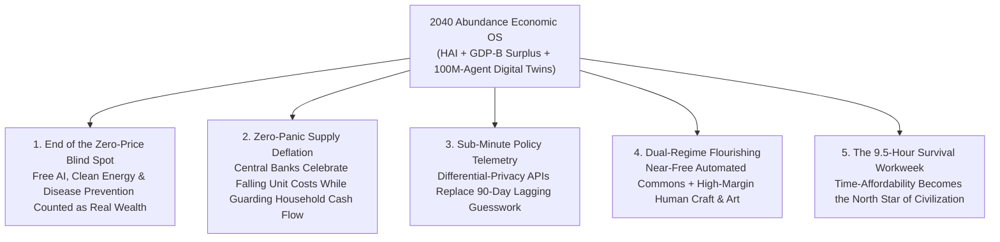

# VISION 01 — SOCIAL ARCHITECTURE: REIMAGINING ECONOMICS FOR AN ABUNDANCE ERA
## Pathway 5E: Upgrading 1930s Scarcity Metrics (GDP), Real-Time Feedback Loops, and Zero-Marginal-Cost Pricing

> **Executive Framing & Philosophical Premise:**
> * **The Paradox of Social Reality:** Economics calls itself the study of how society allocates *scarce* resources—and for ninety years, presidents, central banks, and bond markets have steered civilization using a single number invented by Simon Kuznets in **1934**: **Gross Domestic Product (GDP)**. We treat GDP, quarterly inflation surveys, and scarcity pricing as if they were laws of astrophysics. Yet economic metrics are **100% human-invented accounting rules**—and when our accounting software is blind to abundance, it steers society straight into panic.
> * **The Cynic's Objection:** *"If AI, fusion energy, and robotics make goods and services nearly free, corporate revenues and nominal GDP will shrink, triggering a deflationary debt spiral, central bank policy blunders, and a Great Depression 2.0!"*
> * **The Core Thesis:** A 1934 metric designed to count factory smoke and munitions cannot measure an economy where the most valuable goods—open-source AI, \$0.003/kWh electricity, preventative genomics, and Wikipedia—have a **price approaching zero**. In fact, under GDP accounting, turning a \$1,000 encyclopedia into free Wikipedia or replacing a \$500,000 heart bypass with a \$2 preventative AI scan *makes GDP go down* even as humanity grows massively richer! By upgrading our macroeconomic dashboard to **Deflation-Adjusted Real Household Flourishing Indices (GDP-B / Consumer Surplus Accounting)**, **Real-Time Agent-Based Digital Twins**, and **Dual-Regime Monetary Rails (separating Zero-Marginal-Cost Commons from Positional Scarcity Assets)**, we navigate the transition to abundance without central-bank errors or debt deflation.

---

## ACT I: A BELIEVABLE NEAR-FUTURE VISION
### A Federal Reserve & Municipal Policy Briefing in 2040 — Flying With 21st-Century Instruments

Imagine stepping inside a regional economic briefing room—or opening the public **Civic Pulse App** on your phone in Seattle, Zurich, Singapore, or Austin—on a Wednesday morning in **2040**.

In 2026, central bankers and mayors flew blind: they waited 60 days for noisy telephone surveys of 60,000 households, panicked whenever falling prices threatened "nominal GDP growth," and celebrated traffic jams, cancer surgeries, and hurricane rebuilding because they boosted spending.

In 2040, watch how households, businesses, and policymakers actually measure and steer the economy:

1. **The Three-Dial National & Household Dashboard:**
   Instead of a single crude GDP ticker, every news broadcast and municipal dashboard displays three transparent, real-time dials:
   * **Dial 1 — Real Household Abundance & Time-Affordability Index (HAI):** Measures how many **hours of median human life** are required to secure the complete flourishing basket (housing, organic nutrition, preventative longevity care, mastery education, clean energy, and mobility). From **36 hours/week in 2026**, that figure has fallen to **9.5 hours/week in 2040**—a **$3.8\times$ surge in real human freedom**.
   * **Dial 2 — Gross Consumer Surplus & Demonetized Commons Value ($\text{GDP-B}$):** Explicitly counts the trillions of dollars of real wealth created when AI tutoring, open-source robotics, and fusion power drop in price toward zero—so policymakers cheer *good supply-side deflation* instead of fighting it.
   * **Dial 3 — Median Household Net Worth & Sovereign Dividend Runway:** Tracks the bottom-50% and median household balance sheet in real time, ensuring prosperity is broad-based rather than skewed by billionaire outliers.
2. **Real-Time Supply-Chain & Household Telemetry (No More 90-Day Lagging Guesses):**
   When a localized lithium-membrane bottleneck or regional drought begins to form, an **anonymized, privacy-preserving Agent-Based Digital Twin**—fed by real-time grid meters, freight APIs, and clearinghouse flows—spots the friction in **hours rather than quarters**, routing automated production capacity and targeted micro-liquidity before price spikes ever hit a grocery shelf.
3. **The Dual-Regime Economy (Near-Free Essentials + Thriving Human Luxury Markets):**
   Nobody confuses falling solar, food, and compute prices with a "recession." The monetary system cleanly distinguishes between **Regime 1 (Zero-Marginal-Cost Replicable Commons)**—where prices are *supposed* to fall 15% a year along Wright's Law—and **Regime 2 (Human Craft, Experiential & Positional Goods)**—where untaxed human chefs, artists, therapists, explorers, and architects command vibrant, high-margin market prices.
4. **The Skeptic's Question:**
   To an economist trained in 2026, this triggers an immediate question: *"Hold on—if prices fall by 70% across energy, construction, and manufacturing, what happens to all the existing mortgages, corporate bonds, and national debt denominated in nominal dollars? Why didn't 2030s technological deflation trigger an Irving Fisher 1933 debt-deflation crash?"*

Here is the exact monetary, statistical, and institutional bridge that solved the debt-deflation paradox and upgraded economic science between 2026 and 2038.

---

## ACT II: THE TRANSITION BRIDGE — UPGRADING ECONOMIC SCIENCE (2026–2038)
### Fixing GDP's Blind Spots, Separating Good Deflation from Bad, and Re-Engineering Monetary Policy

```mermaid
flowchart LR
    subgraph Blind2026["1934–2026 Scarcity Economics (Flying Blind)"]
        B1["GDP = Price × Quantity (If Price -> $0, Value Vanishes from GDP!)"]
        B2["Pollution, Disease & Divorce Boost GDP; Free Open-Source AI Shrinks It"]
        B3["Lagging 90-Day Surveys + Blunt Interest Rate Hammers"]
    end

    subgraph Upgrade["2026–2038 Macroeconomic Software Upgrade"]
        U1["Erik Brynjolfsson GDP-B & Time-Affordability Accounting"]
        U2["Dual-Basket Central Banking: Good Supply Deflation vs. Demand Collapse"]
        U3["Privacy-Preserving Real-Time Telemetry & Agent-Based Digital Twins"]
    end

    subgraph Abundance2040["2040 Dual-Regime Abundance Economics"]
        A1["Regime 1: Zero-Marginal-Cost Commons (Energy, Food, AI, Prefab)"]
        A2["Regime 2: High-Margin Human Craft, Art, Care & Discovery"]
        A3["Automatic Productivity-Indexed Debt & Sovereign Dividend Stabilizers"]
    end

    Blind2026 ==> Upgrade ==> Abundance2040
```

### Step 1: Curing the "Zero-Price Paradox" of 1934 GDP
When Simon Kuznets presented the first national income accounts to the US Congress in **1934**, he explicitly warned lawmakers: *"The welfare of a nation can scarcely be inferred from a measurement of national income."* Yet for nearly a century, we ignored his warning.
* **Why $\text{GDP} = \sum (P_i \times Q_i)$ Breaks in an Abundance Era:** Because GDP multiplies **Market Price ($P$)** by **Quantity ($Q$)**, any breakthrough that drives the marginal price $P$ of a vital good toward **\$0** causes that sector's contribution to GDP to **shrink toward zero**—even as physical quantity $Q$ and human well-being skyrocket!
  * *Example:* In 2026, a hospital performing 10,000 invasive late-stage cancer surgeries at \$150,000 each added **\$1.5 billion to GDP**. In 2036, an AI liquid-biopsy and custom mRNA shot that prevents those 10,000 cancers at \$20 each adds only **\$200,000 to GDP**. On a 1934 spreadsheet, society looks \$1.4998 billion "poorer"—when in reality 10,000 human lives and \$1.5 billion in productive wealth were saved!
* **The Statistical Fix ($\text{GDP-B}$ and Time-Prices):** Building on Stanford economist **Erik Brynjolfsson's $\text{GDP-B}$ framework** and **BEA/OECD "Beyond GDP" satellite accounts**, national statistical agencies upgraded the headline dashboard in 2029–2033 to measure **Total Consumer Surplus** (how much citizens would have paid for demonetized digital, energy, and medical goods) alongside **Time-Prices** (minutes of median work required to buy a unit of calorie, lumen, kilowatt-hour, or diagnostic scan).

### Step 2: Real-World Precedents & 2026 Pilot Foundations
Every statistical, monetary, and modeling tool needed for 2040 economics was already running in pilot or official form by 2026:

| Economic Innovation | Real-World Precedent / Pilot | Verified 2026 Empirical Metric | 2030–2040 Abundance Scaling Mechanism |
| :--- | :--- | :--- | :--- |
| **Consumer Surplus & Zero-Price Accounting ($\text{GDP-B}$)** | **Stanford Digital Economy Lab ($\text{GDP-B}$)** & **UK ONS / US BEA Digital Economy Accounts** | Empirical choice experiments proved free digital goods (search, maps, Wikipedia, open AI) add **>\$2.5 trillion/yr in unmeasured US welfare** (~10% of GDP). | Integrated into headline **National Abundance Accounts** covering demonetized AI, open-source robotics, preventative health, and off-peak energy. |
| **Real-Time High-Frequency Economic Telemetry** | **Opportunity Insights (Harvard TrackTheRecovery)** & **JPMorgan Chase Institute / Brazil PIX Data** | Real-time anonymized card, payroll, and PIX telemetry tracked household liquidity by zip code with **24-hour latency** vs. 90-day Census lags. | Upgrades central bank and municipal dashboards to **zero-lag, zero-survey differential-privacy telemetry** across supply chains and households. |
| **Agent-Based Macroeconomic Digital Twins** | **Bank of England / ECB Agent-Based Models (ABMs)** & **Santa Fe Institute Complexity Models** | Outperformed traditional DSGE models in predicting supply-chain cascades and housing shocks by simulating **millions of heterogeneous households**. | Runs continuous **100-million-agent national digital twins** to stress-test tax shifts, energy rollouts, and dividend adjustments before enactment. |
| **Dual-Regime "Good vs. Bad" Deflation Monetary Policy** | **Bank for International Settlements (BIS) Supply-Deflation Studies** & **Swiss National Bank Framework** | BIS research across 140 years proved **supply-driven technological deflation** correlates with *booming* real output, unlike 1930s demand-collapse deflation. | Central banks replace blunt 2% aggregate CPI targets with **Dual-Basket Targeting**: allowing -10%/yr deflation in automated essentials while keeping nominal household income growing steadily. |
| **Household Balance-Sheet & Median Distributional Accounts** | **Federal Reserve Distributional Financial Accounts (DFA)** & **New Zealand Living Standards Framework** | Fed DFA tracks wealth across the **Top 1%, Next 9%, Middle 40%, and Bottom 50%** quarterly rather than hiding inequality behind a single mean average. | Statutory requirement that every fiscal and monetary policy be scored by its impact on **Median & Bottom-Decile Household Runway**. |
| **Zero-Marginal-Cost Public & Cooperative Commons** | **Creative Commons, Linux, GPS & Municipal Fiber Utilities (Chattanooga EPB)** | Chattanooga's municipal 10-gigabit fiber utility generated **\$2.69B in local economic value** and 9,500 jobs by pricing bandwidth as abundant infrastructure. | Establishes formal **Public Utility Commons Accounting** where energy, water, compute, and transit are optimized for maximum downstream societal surplus, not toll extraction. |

### Step 3: Solving the "Debt-Deflation Spiral" (Why Falling Prices Didn't Break Mortgages)
Why did deflation cause a depression in 1932, and how did we prevent that in the 2030s when fusion and robotics slashed physical prices by 70%?
* **The Critical Distinction:** In 1932, prices fell because **nominal incomes and money supply collapsed (-30%)**, so families couldn't pay fixed dollar debts.
* **The 2030s Solution (Rising Nominal Household Cash Flows + Falling Unit Costs):** During the 2028–2040 abundance transition, central banks and sovereign dividend funds maintained **steady 3%–4% growth in nominal household cash inflows** (via untaxed human wages + compounding Sovereign Automation Dividends), while letting the **unit cost of physical goods fall 8%–12% per year** due to productivity surges. Furthermore, new residential mortgages were transitioned to **Equity-Share & Land-Trust Leases** (Pathway 5B & 5D). Because nominal household cash flow never shrank, existing dollar debts were *easier* to service even as every dollar bought three times as much physical abundance!

---

## ACT III: PHASED POLICY & ECONOMIC ROLLOUT ROADMAP (2026–2050)
### Upgrading the Cockpit Instruments While the Plane Is in Flight

| Phase & Timeline | Metric & Institutional Upgrade | Monetary & Debt Stabilization Rule | Real-World Economic & Household Impact |
| :--- | :--- | :--- | :--- |
| **Phase 1: Parallel Dashboard & Real-Time Telemetry (2026–2030)** | BEA, Fed, and OECD launch official **$\text{GDP-B}$ (Consumer Surplus)** and **Household Time-Affordability Index (HAI)** alongside legacy GDP; 90-day paper surveys replaced by differential-privacy API telemetry. | Central banks formally separate **Tech-Supply Deflation Basket** (compute, solar, batteries, AI) from **Core Demand Basket** so rate hikes aren't triggered by misread productivity booms. | Bond markets and policymakers stop panicking when AI and automation drive down healthcare, software, and energy prices. |
| **Phase 2: Agent-Based Digital Twins & Distributional Scoring (2030–2035)** | Congressional Budget Office (CBO) and central banks adopt **100M-Agent Digital Twins**; all legislation scored by **Median Household Net Worth & Time-Price Reduction** rather than crude 10-year nominal GDP. | Introduction of **Sovereign Dividend Liquidity Injection**: instead of QE buying bank bonds that inflate asset bubbles, liquidity is injected directly into citizen capital/dividend accounts when needed. | Zero-recession navigation through the peak automation wave of the early 2030s; bottom-50% household net worth triples. |
| **Phase 3: Dual-Regime Pricing & Equity-Linked Housing Reset (2035–2042)** | **Household Abundance Index (HAI)** replaces GDP as the primary headline metric of national success; legacy fixed-interest housing debt smoothly refinanced into **Shared-Equity & Citizen Capital Collateral**. | Monetary policy anchors **Nominal Per-Capita Household Income + Dividend Growth at +4%/yr** while allowing physical goods prices to fall freely toward marginal energy cost. | Physical cost of living drops **>70%** with zero debt-deflation defaults; human creative and care sectors boom on rising discretionary cash flow. |
| **Phase 4: Post-Scarcity Flourishing Economics (2042–2050)** | Economic science completes its evolution from *allocating physical scarcity* to **optimizing human flourishing, ecological regeneration, and scientific discovery**. | Automated real-time resource, compute, and spatial clearing keeps physical supply chains in continuous equilibrium without boom-bust business cycles. | Median human workweek for material survival sits below **8 hours/week**, freeing civilization for art, family, exploration, and science. |

---

## ACT IV: THE DEEPER HORIZON & SUMMARY FOR THE SKEPTIC
### What We Measure Is What We Build

When civilization upgrades its economic scoreboard from 1934 scarcity accounting to 2040 abundance metrics, five transformative shifts take hold:

1. **Stopping Central Bank & Policy Blunders Before They Happen:**
   * Had central banks and governments kept using 1934 GDP and CPI rules during the 2030s fusion-and-robotics boom, they would have misread collapsing energy and medical costs as a "deflationary recession" or "shrinking hospital sector."
   * Upgrading the dashboard allowed society to celebrate and accelerate cost collapses in life's essentials while keeping nominal household cash flows growing steadily.
2. **The Two-Tier Renaissance (Free Essentials, Priceless Human Experiences):**
   * Once we accept that replicable physical and digital goods *should* trend toward zero marginal cost (**Regime 1**), human ambition and discretionary spending shift toward things that are authentically scarce and deeply human (**Regime 2**): live music, culinary mastery, athletic competition, scientific discovery, mentorship, craftsmanship, and deep community bonds.
3. **Pre-Testing Laws in 100-Million-Agent Flight Simulators:**
   * Just as aerospace engineers never fly a new airliner without thousands of hours in a wind-tunnel digital twin, lawmakers no longer pass tax or monetary reforms based on ideological hunches—every policy is stress-tested across millions of simulated household balance sheets first.
4. **Measuring Time-Freedom as the Ultimate Currency:**
   * Money is merely an intermediary; **healthy human time** is the ultimate scarce resource in the universe. By anchoring national policy to the **Household Time-Affordability Index (HAI)**, every technological breakthrough translates directly into more free hours of human life.

### Summary Comparison: 1934 Scarcity Accounting (GDP) vs. 2040 Abundance Accounting

| Economic Phenomenon | How 1934 Nominal GDP Scores It | How 2040 Abundance Dashboard ($\text{HAI}$ + $\text{GDP-B}$) Scores It | Why the Upgrade Matters |
| :--- | :--- | :--- | :--- |
| **AI Prevents 100,000 Heart Attacks for \$10 vs. \$150k Bypass Surgeries** | **-\$15 Billion "Recession"** in healthcare sector output | **+\$45 Billion Surge** in Consumer Surplus & Healthy Life-Years | Aligns medical incentives with curing/preventing disease, not billing procedures |
| **Fusion & Solar Drop Power Cost from \$0.16/kWh to \$0.003/kWh** | Utility sector revenue appears to "shrink" by 90%+ | **+380% Boost** in Industrial & Household Real Energy Abundance | Prevents bond/market panic when infrastructure becomes super-cheap |
| **Open-Source AI Tutor & Wikipedia Replace \$20k Private Tuition** | **\$0.00** (invisible because price $P = 0$) | Counted at full **Consumer Surplus value ($\text{GDP-B}$)** | Rewards public & open-source digital commons on par with paid monopolies |
| **Data Collection Latency & Granularity** | **60–90 day lag** via noisy phone/mail sample surveys | **<60 second real-time** differential-privacy API telemetry | Stops supply-chain bottlenecks and liquidity crunches in hours, not quarters |
| **Headline Distribution Metric** | Mean GDP per capita (skewed if 1 billionaire earns +\$100B) | **Median & Bottom-Decile Household Runway + Time-Price (9.5 hrs/wk)** | Guarantees economic growth reaches the median kitchen table |

### Addressing the Top 3 Skeptic Objections
* **Objection 1: "Doesn't real-time economic telemetry threaten citizen privacy?"**
  * *Answer:* All 2040 macroeconomic telemetry uses **cryptographic zero-knowledge proofs and mathematical differential privacy** (pioneered by the US Census and Apple/Google in the 2020s): regional supply-chain and liquidity aggregates are computed at sub-minute speed while making it mathematically impossible to inspect any individual household's private transactions.
* **Objection 2: "How do you objectively measure the price of a 'free' good in GDP-B?"**
  * *Answer:* Following **Stanford's $\text{GDP-B}$ methodology** and UK Office for National Statistics standards, statistical agencies run continuous, randomized choice valuations and **Time-Price Equivalence audits**—measuring both the exact hours of human life saved and the verified market replacement cost of demonetized energy, healthcare, and AI services.
* **Objection 3: "If automated goods drop toward zero price, how do businesses make a profit?"**
  * *Answer:* Infrastructure utilities (power, compute, automated prefab) operate as high-volume, predictable-yield regulated commons or sovereign-backed utilities, while private high-margin entrepreneurship thrives in **frontier R&D innovation prizes, bespoke human design, hospitality, live experiences, and creative industries**.

### The Bottom Line for the Skeptic
Economics was never meant to be a religion worshipping a 1934 accounting formula. By deploying **Stanford's $\text{GDP-B}$ consumer surplus math, Harvard's real-time telemetry, BIS supply-deflation rules, and agent-based digital twins**, we gave humanity the cockpit instruments required to land safely in an age of abundance.

