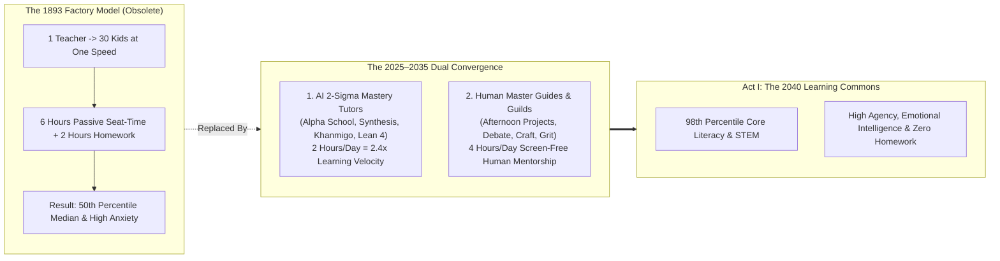
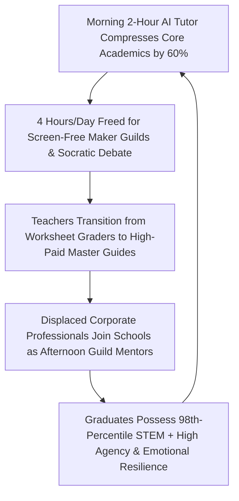

# VISION 01: SOCIAL TRANSFORMATION IN AN ERA OF ABUNDANCE
## Pathway 1B: The Post-Factory Education Renaissance — *2-Hour AI Mastery Mornings, Afternoon Maker Guilds, and the Teacher as Master Guide*

> **Executive Framing & The Core Thesis:**
> * **The Cynic's Objection:** *"AI in education just means kids using chatbots to cheat on essays while staring at iPads all day in isolation—destroying critical thinking, attention spans, and human socialization."*
> * **The Core Thesis:** That nightmare only happens when you bolt 21st-century AI onto an **1893 Prussian factory-bell classroom** designed to produce compliant industrial clerks. Because school schedules, grade levels, and standardized lectures are 100% human-invented social structures, we can redesign them from the ground up. By combining **1-on-1 Socratic AI Mastery Tutors** (which solve Benjamin Bloom's 1984 **2-Sigma Problem**, compressing all core math, literacy, and science mastery into **2 focused hours each morning**) with **4 screen-free afternoon hours of hands-on Maker Guilds, Socratic debates, athletics, wilderness stewardship, and apprenticeships** led by high-status human **Master Guides**, education shifts from anxious memorization to curiosity, agency, emotional intelligence, and philosophical depth.

---

## ACT I: A BELIEVABLE NEAR-FUTURE VISION (THE WORLD OF 2040)
### A Thursday at a Neighborhood Learning Guild in 2040 — How a 12-Year-Old Actually Learns

Step inside the **Oakridge Learning Commons** in a mid-sized city in **2040**. The building doesn't look like a cinderblock prison with fluorescent hallways and rows of bolted-down desks. It looks like a cross between an Oxford college courtyard, a botanical conservatory, and an artisan robotics workshop.

Follow Maya, a 12-year-old whose parents used to worry in the 2020s whether she would ever afford college or survive the AI job market. Here is what her actual school day looks like:

1. **8:30 AM – 10:30 AM: The Two-Hour Mastery Sprint (Zero Lectures, 100% Flow State):**
   Maya sits in a sunlit timber study pod for her only two hours of screen time all day. She isn't listening to a tired teacher lecture 30 kids at the exact same speed. Her personal **Socratic AI Tutor** knows her exact cognitive frontier down to the millisecond.
   * For 45 minutes, she tackles multivariable calculus and physics simulations—guided by an interactive **Lean-verified reasoning engine** that never gives her the answer, but asks probing questions until *she* discovers the proof.
   * Because the AI adapts to her optimal challenge zone ($80\text{–}85\%$ success rate) and requires **90%+ true mastery** before advancing, Maya never accumulates "Swiss-cheese gaps" in math or reading. Like 95% of her peers in 2040, she progresses at **$2.4\times$ the speed of 2026 classrooms**—mastering a full year of core academics in **2 hours a day** and scoring at the **98th percentile** of historical benchmarks.
2. **10:30 AM – 12:00 PM: Socratic Seminar & Moral Philosophy (Zero Screens):**
   At 10:30 AM, every tablet locks into a wooden charging vault. Maya joins 11 classmates and their human **Master Guide**, Mr. Vance (a former biomedical researcher who now earns the equivalent of \$135,000/year coaching adolescents), around an oak table. Today they are debating Thucydides' *Melian Dialogue* alongside the bioethics of epigenetic rejuvenation—practicing eye-contact persuasion, intellectual humility, and steel-manning opposing arguments.
3. **1:00 PM – 4:00 PM: The Afternoon Maker Guilds & Real-World Apprenticeships:**
   The entire afternoon belongs to physical creation, teamwork, and grit. This term, Maya's 6-student team is designing, wiring, and field-testing an autonomous solar-powered water-quality drone for the town's rewilded river basin, mentored by a local retired aerospace engineer. Before graduating at age 17, every student completes **12 real-world guild quests**—from running a profitable neighborhood micro-business and delivering a 20-minute TED-style talk from memory to leading a 5-day wilderness expedition and apprenticing in elder care.
4. **Zero Homework, Restored Evenings:**
   When Maya walks home at 4:00 PM, there is **zero homework**. Because two hours of hyper-targeted 1-on-1 mastery replaced six hours of passive classroom seat-time, her evenings belong to family dinners, cello practice, and nine hours of deep adolescent sleep.

---

## ACT II: THE CONVERGENCE & SOCIAL BRIDGE: HOW IT CAME ABOUT (2026–2038)
### Solving Bloom's 2-Sigma Problem While Rescuing Human Childhood

In 1984, educational psychologist **Benjamin Bloom** published his landmark *2-Sigma Problem*: students given 1-on-1 human mastery tutoring performed **two standard deviations ($2\sigma$) better** than students in conventional 30-person classrooms—moving the average child from the **50th percentile to the 98th percentile**. For four decades, society knew the lecture classroom was broken, yet treated age-batched, 6-hour seat-time classrooms as an unchangeable law of nature because 1-on-1 human tutors for 50 million children seemed unaffordable.

Between 2024 and 2034, two forces converged to break that stalemate: **adaptive AI reasoning tutors** took over cognitive instruction, while the **middle-class labor transition** (`01-unemployment`) supplied millions of talented adults eager to serve as high-empathy human **Master Guides and Guild Mentors**.

### Real-World Precedents & 2025–2026 Breakthroughs Already Proven
The 2-hour mastery + 4-hour life-skills model is not a speculative theory; it was empirically validated in real schools and peer-reviewed trials by 2025–2026:

| Educational Breakthrough | Real-World Pioneer (2024–2026) | Verified Empirical Results | 2028–2038 Universal Scaling Pathway |
| :--- | :--- | :--- | :--- |
| **1. The 2-Hour AI Mastery School Model** | **Alpha School** (Austin, Brownsville, Miami) & **GT School / 2 Hour Learning** | Students complete all core K–12 academics in **2 hrs/morning** via adaptive AI apps with zero lectures; learn **$2.2\times\text{–}2.6\times$ faster** than national average; cohorts score in **top 1–2% nationally on NWEA MAP** (including Title I low-income Brownsville campus). | Adopted by charter networks, microschools, and public school districts nationwide via open-source **2-Hour Mastery Curricula**; eliminates the "seat-time" Carnegie Unit by 2032. |
| **2. Interactive Multi-Agent & Game-Theory Tutors** | **Synthesis Tutor** (born out of SpaceX's **Ad Astra** school) & **Khanmigo (Khan Academy)** | Synthesis DARPA-inspired collaborative games + voice/visual math tutor boosted K–8 mathematical intuition and problem-solving speed by **$2\times+$** across 100,000+ learners. | Multimodal voice-and-canvas tutors become free public infrastructure, running locally on \$50 tablets powered by abundant clean energy. |
| **3. Formal First-Principles Mathematical Proof AI** | **Google DeepMind (AlphaGeometry 2 & AlphaProof)** + **Lean 4 Theorem Prover** | Achieved **IMO Gold-Medal level** mathematical reasoning (2024–2026) by translating natural language into verifiable formal proofs rather than probabilistic text guessing. | Replaces rote formula memorization with **Interactive Proof Games** where 10-year-olds build airtight logical arguments verified in real time. |
| **4. Randomized Controlled Trials in Developing & Public Schools** | **World Bank / Nigeria EdoBEST AI Tutoring RCT (2024)** & **Harvard Active AI Physics Study (2024)** | In just **6 weeks** of after-school AI tutoring in Nigeria, students gained the equivalent of **2 full years of standard schooling** ($+0.31\sigma$); Harvard study showed AI tutors generated **$2\times$ learning gains in less time** than active human lectures. | Closes both the domestic socioeconomic achievement gap and the global North-South literacy divide within a single decade. |
| **5. Teacher-to-"Master Guide" Role Redesign** | **Alpha School "Guides"** & **Acton Academy Studio Model** (300+ global campuses) | Liberating educators from lesson-planning and grading worksheets to focus 100% on **motivation, emotional regulation, and project coaching** increased educator retention and student agency scores to **>92%**. | Public teachers' unions negotiate the **Master Guide Compact**: smaller 12-student advisories, zero grading drudgery, and high-status compensation tied to coaching human flourishing. |
| **6. Dual-System Maker & Industry Apprenticeships** | **Switzerland Vocational *Berufslehre* (70% of youth)** & **FIRST Robotics / Maker Guilds** | Switzerland maintains **<3% youth unemployment** and world-leading precision engineering by pairing classroom mastery with hands-on guild apprenticeships starting at age 15. | Every secondary school converts 50% of its floor space from lecture rooms into **Maker Studios, Bio-Labs, Culinary Kitchens, and Civic Incubators**. |

### Three Structural Shifts That Transformed Childhood

#### 1. Abolishing the "Carnegie Unit" (From Time-Served to Competency-Proven)
In 1906, the Carnegie Foundation defined educational credit by **120 hours of sitting in a chair**—meaning a fast learner was trapped in boredom while a struggling student was pushed forward with an "C-" and permanent comprehension gaps.
* **The Fix:** Between 2027 and 2033, state boards of education and universities replaced seat-time transcripts with **Competency Mastery Graphs**. As soon as a student proves 90% mastery of Algebra II or Molecular Biology in their morning sprint, they unlock the next node—whether they are 10 years old or 16.

#### 2. Defeating Screen Addiction Through the "2-Hour Vault Rule"
Parents in 2026 rightly feared that "ed-tech" meant kids glued to glowing screens for 8 hours a day.
* **The Fix:** Because AI mastery apps are $2.5\times$ more efficient than human lectures, students actually spend **less time on screens** in 2040 than they did in 2026! Once the 2-hour morning cognitive sprint concludes at 10:30 AM, schools enforce a strict **Screen-Free Afternoon Sanctuary**: four hours of eye-to-eye human rhetoric, music, woodworking, athletics, outdoor ecology, and team engineering.

#### 3. Replacing Standardized Cheating with Live Defense & Real-World Artifacts
When generative AI made take-home five-paragraph essays trivial to fake in 2023–2026, schools didn't ban technology—they revived the **Renaissance Masterpiece & Oral Defense (*Viva Voce*)**.
* To graduate from a module in 2040, a student must stand before three human Master Guides and peers without notes, defend their reasoning at a whiteboard under live questioning, and demonstrate a working physical or community project they built with their team. **You cannot fake agency, poise, or a working prototype.**

### Side-by-Side Anatomy of a 12-Year-Old's Day (2026 Factory Model vs. 2040 Learning Commons)

| Dimension | 2026 Conventional School (1893 Prussian Model) | 2040 Neighborhood Learning Commons (2-Sigma + Guilds) |
| :--- | :--- | :--- |
| **8:30 AM – 10:30 AM (Core Academics)** | 2.5 classes of passive 30-student lectures; top third bored, bottom third lost; ~25 minutes of actual active thinking. | **2-Hour 1-on-1 AI Mastery Sprint**: adaptive Socratic & Lean-verified tutors keep every child in their exact $85\%$ flow zone; **$2.4\times$ learning velocity**. |
| **10:30 AM – 12:00 PM (Human Reasoning)** | Standardized multiple-choice worksheets and test-prep drills; screens open in class causing constant distraction. | **Screen-Free Socratic Seminar**: devices locked in vault; 12 students + 1 human **Master Guide** debate ethics, history, literature, and logic face-to-face. |
| **1:00 PM – 4:00 PM (Afternoons)** | 3 more hours of fatigued classroom sitting under fluorescent lights; declining attention and rising behavioral friction. | **Hands-On Maker Guilds & Apprenticeships**: robotics, timber craft, bio-domes, entrepreneurship, wilderness leadership, and public speaking coached by local mentors. |
| **4:00 PM – 9:30 PM (Evenings & Sleep)** | **2–3 hours of homework** + private tutoring pressure; family dinner rushed; teens average **6.5 hours of sleep**. | **Zero homework**; unhurried family dinner, music/athletics, free outdoor play, and **9 full hours of restorative sleep**. |
| **Academic & Human Outcome** | **50th percentile** median mastery; high test anxiety; fragile real-world problem-solving agency. | **98th percentile ($+2\sigma$)** core literacy & STEM mastery; portfolio of 12 real-world guild builds; high emotional resilience. |
| **Educator Experience** | \$62k/yr average pay; **55+ hrs/wk** crushed by grading worksheets, bureaucratic forms, and classroom management. | **\$110k–\$145k/yr Master Guide**; zero worksheet grading; 100% of energy devoted to coaching human character, curiosity, and teamwork. |

---

## ACT III: PHASED ROLLOUT ROADMAP (2026–2050) & SOCIAL FEEDBACK LOOPS

### The 2026–2050 Phased Educational Transformation Table

| Phase & Window | Academic Schedule & Pedagogy | Role of AI & Compute Tools | Role of Human Educators | Credentialing & University Impact |
| :--- | :--- | :--- | :--- | :--- |
| **Phase 1: Hybrid Co-Pilot & Pioneer Microschools (2026–2030)** | **4 hrs lectures + 2 hrs AI tutoring**; rapid proliferation of Alpha/Acton-style 2-hour mastery campuses and public charter pilots. | Adaptive LLM/symbolic tutors (Khanmigo, Synthesis, Alpha apps) automate grading and provide 1-on-1 homework/remedial coaching. | Teachers save **10–12 hrs/wk** on grading and lesson prep; early training in motivational coaching. | AP/SAT exams shift toward live proctored adaptive reasoning; early competency portfolios. |
| **Phase 2: The Death of the Carnegie Unit (2030–2035)** | **2.5 hrs Morning Mastery + 3.5 hrs Afternoon Projects** becomes standard across 50%+ of public and private districts; **zero homework**. | Formal-verification tutors (Lean/AlphaGeometry descendants) + immersive historical/scientific simulation sandboxes. | Transition to **Master Guides** (1:12 ratio); displaced engineers & creatives enter schools as paid **Afternoon Guild Mentors**. | States abolish age-batched seat-time credits; universities accept **Verified Mastery Graphs & Project Defenses**. |
| **Phase 3: The Neighborhood Learning Commons (2035–2042)** | **2 hrs Morning Mastery + 4 hrs Guilds/Apprenticeships** universalized; school buildings retrofitted into studios and workshops. | Personalized cognitive digital twins detect dyslexia, dyscalculia, or boredom within days and adapt pedagogy seamlessly. | Master Guides are among the most respected professionals in society, focusing on ethics, psychology, and team dynamics. | Traditional 4-year lecture colleges transform into **Research & Deep-Apprenticeship Fellowships** starting at age 16–17. |
| **Phase 4: Lifelong Intergenerational Guilds (2042–2050+)** | Education is no longer segregated to ages 5–22; campuses serve ages **5 to 95** in shared maker, arts, and science commons. | Ubiquitous, invisible Socratic co-pilots for any skill on Earth—from quantum mechanics to luthiery. | Every master practitioner in the community mentors the next generation as a natural rhythm of civic life. | Universal human polymathy: every citizen commands rigorous scientific literacy, practical craft, and philosophical depth. |

---

## ACT IV: THE DEEPER HORIZON & SUMMARY FOR THE SKEPTIC

### What Happens When Every Child on Earth Receives an Aristocratic Tutoring Education?
In past centuries, only rare figures like John Stuart Mill, Alexander the Great (tutored by Aristotle), or Blaise Pascal received intensive 1-on-1 Socratic tutoring paired with real-world apprenticeship—and that tiny handful of individuals reshaped human history.
1. **Unleashing the "Lost Einsteins":** By delivering 98th-percentile $2\sigma$ mastery tutoring to every child in rural villages, post-industrial towns, and developing nations alike (powered by off-grid solar/fusion and low-cost tablets), humanity multiplies its pool of world-class scientists, artists, and ethical leaders tenfold.
2. **Healing the Youth Mental Health Epidemic:** The adolescent anxiety surge of the 2010s–2020s was fueled by sleep deprivation, meaningless busywork, social-media isolation, and the absence of real-world competence. Restoring 9 hours of sleep, zero homework, and 4 hours a day of tangible, embodied team accomplishment produces the most grounded, resilient generation in modern history.
3. **Symbiosis with the Employment Transition:** As automation frees millions of mid-career engineers, writers, artisans, and scientists from corporate drudgery (`01-unemployment`), neighborhood Learning Guilds become the ultimate high-purpose arena where adults pass on wisdom, craft, and character to the young.

### Answering the Three Toughest Questions From Educators & Parents
1. **What about neurodivergent learners (dyslexia, ADHD, autism, or giftedness)?**
   * The 1893 lecture classroom was brutal for neurodivergent children because it demanded one uniform sensory environment and one uniform reading/processing cadence. In the 2040 Learning Commons, the morning 2-hour AI tutor automatically adapts typography, audio-visual modality, micro-break cadence, and Socratic questioning style to each child's neurological profile—turning ADHD kinetic energy and autistic deep-focus pattern recognition into superpowers during afternoon Maker Guilds.
2. **How do public school districts fund a 1:12 Master Guide ratio without raising property taxes?**
   * In 2026, U.S. public schools already spent an average of **\$17,000+ per pupil per year**, yet less than 40% of that money reached classroom teacher salaries—the rest was swallowed by administrative bureaucracy, remedial summer school, textbook cartels, and standardized testing overhead. Replacing remedial failure loops and administrative paperwork with near-zero-marginal-cost AI mastery software frees billions inside *existing* school budgets to pay Master Guides \$110,000–\$145,000/year.
3. **What happens to universities when 17-year-olds already possess 98th-percentile STEM and humanities mastery?**
   * Universities stop wasting Freshman and Sophomore years on 500-seat introductory weed-out lectures. Higher education returns to its highest ideal: **hands-on laboratory research fellowships, surgical/engineering apprenticeships, and deep philosophical residential colleges** where young adults co-author discoveries alongside senior scientists.

### Cross-Domain Synergy Across the Vision-01 Architecture
* **Link to `01-unemployment` (The Middle-Class Bridge):** Every neighborhood Learning Commons creates 15 to 25 high-status, 20-hour/week adult careers for former corporate engineers, analysts, and creatives serving as afternoon **Maker Guild Mentors** and **Master Guides**.
* **Link to `01-housing` (Ending Housing Scarcity):** Because every rural town and exurban village has access to the exact same 98th-percentile $2\sigma$ AI tutoring engine as wealthy urban districts, families no longer have to bid \$1.2 million for houses in "exclusive school zones."
* **Link to `01-religion` & `01-longevity`:** Afternoon guilds pair adolescents with biologically vibrant 75-to-85-year-old community elders (`01-longevity`) for woodworking, luthiery, ecological restoration, and coming-of-age moral philosophy (`01-religion`).

### Summary for the Skeptic
> *"We didn't replace human teachers with screens. We used 2 hours of precision AI tutoring each morning to replace 6 hours of soul-crushing factory lectures and homework—and gave the remaining 4 hours of every day back to human Master Guides, hands-on workshops, Socratic debate, and real-world grit."*

