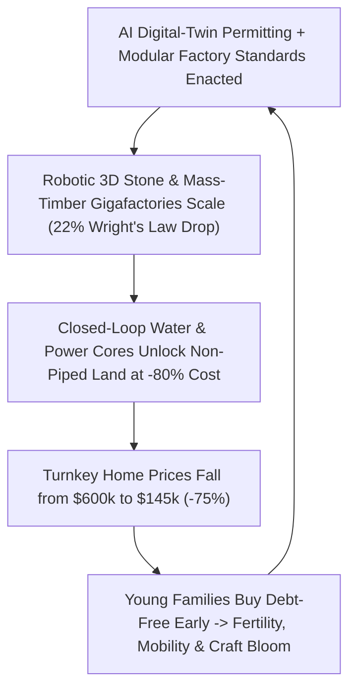

# VISION 01: SOCIAL TRANSFORMATION IN AN ERA OF ABUNDANCE
## Pathway 1C: Ending the Housing Scarcity Trap — *Factory Mass-Timber, Robotic 3D Architecture, 48-Hour AI Permitting, and Autonomous Off-Grid Homesteads*

> **Executive Framing & The Core Thesis:**
> * **The Cynic's Objection:** *"Energy and electronics can get cheaper through Wright's Law, but housing will ALWAYS be unaffordable because 'they aren't making any more land,' municipal permitting takes years, and construction is hopelessly manual."*
> * **The Core Thesis:** The 2020s housing crisis was never caused by a physical shortage of Earth's surface—less than 3% of global land is urbanized. It was caused by two human-made bottlenecks: **building houses by hand outdoors in the weather like it was 1850**, and **tethering every legal home to \$100,000+ of trenched water/sewer/grid pipes and 18-month paper permitting queues**. When we combine **(1) Automotive-Grade Factory Mass-Timber & Modular Manufacturing**, **(2) Robotic 3D-Printed Carbon-Cured Stone**, **(3) 48-Hour AI Digital-Twin Permitting**, and **(4) Autonomous Closed-Loop Utility Systems** (solar/battery + atmospheric water + 95% water recycling + bio-digesters that turn inexpensive non-piped land into luxury homesteads), the total cost of a durable, architectural-grade family home drops by **60% to 75%**—ending the 30-year mortgage debt trap forever.

---

## ACT I: A BELIEVABLE NEAR-FUTURE VISION (THE WORLD OF 2040)
### A Saturday Afternoon in 2040 — How a Young Couple Buys a Custom Home Debt-Free in 28 Days

Imagine visiting Maya and David, a couple in their late twenties living in the foothills outside Austin, Texas—or the Scottish Highlands, British Columbia, or regional Victoria—on a Saturday afternoon in **2040**.

In 2026, a starter home in their region cost \$580,000 at 6.5% interest—demanding a \$115,000 down payment and \$3,800/month for 30 years, forcing young couples to delay marriage and children into their mid-thirties.

In 2040, Maya and David live in a sunlit, 2,200-square-foot architectural courtyard home built from **fireproof carbon-negative stone and precision cross-laminated mass timber (CLT)** with floor-to-ceiling triple-pane acoustic glass. Here is the reality of how it was built and paid for:

1. **Configured Online, Permitted in 14 Minutes, Assembled in 21 Days:**
   Six months ago, Maya and David customized their home layout inside an architectural digital twin. The software automatically verified every structural load, fire egress, and seismic joint against the **National Automated Building Code**, issuing their municipal building permit in **14 minutes for a \$150 filing fee** (down from 14 months and \$65,000 in 2026 soft costs).
2. **Robotic Shell + Precision Factory Modules:**
   On site, two autonomous **mobile 3D-printing gantry robots** extruded the curved, thermally insulated mineral-stone exterior walls in **6 days** using local soil-geopolymer concrete cured with captured atmospheric $\text{CO}_2$. The next week, quiet electric flatbed trucks delivered precision-milled **Cross-Laminated Timber (CLT) roof beams** and plug-and-play kitchen/bath mechanical cores manufactured at tolerances of **0.5 millimeters** on an indoor robotic assembly line. Total on-site assembly took **21 days** with zero dumpster waste.
3. **The Autonomous Utility Unlock (Why Their Scenic 2-Acre Lot Cost \$18,000):**
   In 2026, their 2-acre wooded ridge lot was considered "unbuildable" because running municipal water mains, sewer pipes, and high-voltage power lines two miles up the hill would have cost \$185,000. In 2040, the home is an **Autonomous Closed-Loop Homestead**:
   * **Power:** Architectural solar roof tiles + a garage solid-state battery pack (backed by regional \$0.003/kWh wireless/microgrid fusion power) provide 200 kWh/day of limitless climate control.
   * **Water:** A rooftop **Atmospheric Water Generator** paired with a **95%-recycling NASA-grade membrane purifier** produces 800 gallons of ultra-pure mineralized water per day from ambient humidity and rainwater—using *less* external water than a cactus.
   * **Sanitation:** A compact basement **supercritical thermal bio-digester** sterilizes all organic waste into odorless garden biochar and pure irrigation water—requiring zero municipal sewer pipes.
4. **The Bottom-Line Price Tag (\$145,000 Total):**
   Because factory automation cut hard construction costs by 68%, AI permitting erased soft-cost bloat, and off-grid utility autonomy unlocked abundant \$18,000 land, their brand-new 2,200 sq ft home cost **\$145,000 all-in (\$920/month on a 12-year shared-equity note)**. Housing is no longer a speculative financial casino; it is an abundant, durable consumer good.

---

## ACT II: THE CONVERGENCE & SOCIAL BRIDGE: HOW IT CAME ABOUT (2026–2038)
### Breaking Both the Physical Construction Bottleneck and the Regulatory Land Monopoly

Why did the price of a 65-inch television fall by 92% between 2000 and 2026 while the price of a median house tripled? Because televisions were built inside automated factories under Wright's Law, whereas houses were built by hand in the mud, strangled by 1970s municipal zoning boards, and chained to 19th-century underground pipe monopolies.

### Real-World Precedents & 2025–2026 Pioneers Already Operating at Scale
Every technological and legal pillar of the 2040 housing revolution was already proven in commercial deployments by 2025–2026:

| Housing Innovation Pillar | Real-World Leader / Precedent (2025–2026) | Verified Metric & Performance | 2028–2038 Scaling Pathway |
| :--- | :--- | :--- | :--- |
| **1. Industrialized Factory Prefabrication** | **Sweden National Housing Model (Lindbäcks / BoKlok)** & **Toyota Home (Japan)** | **>80% of Swedish single-family homes** are built on indoor factory lines (vs. <3% in 2025 US), cutting on-site assembly to **3–10 days** and energy bills by **50%**. | North American, European, and Asian regional **Housing Gigafactories** producing 50,000 modular/panelized homes/yr per plant under Wright's Law (20% cost drop per doubling). |
| **2. Precision CNC Panelized Systems** | **Cover (Los Angeles)**, **Volumetric Building Co. (VBC)** & **Boxabl** | Cover's software-driven precision panel system builds custom architectural homes to **sub-millimeter tolerances** with zero structural wood framing and **5x faster** indoor assembly. | Standardized open-architecture connector joints allow any local builder to snap together factory-milled mass-timber, steel, and MEP wall panels in days. |
| **3. Robotic 3D-Printed Communities** | **ICON (Austin, TX — 100-Home *Wolf Ranch* Community with Lennar & BIG)** | World's largest 3D-printed neighborhood completed 2024–2026; *Vulcan* robots printed fire/hurricane-resistant *Lavacrete* walls at **30–40% lower shell cost** and near-zero waste. | Next-gen autonomous crawler printers use local excavated subsoil + geopolymer binders to print thermal stone shells anywhere on Earth in **5–7 days**. |
| **4. Carbon-Negative Mass Timber & Mineral Concrete** | **Stora Enso / Binderholz (CLT)** & **CarbonCure / Holcim / Brimstone** | Cross-Laminated Timber matches steel strength-to-weight while sequestering **~1 ton of $\text{CO}_2$ per $\text{m}^3$**; Brimstone/CarbonCure produce carbon-negative structural stone. | Powered by cheap fusion/solar heat, carbon-cured mineral stone and automated forestry CLT replace energy-intensive Portland cement and manual stick framing. |
| **5. Instant AI Code-Compliance Permitting** | **Symbium**, **Archistar**, **Austin/CA Pre-Approved ADU Pattern Books** & **Tokyo By-Right Zoning** | Symbium's computational law engine reduced municipal residential solar/ADU permitting from **6–12 months to instant (<60 seconds)** across dozens of California cities. | Federal and state **By-Right Digital Twin Codes**: any design passing automated structural/fire physics simulation receives an instant permit by law. |
| **6. Closed-Loop Water & Off-Grid Utility Cores** | **Hydraloop / Epic Cleantec (Water Recycling)**, **Source Hydropanels**, & **HomeBiogas / Cinderella Thermal** | Hydraloop & Epic Cleantec recycle **85–95% of domestic water** on-site; San Francisco mandated on-site water reuse in large buildings, slashing municipal pipe demand by **>75%**. | Integrated **Appliance-in-a-Box Utility Core** (Power + Water Gen + 95% Recycling + Thermal Sanitation) drops into any home for **\$14,000**, eliminating \$120k utility hookup fees. |

### Why Each of the Four Bottlenecks Collapsed Between 2026 and 2036
1. **Moving 85% of Construction Labor Indoors (The Swedish & Automotive Playbook):**
   * In a 2026 stick-built house, 40% of paid contractor hours were lost to weather delays, trade scheduling conflicts (the electrician waiting two weeks for the plumber), and rework of crooked framing.
   * When Cross-Laminated Timber (CLT) wall panels and pre-plumbed kitchen/bathroom wet cores are milled by CNC robots inside climate-controlled gigafactories, labor productivity jumps **$4\times$**, material waste drops from **25% to <2%**, and factory workers enjoy safe, year-round indoor careers.
2. **Robotic Mineral Stone Printing From Local Earth:**
   * Rather than trucking heavy Portland cement across continents, 2030s autonomous crawler printers mix excavated on-site subsoil with carbon-negative geopolymer binders—extruding sculpted, double-wythe insulated stone walls that withstand Category-5 hurricanes and wildfires without a single stick of dimensional framing lumber.
3. **Replacing Discretionary NIMBY Vetoes with Objective Physics Simulation:**
   * By shifting municipal law from subjective design-review hearings to **By-Right Digital Twin Compliance**, any architectural plan that passes automated structural, fire, acoustic, and solar-shadow simulation receives an instant building permit by statutory right—slashing pre-construction soft costs by **95%**.
4. **Severing the Municipal Pipe Umbilical Cord:**
   * Once a home generates its own power, harvests atmospheric water, recycles 95% of greywater, and thermally mineralizes sanitation waste on-site, the artificial land monopoly around city water/sewer mains vanishes overnight.

### How the Cost of a 2,200 Sq Ft Home Drops by 70% (2026 vs. 2040 Cost Breakdown)

To understand why housing becomes radically affordable without sacrificing architectural beauty or square footage, compare the line-item cost of a 2,200 sq ft single-family home in 2026 versus 2040:

| Cost Component (2,200 sq ft Home) | 2026 Stick-Built Status Quo | 2040 Automated & Off-Grid Capable | Engineering & Institutional Driver of Savings |
| :--- | :--- | :--- | :--- |
| **1. Structural Shell, Framing & Enclosure** | **\$185,000** (manual lumber framing, 6 months weather delays, 25% waste) | **\$42,000** (Robotic 3D stone shell + CNC Cross-Laminated Timber roof) | **-77%**: Indoor gigafactory automation + local geopolymer 3D printing + cheap industrial energy. |
| **2. MEP (Plumbing, HVAC, Electrical, Kitchen/Bath)** | **\$125,000** (4 separate manual trade subcontractors cutting holes on-site) | **\$36,000** (Plug-and-play factory wet-core module + solid-state heat pump) | **-71%**: Pre-plumbed, pre-wired bathroom/kitchen cartridges built on robotic assembly lines like EVs. |
| **3. Permitting, Architecture, Impact Fees & Financing Carry** | **\$85,000** (18-month city delay, manual plan check, construction loan interest) | **\$4,000** (14-minute AI digital-twin permit + 21-day build carry) | **-95%**: Computational building codes eliminate 18 months of idle land carry and bureaucratic overhead. |
| **4. Land Parcel & Utility Trenching Hookups** | **\$185,000** (scarcity premium for piped urban lot + \$60k water/sewer/grid fee) | **\$32,000** (\$18k non-piped scenic lot + \$14k Autonomous Utility Core) | **-83%**: Closed-loop water (95% recycling + atmospheric capture) & solar/fusion microgrids unlock 90% of land. |
| **5. Interior Finishes, Acoustic Glass & Landscaping** | **\$60,000** (standard contractor drywall and builder-grade carpet) | **\$31,000** (architectural timber surfaces, triple-pane glass, native garden) | **-48%**: Precision factory wall panels arrive pre-finished with zero drywall taping/sanding labor. |
| **TOTAL TURNKEY HOME PRICE** | **\$640,000** (\$4,100/mo for 30 yrs) | **\$145,000** (\$920/mo for 12 yrs) | **-77% Total Cost Collapse** \| **Zero 30-Year Debt Servitude** |

---

## ACT III: PHASED ROLLOUT ROADMAP (2026–2050) & SOCIAL FEEDBACK LOOPS

### The 2026–2050 Phased Housing Transformation Table

| Phase & Window | Construction & Factory Tech | Permitting & Zoning Law | Utility & Land Independence | Typical Home Price & Timeline |
| :--- | :--- | :--- | :--- | :--- |
| **Phase 1: ADU & Pattern-Book Breakout (2026–2030)** | Regional panelized/modular factories (Cover, VBC, Boxabl) + 1st-gen 3D-printed developments (ICON). | Cities adopt **Symbium-style instant AI permits** for ADUs and pre-approved starter homes; parking minimums repealed. | Early hybrid solar + battery + greywater recycling reduces municipal impact fees by 40%. | **\$320,000–\$380,000**; build time cut from 14 months to **90 days**. |
| **Phase 2: The Gigafactory & Off-Grid Inflection (2030–2035)** | Automated **CLT Mass-Timber & Geopolymer 3D-Printing** plants open near every major metro; plug-and-play MEP cores standardized. | Statewide **By-Right Digital Twin Codes** mandate 48-hour automated permit issuance for compliant simulations. | **Autonomous Utility Cores** (95% water loop + atmospheric water + bio-digester) legalized for primary residences nationwide. | **\$210,000–\$250,000**; on-site assembly cut to **30 days**; rural/exurban land renaissance. |
| **Phase 3: True Architectural Abundance (2035–2042)** | Autonomous site-prep and assembly swarms pair with carbon-negative mineral stone and cheap fusion-smelted alloys/glass. | Global open-source structural safety engine; zero paper building departments. | 100% of new homes are net-positive energy and water producers; municipal pipe trenching obsolete for low-density areas. | **\$130,000–\$160,000** for a 2,200 sq ft custom architectural home built in **14–21 days**. |
| **Phase 4: Living, Adaptable Architecture (2042–2050+)** | Reconfigurable modular courtyard homes that expand or snap-detach rooms as families grow and children leave home. | Dynamic community aesthetic and ecological stewardship charters. | Homes actively sequester $\text{CO}_2$, purify local air, and feed surplus water/power into neighborhood commons. | Housing costs **<12% of household income** globally; involuntary homelessness eradicated. |

---

## ACT IV: THE DEEPER HORIZON & SUMMARY FOR THE SKEPTIC

### What Happens When Shelter Stops Being a Speculative Scarcity Asset?
In the early 21st century, the Anglosphere and parts of Europe/Asia fell into a perverse trap: treating a basic human necessity—shelter—as the primary vehicle for middle-class retirement speculation. That forced existing homeowners to block new construction (NIMBYism) to protect their home equity, which priced their own children out of starting families.
1. **Decoupling Wealth from Housing Scarcity:** Once middle-class families hold compounding wealth in **Citizen Compute & Automation Equity Trusts** (`01-unemployment`), they no longer need their house to double in price at their children's expense. A house returns to being a cherished, affordable place to live, while productive industrial equity funds retirement.
2. **The Renaissance of Small Towns & Scenic Homesteads:** When a family no longer needs to live within 45 minutes of a downtown office tower (`01-unemployment`), needs no municipal water/sewer pipe hookup (`01-housing`), and has 98th-percentile AI/Guild schools in every village (`01-education`), humanity decompresses from hyper-congested megacities into vibrant, walkable small towns, coastal bluffs, and forested valleys.
3. **A Baby Boom of Choice and Optimism:** Surveys in the 2020s consistently showed that the #1 reason young adults had fewer children than they desired was **the cost of family-sized housing**. Dropping the cost of a 4-bedroom courtyard home to \$145,000 removes the material barrier to family formation overnight.

### Engineering & Policy Deep-Dive: Solving the Three Hardest Housing Objections
1. **How can an Autonomous Off-Grid Home supply 800 gallons/day of water in arid climates?**
   * A typical 4-person household in 2026 drew 300 gallons/day from city mains only because it flushed drinking water down toilets and drains once. When a closed-loop **membrane bioreactor + reverse-osmosis + UV-C purifier** (proven by Hydraloop and Epic Cleantec) recycles **95% of shower, laundry, and sink water**, net daily make-up water drops to just **15–20 gallons/day**. Even in 25% desert humidity, a compact 3 kW rooftop atmospheric water condenser easily harvests 25 gallons/day from night air—making the home 100% water-independent anywhere on Earth.
2. **If new homes cost \$145,000, won't existing homeowners who bought at \$550,000 in 2025 go underwater?**
   * This is where `01-housing` locks directly into the **Shared-Equity Mortgage Buffer & Citizen Automation Trust** from `01-unemployment`:
     * Existing homeowners who bought at peak 2020s prices receive automatic **Sovereign Equity Equalization Credits** that write down their legacy mortgage principal in step with regional construction-cost deflation.
     * Homeowners never go underwater in cash terms, and when they trade up or downsize, their new replacement home is 70% cheaper as well.
3. **What about high-density walkable cities? Does factory housing only work on 2-acre country lots?**
   * Not at all. In dense urban cores, **8-to-18-story Cross-Laminated Timber (CLT) and Volumetric Steel-Modular Courtyard Buildings** assemble in 45 days at half the cost of poured-in-place concrete towers—bringing \$160,000 family-sized 3-bedroom urban flats to walkable city neighborhoods with zero construction noise or dust.

### Summary for the Skeptic
> *"We didn't run out of land—less than 3% of the Earth is built on. We ran out of tolerance for building houses by hand in the rain, waiting 18 months for a paper stamp, and paying \$150,000 to dig sewer pipes. When you build precision homes in factories like Sweden, print stone walls with robots like ICON, permit via AI in 48 hours, and recycle 95% of water on-site, a custom family home costs less than a luxury SUV."*

