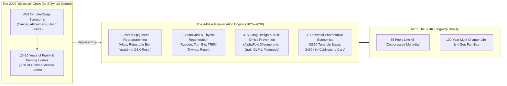
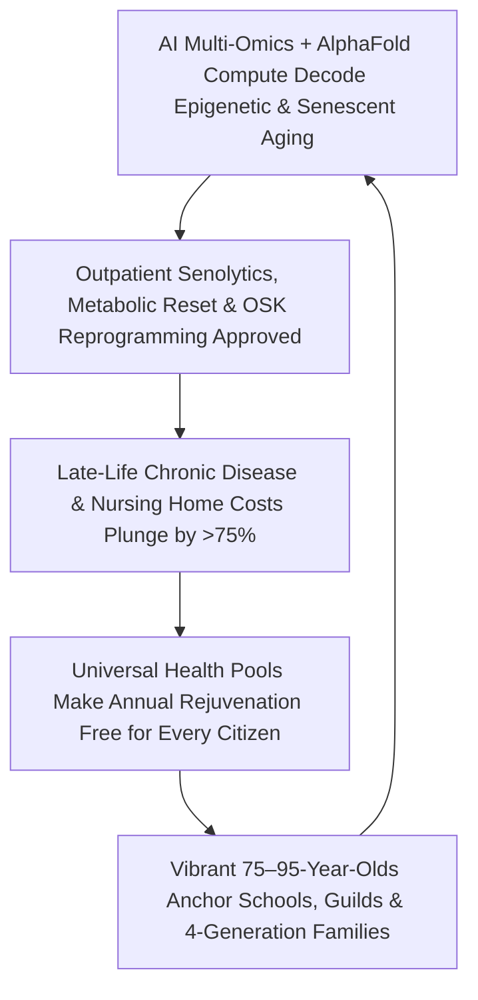

# VISION 01: SOCIAL TRANSFORMATION IN AN ERA OF ABUNDANCE
## Pathway 1F: Compressing Morbidity & Extending Healthy Human Lifespan — *Epigenetic Rejuvenation, AI Preventative Medicine, and When 85 Feels Like 45*

> **Executive Framing & The Core Thesis:**
> * **The Cynic's Objection:** *"Longevity technology will just keep frail 95-year-olds on hospital machines for another decade—bankrupting Medicare and pensions—or else it will be a \$2 million fountain of youth hoarded by billionaires while the rest of us grow old and sick."*
> * **The Core Thesis:** Both fears misunderstand the biology and the economics of aging. First, 21st-century longevity science does **not** stretch out late-life decrepitude ("sickspan"); it targets the upstream cellular root causes of aging—**epigenetic noise, senescent zombie cells, thymic atrophy, and metabolic inflammation**—so that an 85-year-old has the cardiovascular, cognitive, and immune vitality of a 45-year-old (**compression of morbidity**). Second, keeping a citizen biologically 45 costs **90% less** than paying \$300,000/year for nursing homes, dialysis, and late-stage Alzheimer's care—meaning every public health system on Earth makes rejuvenation therapies **universally free at the point of care** to save trillions. Combined with the 20-hour workweek (`01-unemployment`) and neighborhood Learning Guilds (`01-education`), humanity retires Bismarck's 1889 "3-Box Life" (School $\rightarrow$ Burnout $\rightarrow$ Nursing Home) in favor of a vibrant **100-Year Multi-Chapter Life**.

---

## ACT I: A BELIEVABLE NEAR-FUTURE VISION (THE WORLD OF 2040)
### A Saturday Morning in 2040 — Meeting Elena's Mother at Age 84

Imagine meeting Clara on a crisp Saturday morning in **2040** in a coastal town in Northern California—or Japan, Spain, or New Zealand.

Clara was born in 1956. In **2040**, her chronological birth certificate says she is **84 years old**. In the 2020s, an 84-year-old typically took seven daily prescription pills, lived with chronic joint pain or cognitive decline, and worried about moving into an assisted-living facility at \$9,500/month.

Here is Clara's actual morning at age 84 in 2040:

1. **7:30 AM: A 5- Mile Trail Run With Her 16-Year-Old Great-Granddaughter:**
   Clara laces up her trail shoes and runs five miles along the coastal ridge with her teenage great-granddaughter, Maya. Clara's resting heart rate is 52 bpm, her $\text{VO}_2\text{ max}$ is in the top quartile for a 42-year-old, her bone mineral density is 100% intact, and her eyesight and hearing are crystal clear. According to her quarterly multi-omics epigenetic clock, her **biological age is 44.2**.
2. **The Annual \$350 Rejuvenation Tune-Up (Not a Billionaire's Luxury):**
   Clara is not a tech billionaire; she is a retired public librarian. Every 18 months at her neighborhood longevity clinic—covered 100% by the universal preventative health pool because it saves the hospital system \$400,000 in avoided geriatric ICU bills—Clara receives a three-part outpatient protocol:
   * **Targeted Partial Epigenetic Reset:** A transient lipid-nanoparticle mRNA infusion of modified **OSK (Oct4, Sox2, Klf4) factors** that strips accumulated epigenetic methyl noise off her vascular, hepatic, and neural cells without altering cell identity.
   * **Senolytic & Thymic Clearance:** A targeted senolytic pulse clears pro-inflammatory senescent "zombie" cells from her joints and arteries while a thymic regeneration protocol keeps her naive T-cell immunity as sharp as a 30-year-old's.
   * **Liquid Biopsy & AI Digital Twin:** A quarterly blood drop (Grail-descendant cell-free DNA + 10,000-protein panel) and a 12-minute whole-body MRI scan are analyzed by an **AlphaFold-4/5 personal physiology twin**, catching any rogue pre-cancerous cell or arterial plaque **8 years before a symptom could ever form**.
3. **1:00 PM: Clara's "Third Career" as a Botanical & Luthiery Guild Master:**
   Clara didn't spend the last 20 years isolated in an age-segregated "Sun City" golf-cart enclave watching daytime television. After retiring from library administration at 66 and taking a two-year travel sabbatical, she apprenticed in botanical restoration and acoustic violin making. Today, she works **15 joyful hours a week** coaching adolescents at the neighborhood Learning Commons (`01-education`) and stewarding the parish food forest (`01-religion`).
4. **The End of the Nursing Home Terror:**
   Clara's children (Marcus and Elena, now in their 50s) never had to drain their life savings or quit their jobs to manage a 12-year parental decline into dementia. Four healthy generations live within a 15-minute walk, sharing wisdom, childcare, and dinner tables as vigorous equals.

---

## ACT II: THE CONVERGENCE & SOCIAL BRIDGE: HOW IT CAME ABOUT (2026–2038)
### Treating Aging as a Rewritable Information Problem Rather Than Iron Destiny

For centuries, medicine operated on a **"Whack-a-Mole" model**: wait until a 70-year-old develops symptomatic Stage III cancer, heart failure, or Alzheimer's—all driven by the *exact same* underlying biological aging hallmarks—and then spend \$500,000 trying to patch one organ while the next organ fails.

Between 2021 and 2035, four scientific revolutions converged with abundant AI compute to treat biological aging at its root:

### Real-World Precedents & 2025–2026 Clinical Breakthroughs Already Underway
Every biological and diagnostic pillar of the 2040 healthspan revolution was backed by billions in capital and human/primate clinical data by 2025–2026:

| Longevity & Prevention Pillar | Real-World Leader / Clinical Trial (2024–2026) | Verified Scientific & Clinical Milestone | 2028–2038 Universal Scaling Pathway |
| :--- | :--- | :--- | :--- |
| **1. Partial Epigenetic Reprogramming (OSK / Yamanaka Factors)** | **Life Biosciences**, **Altos Labs (\$3B)**, **Retro Biosciences (\$1B+)**, & **NewLimit** | Life Bio's **ER-100 (OSK gene therapy)** restored optic nerve function & vision in non-human primates (entering human trials 2025–2026); Altos/Retro proved transient reprogramming reverses cellular age without teratomas. | Systemic lipid-nanoparticle (LNP) transient mRNA epigenetic resets delivered as a routine outpatient infusion every 18–24 months. |
| **2. Senolytic Clearance & mRNA Cellular Repair** | **Rubedo Life Sciences**, **Turn Biotechnologies (ERA mRNA)**, **Unity**, & **Oisín Bio** | Rubedo & Unity entered human clinical trials clearing senescent cells in skin, lung, and retinal tissues; Turn Bio's mRNA platform restored youthful stem-cell and immune function in aged human cells. | Broad-spectrum senolytic and mitochondrial-repair biologics eliminate chronic "inflammaging," osteoarthritis, and vascular stiffness. |
| **3. Thymic & Immune System Rejuvenation** | **Intervene Immune (TRIIM & TRIIM-X Clinical Trials — Greg Fahy / Horvath)** | First human clinical trial to **reverse epigenetic biological age by ~2.5 years** across 4 GrimAge clocks while regenerating functional thymus tissue and naive T-cell output in adults aged 51–65. | Standard age-55+ immune restoration prevents the late-life collapse of cancer surveillance and infectious-disease immunity. |
| **4. Pleiotropic Metabolic & Neuro-Cardio Protection** | **Next-Gen GLP-1 / GIP / Glucagon Agonists (Novo Nordisk *SELECT*, Lilly)** & **Targeting Aging with Metformin (TAME)** | Landmark trials (2024–2026) proved metabolic hormone modulation cuts **MACE heart attacks/strokes by 20%**, kidney progression by **24%**, all-cause mortality by **19%**, and reduces neuroinflammation/dementia risk. | Once-yearly metabolic-stability implants or oral small molecules eliminate visceral metabolic syndrome and vascular dementia at the root. |
| **5. AI Molecular Design & Digital Twins** | **Google DeepMind Isomorphic Labs (AlphaFold 3)**, **Insilico Medicine**, & **EvolutionaryScale (ESM3)** | AlphaFold 3 predicts interactions of all life's molecules (proteins, DNA, RNA, ligands); Insilico took an AI-discovered fibrosis drug from target to **Phase II human trials in <30 months at 1/10th the cost**. | Powered by cheap fusion compute, AI simulates personalized multi-target rejuvenation biologics with near-zero off-target toxicity. |
| **6. Pre-Symptomatic Liquid Biopsy & Whole-Body AI Imaging** | **Grail *Galleri* (NHS & US Trials)**, **Prenuvo / Ezra AI MRI**, & **SomaLogic 11,000-Protein Assay** | Grail detects **50+ cancer types from a single blood draw** (over 75% lacking prior screening tests); AI MRI detects aneurysms, fatty liver, and 2mm tumors years before symptoms. | Annual **\$100 Multi-Omics + 10-Minute MRI Scan** shifts 90% of cancer, cardiovascular, and neurodegenerative diagnoses to **Stage 0/I** (>98% cure rate). |

### Why Rejuvenation Solves the Fiscal "Aging Bomb" Instead of Causing It

Skeptics in 2026 worried that if people lived longer, Social Security, Medicare, and European/Asian state pensions would collapse. Look at the actual fiscal math when **Biological Age** is decoupled from **Chronological Age**:

| Lifecycle & Fiscal Metric | 2026 Status Quo ("Sickspan" Aging Model) | 2040 Rejuvenated Equilibrium ("Compressed Morbidity" Model) | Net Social & Economic Impact |
| :--- | :--- | :--- | :--- |
| **Biological State at Chronological Age 75–85** | Average **3.4 chronic diseases**; high frailty, cognitive decline, and dependence on family/institutional care. | Biologically equivalent to **age 42–48**; full physical mobility, sharp cognition, and immune resilience. | Eradicates the 12-year window of late-life human suffering and family caregiving burnout. |
| **Cost of Last 15 Years of Life per Citizen** | **\$380,000–\$650,000** (ICU hospitalizations, late-stage oncology, memory-care facilities at \$110k/yr). | **<\$25,000** (preventative \$350/yr mRNA/senolytic tune-ups + rapid, dignified compression of morbidity). | **Saves \$2.5+ Trillion/year** in the US alone—making universal free access fiscally self-funding from Day 1. |
| **Work, Contribution & Pension Ratio (Ages 65–90)** | Forced binary: either work in pain or retire into passive consumption funded by shrinking youth payroll taxes. | **Voluntary 15–20 hr/wk Guild Contribution**: biologically vibrant 70–85-year-olds mentor youth, create, and pay into community trusts. | Turns the "Silver Tsunami" from a dependency liability into the greatest **Wisdom & Mentorship Dividend** in history. |

### How Partial Epigenetic Reprogramming Works Without Losing Cell Identity
For decades, biologists wondered how two fertilized egg cells with the exact same DNA as an 80-year-old parent always produce a biologically zero-year-old baby. The answer is the **Epigenome**: the chemical methyl and acetyl tags that tell each cell which genes to read.
1. **The "Scratched DVD" Discovery:** As we age, double-strand DNA breaks and cellular stress cause chromatin modifiers (like sirtuins) to wander away from their posts, introducing "epigenetic noise"—a heart cell or neuron partially forgets how to read its youthful gene program.
2. **The OSK Safe Window (Dropping *c-Myc*):** Full expression of all four Yamanaka factors (OSKM) for weeks turns a somatic cell all the way back into a pluripotent stem cell (erasing its identity). By removing the oncogenic *c-Myc* factor and pulsing just **OSK (Oct4, Sox2, Klf4)** transiently via lipid-nanoparticle mRNA for 3–5 days, cells wipe away decades of epigenetic methylation noise while **100% retaining their differentiated cell identity**.
3. **Synergy with Senolytics and Thymic Renewal:** Epigenetic resetting rejuvenates intact cells, while targeted senolytics clear damaged non-dividing "zombie" cells, and thymic regeneration restores the naive T-cell repertoire—addressing intracellular, extracellular, and immune aging as a unified system.

---

## ACT III: PHASED ROLLOUT ROADMAP (2026–2050) & SOCIAL FEEDBACK LOOPS

### The 2026–2050 Phased Healthspan & Longevity Transformation Table

| Phase & Window | Preventative Diagnostics | Rejuvenation Therapeutics | Healthcare Economics & Access | Social & Life-Arc Redesign |
| :--- | :--- | :--- | :--- | :--- |
| **Phase 1: Metabolic & Early-Detection Revolution (2026–2030)** | Multi-cancer liquid biopsies (**Grail**) + rapid AI whole-body MRI + continuous wearable biomarker rings scale to millions. | Next-gen **GLP-1/GIP/Glucagon** metabolic shield + 1st-gen localized **senolytics & OSK eye/joint trials** (**Life Bio, Rubedo**). | Insurers & national health systems cover preventative liquid biopsy and metabolic protection as cardiovascular/renal hospitalizations drop 20%. | Adults in their 60s and 70s experience a sharp drop in heart attacks, strokes, and mobility loss; retirement age becomes flexible. |
| **Phase 2: Systemic Immune & Senolytic Reset (2030–2035)** | Quarterly **10,000-protein + epigenetic clock** blood panels paired with personal AI physiology digital twins. | FDA/EMA approval of **Thymic Regeneration**, systemic **Senolytic LNP pulses**, and blood-brain-barrier neuro-proteostasis clears early Alzheimer's plaques. | CMS/NHS enact **"Aging Hallmarks Preventive Reimbursement"**—funding biological-age reversal out of saved nursing-home budgets. | The "3-Box Life" dissolves; 65-year-olds take **2-year Mid-Life Sabbaticals** and train for 20-hour second careers in Human Guilds. |
| **Phase 3: Whole-Body Epigenetic Rejuvenation (2035–2042)** | Real-time intracellular genomic and mitochondrial monitoring; **>95% of cancers intercepted at Stage 0**. | Safe, transient **Systemic Partial Epigenetic Reprogramming (OSK/mRNA)** resets tissue biological age by **15–25 years** in outpatient clinics. | Universal outpatient rejuvenation protocol costs **<\$350/year** (manufactured in automated bio-foundries); geriatric ICU demand falls by **75%**. | **85 is the new 45**: four healthy living generations become the norm; nursing homes repurpose into intergenerational commons. |
| **Phase 4: The 120-Year Flourishing Horizon (2042–2050+)** | Continuous home bio-monitoring; infectious, neoplastic, and degenerative diseases become historical rarities. | Precision organ renewal, telomere/mitochondrial maintenance, and complete extracellular matrix restoration. | Healthcare consumes **<5% of GDP** (down from 18% in 2026) while delivering universal century-long vitality. | Humans plan life across **four 25-year creative chapters**—mastering science, art, parenting, craftsmanship, and philosophical wisdom. |

---

## ACT IV: THE DEEPER HORIZON & SUMMARY FOR THE SKEPTIC

### How Long-Term Thinking Changes When You Will Live to See 2100
Consider a hidden psychological flaw of 20th-century civilization: when a 60-year-old politician, CEO, or voter knew they only had 15 to 20 years of healthy life left, they had a rational temptation to kick climate, debt, and ecological problems down the road.
1. **The Horizon Shift:** When a 60-year-old is biologically 38 and expects to live another 50+ vibrant years alongside their grandchildren and great-grandchildren, **long-term planetary stewardship becomes personal self-interest.**
2. **Compounding Human Wisdom:** In 2026, just when a scientist, surgeon, statesperson, or master artisan finally accumulated 40 years of deep pattern recognition and emotional maturity, their biological brain and body began to fail. Preserving a 40-year-old's biological brain inside an 85-year-old's lived wisdom creates a civilization that is not merely smarter, but **profoundly wiser**.

### Answering the Two Classic Sociological Objections to Longevity
1. **"Won't extending healthy lifespan cause catastrophic overpopulation and resource exhaustion?"**
   * Actually, the demographic crisis of the 2020s–2030s across East Asia, Europe, and the Americas was **population collapse and demographic aging**, not overpopulation! Moreover, in a world powered by \$0.003/kWh fusion (`01-fusion-pathway-v3`), vertical agro-towers using 95% less land, and closed-loop water recycling (`01-housing`), Earth's ecological footprint shrinks by half even as healthy lifespans expand.
2. **"Won't 85-year-olds hog all the top leadership positions and block young people from advancing?"**
   * That only happened in the scarcity era when status and income were locked inside narrow corporate pyramids. Under the **Multi-Chapter Guild & Term-Rotation Compact**, executive and political leadership roles carry statutory **12-to-15-year term limits**, after which senior leaders transition to **Master Guide, Advisory, Research, or Artistic Guild chapters** (`01-education`, `01-unemployment`)—ensuring young adults step into executive leadership in their 30s while drawing on the mentorship of vibrant 80-year-old elders.

### Retiring Bismarck's 1889 "3-Box Life": The 2040 Multi-Chapter Life Arc
When German Chancellor Otto von Bismarck set the state pension age at 65 in 1889, average life expectancy was 47—and humans were squeezed into three rigid boxes: *Learn (5–22), Grind (22–65), Decline (65–80)*. In 2040, a biologically rejuvenated 100-year lifespan unfolds across interleaved creative chapters:

| Life Stage (Chronological Age) | Biological Age in 2040 | Primary Focus & Social Role | Income & Health Architecture |
| :--- | :--- | :--- | :--- |
| **Chapter 1: Foundation & Discovery (Ages 5–20)** | **5–20** | 2-Hour AI Mastery Mornings + 4-Hour Maker Guilds & Wilderness Quests (`01-education`) | Citizen Child Trust compounding from birth; 100% preventative multi-omics baseline. |
| **Chapter 2: First Mastery & Family Building (Ages 20–45)** | **20–32** | 20-hr/wk Deep Engineering, Science, or Enterprise + unhurried parenting in debt-free \$145k home (`01-housing`) | Guild/Enterprise pay + Citizen Automation Dividends; first metabolic/senolytic shield at 38. |
| **Chapter 3: Mid-Life Sabbatical & Second Act (Ages 45–70)** | **32–40** | 2-year *Shmita* Sabbatical (`01-religion`) followed by second career in Civic Architecture, Arts, or Bio-Stewardship | Mature Equity-for-Displacement portfolio (`01-unemployment`) + 18-month OSK/Thymic tune-ups. |
| **Chapter 4: The Elder Renaissance (Ages 70–105+)** | **42–48** | **Master Guide in Schools**, Luthiery/Botanical Guild Mentor, Community Chaplain, and 4-Generation Family Anchor | Zero nursing-home dependency; \$350/yr universal rejuvenation keeps cognitive & physical vitality at peak. |

### Summary for the Skeptic
> *"Longevity isn't about adding ten frail years in a hospital bed, and it isn't a luxury for billionaires. Because preventing Alzheimer's, heart failure, and frailty with a \$350 epigenetic and senolytic tune-up is a thousand times cheaper than paying for nursing homes, universal rejuvenation pays for itself. We aren't stretching out old age—we are giving every human being forty extra years of prime vitality to love, learn, and build."*

