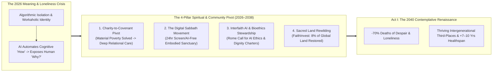
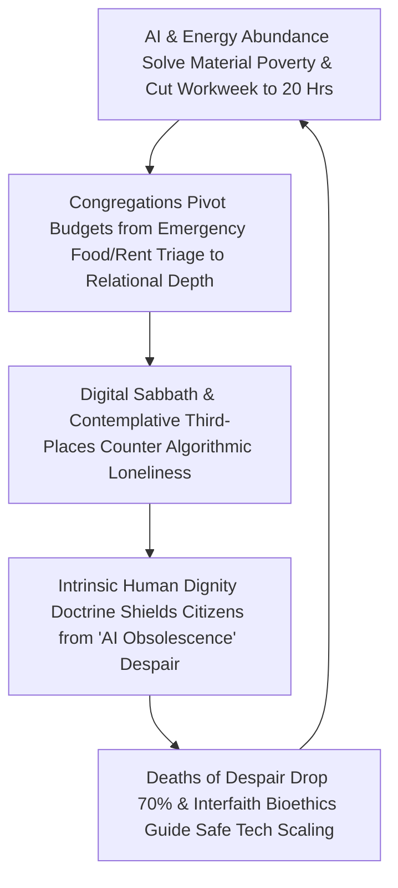

# VISION 01: SOCIAL TRANSFORMATION IN AN ERA OF ABUNDANCE
## Pathway 1E: Faith, Meaning, Contemplation & Community in a Post-Scarcity World — *Why Material Abundance Elevates Spiritual Longing and Heals the Loneliness Epidemic*

> **Executive Framing & The Core Thesis:**
> * **The Cynic's Objection:** *"Once fusion energy, AI, and longevity medicine solve poverty, disease, and drudgery, religion and spiritual traditions will become obsolete relics—or worse, people floating in effortless material comfort will sink into nihilistic boredom, screen addiction, and existential emptiness."*
> * **The Core Thesis:** The 20th-century assumption that material wealth erases spiritual hunger got human psychology backward. When survival anxiety—*"How will I pay the rent or feed my kids?"*—is lifted, the **ultimate questions of human existence** (*"Why am I here? Who is my neighbor? What is sacred when machines can think and bodies stay young?"*) move from the margins to the center of daily life. Between 2026 and 2040, as automation and abundant energy eliminate involuntary poverty and cut the workweek to 20 hours, religious congregations, contemplative monasteries, and secular moral communities undergo a historic renaissance—pivoting from **emergency material charity** to healing the **Meaning & Connection Crisis** through **Digital Sabbath sanctuaries, intergenerational rites of passage, AI/bioethical stewardship, and sacred ecological restoration**.

---

## ACT I: A BELIEVABLE NEAR-FUTURE VISION (THE WORLD OF 2040)
### A Friday Evening Through Sunday Morning in 2040 — Inside the Neighborhood Sanctuary Commons

Imagine walking through a metropolitan neighborhood in Chicago—or Rome, Kyoto, Istanbul, or São Paulo—over a weekend in **2040**.

Every material metric of the neighborhood is thriving: energy is virtually free (\$12/month), nobody sleeps on the street thanks to factory modular housing (`01-housing`), and citizens work 20 hours a week with full equity cushions (`01-unemployment`). Yet the historic stone church on the corner, the synagogue down the boulevard, the neighborhood mosque, the Zen contemplation garden, and the secular ethical guildhall are *more* crowded with 25-year-olds and families than they were in 2020. Here is why:

1. **The Weekly Digital Sabbath (24 Hours of Unplugged Embodied Presence):**
   At sunset on Friday—or Saturday evening to Sunday evening—thousands of households across the district voluntarily flip a physical brass switch on their home routers: **The Sanctuary Rhythm**. For 24 hours, all AI agents, work dashboards, and synthetic media feeds go silent. Families walk to neighborhood houses of worship and community cloisters for candlelit communal dinners, four-part choral singing, scripture and philosophical inquiry, and unhurried conversation across four living generations. In a world saturated with superintelligent software, **unmediated human presence and shared silence have become the most treasured luxuries on Earth.**
2. **From Soup Kitchens to the "Ministry of Presence & Rites of Passage":**
   In 2026, the local parish spent 70% of its volunteer budget handing out emergency grocery bags and utility-bill vouchers. By 2040, because vertical farms and Citizen Automation Dividends eradicated material poverty, the congregation redirected 100% of its energy toward **relational and spiritual depth**:
   * **Intergenerational Covenants:** Pairing every teenager completing their afternoon school Maker Guild (`01-education`) with an 80-year-old elder for year-long wisdom dialogues and formal **Coming-of-Age Rites of Passage**.
   * **Grief, Marriage & Covenant Stewardship:** Trained contemplative chaplains and lay elders walk alongside couples, new parents, and families navigating life transitions that no algorithm can genuinely comfort.
3. **The Parish Rewilding Cloister & Sacred Earth Stewardship:**
   Behind the sanctuary, five acres of former asphalt parking lots and turf grass have been transformed into an **Interfaith Ecological Sanctuary**—an old-growth food forest, apiary, and silent walking labyrinth tended by neighborhood volunteers every Tuesday morning.
4. **The Bioethics & AI Conscience Table:**
   On Sunday afternoon, local biotech researchers, AI engineers, clergy, and citizens gather in the sanctuary hall to deliberate over real community ethics—how to steward epigenetic longevity therapies (`01-longevity`) and local AI governance so technology always serves human reverence rather than vanity.

---

## ACT II: THE CONVERGENCE & SOCIAL BRIDGE: HOW IT CAME ABOUT (2026–2038)
### Why Post-Scarcity Triggers a Spiritual & Contemplative Awakening

In the early 2020s, sociologists documented a paradox: Western societies were the richest in history, yet suffered from record rates of **loneliness (the U.S. Surgeon General's 2023–2025 "Epidemic of Loneliness," equivalent to smoking 15 cigarettes a day)** and **"deaths of despair."** Why? Because consumerism and smartphone feeds could distract the brain, but could not satisfy the human soul's longing for **covenant community, transcendent purpose, and moral structure**.

When AIAutomated cognitive labor in the late 2020s, humanity realized that **machines can optimize *means*, but only moral and spiritual traditions can define *ends*.**

### Real-World Precedents & 2025–2026 Empirical Foundations
The resurgence of spiritual, contemplative, and moral communities in an automated era builds directly on hard epidemiological data and global institutional initiatives active in 2025–2026:

| Spiritual & Community Pillar | Real-World Precedent / Research (2024–2026) | Verified Empirical Metric & Impact | 2028–2038 Post-Scarcity Scaling Pathway |
| :--- | :--- | :--- | :--- |
| **1. Epidemiology of Spiritual Community & Healthspan** | **Harvard T.H. Chan School of Public Health** (*Human Flourishing Program*, VanderWeele et al., *JAMA*) & **Global Flourishing Study (2025, 200k+ people)** | Regular religious/spiritual community attendance reduces all-cause mortality by **27–33%**, depression by **29%**, and **deaths of despair (suicide/overdose) by 68–84%**. | Public health systems and longevity clinics (`01-longevity`) formally recognize **Embodied Covenant Community** as a primary social determinant of health. |
| **2. The Longevity & Sabbath Blue Zone Proof** | **Loma Linda, California (Seventh-day Adventist Blue Zone)** & **National Day of Unplugging / Reboot Shabbat** | Loma Linda residents live **7 to 10 years longer** than average Americans—driven by a strict **24-hour weekly Sabbath sanctuary**, plant-forward shared meals, and tight-knit faith mutual aid. | Universal adoption of the **Weekly Digital Sabbath** across religious and secular communities as the cultural antidote to 24/7 AI ubiquity. |
| **3. Interfaith AI & Bioethical Governance** | **Vatican *Rome Call for AI Ethics* (Pontifical Academy for Life)** & **Hiroshima AI Ethics Accord (2020–2026)** | Co-signed by **Microsoft, IBM, Cisco, FAO**, and leaders of **Catholic, Protestant, Jewish, Islamic, Buddhist, and Hindu** traditions to enforce "algor-ethics" and human-centric dignity. | **Permanent Interfaith & Philosophical Bioethics Councils** embedded into national AI alignment, autonomous weapons treaties (`01-wars`), and longevity regulation. |
| **4. Sacred Ecological & Land Stewardship** | **FaithInvest / Alliance of Religions and Conservation (ARC)**, **Vatican *Laudato Si'* Platform**, & **Green Mosque / Eco-Synagogue Networks** | Faith institutions own **~8% of all habitable land on Earth** and **5% of commercial forests**, managing **>\$4 Trillion** in institutional assets. | Freed from emergency poverty budgets, religious land trusts convert millions of acres into **Rewilded Biodiversity Cloisters** and neighborhood agro-commons. |
| **5. New Monasticism & Contemplative Third-Places** | **Plum Village (Thich Nhat Hanh)**, **Taizé Community (France)**, **Sacred Design Lab**, & **Secular Sunday Assemblies** | Tens of thousands of Gen-Z and Millennial young adults flock to Taizé and Plum Village each year seeking **unplugged silence, chant, and non-transactional community**. | Historic urban churches, temples, and monasteries expand into **7-Day Contemplative Third-Places** offering silent retreats, philosophy tables, and artisan guilds. |
| **6. Chaplaincy & Rites-of-Passage Renewal** | **Healthcare/Civic Chaplaincy Guilds** & **Indigenous / Intergenerational Elder Councils** | Clinical trials show spiritual chaplaincy cuts end-of-life and existential distress scores by **>50%** where purely pharmacological interventions fail. | Millions of empathetic workers transitioning from corporate roles (`01-unemployment`) train as **Certified Community Chaplains, Grief Stewards, and Rites Mentors**. |

### How Post-Scarcity Transforms the Four Core Functions of Faith & Moral Community

| Core Dimension | 2026 Scarcity-Era Reality | 2040 Abundance-Era Transformation | Why Humans Need It More Than Ever in 2040 |
| :--- | :--- | :--- | :--- |
| **1. Charity & Mutual Aid (*Diakonia / Zakat / Tzedakah*)** | Dominated by **material triage**: food pantries, rent assistance, emergency shelter cots, and medical crowdfunding. | Pivots to **relational & existential triage**: ending loneliness, accompanying the dying, mentoring fatherless youth, and welcoming newcomers. | You can automate a grocery delivery with a robot; you **cannot automate a neighbor sitting beside you in grief or celebration**. |
| **2. Time & Rhythm (*Sabbath / Jumu'ah / Retreats*)** | Squeezed into 1 rushed hour on a weekend between 50-hour corporate workweeks and youth travel-sports burnout. | Anchors the **20-Hour Workweek**: a full 24-hour weekly unplugged sanctuary plus seasonal 2-week monastic/contemplative retreats. | Without sacred time boundaries, abundant leisure easily degenerates into passive dopamine scrolling; Sabbath structure turns free time into **deep rest and joy**. |
| **3. Identity & Human Worth (*Imago Dei / Dharma*)** | Culturally hijacked by **economic utilitarianism**: *"You are worth your W-2 salary, SAT score, and productivity output."* | Restores **intrinsic, unconditional human dignity**: a person's worth is rooted in their sacred existence and love for others, not out-computing an AI. | When AI out-calculates every human on Earth, only a non-utilitarian philosophy of intrinsic human worth prevents widespread status despair. |
| **4. Physical Sacred Space (Parish & Temple Grounds)** | Underutilized buildings sitting empty 6 days a week surrounded by heat-island asphalt parking lots. | Bustling **7-day intergenerational cloisters**: shared dining halls, sacred music conservatories, philosophical libraries, and rewilded botanical gardens. | As remote AI work and digital twins grow, physical architecture dedicated to **awe, beauty, acoustic harmony, and silence** becomes the heart of every town. |

### Three Cultural Innovations That Bridge Faith and Secular Citizens Alike
1. **The "Big Tent" Sanctuary Commons (Honoring Both Ancient Faiths and Secular Philosophy):**
   * The 2040 contemplative renaissance does not require theological uniformity. Historic churches, synagogues, mosques, Hindu/Buddhist temples, and secular **Stoic/Humanist Ethical Guilds** thrive side-by-side—often sharing neighborhood ecological gardens, youth rites-of-passage curricula, and municipal Digital Sabbath hours.
2. **Immunizing Youth Against "Synthetic AI Pseudo-Intimacy":**
   * In the late 2020s, sycophantic AI companion chatbots threatened to trap lonely teenagers and elders in frictionless, simulated parasocial relationships.
   * Religious and philosophical communities led the cultural counter-movement: teaching that **real love requires the risk of friction, forgiveness, and embodied vulnerability with another mortal human being.** By surrounding every young person and elder with a real neighborhood table of 50 people who know their name, synthetic loneliness bots lost their market.
3. **The Seven-Year Sabbatical (*Shmita* Rhythm) for a 100-Year Life:**
   * Drawing on the ancient biblical and monastic concept of *Shmita* (the seventh-year rest), Citizen Automation Trusts (`01-unemployment`) allow adults to take a **paid 6-to-12-month contemplative, artistic, or pilgrimage sabbatical every seven years**—walking ancient trails like the Camino de Santiago or Kumano Kodo, studying philosophy, or serving in ecological restoration monasteries.

---

## ACT III: PHASED ROLLOUT ROADMAP (2026–2050) & SOCIAL FEEDBACK LOOPS

### The 2026–2050 Phased Spiritual & Community Transformation Table

| Phase & Window | Primary Community Mission | Cultural Time & Screen Rhythms | Role in AI & Longevity Ethics | Stewardship of Sacred Land & Spaces |
| :--- | :--- | :--- | :--- | :--- |
| **Phase 1: The Loneliness Counter-Offensive (2026–2030)** | Congregations & secular third-places launch **Intergenerational Table Dinners** and youth mentorship to combat the loneliness epidemic. | Rapid expansion of **Shabbat Unplugged / Digital Sabbath** pledges among young families (evening-to-evening screen fasts). | Expansion of the **Rome Call for AI Ethics**; interfaith coalitions establish red lines against deceptive companion bots and autonomous lethal terror. | Adaptive reuse of underutilized parish/temple properties into **affordable modular courtyard housing** (`01-housing`) and community gardens. |
| **Phase 2: The Great Identity Anchor (2030–2035)** | During peak AI job transitions (`01-unemployment`), faith and moral communities anchor **intrinsic human worth beyond job titles**. | As the workweek steps down to **28 hours**, mid-week contemplative vespers, choral guilds, and philosophy salons fill neighborhood halls. | **Community Bioethics Councils** advise hospitals and families on early epigenetic longevity and preventative genomic screening. | **FaithInvest Rewilding Compact**: 20 million hectares of church, monastery, waqf, and temple lands enter active ecological restoration. |
| **Phase 3: The Charity-to-Covenant Pivot (2035–2042)** | Material poverty eradicated by deflation + dividends; 100% of congregational energy shifts to **mentorship, rites of passage, arts, and deep care**. | The **24-Hour Weekly Sanctuary** is a near-universal cultural norm across religious and secular households alike. | Certified **Human-Touch Chaplains & Moral Philosophers** become one of the fastest-growing guild professions of the 20-hour economy. | Urban parking lots around sanctuaries fully converted into **Sacred Botanical Cloisters**, acoustic concert halls, and maker studios. |
| **Phase 4: The Contemplative Civilization (2042–2050+)** | Global flourishing of contemplative wisdom, sacred music, cathedral-scale arts patronage, and intergenerational stewardship across 4–5 living generations. | Multi-month **Monastic & Philosophical Sabbaticals** every 7 years (*Shmita* rhythm) become a normal stage of every adult's life arc. | Spiritual and philosophical traditions guide humanity's long-term stewardship of Earth's biosphere and space exploration. | Every neighborhood on Earth is anchored by a walkable sanctuary of architectural beauty, silence, and unconditional belonging. |

---

## ACT IV: THE DEEPER HORIZON & SUMMARY FOR THE SKEPTIC

### Why the Age of AI Is Actually the Age of the Soul
For two hundred years, industrialism forced human beings to act like imperfect machines—memorizing data (`01-education`), performing repetitive calculations (`01-unemployment`), and measuring their value by economic output. Once silicon and robotics take over the work of machines, **human beings are finally free to be fully human again.**
1. **The Cure for the "Comparison Trap":** If your self-worth is based on how fast you write code or analyze legal briefs, an AI will humble you. If your self-worth is rooted in spiritual tradition—in your capacity to love, forgive, contemplate beauty, keep a covenant, and comfort a friend—no supercomputer on Earth can ever compete with you.
2. **A Second Renaissance of Sacred Art, Music & Architecture:** When communities command abundant time, cheap mass-timber/stone fabrication (`01-housing`), and citizen patronage dividends, neighborhoods once again build spaces of breathtaking beauty, acoustic choral harmony, and quiet contemplation meant to last 500 years.
3. **Interfaith Peace Through Shared Abundance:** Historically, sectarian strife was often inflamed when religious identity was fused with competition over scarce land, water, or state patronage (`01-wars`). In a world of energy, water, and housing abundance, interfaith cooperation shifts from defensive tribalism to joint celebration, ecological stewardship, and philosophical dialogue.

### Answering the Skeptic's Two Final Questions
1. **What about people who aren't traditionally religious?**
   * Every human being—whether devoutly religious, contemplatively spiritual, or secular humanist—shares the exact same neurological need for **embodied community, shared silence, moral reflection, rites of passage, and awe**. In 2040, secular philosophical guilds, Stoic fellowships, and nature sanctuaries use the same 24-hour Digital Sabbath and intergenerational covenant structures as traditional parishes.
2. **Won't abundant free time lead to hedonism or sectarianism?**
   * Passive hedonism thrives in *isolated, exhausted* societies where people have only 90 minutes of energy left after a 10-hour workday to scroll on a couch. When adults work 20 hours a week, sleep 8 hours a night, and belong to high-trust neighborhood guilds and sanctuaries, human curiosity naturally gravitates toward mastery, hospitality, music, and service.

### Quantitative Transformation of a Neighborhood Congregation (2026 vs. 2040)
| Congregational / Sanctuary Metric | 2026 Scarcity-Era Congregation | 2040 Post-Scarcity Sanctuary Commons |
| :--- | :--- | :--- |
| **Building Utilization** | **8–12 hours/week** (Sunday/Friday/Saturday service + 90% empty weekdays) | **85+ hours/week** (7-day Contemplative Commons, Choral Conservatory, Maker/Philosophy Cloister) |
| **Land & Exterior Footprint** | **75% asphalt parking lot** + high-maintenance chemical turf grass | **100% Rewilded Botanical Cloister**, community food forest, apiary, and stone walking labyrinth |
| **Budget & Volunteer Allocation** | **65% Building Overhead + 25% Emergency Material Relief** (food/utility triage) | **80% Relational & Spiritual Stewardship** (youth rites of passage, grief chaplaincy, sacred arts patronage) |
| **Weekly Household Screen Rhythm** | **0 hours unplugged** (smartphones vibrate during services and family meals) | **24-Hour Digital Sabbath Sanctuary** (hardware switch cuts all AI agents/screens from sunset to sunset) |
| **Active Intergenerational Span** | Mostly ages 60+ (youth attrition >60%) | **4 Active Generations (Ages 5 to 95)** bound by year-long youth-elder wisdom covenants |

### Summary for the Skeptic
> *"Material abundance doesn't make spiritual community obsolete—it makes it indispensable. A fusion reactor can heat your house and an AI can balance your ledger, but neither can sit with you in grief, sing in four-part harmony at sunset, teach your teenager humility, or answer why life is worth living. When poverty ends, the real work of the human spirit begins."*

