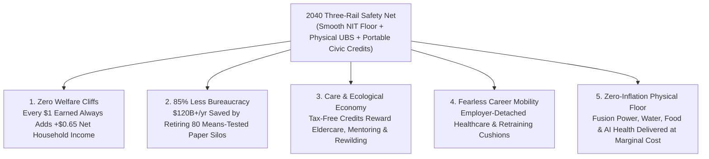

# VISION 01 — SOCIAL ARCHITECTURE: DIGNITY-ENHANCING, NON-BUREAUCRATIC SAFETY NETS
## Pathway 5C: Replacing Punitive Welfare Cliffs with Smooth-Taper Floors, Universal Basic Services, and Portable Civic Rails

> **Executive Framing & Philosophical Premise:**
> * **The Paradox of Social Reality:** Why is it easier for humanity to build autonomous surgical robots and gigawatt fusion reactors than to fix a broken unemployment office? Because we mistakenly treat 1930s welfare bureaucracies as permanent fixtures of civilization—forgetting that **social safety nets are human-written software**. Means-testing forms, benefit cliffs, and six-month waiting lines are not laws of nature; they are bad code that we can refactor.
> * **The Cynic's Objection:** *"If we expand safety nets to cushion workers during the AI and robotics transition, we'll either create a sprawling, corrupt bureaucracy that bankrupts the state, or trap millions of people in permanent, purposeless dependency where nobody bothers to work."*
> * **The Core Thesis:** The 20th-century welfare state failed because it was built on **suspicion, fragmentation, and punitive "welfare cliffs"**—where earning **\$1 more in wages could cost a family \$3 in lost healthcare, food, or childcare benefits** (an effective marginal tax rate exceeding 100%). By replacing 80+ overlapping bureaucratic agencies with **three automated rails**:
>   1. **Smooth-Taper Negative Income Tax (NIT) Floors** (guaranteeing working is *always* strictly more profitable than not working),
>   2. **Demonetized Universal Basic Services (UBS)** (near-free baseline energy, water, local nutrition, and AI learning/health compute), and
>   3. **Portable Career Cushions & Civic/Ecological Contribution Credits**,
>   society eliminates poverty and transition panic while cutting administrative overhead by **>85%**.

---

## ACT I: A BELIEVABLE NEAR-FUTURE VISION
### A Career Pivot in 2040 — Zero Panic, Zero Welfare Offices, 100% Dignity

Imagine living in Detroit, Michigan—or Glasgow, Rotterdam, Pittsburgh, or Kitakyushu—in the autumn of **2040**.

Your neighbor Marcus, a 39-year-old supply-chain coordinator, just learned that his regional freight brokerage is being fully automated by an autonomous routing swarm. In 2026, that news meant a knot in the stomach: losing employer-tied health insurance, standing in line at an unemployment office, filling out 40-page asset-test forms, and fearing foreclosure.

In 2040, watch what happens to Marcus and his family over the next 48 hours:

1. **Zero Benefit Cliffs & Instant API Stabilization:**
   Marcus never visits a government office or fills out a single paper form. Because his **Portable Benefits & Civic Wallet** is tied to him as a citizen rather than to his former employer, his family's healthcare, retirement compounding, and life coverage do not skip a beat. The morning after his contract ends, his **Smooth-Taper Income Floor** automatically adjusts via real-time payroll API—replacing 65% of his transitional income gap within 60 seconds, with **zero stigma and zero caseworker interrogations**.
2. **Every Dollar He Earns Makes Him Better Off (The 35% Smooth Taper):**
   Two weeks later, Marcus starts doing part-time architectural restoration and coaching youth robotics for \$2,200 a month. In the 2020s, taking that part-time work would have disqualified him from unemployment and healthcare—punishing him for working. In 2040, his floor tapers smoothly at just **\$0.35 per \$1.00 earned**. Taking the \$2,200 job immediately increases his net household take-home income by **\$1,430/month**. Work *always* pays.
3. **The Universal Basic Services (UBS) Foundation:**
   Even before cash transfers are counted, Marcus's family cannot fall into destitution because the physical basics of survival have been structurally demonetized by abundant energy and automation:
   * **Household Utility Baseline:** First **800 kWh/month** of fusion/solar power and **15,000 liters** of desalinated water are included free on every residential meter.
   * **Preventative Health & AI Tutor Commons:** 24/7 AI diagnostic medicine, generic automated-synthesis pharmaceuticals, and personalized AI tutoring/re-skilling cost **\$0 at point of care**.
   * **Civic & Ecological Service Credits:** While transitioning, Marcus spends 10 hours a week mentoring at the neighborhood maker-school and helping restore an urban wetland—earning tax-free **Civic Contribution Credits** that top up his household income and social standing.
4. **The Skeptic's Question:**
   To someone in 2026, this sounds suspiciously frictionless. *"Wait,"* the skeptic says, *"in 2026 the US spent over \$1.2 trillion across 80 different means-tested programs and still had poverty, homelessness, and soul-crushing bureaucracy. How did we eliminate the bureaucracy AND the welfare traps without blowing up the budget?"*

Here is the exact institutional, mathematical, and technological refactoring that made it real.

---

## ACT II: THE TRANSITION BRIDGE — REFACTORING THE SAFETY NET (2026–2038)
### From 80 Fragmented Bureaucracies to One Smooth-Taper Algorithmic Floor

### Step 1: Abolishing the "Welfare Cliff" via the Smooth-Taper Equation
In 2026, studies by the Federal Reserve Bank of Atlanta ("CLIFF Dashboard") revealed why millions of low- and middle-income families felt trapped: when a single parent or displaced worker increased their wage from \$28,000 to \$34,000, they simultaneously crossed hard eligibility cutoffs for Medicaid, SNAP, childcare subsidies, and housing vouchers—suffering a **net loss of \$4,000 to \$9,000 in real household resources**.
* **The Mathematical Cure (Milton Friedman meets Martin Luther King Jr.):** One of the few ideas endorsed by both free-market Nobel laureate Milton Friedman and civil-rights leader Dr. Martin Luther King Jr. was the **Negative Income Tax (NIT)**—a unified income floor that phases out along a single, gentle linear slope:
  $$\text{Net Household Income} = Y_{\text{floor}} + (1 - \tau_{\text{taper}}) \times W_{\text{earned}}$$
  Where $Y_{\text{floor}}$ is the guaranteed baseline floor (e.g., **\$18,000/adult** in 2040 purchasing power) and $\tau_{\text{taper}} = 0.35$.
* **Why This Changes Human Behavior:** Under this equation, **there is no cliff anywhere on the curve**. Every single hour a citizen works—whether 5 hours a week at a neighborhood bakery, 20 hours in eldercare, or 40 hours launching a startup—adds **$0.65\text{ of net real wealth per dollar earned}$** right up until they graduate seamlessly out of the transfer zone at **\$51,400** (and remember from Pathway 5A: earned human income carries 0% payroll and income tax below \$250,000!).

### Step 2: Real-World Precedents & 2026 Pilot Foundations
Every component of the 2040 dignity architecture was built upon empirical systems already operating by 2026:

| Safety Net Component | Real-World Precedent / Pilot | Verified 2026 Empirical Metric | 2030–2040 Abundance Scaling Mechanism |
| :--- | :--- | :--- | :--- |
| **Smooth-Taper Income Floor (NIT / EITC)** | **US Earned Income Tax Credit (EITC)** & **Expanded Child Tax Credit (2021 Pilot)** | Expanded CTC cut US child poverty by **46% (to a historic low of 5.2%)** within 6 months via automated monthly direct deposits; EITC lifts **>5.6M people** out of poverty annually. | Upgraded from an annual tax-time lump sum into a **real-time, smooth-taper biweekly floor** covering all adults with a strict 35% max phaseout rate. |
| **Zero-Bureaucracy Digital Eligibility** | **Estonia X-Road Once-Only Principle** & **Denmark Borger.dk** | Citizens **never apply** for child/family/disability allowances; state APIs detect birth or job loss automatically and deposit funds at **<0.4% administrative cost**. | Consolidates 80+ legacy US/OECD means-tested bureaucracies into a single cryptographic API rail, saving **\$120B+/year in administrative overhead**. |
| **Employer-Detached Portable Benefits** | **Washington State / Pennsylvania Portable Benefits Pilots** & **Danish "Flexicurity"** | Denmark combines **flexible, zero-friction hiring/firing** with **80%–90% portable transition pay** and active rapid upskilling—yielding higher employment rates than the US. | Decouples healthcare, disability, and retraining accounts from W-2 employers so workers can switch careers or work across multiple gigs with zero risk. |
| **Universal Basic Services (Physical Dividends)** | **Singapore Public Housing (HDB)**, **Free Municipal Solar/Transit (Tallinn, Luxembourg)** | **>80% of Singaporeans** live in high-quality, asset-building HDB estates; Tallinn & Luxembourg operate **100% fare-free public transit** with higher mobility. | Pairs cash floors with **Physical Abundance Vouchers**: free baseline residential kWh, desalinated water, vertical-farm staple credits, and AI diagnostics. |
| **Civic, Care & Ecological Service Credits** | **Japan "Fureai Kippu" (Caring Relationship Tickets)** & **AmeriCorps / Swiss Time-Banks** | Japan's *Fureai Kippu* network allows citizens to earn time-bank credits caring for local seniors that can be redeemed by their own aging parents across the country. | Expands into **Tax-Free Civic Contribution Credits** (\$20–\$30/hr equivalent) for coaching youth, tending community gardens, elder companionship, and rewilding. |
| **Automated Wage Insurance for Mid-Career Shifts** | **US Trade Adjustment Assistance (RTAA) Wage Insurance** & **German Kurzarbeit** | Wage insurance pays displaced workers **50% of the wage gap** when they accept a new job in a growing field, cutting unemployment duration by **>35%**. | Generalized into **Universal Automation Transition Insurance**: any worker displaced by AI/robotics gets a 3-year wage-bridge while mastering a new craft. |

### Step 3: Why Universal Basic Services (UBS) Prevent Inflation
A common fear of pure cash handouts (like a naive \$3,000/month cash UBI in a scarce economy) is that landlords and healthcare monopolies will simply raise prices to swallow the cash.
* **Supply-Side Abundance + Smart Vouchers:** By pairing the smooth-taper cash floor with **physical supply expansion**—cheap fusion/solar energy (<\$0.003/kWh), automated modular housing, automated vertical-farm produce, and AI primary healthcare—the cost of delivering the **Universal Basic Services bundle** falls by **75% to 90%** over 15 years. You cannot have inflation in goods whose marginal cost of production has collapsed to near zero.

---

## ACT III: PHASED POLICY & ECONOMIC ROLLOUT ROADMAP (2026–2050)
### Retiring the Bureaucracy Without Dropping a Single Vulnerable Family

How do you transition from 80 messy programs to one clean system without anyone falling through the cracks during the switchover? Through an **Opt-In "Hold Harmless" Consolidation Bridge**:

| Phase & Timeline | Institutional Reform Milestone | Bureaucratic & Cost Efficiency | Household & Worker Experience |
| :--- | :--- | :--- | :--- |
| **Phase 1: The "No-Cliff" API Wrapper & Portable Benefits (2026–2030)** | Federal/state **Single-Portal Civic Wallet** launches; statutory cap limits combined benefit phaseout rates to **max 45%** across SNAP/Medicaid/CTC; portable health/retraining accounts detach from W-2 jobs. | Eliminates duplicate identity/income verification across 14 agencies; saves **\$35B/yr** in paperwork and improper-payment audits. | No worker ever loses healthcare or childcare for taking a raise or switching from a corporate job to independent/part-time work. |
| **Phase 2: Automation Wage Insurance & Opt-In NIT Floor (2030–2035)** | **Universal Automation Transition Insurance** activates; citizens can opt into the unified **Smooth-Taper Income Floor (35% taper)** in place of legacy fragmented programs with a 100% "Hold Harmless" guarantee. | **>75% of households** voluntarily switch to the instant, stigma-free NIT rail; legacy welfare office headcount shrinks by 60% via natural retirement. | Mid-career workers displaced by autonomous trucking, coding, or admin AI pivot smoothly into new roles with zero income panic. |
| **Phase 3: Universal Basic Services (UBS) Integration (2035–2042)** | As fusion/solar and vertical agro-towers scale, every residential meter receives the **Abundance Baseline Allotment** (free 800 kWh power, water, AI health/tutoring, and staple food credits). | Physical cost of providing the baseline safety net drops **>70%** due to technological deflation; legacy means-tested silos formally sunset. | Absolute material poverty (hunger, utility shutoffs, untreated illness, homelessness) reaches **0.0%** across participating regions. |
| **Phase 4: The Civic Flourishing Commons (2042–2050)** | **Civic, Care & Ecological Credit networks** operate in every municipality alongside the Smooth-Taper Floor and Universal Capital Dividends. | Total administrative overhead of the entire national safety net sits below **0.4% of disbursements**. | Every citizen enjoys unconditional baseline security *plus* abundant opportunities to earn recognition and income through community care and creation. |

---

## ACT IV: THE DEEPER HORIZON & SUMMARY FOR THE SKEPTIC
### Safety Nets as Trampolines, Not Hammocks

When we replace 1930s bureaucratic suspicion with 2040 digital precision and physical abundance, five civilizational breakthroughs follow:

1. **Valuing the Work Markets Used to Ignore:**
   * In 2026, GDP and the tax code treated raising healthy children, caring for an aging parent with dementia, coaching a neighborhood youth league, or restoring a local creek as worth **\$0.00**.
   * Through **Civic & Care Contribution Credits**, society honors and rewards the deeply human work that holds communities together—giving millions of people proud, purposeful roles that no robot can ever replace.
2. **Psychological Freedom to Innovate and Pivot:**
   * Workers cling to dying industries and fear technological change only when losing a job means losing healthcare, housing, and dignity.
   * When the floor beneath every family is rock-solid, portable, and stigma-free, people embrace lifelong learning and bold career pivots.
3. **Rescuing \$120+ Billion/Year from Bureaucratic Red Tape:**
   * By consolidating 80+ fragmented federal and state means-testing silos onto Estonia-style automated API rails, administrative overhead drops from **12%–18% down to <0.4%**—freeing tens of billions of dollars for frontline mental health and community infrastructure.
4. **Ending the Stigma of Transition:**
   * Because every citizen uses the exact same **Portable Civic Wallet** for capital dividends, baseline utility credits, health access, and career bridges, the humiliating divide between "taxpayers" and "welfare recipients" disappears forever.

### Quantitative Comparison: The 2026 "Welfare Cliff" vs. The 2040 Smooth-Taper Floor

| Earned Human Wage ($W$) | 2026 Legacy Fragmented Benefits (SNAP + Medicaid + Childcare Cliffs) | 2026 Net Household Resources (Notice the Cliff!) | 2040 Smooth-Taper Floor ($Y_{\text{floor}} = \$18\text{k}$, $\tau = 35\%$) + UBS | 2040 Net Household Resources (Work Always Pays!) |
| :--- | :--- | :--- | :--- | :--- |
| **\$0 / yr** (In Transition) | \$16,500 (after 6-week bureaucratic delay) | **\$16,500** | \$18,000 Instant NIT Floor + \$9,000 UBS Bundle | **\$27,000** (Zero poverty) |
| **\$15,000 / yr** (Part-Time) | \$14,200 (partial phaseout begins) | **\$29,200** | \$12,750 NIT Transfer + \$9,000 UBS Bundle | **\$36,750** (+\$9,750 gain) |
| **\$25,000 / yr** (Half-Time) | \$11,800 (approaching Medicaid/Childcare cliff) | **\$36,800** | \$9,250 NIT Transfer + \$9,000 UBS Bundle | **\$43,250** (+\$6,500 gain) |
| **\$32,000 / yr** (Full-Time Entry) | **\$2,100** (**CLIFF HIT: Lost \$9,700 in benefits!**) | **\$34,100** (**-\$2,700 poorer!**) | \$6,800 NIT Transfer + \$9,000 UBS Bundle | **\$47,800** (+\$4,550 gain) |
| **\$52,000 / yr** (Skilled Craft) | \$0 | **\$44,200** (after 15.3% payroll tax) | \$0 NIT + \$9,000 UBS + **0% Payroll/Income Tax** | **\$61,000** (100% wage kept) |

### The Bottom Line for the Skeptic
We did not build a bloated nanny state. We took **Milton Friedman's Negative Income Tax math, Estonia's zero-bureaucracy digital rails, Denmark's portable flexicurity, and Japan's care-credit networks**—deleted 80 layers of red tape—and built a safety net worthy of an abundant century.

