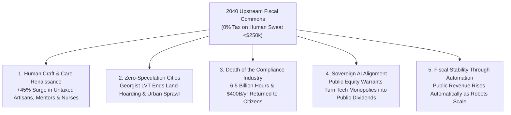

# VISION 01 — SOCIAL ARCHITECTURE: RETHINKING TAXATION FOR AN AUTOMATED WORLD
## Pathway 5A: Taxing Compute, Autonomous Capital, and Common Rents Instead of Human Sweat

> **Executive Framing & Philosophical Premise:**
> * **The Paradox of Social Reality:** Humanity spent fifty years conquering 150-million-degree plasma instabilities and atomic-scale lithography—challenges governed by unforgiving laws of physics. Yet we treat our tax code as if it were carved into tectonic plates, forgetting that **social reality is a human invention**. Laws, tax bases, and fiscal rails are pure institutional software. They should be the *most* malleable part of civilization.
> * **The Cynic's Objection:** *"If AI and robotics replace a massive share of human wage labor, the income and payroll tax base will collapse—either bankrupting public infrastructure or forcing confiscatory tax hikes that trigger capital flight and economic panic."*
> * **The Core Thesis:** The 20th-century tax system was designed for an era when human labor was abundant and capital/energy were scarce. Yet taxing payroll and W-2 wages in an age of robotics acts as a **perverse subsidy to replace humans with machines**. By smoothly pivoting public revenue from **human sweat** to **automated capital throughput, compute-exaFLOPs, industrial energy footprints, and unimproved land/spectrum rents**, society funds world-class infrastructure while making human employment tax-free for the vast majority of citizens.

---

## ACT I: A BELIEVABLE NEAR-FUTURE VISION
### April 15, 2040 — The Day Nobody Filed a Tax Return

Imagine sitting at a kitchen table in Columbus, Ohio—or Tallinn, Austin, Melbourne, or Osaka—on the morning of **April 15, 2040**.

Nothing around your neighborhood looks like an ideological utopia. Private businesses compete fiercely, entrepreneurs still build fortunes, and local shops bustle with activity. Yet four quiet institutional realities have transformed how your family interacts with the state and the economy:

1. **Zero Tax on Human Sweat Up to \$250,000:**
   Your spouse works 28 hours a week as a pediatric physical therapist and master woodworker; you run a neighborhood ecological landscaping cooperative. Neither of you pays a single cent in federal payroll tax (formerly 15.3% FICA) or income tax on the first **\$250,000 of household human-earned income**. Hiring a human neighbor, mentor, artisan, or nurse carries **zero tax penalty**.
2. **The Death of Tax Day Bureaucracy:**
   April 15 is just another Tuesday. Nobody collects crumpled receipts, hires accountants to navigate 70,000 pages of loopholes, or fears an adversarial audit. In the 2020s, Americans wasted **6.5 billion hours and \$400+ billion annually** on tax compliance alone. By 2040, fiscal collection happens upstream and invisibly at the infrastructural layer—settled in real time by autonomous data centers, robotic logistics fleets, and land-title registries.
3. **Your Municipal Transparency Dashboard:**
   Opening your household civic wallet takes ten seconds. A clean visual Sankey diagram shows exactly how your city and nation are funded: **42%** from Automated Compute & Robotic Throughput Levies, **28%** from Unimproved Land & Electromagnetic Spectrum Rents, **18%** from Sovereign Equity Dividends, and **12%** from Industrial Energy & Resource Extraction Severance Fees.
4. **The Skeptic's Question:**
   To an observer in 2026, this sounds almost impossible. *"Sure,"* the skeptic says, *"taxing robots and land sounds neat in a textbook, but how do you define a 'robot'? Won't data centers just move offshore? And how did we transition from an income-tax state where 80% of federal revenue came from human payroll and income without crashing municipal bond markets?"*

Here is the exact legal, mathematical, and technological bridge that made the transition smooth, non-disruptive, and panic-free.

---

## ACT II: THE TRANSITION BRIDGE — UPGRADING OUR FISCAL SOFTWARE (2026–2038)
### Why 1935 Tax Rules Broke—and How Upstream Infrastructure Taxation Replaced Them

```mermaid
flowchart LR
    subgraph Legacy["1935–2026 Legacy Tax Code (Scarcity Era)"]
        L1["82% of Federal Revenue from W-2 Income & 15.3% Payroll Tax"]
        L2["5% Effective Tax on Accelerated CapEx / Robotics"]
        L3["Perverse Incentive: Firing Humans Saves 15.3%+ in Taxes"]
    end

    subgraph Bridge["2026–2036 Smooth Fiscal Pivot (Algorithmic Rebalancing)"]
        B1["Phase Out Payroll & Sub-$250k Earned Income Taxes"]
        B2["Base-Broadened Compute (ExaFLOP-hr) & Kilowatt-Throughput Levy"]
        B3["Georgist Split-Rate Land Value Tax (LVT) & Spectrum Rents"]
        B4["Sovereign Automation Equity Shares (Non-Voting Public Warrants)"]
    end

    subgraph Future["2040 Abundance Fiscal Architecture"]
        F1["0% Tax on Human Labor & Local Service Work"]
        F2["Zero-Friction API Settlement (No Personal Tax Returns)"]
        F3["Stable 22% GDP Public Revenue Locked to Productivity Growth"]
    end

    Legacy ==> Bridge ==> Future
```

### Step 1: Curing the "Automation Tax Asymmetry"
In 2026, economist Daron Acemoglu and MIT researchers documented a glaring distortion in the US and OECD tax codes: human labor faced an effective tax wedge of **25% to 37%** (combining employer/employee payroll taxes and income taxes), whereas capital equipment and software enjoyed accelerated depreciation and R&D credits that pushed the effective tax rate on replacing a worker with a machine down to **~5%**.
* **The Old Trap:** Even when a robot or AI agent was *only marginally* as productive as a human worker, the tax code artificially subsidized firing the human.
* **The Fix (Don't Count "Robots"—Tax Physical & Digital Inputs):** Early critics rightly noted that trying to count individual "robots" on a factory floor is an accounting nightmare. Instead, the 2028–2035 tax reforms targeted the **three inescapable, non-offshorable bottlenecks of automated production**:
  1. **Commercial Compute & Energy Throughput ($\text{ExaFLOP-Hours}$ & $\text{MWh}$):** You cannot run a trillion-parameter AI cluster or a 10,000-unit humanoid logistics warehouse without consuming massive grid power and licensed interconnect bandwidth. A modest, uniform **\$0.0015/kWh industrial automation excise** paired with a **compute-capacity micro-levy on commercial data centers above 10 MW** captures productivity at the meter—with zero paperwork.
  2. **Unimproved Land Value & Spatial Commons (The Georgist Engine):** As AI and cheap energy make manufactured goods dirt-cheap, economic value concentrates in **location, urban land, water rights, orbital slots, and wireless spectrum**. Unlike factories, **land cannot flee to the Cayman Islands**. Following economist Henry George's theorem—proven in Estonia, Taiwan, Singapore, and Pennsylvania—replacing property taxes on buildings with a **Land Value Tax (LVT) on unimproved land value** eliminates real-estate speculation while encouraging dense, affordable housing construction.
  3. **Public Equity Warrants instead of Cash-Strapping Startups:** Rather than crushing high-growth AI and robotics pioneers with heavy upfront cash taxes, nations adopted the **Sovereign Equity Share option**: corporations could pay a tiny **0.5% annual equity issuance** into a non-voting National Citizen Wealth Trust—aligning public revenue directly with compounding corporate automation profits.

### Step 2: Real-World Precedents & 2026 Pilot Foundations
Every pillar of the 2040 tax architecture was already operating at sovereign or municipal scale by 2026:

| Fiscal Mechanism | Real-World Precedent / Pilot | Verified 2026 Empirical Metric | 2030–2040 Abundance Scaling Mechanism |
| :--- | :--- | :--- | :--- |
| **Land Value Tax (LVT)** | **Estonia (National LVT)** & **Harrisburg/Allentown, PA** (Split-Rate Tax) | Estonia taxes **100% unimproved land value** (0.1–2.5%), 0% on buildings; Harrisburg cut vacant structures by **>80%** after 5:1 land-to-building split. | Replaces municipal property/sales taxes nationwide; captures AI-driven urban land appreciation without penalizing home upgrades. |
| **Spatial & Spectrum Lease Rents** | **Singapore State Land & FCC Spectrum Auctions** | Singapore generates **>15% of public capital receipts** from land lease premiums; US FCC auctions raised **\$230B+** without taxing wages. | Expands to autonomous drone corridors, LEO satellite orbital slots, autonomous vehicle right-of-way pricing, and deep-sea mineral leases. |
| **Resource & Energy Rent Tax** | **Norway Hydroelectric & Resource Rent Tax** | Norway levies a **45%–78% resource rent tax** on super-normal hydro and offshore energy profits after full CapEx deduction. | Applied to utility-scale fusion/solar industrial hubs and automated brine-mining refineries, funding sovereign infrastructure. |
| **Automated Digital Tax Rails** | **Estonia X-Road & EMTA Pre-Filled Ledger** | **99% of tax declarations** completed online in **<3 minutes** via automated bank/payroll API integration; administrative cost **<0.4% of revenue**. | Shifts 100% of fiscal collection to B2B energy meters, cloud-compute registries, and title transfers; abolishes personal filing. |
| **Financial & Micro-Flow Settlement** | **Brazil PIX & Swiss Stamp Duty / Micro-Fee** | Brazil's PIX processes **>40 billion instant transactions/year** at near-zero friction; UK 0.5% SDRT collects £4B+ purely via automated clearinghouse scripts. | Enables a **0.02% high-frequency algorithmic clearing fee** on institutional dark-pool and autonomous B2B settlement volumes. |
| **Sovereign Equity Royalty** | **Alaska Permanent Fund & Texas Permanent University Fund** | Texas PUF (**\$36B+**) & Alaska (**\$80B+**) fund top-tier universities and citizen dividends purely from non-tax resource & equity royalties. | Scales to **1%–2% public equity warrants** in foundational AI, robotics, and energy monopolies receiving federal grid/liability backstops. |
| **Zero-Payroll-Tax Human Enterprise Zone** | **Nordic Eco-Tax Shift (Sweden/Denmark Green Tax Swap)** | Shifted **€15B+ in tax burden** from employer labor contributions onto industrial carbon and energy consumption with neutral net budget impact. | Codifies the **"Human Labor Exemption"**: 0% employer/employee payroll tax on all human roles, funded 1:1 by automated compute/energy levies. |

### Step 3: Solving the "Capital Flight" Objection
Why didn't tech giants simply move their servers to low-tax jurisdictions?
* **Destination-Based Digital Access & Grid Tethering:** While code is weightless, **customers, land, latency-sensitive inference, and physical robotics are local**. Under the OECD Pillar One successor framework and **Destination-Based Automated Value-Added adjustments**, any autonomous fleet, AI service, or robotic manufacturer selling into a domestic market or drawing power from the domestic grid settles its micro-levy automatically at the point of market access or grid interconnection.

---

## ACT III: PHASED POLICY & ECONOMIC ROLLOUT ROADMAP (2026–2050)
### The Zero-Panic Formula: Automatic Algorithmic Rebalancing

To prevent economic shock, the transition was never executed as a sudden overnight tax hike. Instead, Congress and OECD parliaments passed the **Automated Revenue Parity Act**, creating a mathematical **Automatic Stabilizer**: for every 1% increase in revenue collected from automated compute, energy throughput, and land rents, the statutory payroll and sub-\$250k human income tax rate automaticallyratcheted down by an equal dollar amount.

| Phase & Timeline | Trigger Milestone | Tax Base Shift (Human Sweat $\rightarrow$ Automation/Commons) | Household & Business Experience |
| :--- | :--- | :--- | :--- |
| **Phase 1: Parity & Payroll Relief (2026–2030)** | Commercial AI agents & humanoid pilots reach 5% task share; accelerate depreciation reform. | **15.3% FICA Payroll Tax cut in half (to 7.65%)** for incomes under \$120k; offset by eliminating the human-replacement tax subsidy and introducing a **0.5% Sovereign AI/Compute Equity Warrant**. | Small businesses see immediate **7.6% drop in hiring costs** for human workers; zero shock to corporate cash flow. |
| **Phase 2: The Municipal LVT & Compute Meter Shift (2030–2035)** | Autonomous trucking, robotic warehouses, and >50 GW AI data centers scale nationwide. | **Payroll tax reaches 0%**; federal income tax exempted up to **\$150,000**. Cities swap building/sales taxes for **Split-Rate Land Value Tax (LVT)** + **\$0.0015/kWh industrial compute/robotics meter fee**. | Take-home pay for median families jumps **14%–18% overnight**; housing construction surges as building improvements are untaxed. |
| **Phase 3: Post-Filing Upstream Settlement (2035–2042)** | Cheap fusion/solar power (<\$0.01/kWh) and general robotics generate >50% of gross physical output. | **Earned income tax eliminated up to \$250,000**. **85%+ of public revenue** collected automatically from compute throughput, land/spectrum leases, and sovereign equity dividends. | **The IRS 1040 form is retired** for 96% of households; April 15 becomes an ordinary spring day. |
| **Phase 4: Steady-State Abundance Commons (2042–2050)** | Fully autonomous supply chains; marginal cost of energy, manufacturing, and intelligence near zero. | Public budgets funded **~95% by common-pool resource rents, spatial leases, and sovereign capital dividends**; human creative, care, and artisanal work is 100% untaxed. | A vibrant human-centered service, art, science, and entrepreneurship economy flourishes with zero fiscal drag. |

---

## ACT IV: THE DEEPER HORIZON & SUMMARY FOR THE SKEPTIC
### What Happens When Human Work Is Untaxed?

When civilization upgrades its fiscal software from taxing human effort to taxing physical throughput and common rents, five profound second-order benefits emerge:

1. **A Renaissance of Human-to-Human Craft, Care, and Mentorship:**
   * In 2026, hiring a human carpenter, music teacher, eldercare companion, or sous-chef meant paying a 30%+ tax wedge on top of their living wage.
   * By 2040, human labor is completely tax-exempt while robotic goods are dirt-cheap.
   * The result is an explosion of high-touch human professions—local theater, bespoke craftsmanship, small-group teaching, culinary arts, and community care—where authentic human presence is the product.
2. **The End of Predatory Real Estate Speculation:**
   * Because Land Value Taxation makes hoarding empty urban lots or vacant luxury apartments financially unprofitable while rewarding productive building, cities become denser, greener, and dramatically more affordable—while surrounding countryside is spared from sprawl.
3. **Eliminating the \$400 Billion Compliance Parasite:**
   * By moving revenue collection upstream to utility meters, hyperscale compute interconnects, and land registries, society liberates hundreds of thousands of brilliant legal and accounting minds to build productive enterprises rather than gaming statutory loopholes.
4. **Automatic Counter-Cyclical Resilience:**
   * Whenever an industry automates a wave of routine jobs, its kilowatt and exaFLOP consumption rises immediately—meaning public revenue *automatically expands* at the exact moment workers need transition bridges.

### Summary Comparison: The Median Household Tax Experience (2026 vs. 2040)

| Household Fiscal Metric | 2026 Legacy Scarcity Tax Code | 2040 Abundance Upstream Tax Code | Net Household & Societal Impact |
| :--- | :--- | :--- | :--- |
| **Combined Payroll Tax (Employer + Employee FICA)** | **15.3%** starting on the very first dollar earned | **0.0%** on all human labor | **+\$11,475/yr** instant boost on a \$75k human wage |
| **Federal & State Income Tax (<\$250k Household)** | **14%–24%** effective rate | **0.0%** (exempt up to \$250,000) | Eliminates tax drag on working and middle-class families |
| **Annual Hours Spent on Tax Filing & Receipts** | **13–25 hours/yr** + \$280 software/CPA fees | **0 minutes** (upstream infrastructure settlement) | **6.5 billion hours/yr** returned to American families |
| **Home Improvement & Building Property Tax** | Taxed indefinitely every year you improve your home | **0% on buildings** (Split-rate Land Value Tax only) | Encourages home upgrades, solar roofs, and dense housing |
| **Primary Public Revenue Engine** | **82%** from human wages & salaries | **90%+** from compute, industrial kWh, land & equity rents | Aligns public budgets with automated productivity growth |

### Addressing the Top 3 Skeptic Objections
* **Objection 1: "Won't taxing industrial compute and energy make domestic AI uncompetitive?"**
  * *Answer:* Because commercial fusion and next-gen solar collapse wholesale electricity from \$80/MWh down to **\$3/MWh (\$0.003/kWh)**, adding a **\$1.50/MWh (\$0.0015/kWh) public fiscal levy** still leaves domestic AI and robotics firms paying **94% less for energy than they did in 2026**—while eliminating the 15.3% payroll tax on their human engineers.
* **Objection 2: "Won't a Land Value Tax hurt retired homeowners or family farms?"**
  * *Answer:* Split-rate LVT includes an automatic **Homestead & Working Farmland Circuit-Breaker** (modeled on Estonia and Pennsylvania), deferring any land-value increase for primary residences of seniors and active regenerative farms while targeting urban land hoarding, vacant speculator lots, and commercial real-estate rents.
* **Objection 3: "Can upstream meters really replace the entire income tax base?"**
  * *Answer:* Yes—because in a high-automation economy, **physical kilowatt-hours, exaFLOP compute clusters, electromagnetic spectrum, and urban land** capture the overwhelming majority of gross value added. Taxing them upstream at a low, uniform rate raises *more* stable revenue than chasing dwindling W-2 payrolls.

### The Bottom Line for the Skeptic
We did not need to abolish markets, punish innovation, or invent untested utopian theories. We simply stopped using a 1935 tax code that penalized human workers, and applied proven mechanisms—**Estonia's Land Value Tax and digital rails, Norway's resource rent model, and sovereign equity warrants**—to the machines, compute clusters, and spatial commons that generate 21st-century wealth.

