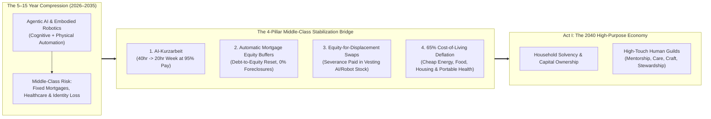
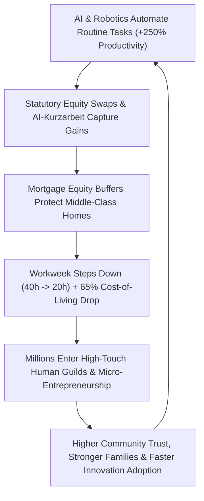

# VISION 01: SOCIAL TRANSFORMATION IN AN ERA OF ABUNDANCE
## Pathway 1A: Technological Unemployment & The Middle-Class Bridge — *Protecting Family Balance Sheets, Dignity, and Purpose During a 10-Year Compression*

> **Executive Framing & The Core Thesis:**
> * **The Cynic's Objection:** *"In the Industrial Revolution, horse-drawn carriage drivers eventually found factory or service jobs—Wait it out! Or conversely: AI and humanoid robots will wipe out 50% of white- and blue-collar jobs in a decade, triggering middle-class mortgage defaults, despair, and social collapse."*
> * **The Core Thesis:** Both lazy optimism and fatalistic doom ignore two fundamental truths. First, **rate of change matters**: previous technological transitions unfolded over 40 to 60 years (two human generations), whereas multimodal AI and embodied robotics are compressing cognitive and physical labor displacement into **5 to 15 years (2026–2040)**—faster than a 30-year fixed mortgage or a mid-career parent's identity can naturally adjust. Second, **social reality is 100% human-made**: mortgages, the 40-hour workweek, and employer-tied healthcare are not laws of physics like plasma turbulence; they are legal inventions we can redesign. By pairing **Automatic Mortgage Equity Buffers**, **AI-Upgraded *Kurzarbeit* (20-Hour Work Sharing)**, **Equity-for-Displacement Swaps**, and **65%+ Cost-of-Living Deflation** (from cheap fusion energy, automated housing, and vertical farms), civilization bridges middle-class families from precarious wage labor to capital ownership and high-purpose human work without panic or foreclosure.

---

## ACT I: A BELIEVABLE NEAR-FUTURE VISION (THE WORLD OF 2040)
### A Wednesday in 2040 — How a Former Corporate Accounting & Logistics Family Actually Lives

Imagine visiting the home of Marcus (44) and Elena (42) and their two teenagers in a tree-lined suburb outside Columbus, Ohio—or Munich, Osaka, or Melbourne—on a Wednesday afternoon in **2040**.

In 2027, Marcus was a senior supply-chain logistics coordinator and Elena was a mid-level corporate financial analyst. Together they earned \$165,000 a year, carried a \$3,400/month mortgage, worked 95 combined hours a week, and lived in quiet terror that enterprise AI agents would erase both of their jobs before their kids finished high school.

By 2040, 85% of the routine spreadsheet reconciliation and freight routing they used to do *has* been automated by autonomous software and robotic warehouses. Yet their house was never foreclosed, their marriage didn't fracture under financial panic, and their standard of living is visibly richer, calmer, and more purposeful than in 2026:

1. **The Re-Engineered Family Balance Sheet (Zero-Default Mortgage & Deflated Living Costs):**
   When Marcus's logistics firm automated its routing division in 2030, his mortgage didn't go into default. Under the **Household Balance-Sheet Stabilization Accord**, 45% of their fixed mortgage principal automatically converted into a zero-interest **Shared-Equity Productivity Lien** backed by the National Automation Dividend Trust, dropping their monthly housing payment from \$3,400 to **\$1,150 overnight**. Meanwhile, because fusion-powered electricity costs **\$12/month**, robotic vertical farms supply organic groceries at **60% lower cost**, and preventative AI diagnostics made employer health insurance obsolete, the baseline cash required for a family of four to live an upper-middle-class life fell from \$11,000/month (2026) to **\$2,900/month (2040)**.
2. **From Severance Checks to Equity-for-Displacement Ownership:**
   When Elena's accounting department transitioned from 60 analysts to 12 AI-orchestrating auditors on a **20-hour workweek**, the company did not hand displaced staff a 6-week severance check. Through **Automation Displacement Insurance & Equity Swaps**, every displaced or hours-reduced employee received vesting equity shares in the enterprise's AI productivity pool plus portable **Citizen Compute & Robotics Units**. Today, passive dividends from those equity swaps deposit **\$2,600/month** directly into Marcus and Elena's household account.
3. **The 20-Hour High-Purpose Human Economy:**
   Neither Marcus nor Elena sits idle on a couch collecting a handout. Elena works **18 hours a week** (Tuesday through Thursday mornings) as a Fiduciary Family & Small-Business Strategist—helping local founders make ethical, human-centered decisions that AI simulates but cannot value-judge. Marcus spends **20 hours a week** as a Master Youth Robotics & Woodworking Mentor at the neighborhood Maker Guild, coaching 35 adolescents through hands-on engineering and character resilience.
4. **Community Stability & Restored Human Time:**
   At 3:30 PM, neighborhood streets that were empty commuter ghost towns in 2026 are alive. Parents coach youth athletics, steward restoration orchards, run artisan bakeries, and care for aging parents without financial terror. **Work did not vanish; compulsory burnout labor was replaced by high-status human contribution.**

---

## ACT II: THE CONVERGENCE & SOCIAL BRIDGE: HOW IT CAME ABOUT (2026–2038)
### Why Social Reality Must Adapt as Fast as Silicon and Steel

Why did humanity spend the early 2020s marveling at 20-Tesla superconducting magnets and trillion-parameter neural networks while acting as if the 1938 Fair Labor Standards Act (the 40-hour week) and the 30-year fixed-rate mortgage were immutable laws of nature?

By 2027–2029, the central insight of the transition crystallized: **Social and financial institutions are human code.** When physical technology accelerates $5\times$ faster than previous industrial revolutions, leaving middle-class families exposed to raw spot-market wage collapse is a design failure, not an economic inevitability.

### Real-World Precedents & 2025–2026 Building Blocks Already Operating
Every mechanism required to protect displaced middle-class families has already been tested in sovereign policy, housing finance, or corporate labor architecture:

| Transition Mechanism | Real-World Precedent / 2025–2026 Pioneer | Verified Metric & Performance | 2028–2038 Scaling Pathway for AI Displacement |
| :--- | :--- | :--- | :--- |
| **1. Short-Time Work Sharing (*AI-Kurzarbeit*)** | **Germany *Kurzarbeit* (BMAS)** & **Iceland / UK 4-Day Week Trials** (Autonomy / Cambridge, 2022–2026) | Germany preserved **3+ million jobs** during industrial crises with **0% mass layoff spikes**; Iceland/UK trials across 61+ firms showed **+1.4% revenue, -65% sick days, -71% burnout** at 100% pay. | Statutory **Productivity Work-Sharing**: as AI boosts output per hour by $2\text{–}3\times$, standard full-time shifts step down from $40 \rightarrow 32 \rightarrow 24 \rightarrow 20\text{ hrs/wk}$ without pay cuts. |
| **2. Automatic Mortgage & Debt Equity Buffers** | **UK Support for Mortgage Interest / Shared-Equity Homes (Unison, Ownify)** & **Denmark Callable Automatic Refi System** | Shared-equity contracts convert 15–40% of home debt into passive appreciation stakes, slashing monthly cash debt service by **30–45%** with zero foreclosure events. | **Automatic Balance-Sheet Breakers**: verified AI job displacement triggers an instant conversion of up to 50% of mortgage principal into a passive Sovereign Equity Lien until re-anchored. |
| **3. Equity-for-Displacement Swaps** | **Employee Ownership Trusts (UK/US EOTs, KKR Ownership Works)** & **OpenAI / Tech Broad-Based RSU Pools** | KKR Ownership Works distributed **\$500M+ in equity** to 100,000+ hourly/salaried workers across 110+ companies, generating \$20k–\$100k+ balance-sheet cushions. | **Mandatory Automation Equity Severance**: firms automating $>10\%$ of headcount must issue displaced workers **vesting equity shares / compute royalty units** equal to 3 years of saved payroll. |
| **4. Portable Benefits & Wage Insurance** | **U.S. Trade Adjustment Assistance (RTAA) Wage Insurance** & **Washington / Pennsylvania Portable Benefits Pilots (2024–2026)** | Wage insurance replaces **50% of the wage gap** for workers transitioning to lower-paid/higher-purpose roles, speeding re-employment by **38%** while protecting retirement savings. | **Universal Portable Career Accounts**: health, pension, and 50% wage-bridge top-ups follow the citizen across corporate, nonprofit, guild, or caregiving roles. |
| **5. Sovereign Automation & Resource Dividends** | **Alaska Permanent Fund (\$80B+ AUM)** & **Norway Government Pension Fund Global (\$1.7T+ AUM, \$300k/citizen)** | Decades of verified non-inflationary dividend payouts (\$1,000–\$3,200/person/yr in AK) funded by capital yields rather than wage taxation. | **National Compute & Robotics Royalty Trusts**: 5–8% equity issuance from commercial AI/robotics and fusion utilities funds universal household stability dividends. |
| **6. High-Touch Human Guilds & Civic Corps** | **Germany Dual *Meister* Guilds**, **AmeriCorps**, & **Buurtzorg (Netherlands Autonomous Care)** | Buurtzorg's 15,000+ autonomous nurses achieved **40% lower healthcare costs** and the highest patient/worker satisfaction in Europe by eliminating bureaucracy. | **Chartered Human-Touch Guilds**: high-status, credentialed careers in youth coaching, elder vitality, ecological restoration, artisan craft, and local governance. |
| **7. Cost-of-Living Deflation Engine** | **Fusion/Solar (<\$0.005/kWh)** + **Factory Housing (ICON/Cover)** + **AI Preventative Medicine** | Energy, shelter, food, and healthcare represent **72% of middle-class household budgets** (BLS 2025). | Collapsing the physical cost of those four essentials by **60–75%** means a 20-hour human-guild income buys more prosperity than two 2026 corporate salaries. |

### How the Three Deepest Middle-Class Fears Were Solved

#### 1. Solving the "90-Day Mortgage Cliff" (Balance-Sheet Protection)
The cruelest feature of 20th-century capitalism was that labor income could drop to zero in an afternoon (a layoff), while fixed financial obligations (mortgages, property taxes, student loans, auto leases) demanded 100% cash payment on the 1st of every month.
* **The Innovation:** Starting in 2028, central banks and housing finance agencies (Fannie Mae, KfW, EIB) introduced **Counter-Cyclical AI Transition Clauses** into all residential mortgages. If a household's W-2 earnings drop by $>25\%$ due to sector-wide automation, the mortgage automatically shifts into **Shared-Equity Standby**: monthly cash payments drop by up to 60%, and the deferred balance is secured as a zero-interest equity share settled only when the home is eventually sold decades later or paid down by the household's Automation Dividend units. Foreclosure cascades become mathematically impossible.

#### 2. Solving the "Loss of Identity & Status" Crisis
Money alone does not cure the psychological trauma of a 45-year-old engineer, paralegal, or radiologist feeling "obsolete." Humans are wired to be needed by their tribe.
* **The Innovation:** Instead of treating displaced workers as welfare recipients in unemployment lines, communities launched **Chartered Human-Purpose Guilds** funded by local municipal automation endowments and enterprise ESG-Transition credits.
* A former project manager becomes a certified **Neighborhood Infrastructure & Resilience Steward**; a former software coder becomes a **Socratic Youth AI/Math Mentor**; a former bank branch manager becomes a **Multigenerational Care & Longevity Coordinator**. These roles carry professional titles, guild apprenticeships, peer respect, and 20-hour flexible schedules that honor family life.

#### 3. Solving the "Wage Compression vs. Cost of Living" Squeeze
As physical goods, energy, food, and construction are automated by robots and powered by near-free energy, the prices of material necessities plummet. Simultaneously, society explicitly revalues **irreducibly human presence**—empathy, eye-to-eye mentorship, hands-on craft, live performance, ethical judgment, and community leadership—as the premium scarce asset of the 21st century.

### Quantitative Anatomy of a Middle-Class Family Transition (2026 $\rightarrow$ 2033 $\rightarrow$ 2040)
To see why this architecture prevents middle-class panic, compare the monthly cash flow and weekly time budget of a representative two-parent, two-child suburban household across the 14-year transition:

| Household Metric (Family of 4) | 2026 Status Quo (Dual W-2 Burnout) | 2033 Mid-Transition (*AI-Kurzarbeit* + Buffers) | 2040 Equilibrium (Ownership + Human Guilds) |
| :--- | :--- | :--- | :--- |
| **Combined Weekly Paid Work Hours** | **90–95 hrs/wk** (2 full-time corporate jobs + commute) | **48 hrs/wk** (Two 24-hr *AI-Kurzarbeit* / transition roles) | **38 hrs/wk** (18 hrs Fiduciary Advisor + 20 hrs Youth Guild Mentor) |
| **Monthly Wage / Guild Income** | \$11,200 (after tax, 100% reliant on W-2 survival) | \$6,800 (work-sharing pay + 50% Wage Insurance bridge) | \$4,800 (high-purpose human guild & advisory stipends) |
| **Monthly Equity & Automation Dividends** | \$0 (minimal 401k locked until age 59.5) | \$1,150 (vesting Equity-for-Displacement shares) | \$2,600 (mature Corporate AI Equity Swaps + Citizen Compute Trust) |
| **Monthly Mortgage / Housing Outflow** | **\$3,400/mo** (rigid 30-yr fixed; 90-day foreclosure risk) | **\$1,650/mo** (Shared-Equity Buffer automatically activated) | **\$1,150/mo** (permanent equity-buffered lien; 0% default risk) |
| **Energy, Food, Transport & Utilities** | **\$2,650/mo** (grid power, gas, global supply-chain groceries) | **\$1,400/mo** (solar/battery microgrid, autonomous EV fleet, local food) | **\$650/mo** (\$12/mo fusion utility fee + local vertical-farm food) |
| **Healthcare, Childcare & Education** | **\$2,950/mo** (employer insurance premiums, deductibles, tutoring) | **\$900/mo** (portable universal health pool + AI mastery schools) | **\$300/mo** (preventative AI diagnostics + community guild co-ops) |
| **Net Monthly Discretionary Surplus** | **\$2,200/mo** (fragile; wiped out by a single layoff) | **\$4,000/mo** (resilient; buffered against automation shocks) | **\$5,300/mo** (+52 extra hours/week of unhurried family & civic life) |

### Why "Social Malleability" Is the Ultimate Unlock
Consider the paradox of the 2020s: humanity readily accepted that engineers could rewrite software models every 90 days and confine plasma at 150 million degrees Celsius, yet treated 1930s mortgage amortization tables and 40-hour payroll codes as if they were carved into stone tablets at the dawn of time.
* **The Institutional Reframing:** Once lawmakers, central bankers, and labor unions recognized that **financial contracts are simply coordination software**, adapting them became straightforward:
  * **From Fixed-Nominal Debt to State-Contingent Equity:** No family should ever lose the roof over their children's heads because an algorithm learned to read medical scans or route freight trucks faster than a human.
  * **From Taxing Human Sweat to Sharing Machine Yield:** In 2026, over 75% of government tax revenue came from payroll and income taxes on human labor—which actively penalized companies for employing humans while taxing robots lightly. Shifting fiscal revenue and employee compensation onto **compute, energy, and automated capital equity** aligned corporate automation directly with middle-class household wealth.

---

## ACT III: PHASED ROLLOUT ROADMAP (2026–2050) & SOCIAL FEEDBACK LOOPS

### The 2026–2050 Phased Transition Table

| Phase & Window | Labour & Workweek Standard | Household Balance-Sheet Protection | Capital & Income Architecture | Dominant Human Work & Culture |
| :--- | :--- | :--- | :--- | :--- |
| **Phase 1: The Cushion & Early Pilot (2026–2030)** | **35–38 hrs/wk**; early enterprise AI adoption; voluntary 4-day week tax credits. | Pilot **Mortgage Transition Buffers** (12-month auto-deferral + rate caps for AI-displaced staff); portable ACA/universal health pools. | **Wage Insurance (50% gap cover)** + first corporate **Equity-for-Displacement** severance mandates. | Hybrid human-AI corporate roles; surge in small-business formation using AI co-pilots. |
| **Phase 2: The Great Compression Bridge (2030–2035)** | **28–32 hrs/wk (*AI-Kurzarbeit*)** across white-collar, logistics, and manufacturing sectors. | Nationwide **Shared-Equity Mortgage Resets** eliminate foreclosure spikes; automated student-loan-to-civic-service swaps. | **Sovereign Compute & Robotics Trusts** begin paying \$3,500–\$6,000/yr per adult; vesting enterprise automation stock. | Rapid growth of **Chartered Human Guilds** (education mentors, elder vitality coaches, ecological restoration). |
| **Phase 3: The Deflationary Equilibrium (2035–2042)** | **18–24 hrs/wk** standard full-time human commitment; complete scheduling autonomy. | Cost of energy, food, and modular housing drops **50–65%**, cutting baseline household cash burn by more than half. | Dual-engine household income: **45% Capital/Automation Dividends + 55% High-Touch Guild/Entrepreneurial Pay**. | Flourishing local main streets, artisan guilds, civic science, parenting presence, and neighborhood third-places. |
| **Phase 4: Post-Scarcity Human Flourishing (2042–2050+)** | **Flexible / Self-Directed** contribution rhythms; multi-sabbatical life arcs. | Universal housing and basic utility security; zero involuntary debt distress. | Universal citizen equity portfolios + patronage/guild marketplaces for human excellence. | Deep scientific exploration, arts, philosophical inquiry, ecological stewardship, and intergenerational care. |

---

## ACT IV: THE DEEPER HORIZON & SUMMARY FOR THE SKEPTIC

### What Happens When Survival Fear Leaves the Human Nervous System?
For 10,000 years of agricultural and industrial civilization, the vast majority of human beings spent their waking hours in low-grade cortisol stress—trading their limited years of health for basic shelter, calories, and healthcare. When we decouple **material survival** from **routine drudgery** while deliberately preserving **human agency, ownership, and social contribution**, three civilizational dividends emerge:
1. **The Renaissance of Parenting & Childhood:** For the first time since the pre-industrial village, mothers and fathers have 20+ unhurried hours a week to raise, teach, and play with their children and aging parents—slashing adolescent anxiety and loneliness at the root.
2. **A Golden Age of Local Craft & Main-Street Entrepreneurship:** When commercial rent, energy, and health insurance no longer crush small founders, millions of former spreadsheet workers open neighborhood culinary kitchens, ceramics studios, timber workshops, community theaters, and botanical cafés—because humans *prefer* buying soulful experiences from neighbors over sterile vending machines.
3. **Zero Luddite Backlash:** Because every family's mortgage is buffered and every worker holds equity in the robotic fleet, citizens welcome new AI and automation breakthroughs as a direct raise in their own leisure and dividend wealth rather than an existential threat.

### Institutional Guardrails: Answering the Three Hardest Edge-Case Questions
To ensure the transition works in messy real-world politics rather than just on paper, three institutional guardrails are built into the framework:
1. **What about small businesses that cannot afford 20-hour *AI-Kurzarbeit* on their own?**
   * Small and medium enterprises (SMEs) with fewer than 250 employees receive automatic **Compute & Automation Transition Rebates** funded by the Sovereign Automation Trust, covering 80% of the wage-bridge differential during the first 36 months of AI workflow integration.
2. **How do you prevent Shared-Equity Mortgage Buffers from inflating home prices?**
   * Shared-Equity Buffers apply strictly to **existing primary residences** when a household experiences verified sector-wide automation displacement—never to speculative second homes or institutional investors. Simultaneously, automated factory housing (`01-housing`) floods the supply side with \$145,000 turnkey homes, permanently capping price inflation.
3. **How do you prevent High-Touch Human Guilds from becoming "make-work" patronage?**
   * Every Chartered Guild operates on **Citizen Choice Vouchers**: parents, elders, and neighborhoods freely choose which youth mentors, artisans, ecological stewards, or vitality coaches receive their guild allocation. High-empathy, high-excellence mentors thrive; bureaucratic sinecures cannot survive.

### Summary for the Skeptic
> *"You don't need to believe that human nature will suddenly become utopian, or that free-market disruption alone will magically heal displaced families. You only need to recognize that mortgages, workweeks, and severance laws are human-written contracts. By upgrading *Kurzarbeit* work-sharing, converting distressed fixed mortgage debt into shared equity, paying severance in vesting automation stock, and letting cheap energy and robotics cut the cost of living by two-thirds, we can cross a 10-year technological revolution without leaving a single middle-class family behind."*

