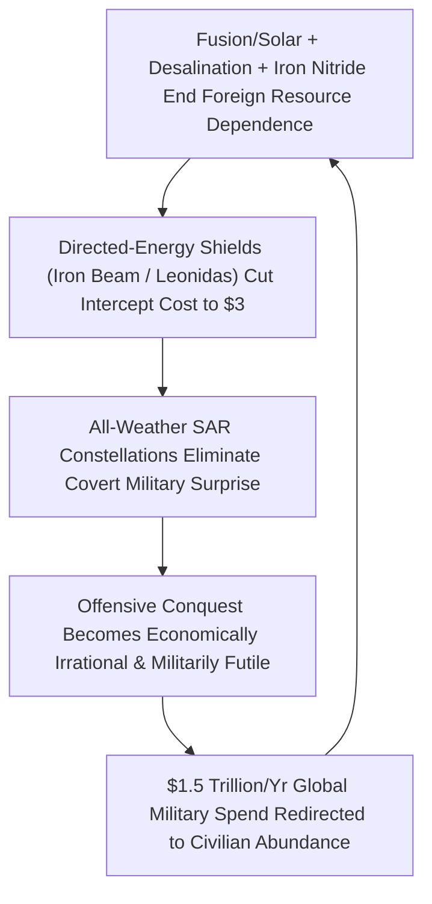

# VISION 01: SOCIAL TRANSFORMATION IN AN ERA OF ABUNDANCE
## Pathway 1D: Dismantling the Material & Strategic Drivers of War — *Resource Sovereignty, Speed-of-Light Defensive Shields, and Planetary Transparency*

> **Executive Framing & The Core Thesis:**
> * **The Cynic's Objection:** *"Human beings are tribal apes who have fought wars for 5,000 years. Abundant energy and AI won't stop war—they'll just give dictators cheaper drone swarms and deadlier weapons."*
> * **The Core Thesis:** War is not a mystical curse in human DNA; for five millennia, large-scale interstate war has been driven by two cold equations: **(1) Zero-Sum Material Scarcity** (when seizing a neighbor's oil fields, river headwaters, farmland, or mineral mines is the only way to secure national survival), and **(2) Offensive Cost Advantage** (when a surprise attack or missile barrage can overwhelm a defender's interceptors). Between 2026 and 2040, four technological shifts invert both equations simultaneously: **Universal Resource Independence** (fusion/solar energy, <\$0.01/1,000L desalination, synthetic air-fuels, and rare-earth-free Iron Nitride magnets), **Speed-of-Light Defensive Dominance** (\$3-per-shot solid-state lasers and high-power microwave shields that render missiles and drone swarms obsolete), **24/7 All-Weather SAR Satellite Transparency**, and **Positive-Sum Institutional Compacts**. We do not need to turn every politician into a saint to make cross-border conquest as obsolete as piracy on the Great Lakes.

---

## ACT I: A BELIEVABLE NEAR-FUTURE VISION (THE WORLD OF 2040)
### A Morning Along Three Former Geopolitical Flashpoints in 2040

Imagine looking down at three of the 20th and early 21st century's most dangerous geopolitical fault lines on a clear morning in **2040**: the **Strait of Hormuz**, the **Nile & Indus River Basins**, and the **Eastern European Frontier**.

In 2026, military planners treated war across these corridors as a perpetual hair-trigger certainty. By 2040, the borders, languages, and national prides still exist—yet the material and military incentives to cross those borders with tanks or missiles have evaporated:

1. **The Former Oil Chokepoints (Strait of Hormuz & Malacca):**
   In 2026, 21 million barrels of crude oil squeezed through the Strait of Hormuz every day; a single naval blockade could trigger a global depression and superpower war. In 2040, Japan, India, Europe, Korea, and the United States import **zero foreign crude oil or LNG**. Every coastal and inland nation runs on domestic compact fusion and solar gigogrids, synthesizing drop-in aviation fuel right out of ambient air and water ($\text{CO}_2 + \text{H}_2\text{O}$) for **\$0.42/gallon**. Meanwhile, the Gulf states have used their solar/fusion wealth to become prosperous global hubs for green hydrogen chemistry, desalination, and AI compute. You do not send carrier strike groups to fight over a commodity you can make at home from seawater.
2. **The Former Water-War River Basins (The Nile, Jordan, Tigris-Euphrates, and Indus):**
   In the 2020s, upstream dams and severe droughts threatened existential water wars between Egypt and Ethiopia, India and Pakistan, and across the Levant. By 2040, coastal fusion-desalination arrays pump inexhaustible freshwater inland for **less than \$0.01 per 1,000 liters**, while solar-powered atmospheric water harvesters and vertical agro-towers produce staple crops using **95% less water**. Every nation in the Middle East, North Africa, and South Asia is a net water and food exporter.
3. **The Impenetrable Sky Dome Along National Borders:**
   Along historically contested borders, kinetic artillery and ballistic missile batteries sit decommissioned in museums. Every border community and critical grid node is protected by solid-state **Megawatt Directed-Energy Laser and High-Power Microwave (HPM) Domes** connected directly to regional power stations. If a rogue actor launches 500 hypersonic missiles or 10,000 autonomous drones, the solid-state defense grid neutralizes the entire salvo at the **speed of light ($300,000\text{ km/s}$) for under \$2,000 in electricity**—before a single projectile crosses the border line.
4. **Zero Surprise Mobilization:**
   Every square meter of Earth's surface is imaged every **8 minutes** in high-resolution optical, thermal, and cloud-penetrating **Synthetic Aperture Radar (SAR)** by open international verification constellations. No state can move a battalion, assemble a covert enrichment centrifuge, or mass logistics trucks without triggering instant automated treaty alerts and global financial/supply-chain circuit breakers.

---

## ACT II: THE CONVERGENCE & SOCIAL BRIDGE: HOW IT CAME ABOUT (2026–2038)
### Inverting Both the Resource Scarcity Equation and the Offense-Defense Balance

In military history, peace collapses when **offense is cheap and resources are scarce**; peace stabilizes for generations when **defense is overwhelmingly dominant and domestic production is cheaper than conquest**.

### Real-World Precedents & 2025–2026 Breakthroughs Already Flipping the Equation
Every technology dismantling resource wars and missile/drone aggression is already deployed or entering commercial/defense production in 2025–2026:

| Deterrence & Independence Pillar | Real-World System / Pioneer (2025–2026) | Verified Cost & Technical Metric | 2028–2038 Geopolitical Scaling Impact |
| :--- | :--- | :--- | :--- |
| **1. Solid-State Laser Air Defense** | **Rafael *Iron Beam* (Israel)** & **UK MoD *DragonFire*** (MBDA / Leonardo / QinetiQ) | *Iron Beam* (100 kW) & *DragonFire* (50 kW+, hitting a coin at 1 km) intercept rockets, mortars, and drones at the speed of light for **\$2 to \$13 per shot** vs. \$1M–\$4M per missile. | Grid-powered 500 kW–1 MW solid-state fiber laser arrays give every city and border an **infinite-magazine shield**, flipping the cost ratio $1,000:1$ in favor of the defender. |
| **2. High-Power Microwave (HPM) Anti-Swarm Shields** | **Epirus *Leonidas* (US Army IFPC-HPM)** & **Raytheon *Phaser* / BAE HPM** | Solid-state gallium-nitride (GaN) HPM emitters fry the electronics of **dozens of drones simultaneously in a single pulse** at **<\$0.05 per engagement**. | Renders autonomous drone swarms completely ineffective against defended borders and civilian infrastructure. |
| **3. Rare-Earth-Free Permanent Magnets & Brine Minerals** | **Niron Magnetics (Minneapolis, MN — $\alpha''\text{-Fe}_{16}\text{N}_2$ Iron Nitride)** & **Direct Lithium Extraction (DLE)** | Niron opened its commercial plant (2024–2026) building high-flux permanent magnets from **100% abundant Iron and Nitrogen** (zero Neodymium/Dysprosium); DLE extracts lithium from brine. | Eliminates geopolitical chokepoints over rare-earth mines in Central Africa and East Asia; every nation manufactures motors and turbines from air and iron. |
| **4. Energy & Synthetic Fuel Sovereignty** | **Commercial Fusion (Helion, CFS, Proxima)** + **Solar DAC E-Fuels (Twelve, Prometheus)** | **1 gallon of seawater = 300 gallons of gasoline** in fusion energy; synthetic e-jet fuel from $\text{CO}_2 + \text{H}_2\text{O}$ scales down toward **\$0.45/gal** at \$0.003/kWh power. | Permanently ends petro-state blackmail, oil-strait naval wars, and winter natural-gas pipeline coercion. |
| **5. Desalination & Food Sovereignty** | **Sorek B / IDE Technologies (RO Desalination)** + **Green Ammonia & Vertical Farms** | Modern reverse osmosis requires just **2.5–3.0 kWh per $\text{m}^3$**; at \$0.003/kWh power, energy cost is **<\$0.01 per 1,000 liters** of pure water. | Eliminates hydro-hegemony conflicts over the Nile, Indus, Jordan, and Mekong river basins; desert and landlocked nations achieve 100% food/water security. |
| **6. All-Weather SAR & RF Satellite Transparency** | **Capella Space**, **Umbra** (16 cm SAR), **Planet Labs**, & **HawkEye 360** (RF Geolocation) | Commercial Synthetic Aperture Radar sees through **100% cloud cover, smoke, foliage, and darkness** at **16–25 cm resolution** with sub-hour revisit rates. | Open-source AI treaty verification spots artillery staging, tunnel excavation, or naval mobilization within minutes—erasing the element of surprise attack. |
| **7. Institutional Resource-Sharing Precedents** | **1951 European Coal & Steel Community (ECSC)** & **1960 Indus Waters Treaty** | By pooling coal/steel production, France and Germany ended 1,000 years of blood-and-iron wars; the Indus treaty survived three wars via verified water allocation. | **Regional Abundance Compacts** co-locate fusion-desalination aqueducts on border zones so neighbors share positive-sum energy and water yields. |

### Quantitative Inversion: Why Conquest & Bombardment Stop Working (2023 vs. 2040)

| Strategic Dimension | 2023–2025 Conflict Equation (Offense & Scarcity Favored) | 2040 Abundance & Deterrence Equation (Defense & Sovereignty Favored) | Strategic Consequence |
| :--- | :--- | :--- | :--- |
| **1. Cost to Attack vs. Cost to Defend (Air/Drone/Missile)** | Attacker fires **\$20,000 drone / \$50,000 rocket**; Defender fires **\$1,000,000–\$4,000,000 kinetic missile** (50:1 cost penalty on defender; magazines run dry in weeks). | Attacker spends **\$50,000–\$2,000,000** per projectile; Defender fires **\$3 laser pulse / \$0.05 microwave wave** powered by local fusion core (**10,000:1 advantage to defender**; infinite magazine). | **Cross-border aerial bombardment becomes bankrupting and futile.** |
| **2. Value of Seizing Foreign Resource Territory** | High: capturing oil fields, lithium mines, black-soil grain belts, or river dams yields trillions in monopolistic rent. | **Near-Zero**: every nation already commands inexhaustible energy from seawater, minerals from brine/iron nitride, and food from vertical agro-towers. | **Resource imperialism loses 100% of its economic return on investment.** |
| **3. Time Window for Covert Military Buildup** | **Weeks to Months**: camouflage, night movement, and cloud cover hide troop staging and underground supply dumps. | **Zero (<10 Minutes)**: 16 cm all-weather SAR, hyperspectral chemical sniffing, and RF constellations broadcast every movement globally in real time. | **Blitzkrieg and strategic surprise are physically impossible.** |

### Anatomy of Three Former Flashpoints Defused by Technology (2026 $\rightarrow$ 2040)
1. **The Petro-Chokepoint Flip (Strait of Hormuz, Bab el-Mandeb & Malacca):**
   * For eighty years, great powers stationed carrier strike groups in the Persian Gulf and South China Sea because halting tanker traffic for 60 days would freeze industrial civilization.
   * Once compact fusion cores (`01-fusion-pathway-v3`) and utility solar drop local power below \$0.005/kWh, any inland city can synthesize drop-in Fischer-Tropsch aviation and marine fuel from atmospheric $\text{CO}_2$ and water for **\$0.42/gallon**. Oil tankers become as strategically irrelevant to national survival as 19th-century whaling ships.
2. **The Mineral & Magnet Chokepoint Flip (Rare Earths & Cobalt):**
   * In 2025, 70–90% of Neodymium/Dysprosium permanent magnets and refined battery minerals passed through single-country geographic bottlenecks.
   * By 2032, **Iron Nitride ($\alpha''\text{-Fe}_{16}\text{N}_2$) magnets** (pioneered by Niron Magnetics from abundant iron and atmospheric nitrogen), sodium-ion/iron-air grid batteries, and electrolytic mineral extraction from coastal desalination brine give every continent 100% domestic mineral sovereignty.
3. **The Hydro-Hegemony Flip (Nile, Indus, Tigris-Euphrates & Jordan Basins):**
   * Upstream dam construction ceases to be a weapon of existential coercion when downstream nations desalinate ocean water at **<\$0.01 per 1,000 liters** and grow 60% of their produce in closed-loop vertical agro-towers using 95% less water.

---

## ACT III: PHASED ROLLOUT ROADMAP (2026–2050) & SOCIAL FEEDBACK LOOPS

### The 2026–2050 Phased De-Escalation & Deterrence Roadmap

| Phase & Window | Defensive Shield Technology | Resource & Supply-Chain Sovereignty | Verification & Treaty Architecture | Global Geopolitical Equilibrium |
| :--- | :--- | :--- | :--- | :--- |
| **Phase 1: The Interceptor Cost Flip (2026–2030)** | **100–300 kW Solid-State Lasers** (*Iron Beam*, *DragonFire*) & **GaN HPM** (*Leonidas*) deployed around cities, ships, and grid substations. | **Niron Iron Nitride magnets** + Direct Lithium Extraction break rare-earth monopolies; LNG/oil demand peaks as EVs and heat pumps scale. | Commercial SAR/optical satellites (**Umbra, Capella, Planet**) integrated into public OSINT war-warning dashboards. | Drone swarms and cheap rocket barrages lose effectiveness; first resource-chokepoint premiums begin deflating. |
| **Phase 2: Energy & Water Decoupling (2030–2035)** | **1 MW+ Grid-Integrated Directed-Energy Domes** protect national borders; autonomous counter-battery lasers neutralize artillery shells in mid-air. | First commercial fusion plants + utility solar drop desalination below **\$0.02/$\text{m}^3$**; domestic synthetic e-fuels replace 40% of seaborne crude oil. | **AI Automated Arms-Control Verification Treaties**: real-time hyperspectral monitoring of nuclear, bio, and missile facilities. | Petro-state leverage collapses; Nile, Jordan, and Indus water-sharing grids stabilized by coastal desalination surpluses. |
| **Phase 3: Full Defensive Dominance (2035–2042)** | Multi-layered terrestrial and orbital relay mirrors provide **99.98% speed-of-light interception** against ballistic and hypersonic threats. | **100% National Self-Sufficiency** in energy, water, fertilizer, critical metals, and staple food across 150+ nations. | **Joint Cross-Border Abundance Zones**: former DMZs and contested borders host shared fusion-desalination parks with automatic shutoff clauses. | Interstate territorial war becomes as archaic as 18th-century privateering; global military budgets step down by **50%+**. |
| **Phase 4: The Planetary Peace Dividend (2042–2050+)** | Automated planetary defense grids re-oriented outward toward asteroid deflection and orbital debris clearing. | Complete atomic circular economy; zero geopolitical competition over raw crust extraction. | Open global scientific, biosecurity, and space-exploration governance federations. | **\$1.5+ Trillion/year** permanently reallocated from weapons attrition to human longevity, education, and ecological restoration. |

---

## ACT IV: THE DEEPER HORIZON & SUMMARY FOR THE SKEPTIC

### Why "Human Nature" Doesn't Prevent the End of Resource Wars
When skeptics claim *"humans will always fight wars because of human nature,"* remind them of Western Europe. For 1,000 years—from Charlemagne through the Thirty Years' War, Napoleon, World War I, and World War II—France, Germany, Britain, and Spain butchered each other every generation over coal valleys, iron ore, and colonial trade routes. Yet since 1945, war between France and Germany has become literally unthinkable—not because Europeans mutated into a different biological species, but because **economic and resource architecture changed the payoff matrix**.
1. **Removing the Desperation Trigger:** Most catastrophic wars in history were supported by ordinary citizens only when they feared their families would freeze, starve, or be encircled without foreign oil, grain, or water. When every nation commands limitless energy in a swimming pool of seawater and limitless food in vertical farms, demagogues lose the scarcity panic required to sell war to their population.
2. **The \$1.5 Trillion Peace Dividend:** In 2026, humanity spent over **\$2.4 trillion per year** on militaries—much of it guarding oil sea-lanes and buying \$2M missiles. Redirecting even two-thirds of that talent and capital into fusion grids, youth Maker Guilds (`01-education`), middle-class equity trusts (`01-unemployment`), and cellular rejuvenation (`01-longevity`) accelerates every other pillar of human flourishing.

### Addressing the Hardest Non-Kinetic Objections: What About Cyber, Bio, and Civil Strife?
1. **If kinetic missiles and drones are blocked by laser shields, won't states just wage cyberwarfare?**
   * Just as directed energy flips the physical offense-defense balance, **Formal Verification Software (Lean 4 / seL4 microkernels)** and **Quantum-Resistant Cryptographic Hardware** flip the cyber offense-defense balance. Critical power grids, water plants, and financial ledgers run on mathematically proven, memory-safe, zero-vulnerability kernels that cannot be buffer-overflowed or remotely hijacked.
2. **What about engineered biological threats?**
   * Ubiquitous wastewater metagenomic sequencing, Far-UVC (222nm) germicidal photonic air sanitation in public spaces (which inactivates 99.9% of airborne pathogens safely without harming human skin or eyes), and rapid AlphaFold-designed mRNA/monoclonal countermeasures compress pandemic response from 12 months to **72 hours**—making biological coercion futile.
3. **What about internal civil wars driven by youth unemployment and food inflation?**
   * Historically, 80% of civil wars erupted when food spikes (like the 2011 Arab Spring wheat shock) collided with cohorts of unemployed young men. Providing every developing nation with <\$0.01/$\text{m}^3$ desalinated water, climate-proof vertical food, 2-Sigma AI/Guild schools (`01-education`), and local energy sovereignty extinguishes the root material fuel of civil insurgency.

### How Defense-Sector Workers & Bases Transition Without Economic Pain
A quiet political blocker to disarmament in the 20th century was that military bases and aerospace contractors anchored middle-class jobs in hundreds of congressional districts and industrial regions.
* **Aerospace-to-Fusion & Orbital Engineering Conversion:** The exact defense primes and skilled machinists who built missile interceptors and submarine hulls in 2026 (Lockheed Martin, Raytheon, BAE, Mitsubishi Heavy Industries) are contracted in the 2030s to mass-produce **20-Tesla REBCO fusion vacuum vessels**, **megawatt solid-state defensive laser domes**, **hyperspectral verification satellites**, and **planetary asteroid-defense systems**.
* **Base-to-Abundance Hub Repowering:** Retiring forward naval and air bases—which already possess deep-water ports, gigawatt power connections, and heavy runways—are converted into **Regional Desalination, Direct Air Capture ($\text{CO}_2$-to-Fuel), and Disaster-Response Logistics Hubs**.
* **Zero Veteran Displacement:** Active-duty personnel transitioning out of shrinking kinetic forces receive automatic **Equity-for-Service Shares** in the Sovereign Automation Trust plus priority chartering as **Neighborhood Resilience, Aviation, and Youth Expedition Guild Masters** (`01-unemployment`, `01-education`).

### Where the \$1.5 Trillion Annual Peace Dividend Goes (2035–2050)
| Former Military Expenditure Category (2026) | 2026 Global Spend | 2040 Reallocated Civilian Abundance Mission | Annual Dividend Freed |
| :--- | :--- | :--- | :--- |
| **Fossil Sea-Lane & Pipeline Patrols** | \$650B/yr | Coastal Fusion-Desalination Aqueducts & Continental Forest Rewilding | **\$550B/yr** |
| **Kinetic Missiles, Artillery & Tank Fleets** | \$850B/yr | Universal Epigenetic Longevity Clinics (`01-longevity`) & 2-Sigma Learning Guilds | **\$600B/yr** |
| **Expeditionary Forward Base Networks** | \$500B/yr | Sovereign Household Mortgage Equity Buffers (`01-unemployment`) & Modular Housing | **\$350B/yr** |

### Summary for the Skeptic
> *"You don't need to cure human pride to end resource wars. When one gallon of seawater gives every nation the energy of 300 gallons of gasoline, when Niron magnets replace conflict rare earths with iron and air, and when \$3-per-shot speed-of-light lasers shoot down \$2 million missiles before they cross the border, invading your neighbor stops being geopolitical strategy—it becomes economic and military suicide."*

