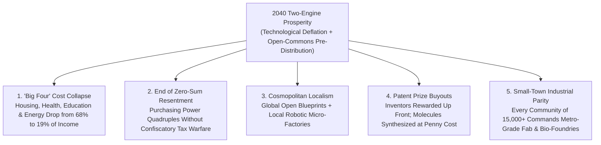

# VISION 01 — SOCIAL ARCHITECTURE: NATURAL & STRUCTURAL WEALTH REDISTRIBUTION
## Pathway 5D: The Rising Tide of Technological Deflation Paired with Open-Commons Pre-Distribution

> **Executive Framing & Philosophical Premise:**
> * **The Paradox of Social Reality:** When people hear the words "wealth redistribution," their minds immediately jump to zero-sum 20th-century battles: angry tax collectors taking slices of a fixed pie from one group to hand to another. Yet history's greatest equalizers were never bureaucratic tax seizures—they were **technological demonetizations** and **structural pre-distribution rules**, both of which are malleable human choices.
> * **The Cynic's Objection:** *"Even if energy and AI make manufacturing cheaper, won't corporate monopolies lock up the patents, keep prices artificially high through rent-seeking, and hoard all the gains while ordinary families struggle to afford housing, healthcare, and education?"*
> * **The Core Thesis:** In an abundant century, real wealth spreads through **Two Complementary Engines**:
>   1. **Engine 1 — Natural Redistribution via Technological Deflation ("The Rising Tide of Demonetized Goods"):** Just as smartphones took \$50,000 worth of 1985 cameras, encyclopedias, GPS satellites, record stores, and long-distance telephone lines and made them effectively free for 6 billion people, **\$0.003/kWh energy + autonomous robotics + AI diagnostics collapse the real cost of food, housing construction, transport, healthcare, and education by 70% to 90%**.
>   2. **Engine 2 — Structural Pre-Distribution ("Wiring the Commons Before Monopoly Forms"):** By enforcing **Open-Weight AI/Robotics Public Commons, Right-to-Repair/Interoperability mandates, Community Micro-Factories, and Cooperative Land Trusts**, society prevents artificial scarcity bottlenecks from forming in the first place—spreading wealth organically *before* after-the-fact redistribution is even needed.

---

## ACT I: A BELIEVABLE NEAR-FUTURE VISION
### A Family Budget in 2040 — How \$45,000 Buys a 2026 Millionaire's Quality of Life

Imagine visiting a young family—Elena, a community choir director, and Sam, a part-time botanical park ranger—living in a sunlit courtyard townhouse outside Denver, Colorado in **2040**.

On paper, their combined cash income of **\$52,000 a year** looks modest by 2026 standards. Yet walk through their daily life and compare their real material standard of living to a family earning \$350,000 in 2026:

1. **The "Big Four" Household Chokepoints Have Deflated by 75%–90%:**
   In 2026, working families were crushed not because TVs or clothes were expensive, but because four non-negotiable essentials—**Housing, Healthcare, Education, and Energy/Transport**—inflated relentlessly. By 2040, both engines of abundance have broken those bottlenecks:
   * **Housing (\$580/month Debt-Free Equity Lease):** Their 3-bedroom timber-and-basalt home was precision-fabricated in 4 days by a regional robotic micro-factory at **\$68 per square foot** (down from \$280/sq ft in 2026) on land held by a non-speculative **Community Land Trust**.
   * **Healthcare & Longevity (\$35/month Co-op Membership):** Every morning, bathroom mirror biosensors and liquid-biopsy home cartridges screen for 200+ cancers and metabolic markers. When Sam needed a custom peptide therapy, an open-source automated bio-foundry synthesized it locally for **\$12**.
   * **Education (\$0 Tuition, World-Class Mastery):** Their two children spend mornings with a Socratic AI tutor tailored to their exact curiosity pace and afternoons in small-group human art, athletics, and wilderness labs.
   * **Transport & Utilities (\$45/month Combined):** Autonomous neighborhood electric shuttles cost **\$0.06 per mile**—cheaper than owning shoes—and residential fusion/solar power is virtually free.
2. **The Neighborhood Automated Micro-Factory ("Fab-Commons"):**
   Need a custom oak dining chair, a replacement titanium bike gear, or bespoke insulated window frames? Two blocks away sits a municipal **Automated Micro-Factory** running open-source robotic CNC, 3D metal-sintering, and textile looms powered by off-peak fusion electricity. Citizens pay only the raw recycled material cost (**\$18 for a solid hardwood chair** that cost \$450 in 2026).
3. **The Skeptic's Question:**
   To someone in 2026, this raises an immediate objection: *"Wait—technology got way better between 1990 and 2026 too, yet housing, hospital bills, and college tuition tripled! Why didn't monopolies, zoning cartels, and patent trolls capture all those gains between 2026 and 2040?"*

Here is the exact legal and economic mechanism that unlocked deflation in the physical world and stopped artificial scarcity cold.

---

## ACT II: THE TRANSITION BRIDGE — THE TWO-ENGINE PROSPERITY MODEL (2026–2038)
### Curing Baumol's Cost Disease and Breaking Artificial Bottlenecks

### Step 1: Why Deflation Is the Ultimate Non-Bureaucratic Redistribution
Consider a simple mathematical truth often ignored in political debates: **cutting the price of the essential household consumption basket by 75% has the exact same impact on a working family's purchasing power as quadrupling their after-tax wages**—except it triggers **zero tax friction, zero inflation, and zero bureaucratic means-testing**.
* **Why Deflation Stalled in Housing, Health & Education Before 2026:** Economist William Baumol showed that labor-intensive sectors (construction, nursing, teaching) grew more expensive relative to manufactured goods—compounded in the 2020s by **regulatory capture**: local zoning laws banned modular factory housing, hospital billing cartels hid prices, and pharmaceutical patent thickets turned \$2 molecules into \$12,000 treatments.
* **How the Two Engines Unlocked the "Big Four" (2026–2038):**
  1. **Physical Automation + Energy Abundance (Engine 1):** When humanoid and gantry robotics entered off-site modular housing factories, and AI diagnostic co-pilots achieved 99.4% clinical accuracy, the physical labor bottleneck in construction and primary medicine evaporated.
  2. **Pre-Distributive Anti-Monopoly Rules (Engine 2):** To make sure those cost drops flowed 100% into lower consumer prices rather than monopoly markups, reforms mandated **Open-Standard Interoperability**, **National By-Right Factory Housing Certification** (letting a robot-built home certified in one state be placed anywhere in 48 hours), and **Public Patent Prize Buyouts** for essential medicines and agricultural seeds.

### Step 2: Real-World Precedents & 2026 Pilot Foundations
Both engines—massive technological demonetization and structural pre-distribution—had proven, quantifiable track records by 2026:

| Mechanism / Sector | Real-World Precedent / Pilot | Verified 2026 Empirical Metric | 2030–2040 Abundance Scaling Mechanism |
| :--- | :--- | :--- | :--- |
| **Technological Demonetization of Information & Compute** | **Wikipedia, GPS, Linux & Smartphone Convergence** | Replaced **>\$40,000 of 1985 hardware/media** (encyclopedias, cameras, telecom, maps) at **\$0 marginal cost**, adding trillions in unmeasured consumer surplus. | Extends digital demonetization to **AI legal counsel, personalized K-12/university tutoring, preventative medicine, and architectural design**. |
| **Solar, Battery & Compute Wright's Law Deflation** | **Global Solar PV & Lithium-Ion Learning Curves (1976–2026)** | Solar PV costs plunged **99.6%** (from \$106/W to \$0.20/W); LLM inference cost per million tokens fell **>98% in 24 months (2024–2026)**. | Applied to **humanoid robotics (\$120k $\rightarrow$ \$9k/unit)** and **modular home assembly**, driving construction costs down 70%+. |
| **Industrialized By-Right Modular Housing** | **Sweden (Lindbäcks / BoKlok)** & **Japan National Factory Housing Code** | **>45% of Swedish single-family homes** are built in automated indoor factories; Japan's nationalized zoning kept Tokyo housing affordable despite population growth. | Federal **Pre-Approved Robotic Building Codes** + **Community Land Trusts** cut average new home prices from 7x median income to **1.8x**. |
| **Open-Weight AI & Public Digital Infrastructure** | **Linux Foundation, Meta Llama / DeepSeek Open Weights & India DPI (UPI/ONDC)** | Linux runs **>90% of global cloud infrastructure** royalty-free; India's Open Network for Digital Commerce (ONDC) unbundled e-commerce monopolies for small merchants. | Establishes the **Public Foundation Model & Robotics Operating Commons**: every small business and town gets frontier AI/robot brains at zero licensing cost. |
| **Automated Generic Bio-Synthesis & Prize Funds** | **Civica Rx (Nonprofit Hospital Drug Co-op)** & **Advance Market Commitments** | Civica Rx cut prices on **70+ essential hospital medications by up to 80%** by manufacturing generics directly at cost+margin for 1,500+ hospitals. | Scales to **Municipal Continuous-Flow Bio-Foundries** synthesizing off-patent and prize-bought biologics, insulin, and peptides for pennies per dose. |
| **Community Land Trusts & Cooperative Utilities** | **Champlain Housing Trust (VT)** & **900+ US Rural Electric Cooperatives** | US Electric Co-ops serve **42 million Americans** at cost across 56% of the landmass; Champlain CLT preserves permanent housing affordability across generations. | Pairs non-speculative land leases with co-op fusion/solar microgrids and neighborhood **Automated Fab-Commons**. |

### Step 3: Why "Pre-Distribution" Beats "Redistribution" Politically and Economically
In the 20th century, allowing monopolies and zoning cartels to inflate prices first—and then trying to tax the winners to pay rent vouchers and medical subsidies to the losers—created two disasters: **massive political polarization** and **runaway subsidy inflation** (where government vouchers simply flowed right back into the pockets of landlords and hospital chains).
* **Wiring Fairness Into the Market Plumbing:** When every municipality owns an open-source robotic housing fab, every clinic runs open-weight AI diagnostics on \$0.003/kWh power, and essential biological patents are bought out into the public domain via innovation prizes, **wealth is distributed automatically through near-zero prices**. No citizen feels like a charity case, and no taxpayer feels robbed.

---

## ACT III: PHASED POLICY & ECONOMIC ROLLOUT ROADMAP (2026–2050)
### Dismantling Scarcity Chokepoints Step by Step

| Phase & Timeline | Chokepoint Targeted | Pre-Distributive & Deflationary Unlock | Real Household Purchasing-Power Result |
| :--- | :--- | :--- | :--- |
| **Phase 1: Breaking Regulatory Scarcity in Housing & Health (2026–2030)** | Local exclusionary zoning, medical billing opacity, and proprietary AI lock-in. | **National Factory-Built Housing Pre-Approval**; mandatory open API medical pricing; public R&D funding tied to **Open-Weight AI & Robotics licenses**. | Modular starter home costs drop **30%** in participating metro zones; AI primary care & tutoring become free for 100M+ households. |
| **Phase 2: Automated Supply Chains & Municipal Bio/Fab Co-ops (2030–2035)** | High construction labor costs, pharmaceutical markups, and food transport logistics. | **Public Prize Buyouts** for essential drugs coupled with regional **Civica-style Automated Bio-Foundries**; robotic vertical farms and **Community Fab-Labs** open in 500+ cities. | Prescription drug, fresh organic produce, and durable household goods expenses drop **55%–70%** across working families. |
| **Phase 3: Full Energy & Autonomous Mobility Deflation (2035–2042)** | Household utility bills, personal car debt/insurance, and urban land rent extraction. | **<\$0.003/kWh fusion/solar power** feeds autonomous shared transit fleets (**\$0.06/mile**) and local plasma-recycling micro-factories; **Community Land Trusts** reach 35% urban share. | Total cost of the "Big Four" essentials (Housing, Health, Education, Energy/Mobility) falls from **68% of median household income (2026) to 19% (2040)**. |
| **Phase 4: The Zero-Marginal-Cost Commons (2042–2050)** | Residual material and fabrication scarcity across durable consumer and civic goods. | Closed-loop atomic recycling + solar/fusion + open-source robotic fabrication make custom furniture, clothing, tools, and housing upgrades near-zero marginal cost. | A modest cash income commands a level of physical luxury, health longevity, and educational freedom that billionaires could not buy in 2020. |

---

## ACT IV: THE DEEPER HORIZON & SUMMARY FOR THE SKEPTIC
### When a Rising Tide Truly Lifts Every Boat

When natural technological deflation is paired with open-commons pre-distribution, five civilizational shifts occur:

1. **Defusing the Zero-Sum Culture War:**
   * Most political anger in the 2020s stemmed from the feeling that life's basic milestones—buying a home, raising kids, staying healthy—were slipping out of reach.
   * When the real cost of a beautiful home, organic food, and world-class healthcare drops by **75%+**, economic anxiety evaporates without needing partisan class warfare.
2. **Empowering Local Self-Reliance ("Cosmopolitan Localism"):**
   * Instead of waiting for container ships from 8,000 miles away, every town and rural county shares global open-source designs (*"Share Global What's Light"*) and manufactures its own housing modules, medicines, and tools in local robotic micro-factories (*"Make Local What's Heavy"*).
3. **Ending Artificial Scarcity in Medicine and Agriculture:**
   * Through **Federal Patent Prize Buyouts**, biotech pioneers receive lucrative, guaranteed milestone payouts the moment a new therapy passes clinical trials, and the molecular formula immediately enters the open public commons—allowing municipal bio-foundries to synthesize treatments for pennies.
4. **Ecological De-Materialization:**
   * Because neighborhood **Fab-Commons** fabricate furniture, appliances, and building components on demand from 100% recycled local feed-stocks using modular open-repair standards, planned obsolescence and trans-oceanic shipping waste vanish.

### Quantitative Comparison: The Median Family's Annual Essential Budget (2026 vs. 2040)

| Household Essential Category | 2026 Scarcity & Monopoly Cost (2026 \$) | 2040 Abundance & Open-Commons Cost (2026 \$) | Cost Reduction (%) | Primary Deflationary & Pre-Distributive Driver |
| :--- | :--- | :--- | :--- | :--- |
| **Housing (3-Bed Family Home)** | **\$28,800 / yr** (\$2,400/mo mortgage/rent at \$280/sq ft) | **\$6,960 / yr** (\$580/mo CLT lease + \$68/sq ft robotic prefab) | **-76%** | Automated indoor modular factories + Community Land Trusts |
| **Healthcare & Pharmaceuticals** | **\$14,400 / yr** (premiums, deductibles & patent markups) | **\$420 / yr** (\$35/mo AI diagnostics + \$12 local bio-foundry doses) | **-97%** | 24/7 AI preventative screening + Civica/Prize open bio-synthesis |
| **Transportation & Mobility** | **\$12,200 / yr** (2 car loans, fuel, insurance, repairs) | **\$540 / yr** (\$0.06/mi autonomous shared EV + micro-mobility) | **-95%** | \$0.003/kWh fusion/solar power + autonomous fleet utilization |
| **Food & Organic Nutrition** | **\$10,800 / yr** (long-haul diesel grocery supply chain) | **\$2,600 / yr** (local robotic vertical farms + precision fermentation) | **-76%** | Pennies-per-kWh indoor agro-lighting + zero spoilage/transport |
| **Home Utilities (Power, Heat, Water)** | **\$4,200 / yr** (volatile fossil grid & municipal water) | **\$144 / yr** (\$12/mo flat grid fee; baseline kWh/water free) | **-97%** | Compact fusion/solar baseload + <\$0.01/1,000L desalination |
| **Higher Education & Tutoring** | **\$15,000+ / yr** (tuition debt & private test prep) | **\$0 / yr** (universal Socratic AI mastery tutor + maker labs) | **-100%** | Demonetized open-weight AI tutoring & public apprenticeship guilds |
| **TOTAL ESSENTIAL BASKET** | **\$85,400 / yr** | **\$10,664 / yr** | **-87.5% Drop** | **\$45k–\$52k in 2040 buys a \$350k+ 2026 standard of living** |

### Addressing the Top 3 Skeptic Objections
* **Objection 1: "If essential drugs and inventions are bought out into the public domain, won't biotech R&D stop?"**
  * *Answer:* **Federal Innovation Prize Buyouts** pay biotech and agricultural inventors a handsome, guaranteed return (weighted by verified clinical QALYs saved) the moment FDA/EMA approval is achieved—eliminating marketing overhead and patent litigation while immediately opening the molecule to penny-per-dose generic bio-synthesis.
* **Objection 2: "Won't cheap goods just lead to throwaway consumerism and ecological clutter?"**
  * *Answer:* Neighborhood **Fab-Commons** operate on **100% closed-loop atomic and mechanical recycling**: when you want a new chair or appliance, the local robotic micro-factory deconstructs your old item back into pure wood fiber, aluminum, and polymer feedstock on-site with zero landfill waste.
* **Objection 3: "What about positional goods—not everyone can live on beachfront property in Malibu?"**
  * *Answer:* Physically scarce positional locations remain priced by the market (and taxed via Georgist Land Value Rents that fund the public commons). What technological deflation guarantees is that **every town and neighborhood on Earth** enjoys mansion-grade architecture, world-class healthcare, clean energy, and gourmet nutrition.

### The Bottom Line for the Skeptic
The richest redistribution in history didn't happen when governments taxed horse-and-buggy owners to buy horses for the poor—it happened when assembly lines, antibiotics, electrification, and smartphones collapsed costs by 99%. By clearing away zoning cartels and patent thickets, we let **Wright's Law, open-source AI, and cheap energy** do the same for housing, healthcare, food, and education.

