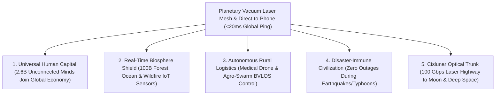

# VISION 01: SPACE INDUSTRIALIZATION & ORBITAL ABUNDANCE
## Pathway 1A: Orbital Optical Mesh & Direct-to-Device Communications — *Connecting Every Human at the Speed of Vacuum Light*

> **The Cynic's Objection:**
> *"Why launch thousands of satellites into orbit just for internet when we can lay fiber-optic cables in the dirt and build cellular towers? Isn't space communications just an expensive luxury for yachts, airlines, and remote cabins?"*
>
> **The Core Thesis:**
> Laying physical trenches across the last 40% of Earth's landmasses—mountain ranges, archipelagos, rainforests, deserts, and oceans—is ecologically destructive and economically impossible. Meanwhile, light travels **47% faster in the vacuum of space ($299,792\text{ km/s}$)** than inside silica glass fiber ($204,000\text{ km/s}$). Driven by a $100\times$ collapse in launch costs from fully reusable stainless-steel rockets, massive orbital phased-array antennas, and 200-gigabit optical laser links, Low Earth Orbit (LEO) has inverted telecommunications physics: **space is now both the fastest global backbone and the cheapest last-mile cell tower on Earth.**

---

## ACT I: A BELIEVABLE NEAR-FUTURE VISION (THE WORLD OF 2040)
### A Tuesday Morning in 2040 — Zero Dead Zones on Planet Earth

Imagine standing in a rural clinic high in the Peruvian Andes—or on a research vessel in the mid-Pacific, a wildfire response camp in British Columbia, or a solar microgrid village in the Sahel—on a Tuesday morning in **2040**.

Nothing in your hand looks like bulky satellite gear. You are holding an ordinary, slim, \$150 smartphone. Yet four quiet realities have transformed how humanity communicates, learns, and protects the planet:

1. **The Invisible Cell Tower 500 Kilometers Overhead:**
   Your standard phone displays full bars and **300 Mbps bidirectional connectivity** with an **18-millisecond ping**. There is no local cell tower scarring the mountain ridge and no diesel generator burning fuel to power remote base stations. Instead, your phone's internal antenna is speaking directly on standard 3GPP cellular spectrum to an orbital phased-array mirror the size of a basketball court gliding silently across the dawn-dusk sky.
2. **Faster Than Undersea Fiber:**
   When a surgeon in Lima or Tokyo consults on a live 3D diagnostic scan from that Andean clinic, the data packets do not snake through fragile undersea cables around continental shelves. They hop 500 kilometers straight up to a Low Earth Orbit satellite, race across an orbital mesh of **1-terabit-per-second optical lasers in pure vacuum at $299,792\text{ km/s}$**, and drop directly into the destination city—cutting transoceanic latency in half compared to legacy glass fiber.
3. **The End of the 2.6-Billion-Person Digital Divide:**
   In 2024, 2.6 billion people lacked reliable internet access because rural trenching cost \$30,000 to \$80,000 per kilometer. By 2040, universal planetary connectivity is bundled into a **\$2/month global civic baseline**. Every child on Earth has access to real-time AI tutoring in their native dialect, every smallholder farmer receives hyper-local orbital soil moisture and pest telemetry, and unbanked communities participate directly in global digital commerce.
4. **The Skeptic's Question:**
   To an observer in the early 2020s—when satellite internet meant geostationary dishes with 600-millisecond lag and \$10,000 satellite phones—this sounds impossible. *"How did standard pocket phones overcome the inverse-square law over 500 kilometers, and how did orbital networks beat terrestrial fiber on both cost and speed?"*

Here is the verifiable physics, hardware, and launch-cost chain that built that reality.

---

## ACT II: THE CONVERGENCE BRIDGE — HOW IT CAME ABOUT (2021–2038)
### Reusable Rockets, Vacuum Laser Physics, and Giant Unfolding Phased Arrays

```mermaid
flowchart LR
    subgraph Drivers["The 2021-2028 Convergence"]
        D1["Launch Cost Collapse: $20,000/kg to <$100/kg (Starship & New Glenn)"]
        D2["Vacuum Light Physics: 299,792 km/s vs 204,000 km/s in Glass Fiber"]
        D3["Giant Orbital Phased Arrays: 64 to 400 sq meter Apertures + AI Beamforming"]
    end

    subgraph SOTA["2025-2026 Industrial Proof Points"]
        S1["Starlink: 7,000+ Sats, 40+ Tbps Laser Mesh & Direct-to-Cell LTE"]
        S2["AST SpaceMobile: 693 sq ft BlueBird Sats Delivering 120 Mbps to Phones"]
        S3["NASA TBIRD & DSOC: 200 Gbps LEO Laser & 267 Mbps Deep-Space Optical"]
    end

    subgraph Outcome["The 2040 Global Reality"]
        O1["Zero Planetary Dead Zones (8.5B Humans Connected)"]
        O2["Sub-20ms Global Vacuum Optical Backbone"]
        O3["Real-Time Biosphere & Disaster Telemetry"]
    end

    Drivers --> SOTA
    SOTA ==> Outcome
```

### Step 1: The Three Physics & Engineering Inflections
For sixty years, telecommunications satellites sat in Geostationary Orbit (GEO) at **35,786 km altitude**. At that distance, the speed-of-light round trip takes at least **477 to 600 milliseconds**, and signal power drops by $1/r^2$ so severely that users needed meter-wide parabolic dishes. Three simultaneous breakthroughs shattered the GEO paradigm:

* **1. The 100x Launch Cost Collapse (Reusable Stainless-Steel Rockets):**
  Launching mass on the Space Shuttle cost **~\$20,000/kg**; expendable rockets in 2010 cost **\$10,000/kg**. SpaceX's partially reusable Falcon 9 drove internal launch costs below **\$1,500/kg**, and the arrival of fully reusable heavy-lift vehicles—led by **SpaceX Starship** (with its Super Heavy "Mechazilla" chopstick tower catch proven in October 2024 and Raptor 3 engines), **Blue Origin New Glenn**, and **Rocket Lab Neutron**—pushes orbital delivery toward **\$50 to \$100/kg** while expanding payload fairings to 8–9 meters in diameter. Suddenly, humanity could deploy thousands of tons of high-power silicon and unfolding antennas into 350–550 km LEO every year.
* **2. The Index of Refraction Advantage (Vacuum Optical Lasers vs. Silica Glass):**
  Silica fiber-optic cables have a refractive index of $n \approx 1.468$, slowing light down to:
  $$v_{\text{fiber}} = \frac{c}{1.468} \approx 204,218\text{ km/s}$$
  In the vacuum of space ($n = 1.000$), optical inter-satellite laser links (OISLs) operate at $1,550\text{ nm}$ wavelengths at the full speed of light:
  $$v_{\text{vacuum}} = 299,792\text{ km/s} \quad (+46.8\%\text{ faster than glass})$$
  Over any distance greater than ~3,000 km, routing packets up 500 km to LEO and across vacuum laser links beats any terrestrial fiber route on Earth—while remaining completely immune to subsea earthquakes, anchor drags, and geopolitical cable sabotage.
* **3. Closing the Link Budget to Unmodified Smartphones (The Friis Aperture Law):**
  By the Friis transmission equation, received power scales directly with the effective aperture area of the satellite antenna ($A_{\text{sat}}$) and inversely with distance squared ($d^2$):
  $$P_r = P_t G_{\text{phone}} \left(\frac{A_{\text{sat}}}{\lambda^2}\right) \left(\frac{\lambda}{4\pi d}\right)^2 = \frac{P_t G_{\text{phone}} A_{\text{sat}}}{4\pi d^2}$$
  Moving from GEO ($35,786\text{ km}$) to LEO ($500\text{ km}$) reduces $d^2$ by **$5,100\times$ ($+37\text{ dB}$)**. Then, by unfolding **64 to 400 square meters of ultra-thin phased-array tiles** in orbit and applying real-time AI digital beamforming to cancel Doppler shift ($7.6\text{ km/s}$ orbital velocity) and LTE/5G timing advance, the satellite acts as a giant electromagnetic lens—hearing a $0.2\text{ Watt}$ whisper from a standard pocket phone 500 km below.

### Step 2: The 2025–2026 Global State of the Art (Verified Hardware in Orbit)
By 2026, orbital laser meshes and direct-to-handset broadband are no longer theoretical papers—they are operating commercially in orbit across multiple constellations:

| Organization / System | Region | Orbital Architecture | Verified 2024–2026 Milestone | Commercial & Societal Pathway |
| :--- | :--- | :--- | :--- | :--- |
| **SpaceX Starlink & Direct-to-Cell** | USA (Global) | 7,000+ LEO Satellites (550 km & 340 km shells) + 100 Gbps OISLs | **2024–2026:** Deployed **>7,000 satellites** serving 5M+ users; **>9,000 space lasers** routing **40+ Terabits/sec**; commercial **Direct-to-Cell** service live on unmodified LTE phones (T-Mobile, Rogers, KDDI, Entel). | **V3 Starship Satellites:** 1 Tbps per satellite capacity; universal global text, voice, and LTE/5G data on every phone. |
| **AST SpaceMobile (*BlueBird*)** | USA (TX) | Massive Unfolding LEO Phased Arrays ($64\text{–}223\text{ m}^2$) | **Sept 2024–2026:** Launched commercial **BlueBird Block 1** ($693\text{ sq ft}$ arrays—largest commercial comms arrays in LEO) & **Block 2** ($2,400\text{ sq ft}$); demonstrated **120 Mbps peak speeds** and live video calls on unmodified everyday smartphones. | Commercial partnerships with **AT&T, Verizon, Vodafone, and Rakuten** reaching 2.8B+ existing mobile subscribers seamlessly. |
| **Amazon Project Kuiper** | USA (WA) | 3,236-Satellite LEO Optical Mesh (590–630 km) | **2024–2026:** Validated **100 Gbps optical inter-satellite laser links** in orbit; began full-scale satellite manufacturing in Kirkland, WA and multi-rocket deployment (Atlas V, New Glenn, Falcon 9). | Ultra-low-cost customer terminals (<\$400, $1\text{ lb}$ portable antennas) + AWS direct orbital cloud backhaul. |
| **NASA TBIRD & DSOC** | USA (MIT LL / JPL) | High-Rate Terabit LEO & Deep-Space Optical Comms | **TBIRD:** CubeSat tissue-box-sized laser transceiver achieved **200 Gbps downlink** (2 terabytes in single 5-min pass). **DSOC (*Psyche*):** Achieved **267 Mbps** laser link from **31 million km** (80x Lunar distance). | Blueprint for multi-terabit LEO-to-ground optical feeder links and high-definition Cislunar/Martian internet. |
| **Telesat Lightspeed & MDA Space** | Canada | 198-Satellite Polar & Global Optical LEO Mesh | Fully funded \$3.5B+ sovereign & enterprise constellation with **MDA Aurora** digital beamforming satellites and 4 optical laser links per spacecraft. | Multi-gigabit low-latency backhaul for Arctic communities, global aviation, maritime, and remote telecoms (2026–2028). |
| **Eutelsat OneWeb & EU IRIS²** | UK / Europe | 630+ LEO Constellation (1,200 km) + Multi-Orbit | **OneWeb Gen-1** fully operational globally across land, sea, and air; **IRIS²** €10.6B contract signed for sovereign European quantum-encrypted optical mesh. | Resilient multi-orbit connectivity for European infrastructure, civil protection, and remote islands. |
| **Lynk Global & Omnispace** | USA (Global) | Nano-Satellite Direct-to-Phone & 3GPP NTN | Deployed commercial "cell-tower-in-space" satellites providing SMS/voice roaming in 30+ countries (Palau, Ghana, Solomon Islands, Cook Islands). | Standardized **3GPP Release 17/18 Non-Terrestrial Network (NTN)** chipsets built into every smartphone and IoT sensor. |

### Step 3: Why Regulatory & Spectrum Bottlenecks Broke Open (2024–2032)
1. **3GPP Release 17, 18 & 19 Standardization:** Instead of requiring proprietary satellite chips, global telecom standards bodies unified terrestrial 5G/6G and Non-Terrestrial Networks (NTN). Every smartphone shipped from 2025 onward natively supports orbital handoffs.
2. **Supplemental Coverage from Space (SCS):** In March 2024, the U.S. FCC established the world's first regulatory framework allowing satellite operators to lease existing terrestrial cellular spectrum from mobile carriers in dead zones—eliminating decade-long spectrum auctions and inspiring reciprocal frameworks across Japan, Europe, Latin America, and Africa.
3. **Adaptive Optics & Cloud-Diversity Ground Gateways:** To bridge the vacuum laser mesh to terrestrial data centers despite cloud cover, networks combined Ka/V/E-band millimeter-wave RF links with geographically diverse adaptive-optics laser ground stations and high-altitude stratospheric relays.

---

## ACT III: PHASED ROLLOUT ROADMAP (2026–2050) & ECONOMIC CASCADE
### From Emergency Texting to the Planetary Optical Nervous System

| Phase & Timeline | Launch Cost & Orbital Scale | Link Performance & Economics | Societal & Biosphere Thresholds Unlocked |
| :--- | :--- | :--- | :--- |
| **Phase 1: Emergency & Rural Bridge** *(2025–2028)* | **\$500–\$1,200/kg** (Falcon 9, New Glenn, Early Starship) 10,000+ LEO Satellites | **10–120 Mbps** Direct-to-Phone; **100 Gbps** Laser Mesh; \$10–\$50/mo terminal or mobile add-on | Zero wilderness dead zones for SMS/voice; instant connectivity after hurricanes/earthquakes; rural schools & clinics online globally. |
| **Phase 2: Starship Megaconstellation Scale** *(2028–2034)* | **\$100–\$250/kg** (Rapid Reuse Starship & Neutron) 30,000+ V3/Block-3 Satellites | **200–500 Mbps** Direct-to-Handset; **1 Tbps** OISL Vacuum Backbone; <\$5/mo emerging-market access | **Final 2.6 billion unconnected humans online**; orbital laser mesh carries 30%+ of transoceanic financial & cloud traffic faster than fiber. |
| **Phase 3: Terabit Optical & IoT Biosphere Mesh** *(2034–2042)* | **\$30–\$80/kg** (Routine Airline-Style Orbital Sorties) Modular $400\text{ m}^2$ Orbital Arrays | **1 Gbps+** to Pocket Devices; **10 Tbps** Coherent Free-Space Optics; <\$1/year per autonomous IoT sensor | **100 billion solar-powered environmental sensors** track every forest fire, illegal fishing vessel, methane leak, and glacier in real time. |
| **Phase 4: The Cislunar Optical Internet** *(2042–2050)* | **<\$25/kg** (Orbital Tug & Propellant Depot Era) LEO + Lunar Lagrange Relays | **100 Gbps** Earth-Moon Laser Trunk; Autonomous AI Spectrum Sharing; Bundled Universal Basic Connectivity | Seamless high-definition telepresence between Earth, orbital habitats, lunar research bases, and asteroid mining tugs. |

### Transoceanic Latency Comparison: Subsea Silica Fiber vs. LEO Vacuum Optical Mesh
Because light travels **46.8% faster in space vacuum ($299,792\text{ km/s}$)** than inside silica glass ($204,218\text{ km/s}$) and follows direct great-circle geodesics rather than zigzagging around coastlines, LEO laser meshes permanently beat terrestrial cables on long-haul routes:

| Global Route | Great-Circle Distance | Subsea Glass Fiber RTT (Actual) | LEO Vacuum Laser Mesh RTT (550 km) | Latency Saved |
| :--- | :--- | :--- | :--- | :--- |
| **New York $\leftrightarrow$ London** | $5,570\text{ km}$ | $\sim 59\text{ ms}$ | **$\sim 41\text{ ms}$** | **$-18\text{ ms}$ ($30\%$ faster)** |
| **London $\leftrightarrow$ Tokyo** | $9,560\text{ km}$ | $\sim 158\text{ ms}$ (via Suez/Red Sea) | **$\sim 68\text{ ms}$** (polar great-circle) | **$-90\text{ ms}$ ($57\%$ faster)** |
| **New York $\leftrightarrow$ Singapore** | $15,340\text{ km}$ | $\sim 215\text{ ms}$ | **$\sim 106\text{ ms}$** | **$-109\text{ ms}$ ($51\%$ faster)** |
| **Sydney $\leftrightarrow$ São Paulo** | $13,350\text{ km}$ | $\sim 260\text{ ms}$ (via US routing) | **$\sim 93\text{ ms}$** (direct South Pacific) | **$-167\text{ ms}$ ($64\%$ faster)** |

### How Space Communications Protects Earth's Biosphere
* **Halting Ecological Scarring from Terrestrial Infrastructure:** Instead of bulldozing access roads through the Amazon, Congo Basin, or Papua New Guinea to lay fiber trenches and erect diesel-powered cell towers every 5 kilometers, a single orbital shell illuminates entire continents from 500 km overhead with zero terrestrial footprint.
* **A Real-Time Planetary Immune System:** When a solar-powered \$2 IoT chip can transmit directly to LEO from anywhere on Earth, conservationists and public agencies gain sub-minute detection of **wildfire ignitions** (stopping megafires inside the first 10 minutes), **illegal rainforest logging**, **pipeline methane leaks**, and **poaching or illegal driftnet fishing** across the high seas.
* **Sustainability in Orbit (Zero-Debris & Dark-Sky Lifecycle):**
  * *Self-Cleaning Altitude:* Operating in 340–550 km orbits ensures natural atmospheric drag deorbits any unpowered satellite within 2 to 5 years—preventing multi-decade orbital debris.
  * *100% Demisable Materials:* Modern V2/V3 satellites replace titanium and stainless-steel reaction wheels with silicon, aluminum, and copper components that vaporize completely upon atmospheric reentry.
  * *Dielectric Mirror Dark-Sky Coatings:* Second-generation dielectric Bragg reflectors scatter sunlight away from Earth, keeping satellites invisible to the unaided human eye ($>\text{Magnitude } 7$) and preserving astronomical observatories.

---

## ACT IV: THE DEEPER HORIZON & SUMMARY FOR THE SKEPTIC

Once every square meter of Earth's surface has high-bandwidth, sub-20-millisecond connectivity, geography ceases to be economic destiny:

1. **Universal Human Capital Unleashed:**
   The next Ramanujan, Marie Curie, or Alan Turing growing up in a remote village in Malawi, Nepal, or Bolivia sits in the exact same real-time interactive classroom, medical diagnostic network, and AI compute environment as a student in Zurich or Palo Alto. Adding 2.6 billion minds to the global knowledge economy is the single largest human-capital unlock of the 21st century.
2. **Autonomous Rural Logistics & Precision Ecology:**
   Electric medical delivery drones (carrying blood plasma, vaccines, and antivenom) and solar-electric agricultural rovers operate safely beyond visual line-of-sight across entire continents via uninterrupted LEO command links—slashing rural maternal mortality and cutting agricultural chemical runoff by 80%.
3. **Disaster-Proof Civilizational Resilience:**
   When the 2022 Hunga Tonga volcanic eruption severed Tonga's undersea fiber cable, the nation was cut off for five weeks; when earthquakes or typhoons topple terrestrial cell towers, emergency responders go blind. With Direct-to-Cell orbital meshes, a natural disaster on Earth can never again sever a community's lifeline to the world.
4. **The Cislunar & Deep-Space Nervous System:**
   By extending coherent 1,550 nm optical relays to Earth-Moon Lagrange points ($L_1, L_2, L_4, L_5$) and deep-space relay stations (scaling NASA's *DSOC*), humanity lays a multi-gigabit optical highway across the inner solar system—supporting real-time tele-robotics on the Moon and Near-Earth Asteroids.
5. **The Bottom Line for the Skeptic:**
   Orbital communications is not an escapist toy for the wealthy. By combining **reusable stainless-steel rockets**, **giant unfolding phased arrays**, and **vacuum laser physics ($299,792\text{ km/s}$)**, humanity has already launched the commercial hardware in 2025–2026 that will erase the digital divide forever and weave a resilient, light-speed nervous system around our home planet.

