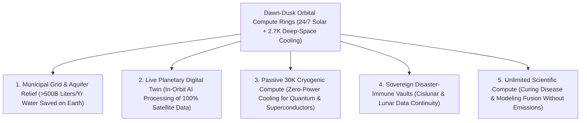

# VISION 01: SPACE INDUSTRIALIZATION & ORBITAL ABUNDANCE
## Pathway 1B: Orbital AI Data Centers & Deep-Space Radiative Compute — *Taking Gigawatt AI Off Earth's Water and Power Grids*

> **The Cynic's Objection:**
> *"Why would anyone launch heavy server racks into space when cooling in a vacuum is supposedly impossible and rockets are expensive? Isn't space a thermal thermos flask that will cook hot GPUs?"*
>
> **The Core Thesis:**
> A vacuum only blocks *convection*—not *thermal radiation*. By the Stefan-Boltzmann Law ($P = \varepsilon \sigma A T^4$), a two-sided radiator wing oriented edge-on to the Sun stares directly into the **$2.7\text{ Kelvin}$ ($-270.45\text{ °C}$) heat sink of deep space**, rejecting over **$1,500\text{ Watts per square meter}$** using **zero drops of water**. Meanwhile, in a Sun-Synchronous Dawn-Dusk Orbit, solar panels receive **$1,361\text{ W/m}^2$ of unattenuated sunlight 24 hours a day, 365 days a year**—requiring zero battery storage and zero terrestrial grid hookups. When fully reusable rockets drop launch costs below \$100/kg, orbit becomes the cleanest, cheapest, and fastest place to scale gigawatt AI compute.

---

## ACT I: A BELIEVABLE NEAR-FUTURE VISION (THE WORLD OF 2040)
### A Tuesday Morning in 2040 — How Moving the Cloud to Actual Orbit Saved Local Grids and Rivers

Imagine driving through Loudoun County, Virginia—or outside Dublin, Phoenix, Frankfurt, or Querétaro—on a warm morning in **2040**.

In the mid-2020s, communities here were locked in fierce battles with tech hyperscalers. Windowless gigawatt data center warehouses were swallowing farmland, drinking up millions of gallons of municipal water daily in evaporative cooling towers, and forcing utilities to delay coal plant retirements just to feed AI training clusters. Yet by 2040, four quiet transformations have reshaped the landscape:

1. **The Aquifers and Municipal Grids Are Healed:**
   No new hyperscale training warehouses have been permitted on arable land or stressed watersheds in nearly a decade. Municipal electricity rates for families have dropped, and local rivers in Arizona, Chile, and Spain no longer lose billions of gallons of freshwater to cool silicon chips.
2. **The Dawn-Dusk Sun-Synchronous Compute Ring (650 km Up):**
   Above the atmosphere, riding the perpetual twilight ring between day and night (Earth's terminator), glides a fleet of modular **100-megawatt orbital compute stations**. Their thin-film solar wings bathe in continuous, unblocked sunlight **99.7% of the year**—never experiencing night, clouds, or winter. Extending perpendicular to the sun-line are gossamer, matte-black pyrolytic-graphite radiator fins that silently beam the heat of a hundred thousand AI accelerators straight into the $-270\text{ °C}$ void of deep space.
3. **Zero-Latency Orbital Intelligence Everywhere:**
   When a hospital in Nairobi, an oceanographer in the Pacific, or a climate physicist in Geneva runs a massive foundation-model simulation, their query hops 650 km up via laser link, computes inside the orbital cluster—where Earth-observation satellites also process raw petabytes of hyperspectral planetary imagery *in situ* rather than choking downlink bandwidth—and beams the finished answer down in **15 milliseconds**.
4. **The Skeptic's Question:**
   To an engineer standing in 2026, this sounds startling. *"Wait—doesn't space radiation fry commercial GPUs, how do you cool 100 megawatts without air or water, and how could launching servers ever be cheaper than building a warehouse in Virginia?"*

Here is the exact thermodynamic, economic, and hardware bridge from 2024–2026 that made orbital data centers inevitable.

---

## ACT II: THE CONVERGENCE BRIDGE — HOW IT CAME ABOUT (2021–2038)
### The Stefan-Boltzmann Law, 24/7 Terminator Solar, and Reusable Heavy Lift

### Step 1: The Three Physics Laws That Favor Orbit Over Earth
Why did hyperscale AI compute hit a wall on Earth in the late 2020s while thriving in Low Earth Orbit?

* **1. The 24/7 Dawn-Dusk Solar Multiplier ($5\times\text{ to }7\times$ Energy Harvest per Panel):**
  On Earth, the atmosphere absorbs and scatters ~30% of sunlight, and night, clouds, and winter reduce average solar capacity factors to **18%–25%**. To run a 24/7 terrestrial data center on solar requires overbuilding solar arrays by $4\times\text{ to }5\times$ and buying billions of dollars of lithium-ion battery banks.
  In a **Sun-Synchronous Dawn-Dusk Orbit (SSO)** at 650–800 km altitude, the orbital plane precesses $0.9856^\circ$ per day, keeping the spacecraft permanently above the sunrise/sunset line. It experiences **zero night**:
  $$I_{\text{AM0}} = 1,361\text{ W/m}^2 \quad (\text{99.7\% annual uptime, zero battery storage required})$$
  Without wind loads, hail, or gravity, orbital roll-out solar arrays weigh **10x less per kilowatt** than glass-and-aluminum terrestrial panels and generate **$6\times$ more annual kilowatt-hours per square meter**.
* **2. Deep-Space Radiative Cooling (The Stefan-Boltzmann Law):**
  On Earth, cooling a 100 MW data center requires either massive chillers consuming 20%–30% overhead power or evaporating **1.5 to 2 million liters of clean water every single day**. In space, a two-sided radiator wing pivoted edge-on to the Sun (and edge-on to Earth's infrared albedo) sees only the **$2.7\text{ K}$ cosmic background**. By the Stefan-Boltzmann Law:
  $$P_{\text{rad}} = 2 \cdot \varepsilon \sigma A \left(T_{\text{rad}}^4 - T_{\text{space}}^4\right)$$
  where $\sigma = 5.67 \times 10^{-8}\text{ W}\cdot\text{m}^{-2}\cdot\text{K}^{-4}$. Because modern liquid-cooled AI chips (like NVIDIA Blackwell/Rubin architectures) run comfortably at coolant temperatures of **$T_{\text{rad}} = 350\text{ K}$ ($77\text{ °C}$)**, and high-emissivity ($\varepsilon = 0.92$) two-sided graphene/loop-heat-pipe panels radiate from both faces:
  $$P_{\text{rad}} / A = 2 \times 0.92 \times (5.67 \times 10^{-8}) \times (350^4 - 2.7^4) \approx 1,565\text{ W/m}^2$$
  Because radiative power scales with the **fourth power of temperature ($T^4$)**, running coolant loops at $77\text{–}90\text{ °C}$ makes orbital radiators compact, passive, and **100% water-free**.
* **3. Vacuum Super-Insulation & Radiation-Tolerant COTS Silicon:**
  For passive cryogenic modules (such as quantum processors or superconducting interconnects) shaded behind a multi-layer sunshield, equilibrium temperature passively drops to **30–40 Kelvin** (as proven on the **James Webb Space Telescope**). Meanwhile, in low-inclination or below-Van-Allen-belt LEO orbits, localized Whipple/polyethylene shielding + liquid-metal thermal jackets + software Error-Correcting Code (ECC) checkpointing allow standard commercial 3nm/2nm AI GPUs to operate at full clock speed without needing 1990s-era rad-hard chips.

### Step 2: The 2025–2026 Global State of the Art (Real Orbital Compute Hardware)
Between 2024 and 2026, startups, aerospace primes, and sovereign agencies moved orbital data centers from whitepapers to flight hardware:

| Organization / Project | Region | Architecture | Verified 2024–2026 Milestone | Commercial & Scaling Pathway |
| :--- | :--- | :--- | :--- | :--- |
| **Starcloud (formerly Lumen Orbit)** | USA (WA) | Dawn-Dusk SSO Megawatt AI Data Centers | Backed by Y Combinator & **NVIDIA Inception**; developed high-flux deployable radiative cooling + NVIDIA H100/Blackwell orbital demonstration nodes (2025–2026 flights). | Scaling from 100 kW pathfinders to **5 MW–100 MW Starship-deployed** orbital AI training clusters with zero grid queue. |
| **European Commission & Thales Alenia (*ASCEND*)** | Europe (EU Consortium) | Gigawatt Orbital Data Center Architecture | **2024–2026:** Consortium (Thales Alenia, Airbus, Orange, CloudFerro, Carbone 4) completed landmark lifecycle study proving orbital data centers achieve **10x lower $\text{CO}_2$ emissions** and zero water use. | **2030:** 10 MW commercial demonstrator; **2036–2050:** 1 GW modular European sovereign orbital cloud nodes. |
| **Axiom Space (*Orbital Data Center / ODC*)** | USA (TX) | LEO Commercial Station & Free-Flying Compute Nodes | Tested AWS Snowcone & Red Hat edge servers on ISS; launching **Axiom ODC Node 1 & 2** (2025–2027) linked via **Kepler** optical lasers and **Skylo** NTN. | In-orbit AI training, satellite fleet orchestration, and sovereign zero-trust cloud storage in LEO. |
| **Lonestar Data Holdings (*Freedom* & *Athena*)** | USA (FL) | Cislunar & Lunar Surface Disaster-Resilient Data Centers | **Feb 2024 (IM-1) & Early 2025 (IM-2):** Successfully transmitted, stored, and processed customer data on the Moon aboard Intuitive Machines landers (*Freedom* solid-state payload). | Permanent cislunar disaster-recovery vaults and edge processing nodes at Lunar Lagrange points. |
| **NTT & SKY Perfect JSAT (*Space Compass*)** | Japan | Integrated LEO/GEO Optical Data Relay & Orbital Compute | Operationalizing high-speed optical data relay satellites (2025–2026) paired with in-orbit edge AI compute for real-time Earth observation processing. | Eliminating the Earth-observation downlink bottleneck by running AI inference on satellite imagery in orbit. |
| **OrbitsEdge (*SatFrame*) & Ramon.Space** | USA / Israel | Hardened Orbital Server Frames & Rad-Tolerant AI DSPs | Validated liquid/radiative thermal management frames for COTS server blades and high-reliability space AI storage/processors across dozens of space missions. | Turnkey modular server racks that drop directly into commercial spacecraft buses. |
| **Microsoft Azure Orbital & AWS Aerospace** | USA (Global) | Cloud-to-Orbit Virtualization & Optical Ground Gateways | Deployed containerized orbital edge workloads (Azure Space / AWS Snowcone on ISS & LEO) proving seamless workload migration between ground and space clouds. | Unified hybrid cloud scheduler routing batch AI training to zero-carbon orbital nodes automatically. |

---

## ACT III: PHASED ROLLOUT ROADMAP (2026–2050) & ECONOMIC CASCADE
### From Orbital Edge Inference to Gigawatt Terminator Compute Rings

| Phase & Timeline | Launch Cost & Module Scale | Compute & Thermal Specs | Societal & Biosphere Thresholds Unlocked |
| :--- | :--- | :--- | :--- |
| **Phase 1: Edge Inference & Cislunar Vaults** *(2025–2028)* | **\$500–\$1,200/kg** 10 kW–100 kW Nodes | Real-time AI processing of Earth-observation imagery in orbit; **Lonestar** lunar vaults; **Axiom ODC** & **Starcloud** pathfinders | Eliminates the 95% discarded satellite data bottleneck: orbital cameras analyze wildfires, methane, and crops in real time before downlink. |
| **Phase 2: Megawatt Starship AI Clusters** *(2028–2034)* | **\$80–\$200/kg** 1 MW–10 MW Single-Launch Modules | Single 9m Starship fairing deploys a **5 MW solar-radiator AI pod** ($3,200\text{ m}^2$ radiator wing); 200 Gbps laser trunk to ground | Bypasses 7-year terrestrial utility interconnection queues; cheaper total cost of ownership (TCO) than grid-constrained ground data centers. |
| **Phase 3: 100 MW Modular Terminator Arrays** *(2034–2042)* | **\$30–\$70/kg** 100 MW Robotic-Assembled Clusters | Autonomous robotic tugs snap together 20 Starship pods into **100 MW Dawn-Dusk SSO rings**; 5-year modular GPU blade swap | **Saves >500 billion liters of terrestrial cooling water per year**; halts data-center land sprawl and relieves municipal electricity grids. |
| **Phase 4: Gigawatt Deep-Space & Cryo Compute** *(2042–2050)* | **<\$25/kg** (+ Lunar Silicon) 1 GW+ Sun-Synchronous & L2 Arrays | Passive **30K deep-space cryogenic cooling** behind sunshields unlocks planetary-scale superconducting & quantum-hybrid AI | Exascale scientific, climate, and medical intelligence running purely on unattenuated starlight with **zero burden on Earth's biosphere**. |

### Why the Total Cost of Ownership (TCO) Crosses Over Terrestrial Data Centers
Consider a **10-megawatt AI training cluster** over a 5-year GPU lifecycle (excluding the identical cost of the GPU silicon itself):

| 10 MW Cluster Cost Component (5-Year Lifecycle) | Terrestrial Grid Data Center (Northern VA / EU) | Dawn-Dusk SSO Orbital Data Center ($650\text{ km}$) | Orbital Advantage |
| :--- | :--- | :--- | :--- |
| **Power Generation & Grid Demand (547,500 MWh)** | **~\$46.5 Million** (\$85/MWh + peak capacity charges) | **\$0 OpEx** ($1,361\text{ W/m}^2$ 24/7 unattenuated solar) | **100% OpEx Eliminated** |
| **Cooling Overhead Power & Water Consumption** | **~\$11.6 Million** + **2.7 Billion Liters** of freshwater | **\$0 OpEx** + **0 Liters Water** ($2.7\text{ K}$ radiative sink) | **Zero Water / Zero Chiller Power** |
| **Land, Concrete, Substation & Backup Diesel CAPEX** | **~\$85.0 Million** (5–8 year utility queue delay) | **~\$22.0 Million** (Roll-out solar + graphene radiator spine) | **deployed in hours, not 7 years** |
| **Orbital Launch & Delivery Cost ($65,000\text{ kg}$)** | \$0 | **~\$6.5 Million** (1 Starship flight at \$100/kg) | **Single-flight deployment** |
| **Total Non-GPU Infrastructure & Energy TCO** | **~\$143.1 Million** (+ 6-Year Grid Delay) | **~\$28.5 Million** (20-Year Solar/Radiator Spine) | **~80% Lower Infrastructure TCO** |

### Solving Radiation, Micrometeoroids & Circular Upgradability
* **1. Below-Belt LEO & Magnetic/Liquid Shielding:** Operating at 550–680 km altitude stays safely below the inner Van Allen radiation belt. Wrapping server blades in a $5\text{ mm}$ polyethylene/liquid-coolant jacket and running AI workloads with automated **HBM3e/HBM4 Error-Correcting Code (ECC)** and millisecond tensor-checkpointing reduces Single-Event Upsets (SEUs) to negligible levels using standard commercial GPUs.
* **2. Whipple Bumpers & Redundant Loop Heat Pipes:** Radiator wings use segmented titanium-graphene micro-channel heat pipes; if a micrometeoroid punctures one capillary tube, isolation valves seal that $2\text{ cm}$ rib while 99.9% of the wing continues radiating normally.
* **3. Circular 5-Year Silicon Cassette Swaps:** While solar wings and graphene radiators last **20+ years** in orbit, AI silicon upgrades every 4–5 years. Modular orbital server cassettes allow a single servicing flight to swap out 8 tons of old GPU blades and return them via atmospheric reentry for 100% rare-metal recycling.

---

## ACT IV: THE DEEPER HORIZON & SUMMARY FOR THE SKEPTIC

Moving humanity's heaviest compute loads 650 kilometers straight up unlocks five profound civilizational wins:

1. **Decoupling AI Growth from Earth's Ecological Limits:**
   Humanity does not have to choose between curing diseases with exascale AI and preserving local drinking water or retiring coal plants. In orbit, solar energy is $10^{9}\times$ larger than humanity's total demand, and the $2.7\text{ K}$ universe is an infinite, water-free heat sink.
2. **In-Orbit Planetary Digital Twin:**
   Previously, Earth-observation satellites discarded over 90% of raw sensor data because radio downlinks were too narrow. With orbital AI supercomputers sitting inside the same laser mesh as imaging satellites, humanity runs a continuous, sub-meter **Digital Twin of Earth's Biosphere**—predicting extreme weather days earlier and tracking every ton of carbon and water on the planet.
3. **Passive Cryogenic Quantum & Superconducting Compute:**
   On Earth, cooling quantum or superconducting Josephson-junction processors to 4–30 Kelvin requires massive, power-hungry liquid-helium dilution refrigerators. Behind an orbital sunshield, **cryogenic cold is free and passive**, enabling ultra-low-energy reversible and superconducting computing.
4. **Cislunar Civilizational Backup (*The Lunar Library & Data Vault*):**
   Expanding **Lonestar Data Holdings'** lunar architecture into permanent high-capacity optical vaults at the Lunar South Pole and Earth-Moon Lagrange points guarantees that humanity's scientific knowledge, genomic libraries, and financial ledgers remain immune to any terrestrial catastrophe.
5. **The Bottom Line for the Skeptic:**
   Space is not an insulating blanket when you use infrared radiation ($P \propto T^4$). As validated by the **European Commission's ASCEND study**, **Starcloud**, **Axiom Space**, and **Lonestar** in 2024–2026, reusable rockets turn Sun-Synchronous Orbit into the greenest, fastest-deploying gigawatt data center site available to civilization.

