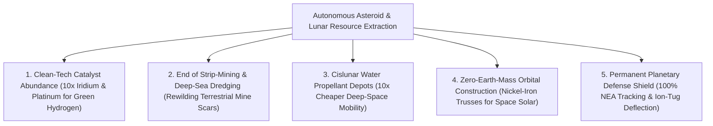

# VISION 01: SPACE INDUSTRIALIZATION & ORBITAL ABUNDANCE
## Pathway 1D: Asteroid & Cislunar Resource Extraction — *Ending Terrestrial Strip-Mining via Planetary Core Abundance*

> **The Cynic's Objection:**
> *"Mining an asteroid millions of miles away sounds like absurd science fiction! Even if an asteroid is made of solid platinum, wouldn't launching mining equipment and flying the metal back cost a thousand times more than digging it up on Earth?"*
>
> **The Core Thesis:**
> Four billion years ago, when infant Earth was molten, 99.9% of its heavy "iron-loving" (siderophile) metals—platinum, iridium, palladium, rhodium, osmium, and cobalt—sank into Earth's core $2,900\text{ km}$ beneath our feet. To get **1 kilogram of platinum** on Earth today, miners must blast, crush, and acid-leach **300 tons of terrestrial rock**. By contrast, M-type Near-Earth Asteroids are the exposed, shattered metallic cores of ancient protoplanets—containing **up to $100\times$ higher concentrations of Platinum-Group Metals (PGMs)** floating in zero gravity. Better still, hundreds of Near-Earth Asteroids require **less rocket energy ($\Delta v$) to reach and return from than the Moon**, and returning refined metals down to Earth uses **Earth's atmosphere as a free brake** ($99\%+$ braking energy provided by air friction, not propellant).

---

## ACT I: A BELIEVABLE NEAR-FUTURE VISION (THE WORLD OF 2040)
### A Tuesday Morning in 2040 — Rewilded Mines on Earth and the Iridium Catalyst Boom

Imagine standing on the rim of a former open-pit platinum and nickel mine in the Bushveld Basin of South Africa—or in Sudbury, Ontario, or Sulawesi, Indonesia—on a sunny morning in **2040**.

In the 2020s, the global transition to green hydrogen electrolyzers, fuel cells, and high-density batteries threatened to require tearing up millions of hectares of rainforests, indigenous watersheds, and deep ocean seabeds for scarce catalyst metals. Yet by 2040, four quiet realities have transformed how humanity sources its rarest elements:

1. **The Scars on Earth Are Closing:**
   Below you, the terraced grey pit of the old terrestrial mine is flooded into a clear terraced lake surrounded by restored native acacia forest. No cyanide or sulfuric acid leach ponds threaten the river valley. Deep-sea polymetallic nodule dredging—which once threatened to bulldoze abyssal ocean ecosystems—was permanently shelved in the early 2030s because orbital supply made it economically obsolete.
2. **The Utah & Australian Desert Drop Zones:**
   Three times a month, a blunt-body ceramic reentry capsule—the size of a delivery van—streaks across the dawn sky above the Utah desert or Woomera, Australia, decelerating from $11\text{ km/s}$ to subsonic speed using only atmospheric air resistance before deploying a parafoil. Inside sits a **2-ton solid ingot of refined Platinum-Group Metals (iridium, platinum, palladium, rhodium)** distilled in zero gravity from a Near-Earth Asteroid and worth over **\$120 million** at 2026 prices.
3. **Abundant Catalysts for Clean Energy & Medicine:**
   Previously, proton-exchange membrane (PEM) water electrolyzers for green hydrogen were bottlenecked because all of Earth's mines produced only **~7 tons of iridium per year**. With orbital iridium and platinum supply expanding tenfold, clean hydrogen production, solid-state fuel cells, corrosion-proof medical implants, and platinum-based cancer therapeutics have plummeted in cost globally.
4. **Water in the Sky (The Orbital Gas Station Network):**
   Meanwhile, not a single kilogram of asteroid water or structural nickel-iron is ever dropped to Earth. Instead, carbonaceous (C-type) asteroids and lunar polar ice supply **thousands of tons of water ($\text{H}_2\text{O}$)** directly to Low Earth Orbit and Cislunar propellant depots—saving **\$50,000 to \$200,000 per ton** in avoided Earth-launch gravity penalties.

---

## ACT II: THE CONVERGENCE BRIDGE — HOW IT CAME ABOUT (2021–2038)
### Protoplanetary Core Physics, Low-$\Delta v$ Trajectories, and Zero-G Refining

```mermaid
flowchart LR
    subgraph Physics["The Three Asteroid Physics Advantages"]
        P1["Planetary Differentiation: M-Type Asteroid Cores Have 20x-100x Higher PGM Grade"]
        P2["Low Delta-V Orbits: >2,000 NEAs Easier to Reach & Return From Than Lunar Surface"]
        P3["Free Atmospheric Braking: 99.5% of Return Velocity Absorbed by Air Heatshield"]
    end

    subgraph SOTA2026["2023-2026 Flight Milestones"]
        S1["NASA OSIRIS-REx (121.6g Bennu) & JAXA Hayabusa2 Autonomous Sample Return"]
        S2["AstroForge: Brokkr-1 Orbital Refinery & Odin/Vestri Deep-Space Missions"]
        S3["TransAstra Optical Mining & Sutter NEA Discovery Network"]
    end

    subgraph Impact2040["The 2040 Biosphere & Economic Dividend"]
        I1["10x Platinum/Iridium Supply for Green Hydrogen & Clean Tech"]
        I2["Orbital Water Depots Fueling Cislunar Economy"]
        I3["Halting Destructive Terrestrial Strip-Mining & Deep-Sea Dredging"]
    end

    Physics --> SOTA2026
    SOTA2026 ==> Impact2040
```

### Step 1: The Three Physics Laws That Make Space Mining Work
Why did skeptics in the 2010s miscalculate the economics of asteroid resource extraction?

* **1. Planetary Differentiation (Why Earth's Crust Is Metal-Starved):**
  During Earth's formation, gravitational heating melted the planet, causing dense iron, nickel, and Platinum-Group Metals (PGMs) to sink to the core (**planetary differentiation**). Mining Earth's crust means scraping up trace leftovers ($0.5\text{ to }3\text{ grams per ton}$).
  By contrast, **M-type (metallic) asteroids** are fragments of protoplanetary cores shattered by ancient collisions in the early solar system. Meteoritic spectroscopy and iron-meteorite analysis confirm PGM concentrations of **50 to 400 grams per ton**—meaning a single **200-meter metallic asteroid** contains more platinum, iridium, and palladium than humanity has ever mined in all of history.
* **2. The $\Delta v$ Gravity-Well Paradox (Closer Than the Moon in Energy):**
  In spaceflight, distance in kilometers matters far less than velocity change ($\Delta v$). Climbing out of Earth's deep gravity well takes $\Delta v \approx 9.4\text{ km/s}$, and descending onto the Moon's surface takes another $\Delta v \approx 6.0\text{ km/s}$.
  Yet over **2,500 Near-Earth Asteroids (NEAs)** (such as 1986 DA, Nereus, and Ryugu-class bodies) orbit the Sun at distances near $1.0\text{ AU}$. Departing from a high-Earth refueled orbit using high-efficiency **Solar Electric Propulsion (Hall-effect thrusters, $I_{\text{sp}} \approx 3,000\text{ s}$)** requires only **$\Delta v \approx 3.5\text{ to }4.5\text{ km/s}$**, and returning a refined payload to Earth intercept requires **$< 0.4\text{ to }0.8\text{ km/s}$**—where Earth's atmosphere absorbs **$11\text{ km/s}$ of kinetic energy for free** via an ablative/ceramic heatshield!
* **3. Zero-Gravity Vacuum Refining (No Bulldozers Required):**
  On an asteroid with $10^{-4}g$ surface gravity, heavy terrestrial excavators would push themselves off into space. Instead, spacecraft attach via micro-spine grapples or enclose cobbles in a capture bag and use two mass-less physics tools:
  * **Vacuum Fractional Distillation (AstroForge Architecture):** Focused solar/electric electron beams vaporize metallic regolith in the free $10^{-12}\text{ Torr}$ vacuum of space, separating iron, nickel, and precious PGMs purely by their boiling-point vapor pressures without a single drop of toxic acid.
  * **Concentrated Solar Spallation (*Optical Mining* — TransAstra):** Lightweight inflatable mylar concentrators focus sunlight onto carbonaceous rock; trapped internal water flashes to steam, fracturing the rock and driving pure water vapor directly into a passive cryogenic cold trap.

### Step 2: The 2025–2026 Global State of the Art (Verified Missions & Hardware)
Between 2023 and 2026, autonomous asteroid sample return and commercial deep-space prospecting became operational realities:

| Organization / Mission | Region | Target & Architecture | Verified 2023–2026 Milestone | Commercial & Resource Pathway |
| :--- | :--- | :--- | :--- | :--- |
| **AstroForge (*Brokkr-1*, *Odin*, *Vestri*)** | USA (CA) | M-Type Metallic NEAs / Zero-G Vacuum PGM Refining | **2023:** Launched *Brokkr-1* LEO refinery demonstrator. **Feb 2025:** Launched *Odin* deep-space asteroid probe (first commercial spacecraft beyond cis-lunar space); preparing *Vestri* asteroid docking mission. | Commercial return of 1,000+ kg refined Platinum-Group Metal (PGM) ingots per mission in the early 2030s. |
| **NASA *OSIRIS-REx* & *Psyche*** | USA | Autonomous NEA Excavation (*Bennu*) & Metallic Core Orbiter | **Sept 2023:** *OSIRIS-REx* returned **121.6g** of water-and-carbon-rich regolith from asteroid Bennu via precision Utah reentry. **2023–2026:** *Psyche* ion-propulsion probe en route to giant metallic asteroid 16 Psyche. | Proven autonomous touch-and-go (TAG) low-G excavation and high-speed ($12.4\text{ km/s}$) atmospheric sample return capsules. |
| **JAXA *Hayabusa2* & *MMX*** | Japan | Autonomous Subsurface Impactor & Asteroid Return | Returned pristine surface and subsurface samples from asteroid *Ryugu*; completing **MMX** spacecraft to return 10+ grams from Martian moon Phobos. | Gold-standard autonomous optical navigation and reaction-free pneumatic/impactor regolith sampling in microgravity. |
| **TransAstra (*Optical Mining* & *Sutter*)** | USA (CA) | C-Type Carbonaceous Water Asteroids & Orbital Tugs | Deployed global **Sutter** astronomical survey telescopes across 3 continents to catalog low-$\Delta v$ NEAs; tested **Optical Mining** solar concentrators & **Worker Bee** tugs. | Extracting hundreds of tons of asteroid water ($\text{H}_2\text{O}$) to supply orbital propellant depots at 10% of Earth-launch cost. |
| **Karman+ & Origin Space** | Netherlands / USA / China | Autonomous Regolith Excavation & Asteroid Prospecting | **Karman+** funded to launch autonomous low-$\Delta v$ asteroid excavation mission (2027); **Origin Space** flew *NEO-1* and *Yangwang-1* optical prospecting satellites. | Scalable autonomous swarm prospectors mapping high-grade metallic and volatile-rich NEAs. |
| **NASA *PRIME-1* / Intuitive Machines / ispace** | USA / Japan | Lunar South Pole Ice & Ilmenite Extraction (CLPS) | **2024–2026:** Landed commercial robotic missions at Lunar South Pole regions carrying **TRIDENT rotary-percussive drills** and **MSolo mass spectrometers**. | In-Situ Resource Utilization (ISRU) producing $\text{LOX/LH}_2$ propellant and oxygen ($42\%$ of lunar regolith by mass) on the Moon. |
| **Colorado School of Mines & OffWorld** | USA | Molten Regolith Electrolysis & Autonomous Mining Swarms | Demonstrated continuous oxygen and iron/silicon extraction from lunar/asteroid simulants and rugged AI robotic crawlers for extreme environments. | Zero-consumable electrochemical refining of structural metals (iron, aluminum, silicon, titanium) in space. |

---

## ACT III: PHASED ROLLOUT ROADMAP (2026–2050) & ECONOMIC CASCADE
### From Platinum Ingots to the Self-Sustaining Cislunar Industrial Supply Chain

| Phase & Timeline | Launch Cost & Probe Scale | Target Resource & Return Economics | Societal & Biosphere Thresholds Unlocked |
| :--- | :--- | :--- | :--- |
| **Phase 1: Prospecting & Pilot PGM Return** *(2025–2030)* | **\$400–\$1,200/kg** 200 kg–1,000 kg Deep-Space Probes | **Iridium, Rhodium, Platinum** (\$30,000–\$150,000/kg market value); 100 kg–1,000 kg pilot return capsules | Proves private property rights (U.S. Commercial Space Launch Competitiveness Act / Artemis Accords) and zero-G vacuum PGM distillation. |
| **Phase 2: Commercial PGM & Orbital Water** *(2030–2036)* | **\$80–\$200/kg** (Starship + Ion Tugs) 5-Ton Modular Refinery Ships | **2–10 Tons PGM/mission** returned to Earth; **100+ Tons Asteroid/Lunar $\text{H}_2\text{O}$** kept in LEO/Cislunar depots | Breaks the **iridium/platinum bottleneck** for global green hydrogen electrolyzers and fuel cells; orbital refueling depots cut deep-space transport cost by $5\times$. |
| **Phase 3: Heavy Structural Metals in Orbit** *(2036–2043)* | **\$30–\$60/kg** Autonomous Swarm Refineries | **Nickel-Iron, Cobalt, Silicon** refined in orbit for solar power satellites & orbital data center trusses | **100% of structural mass** for giant orbital solar arrays and stations comes from asteroids/Moon—zero Earth-launch penalty for bulk steel/aluminum. |
| **Phase 4: Post-Scarcity Mineral Civilization** *(2043–2050)* | **<\$20/kg** (Self-Refueling Tug Fleet) 10,000+ Tons/Year Processed | Rare-earth & precious metals drop **$10\times$ in real cost** on Earth; deep-sea & rainforest strip-mining ended | Humanity retires its most ecologically destructive terrestrial open-pit mines and acid-leach refineries forever. |

### Ore Grade & Ecological Comparison: Terrestrial Crust vs. Near-Earth Asteroids
Because planetary differentiation pulled 99.9% of Earth's heavy siderophile elements into our core 4 billion years ago, M-type metallic asteroids offer a staggering geological and ecological advantage:

| Metric / Resource | Terrestrial Crust Mine (Bushveld / Norilsk) | M-Type / C-Type Near-Earth Asteroid | Space Mining Advantage |
| :--- | :--- | :--- | :--- |
| **Platinum-Group Metal (PGM) Grade** | **$1.5\text{–}4.0\text{ g/ton}$** (ppm) | **$50\text{–}400\text{ g/ton}$** (ppm) | **$20\times\text{ to }100\times$ Richer Ore** |
| **Rock Crushed per $1\text{ kg}$ Platinum/Iridium** | **$250,000\text{–}400,000\text{ kg}$** of living crust | **$2,500\text{–}15,000\text{ kg}$** of lifeless regolith | **$95\%+$ Less Material Processed** |
| **Freshwater & Acid Tailings per $1\text{ kg}$ PGM** | **$400,000\text{ Liters}$** + Cyanide/Sulfuric Acid | **$0\text{ Liters Water}$** + **$0\text{ Acid}$** (Vacuum Distillation) | **100% Zero Biosphere Pollution** |
| **Return Energy ($\Delta v$) from Low-$\Delta v$ NEA** | N/A | **$<0.5\text{ km/s}$** (99.5% braking via Earth air drag) | **Easier Return Than From Lunar Surface** |

### The Two-Direction Economic Rule & Legal Certainty
A common misconception is that space miners will fly millions of tons of heavy iron down to Earth. In reality, orbital economics obeys a strict **Two-Direction Value Split**:
1. **Down to Earth (High-Value / Low-Mass Catalysts):** Platinum, iridium, rhodium, palladium, osmium, and ultra-pure semiconductors command **\$30,000 to \$160,000 per kilogram**. Because a blunt-body reentry heatshield uses Earth's atmosphere to shed 99.5% of return velocity for free, dropping a 5-ton PGM ingot to Utah costs almost zero propellant and generates **\$150M–\$500M per capsule**.
2. **Kept in Space (Bulk Water, Oxygen & Structural Metals):** Launching 1 ton of plain water from Florida to Cislunar orbit still costs \$50,000–\$100,000 in rocket fuel. Extracting water ($\text{H}_2\text{O}$), liquid oxygen ($\text{LOX}$), and structural nickel-iron *already at the top of the gravity well* makes ordinary water worth its weight in silver in orbit—powering orbital tugs, radiation shields, and life support.
3. **Legal Property Rights & Planetary Defense Co-Benefits:**
   * *International Legal Clarity:* Under the **U.S. Commercial Space Launch Competitiveness Act (Title IV)**, national space resource laws in **Luxembourg, Japan, and the UAE**, and the **50+ Nation Artemis Accords (Section 10)**, extracted space resources are legally owned by the operator—just like fish caught in international waters.
   * *Preventing Market Shock via Industrial Demand:* Rather than crashing precious metal prices overnight, predictable orbital PGM deliveries unlock massive pent-up industrial demand—allowing every gigawatt of solar/fusion power to pair with cheap **iridium-catalyzed PEM hydrogen electrolyzers** and **platinum fuel cells**.
   * *Planetary Defense Shield:* The optical telescope networks (like TransAstra's *Sutter*) and ion-tug fleets built for asteroid mining simultaneously give humanity a **100% complete Planetary Defense catalog** capable of deflecting any hazardous asteroid decades before Earth impact.
4. **Low-Temperature Carbonyl Refining (The Mond Process in Zero-G):**
   * Beyond high-temperature electron-beam distillation, metallic asteroid cobbles rich in nickel and iron react with recycled carbon monoxide gas at just **$50\text{–}80\text{ °C}$** to form volatile nickel carbonyl ($\text{Ni(CO)}_4$) and iron pentacarbonyl ($\text{Fe(CO)}_5$).
   * Decomposing those gases at **$180\text{–}200\text{ °C}$** deposits **99.99% pure structural nickel and iron shells** directly onto 3D-printed orbital molds while leaving behind a concentrated **Platinum-Group Metal residue** enriched by $50\times$—requiring almost zero mechanical crushing energy.

---

## ACT IV: THE DEEPER HORIZON & SUMMARY FOR THE SKEPTIC

Tapping the shattered protoplanetary cores and carbonaceous reservoirs of the inner solar system changes humanity's relationship with our home planet:

1. **Ending the Green-Tech Mining Paradox:**
   To decarbonize Earth's economy with electrolyzers, fuel cells, grid batteries, and fusion magnets, we no longer have to strip-mine biodiversity hotspots or dredge the deep ocean floor. The cleanest catalysts on Earth arrive from lifeless rocks in space.
2. **Unlocking Terawatt Orbital Solar Infrastructure:**
   Once autonomous orbital foundries extrude trusses and solar cells directly from asteroid nickel-iron and lunar silicon, humanity can build gigawatt orbital data centers and space solar arrays without lifting structural steel off Earth.
3. **Universal Oncology & Clean Chemical Synthesis:**
   Platinum-group compounds (cisplatin, carboplatin, oxaliplatin) are the backbone of over 40% of human chemotherapy regimens, and rhodium/palladium catalysts drive green ammonia and pharmaceutical synthesis. Removing PGM scarcity lowers medical and clean-chemical costs worldwide.
4. **Permanent Planetary Security:**
   The dinosaurs went extinct because they didn't have a space program. By turning Near-Earth Asteroids from an existential hazard into a commercial resource basin, human civilization permanently insures Earth against catastrophic impact events.
5. **The Bottom Line for the Skeptic:**
   Asteroid mining is not a centuries-distant fantasy. **NASA (*OSIRIS-REx*)** and **JAXA (*Hayabusa2*)** have already autonomously excavated asteroids and returned capsules to Earth, and commercial pioneers like **AstroForge**, **TransAstra**, and **Karman+** are flying hardware in 2025–2026 to turn cosmic abundance into Earth's ecological salvation.
