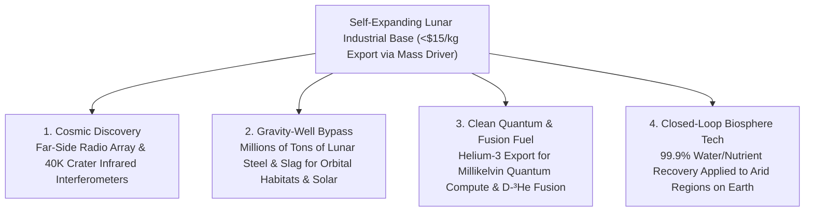

# VISION 01 — SPACE EXPANSION & CISLUNAR CIVILIZATION
## Sub-Pathway 1A: The Permanent Lunar Industrial Base — *Turning Regolith into Sunlight, Oxygen, Steel, and Deep-Space Science*

> **Executive Framing & Structure**
> * **The Cynic's Objection:** *"Why go back to the Moon? Apollo cost \$300 billion in today's dollars just to bring back rocks in a tin can. The Moon is a dead, radiation-baked desert of razor-sharp dust with two-week freezing nights. Every kilogram of water, air, or concrete costs a fortune to launch from Earth. A lunar base will never be more than an expensive geopolitical photo-op."*
> * **The Core Thesis:** Apollo failed to stay because it brought 100% of its mass from Earth at **\$50,000+ per kilogram** and threw every rocket away. Between **2024 and 2026**, four converging technologies inverted lunar economics forever: **100-ton-class reusable lunar landers** (SpaceX Starship HLS & Blue Origin *Blue Moon*), **commercial robotic delivery fleets** (NASA CLPS landers like Firefly *Blue Ghost* and Intuitive Machines), **Molten Regolith Electrolysis (MRE)** that cracks ordinary moon dirt directly into **breathable oxygen, pure silicon solar cells, aluminum, and iron**, and **autonomous laser/microwave regolith sintering**. By **2040**, the Lunar South Pole is a self-expanding industrial quarry, clean-energy forge, and radio-quiet astronomical sanctuary that lifts heavy industry off Earth's biosphere.

---

## ACT I: A BELIEVABLE NEAR-FUTURE VISION (THE WORLD OF 2040)
### A Morning at Shackleton Rim — and Its Quiet Footprint on Earth

It is **2040** along the sunlit connecting ridge between **Shackleton and de Gerlache craters** at the Lunar South Pole (`89.9° S`).

Here, because the Moon's rotational axis is tilted by only `1.54°` relative to the ecliptic, the mountain peaks bathe in **near-continuous sunlight for more than 85% to 92% of the lunar year**, while the permanently shadowed crater floors just two kilometers below stay locked at **40 Kelvin (-233 °C)**—holding hundreds of millions of metric tons of ancient water ice, ammonia, carbon dioxide, and volatiles trapped over three billion years.

Nothing at **Shackleton Industrial Station** looks like a fragile 1969 foil tent:

1. **The Vitrified Basalt Landing Aprons & Vaults:**
   * Down in the shallow saddle between ridges, six **150-meter-wide hexagonal landing pads** gleam like dark volcanic glass. No concrete was ever shipped from Earth to build them.
   * Autonomous rover swarms swept loose lunar regolith into layered berms and fused it with **multi-kilowatt lasers and microwave beams** into solid, dust-free basaltic stone (`>57 MPa` compressive strength).
   * Over the habitats, **3-meter-thick 3D-printed regolith vaults** block 99.9% of galactic cosmic rays, solar particle storms, and micrometeorites. Inside the pressurized woven-and-alloy hulls beneath those arches, 180 engineers, geologists, astronomers, and technicians work in shirt-sleeves amid hydroponic citrus walls and warm circadian lighting.
2. **The Dirt-to-Solar & Oxygen Refineries:**
   * Along the sunlit ridge, a 15-kilometer ribbon of **lunar-manufactured silicon solar arrays** rises vertically like a gleaming fence to catch the low-angle polar sun, backed by **5-megawatt compact fission reactors** tucked into natural rock trenches.
   * Next door, electric **Molten Regolith Electrolysis (MRE)** furnaces heat raw lunar soil to `1,600 °C` without a single chemical reagent imported from Earth.
   * Every metric ton of raw moon dirt yields **400 kilograms of pure breathable oxygen**, alongside cast ingots of **metallurgical silicon, iron, aluminum, and titanium**, plus slag spun into high-tensile basalt fiber.
3. **The Far-Side Radio Observatory & Earth Benefits:**
   * Around the horizon inside **Daedalus Crater** on the lunar far side—shielded by **3,474 kilometers of solid rock** from every television broadcast, cell tower, and satellite constellation on Earth—autonomous spiders have strung a **30-kilometer low-frequency radio interferometer**.
   * For the first time in history, astronomers on Earth are streaming crisp 21-centimeter hydrogen tomography from the cosmic "Dark Ages" before the first stars ignited, and imaging the protective magnetospheres of potentially habitable exoplanets around nearby stars.
4. **The Cislunar Propellant Highway & Helium-3 Skimmers:**
   * Down in the cold traps, heated extraction drills sublime water ice into pure $\text{H}_2\text{O}$, electrolyzing it into liquid hydrogen and liquid oxygen ($\text{LH}_2/\text{LOX}$).
   * Because escaping the Moon's gravity well requires **22 times less energy** than escaping Earth's (`2.38 km/s` vs. `11.2 km/s` $\Delta v$, with zero atmospheric drag), tankers launched from Shackleton refuel communication platforms, asteroid deflectors, and orbital habitats across cislunar space at a tenth the cost of Earth launches—while robotic harvesters in the equatorial maria skim solar-wind-implanted **Helium-3 ($\text{^3He}$)** to cool quantum supercomputers and fuel aneutronic fusion reactors back on Earth.

---

## ACT II: THE CONVERGENCE BRIDGE — HOW IT CAME ABOUT (2021–2038)
### How Reusable Super-Heavy Lift, Robotic Landers, and Regolith Electrolysis Broke the Mass Bottleneck

### Step 1: Why the 50-Year Lunar Hiatus Ended (2021–2026)
During Apollo, the Saturn V cost roughly **\$1.5 billion per launch** (inflation-adjusted) to place a **15-metric-ton** Lunar Module on the surface—of which less than **500 kilograms** was scientific gear. Nothing could scale when every bolt, solar panel, and liter of oxygen had to be lifted out of Earth's deep gravity well on an expendable rocket.

Between **2023 and 2026**, four simultaneous breakthroughs dismantled that barrier:

* **100-Ton-Class Reusable Lunar Landers:**
  SpaceX's **Starship Human Landing System (HLS)** and cargo variants—paired with orbital propellant transfer—and Blue Origin's **Blue Moon MK1 and MK2** landers (backed by BE-7 liquid hydrogen/oxygen engines and zero-boiloff cryocoolers running at `20 K`) increased single-mission payload to the lunar surface from **1.5 tons to 30–100+ metric tons**, driving surface delivery costs down by two orders of magnitude.
* **The Commercial Lunar Payload Services (CLPS) Scouting Fleet:**
  Instead of waiting a decade for single government flagship missions, NASA's fixed-price CLPS program seeded a competitive commercial fleet. Intuitive Machines' **Odysseus (IM-1)** achieved the first U.S. soft landing in 52 years in February 2024, followed by **Athena (IM-2)** at the South Pole in early 2025; Firefly Aerospace's **Blue Ghost Mission 1** executed a flawless precision landing and 14-day surface science campaign at *Mare Crisium* in March 2025—proving GNSS lunar navigation signals at `400,000 km`, subsurface thermal probes, and electrodynamic dust shields.
* **Molten Regolith Electrolysis (The Alchemy of Moon Dirt):**
  Lunar regolith is **40% to 45% oxygen by weight**, chemically bound in silicate and oxide minerals ($\text{SiO}_2, \text{FeO}, \text{Al}_2\text{O}_3, \text{TiO}_2, \text{MgO}$). Blue Origin's **Blue Alchemist** program demonstrated an end-to-end zero-reagent Molten Regolith Electrolysis (MRE) reactor that melts regolith simulant at `1,600 °C` and passes an electric current through an inert anode—bubbling off pure **$\text{O}_2$ gas** while purifying silicon to **>99.999% purity** to manufacture working solar cells and protective cover glass directly from moon dirt, with zero toxic chemicals or water loss.
* **Laser/Microwave Vitrification & Compact Fission Power:**
  Every rocket plume landing on raw regolith blasts high-velocity dust ejecta at `>2,000 m/s`, threatening nearby hardware. **ICON (Project Olympus)** and **Redwire** demonstrated laser and microwave sintering heads that melt regolith in situ into interlocking ceramic-basalt landing pads and roads, while **Westinghouse (*eVinci*)** and **Rolls-Royce** advanced heat-pipe microreactors (`40 kWe` to `1 MWe`) to bridge polar shadow periods.

### Step 2: 2025–2026 Global State of the Art (Verified Hardware & Milestones)

| Organization / System | Focus Area | Verified 2024–2026 Milestone | Commercial & Cislunar Pathway |
| :--- | :--- | :--- | :--- |
| **Firefly Aerospace (*Blue Ghost*)** | Commercial Robotic Lunar Landers (CLPS) | **March 2025:** *Blue Ghost M1* achieved a flawless precision landing in *Mare Crisium*, operating 10 NASA payloads for a full lunar day + eclipse, including LuGRE GPS lock at the Moon. | Annual commercial delivery cadence (*Blue Ghost M2 & M3*, 2026–2028) deploying far-side relays and South Pole rovers. |
| **Intuitive Machines (*Nova-C / Nova-D*)** | South Pole Landers, Hoppers & Data Network | **Feb 2024 & Mar 2025:** Landed *Odysseus (IM-1)* and *Athena (IM-2)* at the South Pole region, deploying the *Micro-Nova* propulsive crater hopper and Nokia 4G/LTE lunar surface network. | Scaling to heavy **Nova-D** cargo landers (1,500–2,500 kg payload) and the **Khon** lunar data/navigation constellation. |
| **SpaceX (*Starship HLS & Cargo*)** | 100-Ton-Class Reusable Cislunar Transport | Achieved multiple full-stack *Super Heavy* booster tower catches (2024–2026), in-space Raptor relights, propellant transfer demos, and HLS life-support/docking hardware qualification. | Delivering **50–100+ metric tons** per landing for Artemis III/IV and oversized one-piece industrial reactors. |
| **Blue Origin (*Blue Moon* & *Blue Alchemist*)** | Cryogenic Landers & Dirt-to-Solar ISRU | Built **Blue Moon MK1** pathfinder (`3-ton` cargo class) for 2025–2026 flight; **Blue Alchemist** produced working solar cells, cover glass, and oxygen from 100% regolith simulant via MRE. | **Blue Moon MK2** crew/cargo lander (`20–30t` payload) + automated lunar solar-panel replication factories. |
| **ICON (*Project Olympus*) & Redwire** | Autonomous Regolith 3D Printing & Sintering | Completed NASA Marshall vacuum-chamber laser vitrification tests on lunar regolith simulants (`>57 MPa` compressive strength, exceeding terrestrial concrete) under a \$57M NASA contract. | Robotic construction of blast-proof landing pads, haul roads, and radiation-shielded habitat vaults. |
| **Lunar Outpost & Astrolab (*FLEX*)** | Autonomous Mobility & Resource Prospecting | Selected in **2024–2026 NASA Lunar Terrain Vehicle (LTV)** contract (\$4.6B ceiling); deployed commercial rovers and autonomous cold-trap prospecting drills. | Commercial rover-as-a-service fleets hauling regolith ore, laying power cables, and tending robotic farms. |
| **Interlune & Magna Petra** | Lunar Helium-3 ($\text{^3He}$) & Volatile Harvesting | **Interlune** (founded by Apollo 17 geologist Harrison Schmitt & former Blue Origin leaders) demonstrated cryocooler $\text{^3He}$ separation and signed 2025–2026 commercial DOE/quantum contracts. | Excavating solar-wind volatiles from ilmenite-rich maria regolith for quantum cryogenics (`millikelvin` cooling) and $\text{D–^3He}$ fusion. |
| **Westinghouse, Rolls-Royce & NASA FSP** | Fission Surface Power (`40 kWe – 1 MWe`) | Completed Phase 1/2 designs for NASA **Fission Surface Power (FSP)** and UK Space Agency microreactors using TRISO fuel and alkali-metal heat pipes with zero moving parts. | Continuous 10-year baseload power inside permanently shadowed craters and across the 354-hour lunar night. |

### Step 3: The Self-Expanding Bootstrap Loop (Why Costs Collapse After Ton #500)
The secret to a permanent lunar base is **the ISRU Multiplication Ratio**:
1. **Phase A (Importing the Seed Factory):**
   Instead of launching 10,000 tons of finished solar panels and liquid oxygen from Earth, five Starship/Blue Moon cargo flights deliver **300 tons of seed machinery**: autonomous excavators, three MRE electrolysis kilns, a silicon wafer deposition unit, a laser sintering rover, and a 500-kWe fission core.
2. **Phase B (Exponential Power & Oxygen Scaling):**
   That 300-ton seed factory processes **5,000 tons of local regolith per year** into **2,000 tons of liquid oxygen**, **800 tons of structural iron/aluminum**, and **2 megawatts of new lunar-made solar arrays every 12 months**.
3. **Phase C (Closing the Propellant Loop):**
   Roughly **75% to 80% of the mass** of a hydrolox ($\text{LH}_2/\text{LOX}$) or methalox ($\text{CH}_4/\text{LOX}$) rocket is **liquid oxygen**. The moment lunar landers refill their oxygen tanks on the Moon using MRE or polar ice, the mass that must be launched from Earth drops by **$4\times$ to $5\times$ overnight**.

---

## ACT III: PHASED ROLLOUT ROADMAP (2026–2050) & ECONOMIC CASCADE

| Phase | Timeline | Infrastructure & Operational Scale | Delivery & ISRU Cost Metrics | Societal & Scientific Thresholds Unlocked |
| :--- | :--- | :--- | :--- | :--- |
| **Phase 1: Robotic Scouts & Polar Pathfinder** | **2026–2030** | 12+ CLPS robotic landers, *Blue Moon MK1*, *Starship HLS* uncrewed/crewed demos (**Artemis III/IV**). First pilot MRE oxygen kiln (`10 tons O₂/yr`) & sintered landing pad at South Pole. | **\$2,500–\$5,000/kg** delivered to lunar surface; first locally produced $\text{LOX}$ & basalt bricks. | Direct assay of Shackleton/Cabeus water-ice reserves; first human return to lunar surface; pathfinder far-side radio dipole (`LuSEE-Night`). |
| **Phase 2: Autonomous Outpost & Propellant Depot** | **2030–2035** | Year-round pressurized base (`15–30 crew`) shielded under 3D-printed regolith vaults; `2 MW` solar + fission microreactors; **500 tons/yr** polar water-ice & MRE oxygen refinery. | **\$400–\$900/kg** to lunar surface; lunar $\text{LOX}$ produced at **<\$80/kg** in situ. | Reusable cislunar tugs refueled from lunar depots; first `10 km` Far-Side Low-Frequency Radio Array imaging the cosmic Dark Ages. |
| **Phase 3: Industrial Quarry & Solar Self-Replication** | **2035–2042** | `150–300 residents` across 3 polar & maria hubs; automated MRE factories producing **10+ MW/yr** of indigenous silicon solar cells, cast iron/aluminum beams, and basalt-fiber pressure hulls. | **\$100–\$250/kg** from Earth; **>90% of structural & propellant mass** sourced locally on the Moon. | Commercial export of lunar **Helium-3** for quantum computing & $\text{D–^3He}$ fusion; electromagnetic mass driver (`2.4 km/s`) launching raw slag/oxygen to L1/L2 orbital shipyards. |
| **Phase 4: Cislunar Metropolis & Deep-Space Shipyard** | **2042–2050+** | `1,000+ permanent population`; `200+ MW` polar solar-ring & fission grid; pressurized dome agronomy; full orbital manufacturing at Earth-Moon L1 fed by lunar mass drivers. | Bulk lunar metals & shielding delivered to Earth orbit at **<\$15/kg** (cheaper than lifting from Earth). | Construction of kilometer-scale spinning artificial-gravity habitats, space solar power arrays, and deep-space vessels without straining Earth's atmosphere. |

### Key Economic & Engineering Inflection Metrics (2026–2045)
* **Surface Delivery Cost Collapse:**
  * *Apollo Era (1969–1972):* **>\$50,000/kg** (expendable Saturn V + Lunar Module).
  * *CLPS / Early Commercial (2025–2027):* **\$3,000–\$8,000/kg** (fixed-price robotic landers).
  * *Reusable Super-Heavy (2028–2034):* **\$300–\$800/kg** (Starship HLS & Blue Moon MK2 with orbital refueling).
  * *ISRU Propellant-Closed Loop (2035–2045):* **<\$100/kg** net Earth-launched mass per ton of surface hardware emplaced.
* **The Local Resource Leverage Ratio:**
  * Every **1 kg of MRE/sintering seed machinery** landed at Shackleton Rim produces **>15 kg of local oxygen, solar silicon, structural iron, and radiation shielding per year**—compounding exponentially as locally manufactured solar arrays power additional MRE furnaces.
* **Cislunar $\Delta v$ Advantage:**
  * Launching 1 ton of liquid oxygen or structural steel from the Lunar surface to Earth-Moon L1 requires **`2.52 km/s` $\Delta v$** (via zero-propellant electric mass driver), compared to **`>12.5 km/s` $\Delta v$** fighting gravity and atmospheric drag from Earth's surface.

---

## ACT IV: THE DEEPER HORIZON & SUMMARY FOR THE SKEPTIC
### How the Eighth Continent Transforms Life on Earth

1. **Unblinding Humanity's Eyes on the Universe:**
   * Earth's ionosphere blocks all radio wavelengths longer than 10 meters (`<30 MHz`), and human radio interference drowns out faint cosmic whispers.
   * Meanwhile, craters at the Lunar poles at `30–40 K` allow **passively cooled infrared and optical interferometers** with baselines of tens of kilometers—100 times wider than the James Webb Space Telescope—capable of directly resolving **continents, oceans, and biosignature gases ($\text{O}_2, \text{CH}_4, \text{H}_2\text{O}$)** on rocky exoplanets within 50 light-years.
2. **The Industrial Gravity-Well Bypass:**
   * Building a future of kilometer-scale orbital solar power stations, asteroid-defense shields, and spinning artificial-gravity habitats requires millions of tons of steel, aluminum, silicon, and radiation shielding.
   * Ripping millions of tons out of Earth's crust and burning chemical rockets through our stratosphere to lift it is the hard way. Launching refined lunar iron, silicon, basalt, and oxygen off an airless body using a **solar-powered electromagnetic linear motor (mass driver)** uses **zero chemical propellant** and **<5% of the kinetic energy** of an Earth launch.
3. **The Closed-Loop Ecological Blueprint for Earth:**
   * Because a lunar outpost cannot waste a single molecule of water, carbon, nitrogen, or phosphorus, lunar life-support engineering drives hyper-efficient **bioregenerative agriculture, solid-state water purification, and zero-loss material recycling**—technologies that spin directly back into arid-land farming and municipal water systems on Earth.
4. **Sovereign Clean Energy & Quantum Cryogenics ($\text{^3He}$):**
   * Four billion years of unshielded solar wind have embedded hundreds of thousands of tons of **Helium-3** into the upper meters of lunar maria regolith.
   * Returning even a few metric tons per year inside returning cargo Starships supplies the global dilution-refrigerator fleet needed for fault-tolerant **quantum computing** and provides the ultimate aneutronic fuel for second-generation **$\text{D–^3He}$ fusion reactors** on Earth.

> **Bottom Line for the Skeptic:**
> We are not going to the Moon to plant flags in dust. The Moon is a **quadrillion-ton stockpiled barge of oxygen, silicon, iron, aluminum, titanium, water ice, and Helium-3** parked three days away at the top of Earth's gravity well. With reusable 100-ton landers and Molten Regolith Electrolysis already proven in 2025–2026 hardware, the Moon becomes humanity's clean offshore industrial foundry—so Earth can remain a garden.
