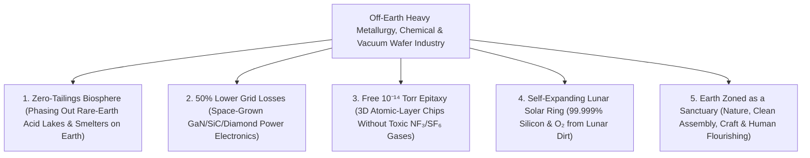

# VISION 01: SPACE INDUSTRIALIZATION & ORBITAL ABUNDANCE
## Pathway 1E: Off-Earth Heavy & Polluting Industry — *Zoning Earth as a Pristine Biosphere Reserve*

> **The Cynic's Objection:**
> *"Moving factories into space to stop pollution sounds like the ultimate billionaire pipe dream! How could it ever make economic sense to refine metals, chemicals, or semiconductors in orbit or on the Moon instead of just putting scrubbers on smokestacks on Earth?"*
>
> **The Core Thesis:**
> On Earth, heavy industry is locked in a war against our own atmosphere and biosphere: semiconductor fabs and vacuum smelters spend billions fighting corrosive oxygen, moisture, and dust, while rare-earth and chemical refineries inevitably leak toxic acids, fluorocarbons, and heavy-metal tailings into living watersheds. In space and on the airless Moon, **ultra-high vacuum ($10^{-12}\text{ to }10^{-14}\text{ Torr}$) is infinite and free**, **unattenuated $3,000\text{ °C}$ solar thermal heat runs 24/7**, and there is **zero groundwater, zero air, and zero living biology to poison**. Better still, sending finished high-value goods *down* to Earth uses atmospheric aerobraking for free, while launching from the Moon's $1/6g$ airless surface requires **$22\times$ less gravitational escape energy** than launching from Earth.

---

## ACT I: A BELIEVABLE NEAR-FUTURE VISION (THE WORLD OF 2040)
### A Tuesday Morning in 2040 — When Heavy Industry Left the Biosphere Behind

Imagine walking along the reclaimed riverbanks of Baotou in Inner Mongolia—or the Rhine-Ruhr valley in Germany, the Texas Gulf Coast, or Hsinchu in Taiwan—on a clear morning in **2040**.

In the 2020s, producing the neodymium magnets, ultra-pure silicon wafers, wide-bandgap gallium-nitride chips, and specialty titanium alloys required for modern civilization meant tolerating toxic rare-earth tailings lakes, hydrofluoric acid plumes, and billion-dollar cleanrooms guzzling municipal water. Yet by 2040, four quiet realities have transformed industrial geography:

1. **The Planetary Zoning Turnaround:**
   Just as 20th-century cities zoned smoky foundries out of residential neighborhoods, 21st-century civilization has begun zoning its most energy-intensive, vacuum-dependent, and hazardous material processing **off Earth's surface entirely**—into autonomous orbital wake-shield factories and Lunar Industrial Zones.
2. **The Wake-Shield Semiconductor Foundry (550 km Up):**
   In Low Earth Orbit, an autonomous free-flying spacecraft glides behind a stainless-steel hemispherical **Wake Shield**. As the shield plows through the tenuous upper thermosphere at $7.6\text{ km/s}$, it sweeps stray atoms aside—creating a trailing shadow of **$10^{-14}\text{ Torr}$ ultra-high vacuum** ($10,000\times$ cleaner than any cleanroom on Earth) without a single mechanical vacuum pump. Inside that open-space wake, robotic Molecular Beam Epitaxy (MBE) arms deposit 1,000 atomic layers of defect-free **gallium nitride (GaN), silicon carbide (SiC), and diamond-substrate chips** using zero toxic perfluorinated cleaning gases.
3. **Zero-Tailings Lunar Metallurgy & Solar Glass:**
   On the sunlit peaks of the Lunar South Pole, **Molten Regolith Electrolysis (MRE)** reactors fed by 24/7 solar concentrators melt raw lunar soil at $1,600\text{ °C}$ without a single drop of water or chemical acid—splitting it directly into **$>99.999\%$ pure solar silicon**, structural iron-aluminum alloys, and breathable oxygen.
4. **Downhill Delivery to Earth:**
   Every week, reusable lifting-body capsules (descended from **Varda Space**, **Space Forge**, and **Sierra Space** vehicles) reenter Earth's atmosphere, using air friction to brake from orbital speed for free, and land pallets of ultra-pure wide-bandgap wafers, radiation-hardened optics, and rare-earth permanent magnets at coastal spaceports—installing into Earth's electric grids to cut terrestrial power conversion losses by **50%**.

---

## ACT II: THE CONVERGENCE BRIDGE — HOW IT CAME ABOUT (2021–2038)
### Free Ultra-High Vacuum, Molten Regolith Electrolysis, and Downhill Aerobraking

```mermaid
flowchart LR
    subgraph Physics["Why Space Beats Earth for Heavy & Ultra-Pure Industry"]
        P1["Free Ultra-High Vacuum (10⁻¹² to 10⁻¹⁴ Torr): 10,000x Cleaner Than Earth Fabs"]
        P2["Zero Biosphere Coupling: Zero Air, Zero Groundwater, Zero Toxic Tailings Leaks"]
        P3["Gravity-Well Asymmetry: Moon Escape Energy is 22x Lower + Free Earth Aerobraking"]
    end

    subgraph SOTA2026["2024-2026 Verified Industrial Proof"]
        S1["Blue Origin Blue Alchemist: 99.999% Pure Silicon & O₂ from Regolith (Zero Chemicals)"]
        S2["Varda Space (W-1, W-2, W-3): Routine Autonomous Orbital Factories & Capsule Return"]
        S3["Space Forge & Redwire MSTIC: In-Orbit Wide-Bandgap Semiconductor Fabrication"]
    end

    subgraph Zoning2040["The 2040 Zoned Biosphere"]
        Z1["Earth Zoned for Life, Clean Assembly & Biodiversity"]
        Z2["LEO Wake-Shield Fabs Producing 50%-More-Efficient GaN/SiC Power Chips"]
        Z3["Lunar & Cislunar Zones Handling Heavy Metallurgy & Rare-Earth Separation"]
    end

    Physics --> SOTA2026
    SOTA2026 ==> Zoning2040
```

### Step 1: The Three Physical Laws That Drive Heavy Industry Off-Earth
Why did semiconductor fabrication, specialty metallurgy, and rare-earth refining begin migrating to orbit and cislunar space in the late 2020s?

* **1. The Free $10^{-14}\text{ Torr}$ Vacuum Law (Eliminating the Cleanroom Bottleneck):**
  On Earth, our $101.3\text{ kPa}$ atmosphere is a soup of reactive oxygen, water vapor, hydrocarbons, and particulates. Building a modern semiconductor fab costs **\$20+ billion**, largely because maintaining Class-1 cleanrooms, ultrapure water systems, and tiny $10^{-9}\text{ Torr}$ vacuum chambers requires massive energy and toxic fluorinated etching/cleaning gases ($\text{NF}_3$, $\text{SF}_6$, $\text{CF}_4$—greenhouse gases **$17,000\times$ more potent than $\text{CO}_2$**).
  In Low Earth Orbit, a spacecraft traveling at $7.6\text{ km/s}$ outruns the thermal velocity of residual gas molecules ($v_{\text{thermal}} \approx 1\text{ km/s}$). Behind a simple metallic **Wake Shield**, pressure drops passively to **$10^{-14}\text{ Torr}$**. You don't pump the vacuum; **the whole facility sits inside an infinite, free vacuum**.
* **2. Zero-Chemical Molten Regolith Electrolysis (MRE) & Plasma Separation:**
  On Earth, separating rare-earth metals or smelting silicon and aluminum uses carbon anodes (releasing $\text{CO}_2$ and perfluorocarbons) or lakes of sulfuric/hydrochloric acid. In vacuum or on the Moon, **Molten Regolith Electrolysis** (proven by **Blue Origin's *Blue Alchemist***) passes direct solar electrical current through molten silicate rock at $1,600\text{ °C}$:
  $$\text{Metal Oxides (SiO}_2, \text{FeO}, \text{Al}_2\text{O}_3, \text{TiO}_2\text{)} \xrightarrow{\text{Direct Solar Electrolysis}} \text{Pure Si, Fe, Al, Ti} + \text{O}_2\uparrow$$
  The only byproduct is **pure breathable oxygen gas**. And when refining toxic heavy elements (beryllium, cadmium, tellurium, thorium-bearing rare earths) via vacuum electromagnetic mass separation in cislunar space, there is **zero atmosphere or water table**—making ecological contamination physically impossible.
* **3. The $22\times$ Gravity-Well Asymmetry (Moving Downhill is Free):**
  Critics forget that industrial trade flows **down** the gravity well toward Earth:
  * **From LEO to Earth:** A reentry capsule needs only $\Delta v \approx 120\text{ m/s}$ ($<2\%$ propellant mass fraction) to dip into Earth's upper atmosphere, where air drag dissipates **$30\text{ megajoules per kilogram}$ of kinetic energy for free**.
  * **From the Moon to Cislunar/Earth:** Because the Moon has no atmosphere and only $1/6$th Earth's gravity, its specific escape energy ($\frac{1}{2}v_{\text{esc}}^2$) is **$2.83\text{ MJ/kg}$** versus Earth's **$62.5\text{ MJ/kg}$**—**$22.1\times$ lower energy**. An electric linear motor (**electromagnetic mass driver**) bolted to the airless lunar surface can fling payloads into cislunar transfer using pure solar electricity and **zero rocket fuel**.

### Step 2: The 2025–2026 Global State of the Art (Verified Flight & Lab Hardware)
The building blocks of off-Earth manufacturing and zero-chemical lunar refining are already operating in 2024–2026:

| Organization / System | Region | Industrial Focus | Verified 2024–2026 Milestone | Commercial & Biosphere Pathway |
| :--- | :--- | :--- | :--- | :--- |
| **Blue Origin (*Blue Alchemist* & *Blue Moon*)** | USA (WA / FL) | Zero-Chemical Lunar Silicon, Metal & Oxygen Refining | **2023–2026:** Demonstrated autonomous **Molten Regolith Electrolysis** producing **$>99.999\%$ pure solar silicon cells**, iron, aluminum, and $\text{O}_2$ with zero chemicals/water; *New Glenn* & *Blue Moon MK1* flight readiness. | Self-expanding lunar solar factories and off-Earth heavy metallurgy, fulfilling the vision of **zoning Earth for residential & ecological life**. |
| **Varda Space Industries (*W-1, W-2, W-3, W-4*)** | USA (CA) | Autonomous Free-Flying Orbital Factories & Reentry Logistics | **Feb 2024 (*W-1*) & 2025 (*W-2, W-3*):** Completed world's first commercial autonomous orbital factory missions and hypersonic capsule landings in Utah & South Australia. | Routine monthly "orbital FedEx" downlinks of high-value materials manufactured in microgravity and space vacuum. |
| **Space Forge (*ForgeStar-1*)** | UK / Europe | Orbital Ultra-High-Vacuum Wide-Bandgap Semiconductors | Launched *ForgeStar* pathfinder and developed reusable *Pridwen* non-ablative alloy heatshield for returning space-grown **GaN, SiC, and diamond semiconductor substrates**. | Space-grown wide-bandgap power chips that slash terrestrial EV charger, wind turbine, and data-center power losses by **50%**. |
| **Redwire Space (*MSTIC* & FabLab)** | USA (FL) | In-Space Semiconductor Coatings & Alloy Manufacturing | Operated **MSTIC** (Microgravity Semiconductor & Thin-Film Integrated Coatings) and brazed/sintered metal components in orbit (2024–2026). | Scaling automated zero-G crystal growth and ultra-pure optical/semiconductor wafer production in LEO. |
| **Sierra Space & NASA (*Carbothermal ISRU*)** | USA (CO / TX) | Lunar Regolith Carbothermal Oxygen & Metal Extraction | **2024–2026:** Validated concentrated-solar carbothermal reactor extracting oxygen and metals from lunar highlands/mare simulants in thermal vacuum; *Dream Chaser* runway reentry. | Industrial-scale lunar metal/oxygen plants paired with low-$1.5g$ runway return of fragile high-value wafers to Earth. |
| **Wake Shield Facility / Orbital MBE Heritage** | USA (TX) | $10^{-14}\text{ Torr}$ Free-Space Epitaxial Thin-Film Growth | Flight-proven orbital stainless-steel wake shield generating vacuum **$10,000\times$ cleaner** than terrestrial cleanrooms for epitaxial thin films. | Blueprint for 10-meter Starship-deployed Wake Shield Semiconductor Foundries requiring zero toxic $\text{NF}_3/\text{SF}_6$ chamber gases. |
| **ETH Zurich / ESA Solar Sintering & 3D Metal** | Europe | Concentrated Solar Regolith Melting & Orbital Metal 3D Printing | **2024–2026:** ESA achieved the **first 3D metal printing in orbit** aboard Columbus; demonstrated direct solar-beam sintering of regolith bricks in vacuum. | Zero-binder, zero-emission construction of radiation-shielded cislunar industrial vaults and foundries. |

---

## ACT III: PHASED ROLLOUT ROADMAP (2026–2050) & ECONOMIC CASCADE
### From Orbital Wafer Drops to the Great Planetary Re-Zoning

| Phase & Timeline | Launch Cost & Facility Scale | Products & Downlink Cadence | Societal & Biosphere Thresholds Unlocked |
| :--- | :--- | :--- | :--- |
| **Phase 1: High-Value Vacuum Wafers & Crystals** *(2025–2029)* | **\$500–\$1,200/kg** 1-Ton Free-Flying Capsules (**Varda, Space Forge**) | **GaN/SiC/Diamond Power Substrates**, ZBLAN fluoride fiber, biologics (\$50k–\$500k/kg); Monthly capsule drops | Space-grown wide-bandgap power electronics cut electricity conversion waste in terrestrial grids and EVs by **30%–50%**. |
| **Phase 2: Starship Wake-Shield Foundries** *(2029–2035)* | **\$80–\$200/kg** 50-Ton Orbital Wake-Shield Fabs | **100+ Tons/Year** of 3D epitaxial chips, ultra-pure titanium/beryllium optics, and radiation-free alloys | Eliminates potent fluorinated greenhouse gases ($\text{NF}_3$, $\text{SF}_6$) and billion-liter ultrapure water draw from next-gen semiconductor growth. |
| **Phase 3: Lunar & Cislunar Heavy Metallurgy** *(2035–2043)* | **\$30–\$60/kg** (+ Lunar Mass Drivers) Megawatt **Blue Alchemist** MRE Plants | **Rare-Earth Magnet Separation**, solar silicon, and bulk aluminum/iron refined on Moon/Cislunar | Toxic rare-earth acid-leach lakes on Earth begin shutting down; 100% of cislunar solar and station hardware built from lunar/asteroid ore. |
| **Phase 4: Earth Zoned as a Biosphere Reserve** *(2043–2050)* | **<\$20/kg** (Downhill Aerobraking) Gigawatt Cislunar Industrial Ring | Full-scale heavy metallurgy, hazardous chemical synthesis, and wafer fab off-Earth | **Earth's land, rivers, and atmosphere are permanently freed from heavy smelting and toxic chemical tailings.** |

### Industrial Comparison: Terrestrial Fab & Smelter vs. Orbital Wake-Shield & Lunar MRE
Why does high-purity wafer fabrication and primary metal/rare-earth refining migrate off-Earth once launch drops below \$100/kg?

| Industrial Process Metric | Terrestrial Fab / Rare-Earth Smelter | LEO Wake-Shield Fab & Lunar MRE Zone | Off-Earth Industrial Advantage |
| :--- | :--- | :--- | :--- |
| **Operating Vacuum Level** | **$10^{-7}\text{ to }10^{-9}\text{ Torr}$** (costly turbopumps) | **$10^{-12}\text{ to }10^{-14}\text{ Torr}$** (infinite, passive & free) | **$10,000\times$ Purer Vacuum at \$0 Pump Cost** |
| **Ultrapure Water & Acid Reagents** | **$15\text{M+ Liters/Day}$** + $\text{HF / H}_2\text{SO}_4$ leach ponds | **$0\text{ Liters Water}$** + **$0\text{ Chemical Acids}$** | **Zero Watershed or Aquifer Depletion** |
| **Greenhouse & Chamber Etch Gases** | $\text{CO}_2$, PFCs, $\text{NF}_3$, $\text{SF}_6$ ($17,000\times\text{ CO}_2$ GWP) | **Pure $\text{O}_2$ Byproduct Only** (Direct Solar MRE) | **100% Elimination of Toxic Atmospheric Plumes** |
| **Downhill Delivery Energy to Earth** | Diesel / Marine Bunker Freight | **$99.5\%$ Free Atmospheric Braking** (+ Lunar $1/6g$) | **Near-Zero Propellant Return Logistics** |

### How Off-Earth Industry Multiplies Clean Energy on Earth
Even before bulk metallurgy moves to the Moon, Phase 1 and Phase 2 orbital factories deliver three massive immediate wins:
1. **Wide-Bandgap Semiconductors (50% Lower Grid Losses):** On Earth, growing thick boules of Silicon Carbide (SiC), Gallium Nitride (GaN), or Indium Phosphide is crippled by **gravity-driven buoyancy convection** and **trace chamber impurities**. In a free-flying LEO Wake-Shield Foundry, zero gravity + **$10^{-14}\text{ Torr}$ vacuum** yields $100\times$ lower defect densities. Replacing legacy silicon switches on Earth with space-grown wide-bandgap substrates eliminates **up to 10% of global electricity conversion waste**—saving more energy on Earth within six months than the rocket fuel used to launch the factory.
2. **ZBLAN Heavy-Metal Fluoride Optical Fiber ($10\times\text{ to }100\times$ Lower Signal Loss):** Drawn in terrestrial gravity, heavy-metal fluoride glass crystallizes into microscopic defects. Drawn in microgravity (proven on ISS by Redwire/FOMS), ZBLAN fiber exhibits near-zero Rayleigh scattering—enabling transcontinental terrestrial optical networks that require almost no undersea signal repeaters.
3. **Closed-Loop Slag Vitrification (Zero Space Pollution):** Moving dirty industry off-Earth does not mean trashing the Moon or littering orbit. In Molten Regolith Electrolysis and vacuum plasma refining, 100% of the residual silicate slag is cast directly into **inert, glass-ceramic radiation shielding bricks and landing pads**, while reusable lifting-body capsules (like Space Forge's *Pridwen* alloy shield and Sierra's *Dream Chaser*) return finished goods with zero orbital debris.
4. **Solar-Electric Lunar Mass Drivers (Zero-Propellant Export):**
   * Because the Moon has zero atmospheric drag and $1/6\text{th}$ Earth's gravity ($v_{\text{esc}} = 2.38\text{ km/s}$), a $2\text{-kilometer}$ linear electromagnetic coilgun bolted along a lunar mare plain accelerates $100\text{ kg}$ billets of refined rare-earth magnets, titanium, and solar-grade silicon into Earth-Moon Lagrange ($L_1/L_2$) catch nets at $30g$ using **only solar electricity ($\sim 0.8\text{ kWh/kg}$, or $<\$0.05/\text{kg}$ in energy)** and **zero chemical rocket propellant**.

---

## ACT IV: THE DEEPER HORIZON & SUMMARY FOR THE SKEPTIC

For two hundred years since the Industrial Revolution, humanity assumed a tragic bargain: to have modern medicine, computers, and metallurgy, we had to dump the entropy—the heat, acid tailings, slag, and toxic gases—into the thin 10-kilometer shell of air and water where all known life exists.

1. **Breaking the Industrial Bargain Forever:**
   Earth is the only biological oasis we know of in the universe; the Moon and cislunar space are sterile, airless expanses bathed in eternal sunlight and infinite vacuum. Putting heavy, high-temperature, vacuum-hungry industry where vacuum and solar heat are free—and where zero rivers or lungs exist—is elementary planetary common sense.
2. **Containerless Ultra-Pure Metallurgy & Bulk Metallic Glasses:**
   On Earth, reactive molten metals like titanium, zirconium, and niobium dissolve and corrode the ceramic crucibles holding them. In zero gravity, electromagnetic levitation melts alloys floating in mid-vacuum without touching a container wall—creating **amorphous bulk metallic glasses** three times stronger than steel and completely immune to corrosion.
3. **Earth as a Garden, University, and Sanctuary:**
   As automated cislunar foundries and orbital wake-shield fabs take over dirty primary extraction and toxic processing, Earth retains clean final assembly, human craftsmanship, arts, research, and thriving wild ecosystems.
4. **Self-Replicating Clean Energy in Space:**
   Because **Blue Origin's *Blue Alchemist*** makes working solar cells directly out of lunar dirt, each new lunar solar array powers the electrolysis of even more lunar solar arrays—creating an exponential, self-expanding clean-energy powerhouse outside Earth's biosphere.
5. **The Bottom Line for the Skeptic:**
   We do not have to wait a century to start. **Varda Space Industries** is already landing orbital factory capsules in Utah and Australia, **Space Forge** and **Redwire** are fabricating space semiconductors, and **Blue Origin's *Blue Alchemist*** has already proven 99.999% pure silicon and metal refining from regolith with zero chemicals and zero water. Space industrialization is how we keep Earth green.
