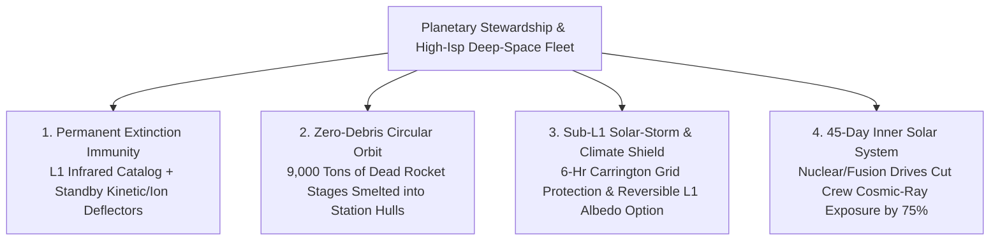

# VISION 01 — SPACE EXPANSION & CISLUNAR CIVILIZATION
## Sub-Pathway 1D: Planetary Defense, Orbital Stewardship & Deep-Space Propulsion — *Protecting the Biosphere and Shrinking the Solar System*

> **Executive Framing & Structure**
> * **The Cynic's Objection:** *"Why spend billions looking at asteroids, chasing space junk, or building nuclear rockets when we have existential crises right here on Earth? Asteroid impacts only happen every few million years, orbital debris is someone else's problem until Kessler Syndrome hits, and chemical rockets already got probes to Voyager's edge of the solar system."*
> * **The Core Thesis:** For 4.5 billion years, Earth's biosphere had no immune system against cosmic hazards—until **September 2022 and 2024–2026**, when NASA's **DART** mission and ESA's **Hera** probe proved humanity can kinetically deflect a killer asteroid, **Astroscale's *ADRAS-J*** demonstrated millimeter-precise rendezvous with uncooperative orbital debris, and **Nuclear Thermal / Electric / Pulsed-Plasma / Direct-Fusion propulsion** (DARPA/NASA *DRACO*, Ad Astra *VASIMR*, Howe *PPR*, Princeton *PFRC*) began doubling to ten-folding rocket exhaust efficiency ($I_{\text{sp}}$). By **2040**, this fourth pillar serves as **Earth's planetary shield, orbital recycling circular economy, L1 space-weather early warning system, and high-speed deep-space highway**—turning catastrophic extinction risks into permanently managed engineering problems.

---

## ACT I: A BELIEVABLE NEAR-FUTURE VISION (THE WORLD OF 2040)
### How Humanity's Planetary Shield and Deep-Space Fleet Operate on an Ordinary Day in 2040

It is **2040**. Down on Earth, eight and a half billion people go about their day completely unbothered by three existential threats that haunted the early 21st century—because an autonomous guard and propulsion network is quietly on watch across inner solar space:

1. **The Planetary Asteroid Shield (100% Cataloged & Deflection-Ready):**
   * Stationed at the **Sun-Earth Lagrange Point 1 (L1)** and in Venus-trailing orbits, a triad of cryogenic infrared telescopes—led by the successors to NASA's **NEO Surveyor**—has mapped **99.8% of all Near-Earth Objects (NEOs) larger than 30 meters** (the "city-killer" Tunguska/Chelyabinsk class).
   * In early 2039, when a 90-meter stony asteroid was discovered on a 2049 impact trajectory with the Pacific basin, there was no panic.
   * Two pre-positioned **autonomous kinetic-and-ion-beam shepherd tugs** docked at the Lunar L1 propellant depot ignited their nuclear-electric thrusters, intercepted the rock 180 million kilometers from Earth, and nudged its velocity by **just 1.8 centimeters per second**—shifting its 2049 path safely past Earth by 45,000 kilometers.
2. **The Clean Orbital Sky & Recycled Aluminum Smelters (Kessler Syndrome Defeated):**
   * Four hundred to 1,200 kilometers above Earth, the dreaded **Kessler Syndrome**—a runaway chain reaction of colliding dead satellites that threatened to trap humanity on Earth beneath a shrapnel cloud—never happened.
   * A commercial fleet of **Active Debris Removal (ADR) tow-trucks** (evolved from **Astroscale** and **ClearSpace**) uses computer-vision LiDAR, magnetic eddy-current brakes, and robotic grapples to capture defunct upper stages.
   * Instead of dropping thousands of tons of aerospace-grade aluminum-lithium, titanium, and copper into the ocean to burn up in the stratosphere, the tugs tow dead rocket bodies to **orbital induction smelters**, melting them down into fresh feedstock rods for spinning space stations.
3. **The L1 Space-Weather Sentinel & 45-Day Mars Fast-Transit Clippers:**
   * Parked `2.5 million kilometers` sunward of Earth in a sub-L1 halo orbit using continuous solar-sail thrust, a fleet of space-weather monitors gives terrestrial power grids **3 to 6 hours of precision warning** before extreme coronal mass ejections (Carrington-class solar storms) strike Earth's magnetosphere—saving trillions of dollars in transformer damage.
   * Meanwhile, in high Earth orbit, a crewed deep-space clipper powered by a **bimodal Nuclear Electric / Pulsed Plasma / Direct Fusion Drive** (`I_sp = 3,000–10,000 s`) departs for Mars—cutting the one-way human transit time from **7–9 months down to 45–60 days** and slashing deep-space radiation exposure by 75%.

---

## ACT II: THE CONVERGENCE BRIDGE — HOW IT CAME ABOUT (2021–2038)
### Breaking the Tyranny of the Chemical Rocket Equation and Securing Earth's Neighborhood

```mermaid
flowchart LR
    subgraph Enablers["2022–2026 Verified Inflection Points"]
        D1["Planetary Defense Proof<br>(NASA DART 33-Min Shift + ESA Hera + NEO Surveyor)"]
        D2["Active Debris Removal<br>(Astroscale ADRAS-J 15m Flyaround + ClearSpace)"]
        D3["Nuclear & Plasma Propulsion<br>(DRACO NTP, VASIMR, Howe PPR, Direct Fusion)"]
        D4["L1 Space Weather & Solar Sails<br>(NASA ACS3 Composite Boom Sail + NOAA SWFO-L1)"]
    end

    subgraph Bridge["2027–2034 Operational Deployment"]
        B1["90%+ City-Killer Asteroid Catalog<br>& Standby Kinetic Impactor Fleet"]
        B2["Commercial Orbital Tow-Trucks<br>& Zero-Debris Satellite Servicing"]
        B3["900s–5,000s Isp Cislunar &<br>Deep-Space Nuclear/Plasma Tugs"]
    end

    subgraph Horizon["2035–2045 Deep-Space Mastery"]
        H1["Permanent Extinction Immunity<br>& Near-Earth Asteroid Mining"]
        H2["Orbital Metal Recycling Circularity<br>(Dead Rockets -> Station Hulls)"]
        H3["45-Day Mars Transit &<br>2-Year Outer Planet Missions"]
    end

    Enablers --> Bridge --> Horizon
```

### Step 1: The Three Physical Breakthroughs That Tamed Orbital and Interplanetary Space
Why was humanity helpless against asteroid strikes, drowning in orbital junk, and stuck with 9-month chemical-rocket coast times to Mars for 60 years?

* **The Kinetic Momentum Transfer Factor ($\beta > 3.6$) & Thermal Infrared Detection:**
  Asteroids are dark like charcoal in visible light, often sneaking up from the sunward daytime sky (like the 2013 Chelyabinsk meteor). By placing passively cooled **mid-infrared telescopes (`4–10 μm`) at Sun-Earth L1**, dark asteroids glow brightly against the `2.7 K` background of deep space from their solar heat.
  * When NASA's **570-kilogram DART spacecraft** slammed into the 5-billion-kilogram asteroid moonlet *Dimorphos* at `6.1 km/s`, the recoil of excavated boulder ejecta amplified the momentum transfer by **$\beta = 3.61$**—shortening its orbit by **33 minutes** (four times the minimum success threshold) and proving that an early nudge years before impact easily deflects a 100-to-500-meter threat.
* **Non-Cooperative Rendezvous & Eddy-Current Detumbling:**
  Tumbling dead rocket stages moving at `7.8 km/s` (`28,000 km/h`) have no docking targets or working radios.
  * In **2024**, **Astroscale's *ADRAS-J*** used relative optical navigation to approach within **15 meters** of a dead 11-meter Japanese H-2A upper stage launched in 2009, flying a precision 360-degree inspection orbit around it—proving autonomous AI vision can lock onto and capture uncooperative orbital debris.
* **Breaking Tsiolkovsky's Chemical Ceiling ($\Delta v = I_{\text{sp}} g_0 \ln(m_0/m_f)$):**
  The highest-performing chemical rocket engine ($\text{LH}_2/\text{LOX}$) hits a hard theoretical ceiling around **$I_{\text{sp}} \approx 450\text{ seconds}$** (`4.4 km/s` exhaust velocity), because chemical bond energies cannot exceed a few electron-volts per molecule.
  * By switching to **Nuclear Thermal Propulsion (NTP)** (`I_sp ≈ 900 s`), **Magnetoplasma Electric Thrusters (VASIMR)** (`I_sp ≈ 5,000 s`), **Pulsed Plasma Fission Rockets (Howe PPR)** (`I_sp ≈ 5,000 s` at `100,000 N` thrust), and **Direct Fusion Drives (PFRC / Helicity)** (`I_sp ≈ 10,000 s+`), exhaust velocity jumps **$2\times$ to $20\times$**—turning multi-year interplanetary voyages into weeks.

### Step 2: 2025–2026 Global State of the Art (Verified Hardware & Milestones)

| Organization / Mission | Domain | Verified 2024–2026 Milestone | Operational & Commercial Pathway |
| :--- | :--- | :--- | :--- |
| **NASA *DART*, ESA *Hera* & *NEO Surveyor*** | Planetary Asteroid Defense & Infrared Early Warning | **DART** proved kinetic deflection (`33-min` orbital change, $\beta=3.61$); **ESA *Hera*** launched Oct 2024 (executed Mars flyby March 2025, arriving at *Dimorphos* late 2026); **NEO Surveyor** infrared enclosure completed testing at JPL for 2027–2028 launch. | Discovering **>90% of 140m+ asteroids** and hundreds of thousands of `30m+` city-killers; pre-positioned rapid-response deflection interceptors. |
| **Astroscale (*ADRAS-J* & *ELSA-M*)** | Active Debris Removal & Satellite Life Extension | **2024–2025:** *ADRAS-J* completed world's first precision 15-meter rendezvous & flyaround of an unprepared dead H-2A rocket body; selected by JAXA for **ADRAS-J2** robotic capture & deorbit mission + UK/ESA *ELSA-M* and *COSMIC*. | Commercial subscription debris removal for satellite mega-constellations and orbital towing of dead upper stages to recycling hubs. |
| **ClearSpace (*ClearSpace-1*) & Starfish Space (*Otter*)** | Robotic Capture & Geostationary Servicing | **Starfish Space** (*Otter Pup*) demonstrated autonomous low-thrust proximity operations and secured U.S. Space Force / NASA servicing contracts (2024–2026); **ClearSpace-1** advancing 4-arm robotic debris capture for ESA. | Extending the operational life of \$500M+ GEO satellites by 5–10 years and clearing crowded polar/LEO orbital shells. |
| **DARPA / NASA / BWXT (*DRACO*)** | Nuclear Thermal Propulsion (NTP, $I_{\text{sp}} \approx 900\text{ s}$) | **BWX Technologies (BWXT)** fabricating **HALEU (High-Assay Low-Enriched Uranium)** cermet/carbide reactor fuel elements (`2,700 K` hydrogen heating) for the **DRACO** in-space nuclear rocket program. | High-thrust, twice-as-efficient orbital transfer vehicles for rapid cislunar logistics and crewed Mars Architecture. |
| **Ad Astra (*VASIMR*) & Howe Industries (*PPR*)** | High-Power Plasma & Pulsed Fission Propulsion | **Ad Astra *VX-200SS*** completed **88-hour continuous high-power endurance test** at `80 kW` (`I_sp ≈ 5,000 s`); **Howe Industries** awarded NASA NIAC Phase II (2024–2026) for the **Pulsed Plasma Rocket (PPR)** (`100 kN` thrust at `5,000 s` $I_{\text{sp}}$). | Cutting crewed Mars transit time from **8 months down to 45–60 days**, virtually eliminating deep-space galactic cosmic ray dose. |
| **Princeton Satellite (*PFRC*) & Helicity Space** | Direct Fusion Drive (DFD) & Magneto-Inertial Fusion | **Princeton *PFRC-2*** demonstrated RF plasma heating under NASA/ARPA-E grants; **Helicity Space** (backed by Lockheed Martin) testing peristaltic magnetic reconnection fusion nozzles (`I_sp > 10,000 s`). | Single-stage ships providing both **megawatts of electrical power** on arrival and continuous `0.01 g` thrust across the outer solar system. |
| **NASA *ACS3* & NOAA *SWFO-L1*** | Composite Solar Sails & L1 Space Weather | **2024–2025:** NASA deployed the **Advanced Composite Solar Sail System (ACS3)** in orbit using rollable carbon-polymer booms; **NOAA *SWFO-L1*** launched (Sept 2025) to Sun-Earth L1 for continuous coronal storm warning. | Propellantless "statites" hovering sunward of L1 to double solar-storm warning time + active solar-radiation management research. |

### Step 3: Turning Threats into Resources (Orbital Recycling & Asteroid Platinum-Group Metals)
The economics of planetary defense and orbital debris cleanup flip from "pure public expense" to "self-funding industry" through two commercial loops:
1. **The Orbital Scrap Yard (~9,000 Tons of Refined Aerospace Metal Already in Orbit):**
   * Humanity has already paid billions of dollars to accelerate **over 9,000 metric tons of refined aerospace aluminum, titanium, stainless steel, and copper** to `7.8 km/s` in low Earth orbit in the form of spent rocket bodies and dead satellites.
   * Capturing a 4-ton upper stage with an Astroscale/Starfish tug and melting it in a solar-induction furnace supplies **\$20,000,000+ worth of orbital structural metal** without launching a single kilogram from Earth.
2. **From Deflecting Asteroids to Prospecting Them (*AstroForge*, *Karman+*, *TransAstra*):**
   * The exact same infrared telescopes (*NEO Surveyor*), autonomous navigation software, and high-$I_{\text{sp}}$ nuclear-electric tugs built to deflect hazardous Near-Earth Asteroids also identify metallic M-type and carbonaceous C-type asteroids with $\Delta v$ lower than the lunar surface (`<4.5 km/s`)—unlocking **water volatiles and platinum-group metals** in deep space.

---

## ACT III: PHASED ROLLOUT ROADMAP (2026–2050) & ECONOMIC CASCADE

| Phase | Timeline | Defense, Cleanup & Propulsion Capabilities | Performance & Economic Metrics | Civilizational Thresholds Unlocked |
| :--- | :--- | :--- | :--- | :--- |
| **Phase 1: Infrared Sentinel & First Debris Capture** | **2026–2030** | ESA *Hera* arrives at *Dimorphos*; NASA *NEO Surveyor* launches to L1; Astroscale *ADRAS-J2* & *ELSA-M* deorbit first commercial rocket stages; first *DRACO* / HALEU nuclear propulsion demo. | Asteroid detection rate jumps **5x**; NTP achieves **$I_{\text{sp}} \approx 900\text{ s}$** (2x chemical rockets); ADR cost **~\$15k/kg** removed. | **>90% of 140m+ region-killer asteroids mapped**; enforceable "Zero-Debris by 2030" orbital licensing backed by commercial tow-trucks. |
| **Phase 2: Orbital Metal Smelters & Nuclear-Electric Tugs** | **2030–2035** | Fleet of 15+ reusable ADR tugs delivering spent stages to **LEO solar/e-beam recycling foundries**; `100–500 kWe` Nuclear-Electric / *VASIMR* cargo tugs operating between LEO, Moon, and L1. | **$I_{\text{sp}} = 3,000\text{–}5,000\text{ s}$**; recycled orbital aluminum sold in LEO at **<\$500/kg**; standby kinetic impactors on 30-day alert. | **Kessler Syndrome permanently averted**; first commercial capture and water/metal extraction from a small Near-Earth Asteroid. |
| **Phase 3: Fast-Transit Clippers & Sub-L1 Space-Weather Array** | **2035–2042** | Multi-megawatt **Pulsed Plasma (PPR) & Bimodal NTP/NEP** deep-space clippers; solar-sail constellation stationed `2.5M km` sunward of Earth for 6-hour Carrington storm warning. | **$I_{\text{sp}} = 5,000\text{–}8,000\text{ s}$** at high thrust; Earth-to-Mars crew transit cut from **240 days $\rightarrow$ 50 days**. | **Safe human round-trips to Mars and the Asteroid Belt** without toxic cosmic-ray exposure; 100% of `30m+` city-killer NEOs cataloged. |
| **Phase 4: Direct Fusion Drives & Solar System Superhighway** | **2042–2050+** | Commercial **Direct Fusion Drive ($\text{D–^3He}$)** vessels (`1–10 MW` continuous thrust + auxiliary electric power); automated planetary-defense ion-beam shepherds at L1/L2. | **$I_{\text{sp}} > 10,000\text{ s}$**; **35-day Mars transit**; **18-month round-trip to Jupiter's Europa & Saturn's Titan**. | **Complete immunity from asteroid extinction**; the entire solar system out to Saturn becomes accessible within a single human sabbatical year. |

### Key Propulsion & Planetary Defense Comparison Metrics
* **Exhaust Velocity & Mars Transit Comparison:**
  * *Chemical Rockets ($\text{CH}_4/\text{LOX}$ or $\text{LH}_2/\text{LOX}$):* $I_{\text{sp}} = 380\text{–}450\text{ s}$ (`3.7–4.4 km/s` exhaust) $\rightarrow$ **210 to 270 days** one-way to Mars.
  * *Nuclear Thermal Propulsion (*DRACO* / HALEU):* $I_{\text{sp}} \approx 900\text{ s}$ (`8.8 km/s` exhaust) $\rightarrow$ **110 to 140 days** one-way to Mars.
  * *Nuclear Electric / Magnetoplasma (*VASIMR*) & Pulsed Plasma (*PPR*):* $I_{\text{sp}} = 5,000\text{ s}$ (`49 km/s` exhaust) $\rightarrow$ **45 to 60 days** one-way to Mars.
  * *Direct Fusion Drive (*PFRC* / *Helicity* $\text{D–^3He}$):* $I_{\text{sp}} \ge 10,000\text{ s}$ (`98+ km/s` exhaust) $\rightarrow$ **30 to 40 days** to Mars; **~12 months** to Jupiter's Europa.
* **Planetary Defense & Orbital Stewardship Leverage:**
  * *Early Deflection Multiplier:* Every **1 cm/s of $\Delta v$** applied to a threatening asteroid **10 years before impact** shifts its arrival position by **~3,150 kilometers** (more than half an Earth radius) amplified $3.6\times$ by ejecta recoil ($\beta$).
  * *Orbital Aluminum Value:* Recycling **9,000 metric tons** of defunct upper stages in LEO recovers **\$18B–\$45B in launch-equivalent structural mass** while eliminating high-altitude alumina re-entry soot.
  * *Carrington Storm Protection:* Sub-L1 solar-sail monitors (`2.5M km` upstream) prevent **\$1 trillion to \$2.6 trillion** in catastrophic grid transformer burnouts.

---

## ACT IV: THE DEEPER HORIZON & SUMMARY FOR THE SKEPTIC
### Giving Earth an Immune System and Unlocking the Outer Solar System

1. **The Dinosaurs Didn't Have a Space Program—We Do:**
   * Roughly 66 million years ago, a 10-kilometer asteroid ended the reign of the dinosaurs; in 1908, a 50-meter rock flattened 2,000 square kilometers of Siberian forest at Tunguska with the force of a 15-megaton thermonuclear bomb.
   * Of all the natural disasters humanity faces—earthquakes, supervolcanoes, hurricanes—**catastrophic asteroid impacts are the ONLY natural disaster we can now 100% prevent** with verified, off-the-shelf engineering (*NEO Surveyor* + *DART* kinetic impactors). For less than 0.01% of global GDP, humanity buys permanent insurance for every living species on Earth.
2. **Emergency Planetary Thermostat Insurance (L1 Solar Sails):**
   * The composite solar-sail technology proven by NASA's **ACS3** and stationed at Sun-Earth L1 for space-weather monitoring also gives humanity a reversible, non-chemical emergency brake against runaway climate tipping points: if ever needed, controllable solar-sail shades at L1 could gently trim incoming solar insolation by `0.5% to 1.0%` without depositing a single gram of sulfate aerosols into Earth's stratosphere.
3. **Why Fast Propulsion Is a Medical Requirement:**
   * Without high-thrust, high-$I_{\text{sp}}$ nuclear and fusion propulsion, astronauts drifting to Mars for 8 months in a chemical Tin Can absorb massive doses of galactic cosmic rays. Cutting the trip to **40–50 days** via Pulsed Plasma or Direct Fusion Drives solves deep-space radiation the simplest way possible: by getting there five times faster.
4. **Opening the Subsurface Oceans of Europa and Enceladus:**
   * Chemical probes take 6 to 8 years of gravity-assist pinball just to reach Jupiter or Saturn, arriving with barely enough plutonium-RTG wattage (`~300 W`) to run a lightbulb.
   * A bimodal nuclear-electric or Direct Fusion probe reaches Europa or Enceladus in **12 to 18 months** and plugs a **megawatt-class reactor** straight into laser-heated cryobots that melt through the ice crust to search for extant marine life in their warm subsurface oceans.

> **Bottom Line for the Skeptic:**
> Planetary defense, orbital debris recycling, and nuclear/plasma propulsion are not distractions from taking care of Earth—they **are** taking care of Earth:
> * **Planetary Extinction Immunity:** NASA's *DART*, ESA's *Hera*, and *NEO Surveyor* turn catastrophic asteroid impacts into the **first 100% preventable natural disaster** in Earth's 4.5-billion-year history.
> * **Orbital Circular Economy:** *Astroscale* and *ClearSpace* tow-trucks convert 9,000 tons of dangerous orbital rocket debris into pre-launched aerospace aluminum and titanium feedstock.
> * **High-$I_{\text{sp}}$ Deep-Space Highway:** *DRACO* nuclear thermal, *VASIMR* magnetoplasma, *Howe* pulsed plasma, and *Direct Fusion Drives* boost exhaust efficiency $2\times$ to $20\times$, shrinking the Mars voyage to **45 days** and opening the outer solar system.
>
> For the first time in history, the biosphere has an active immune system—and the solar system has a fast lane.
